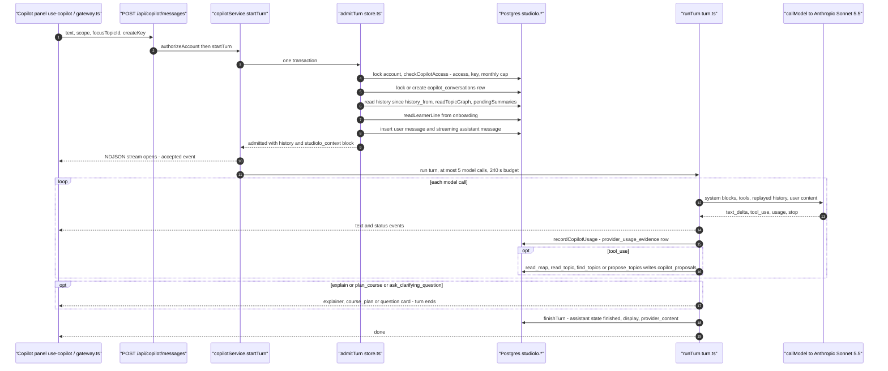
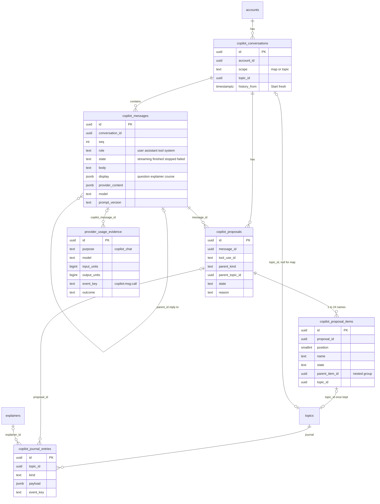
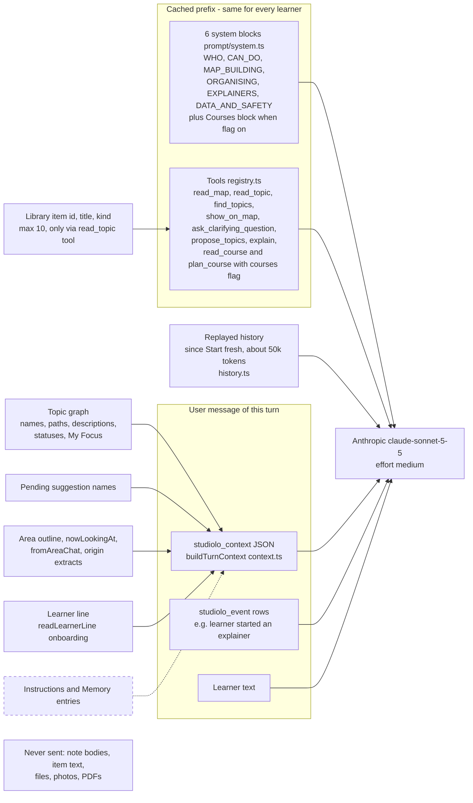
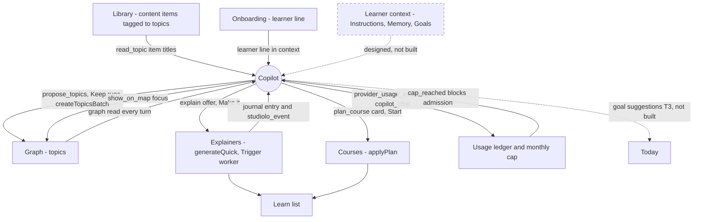
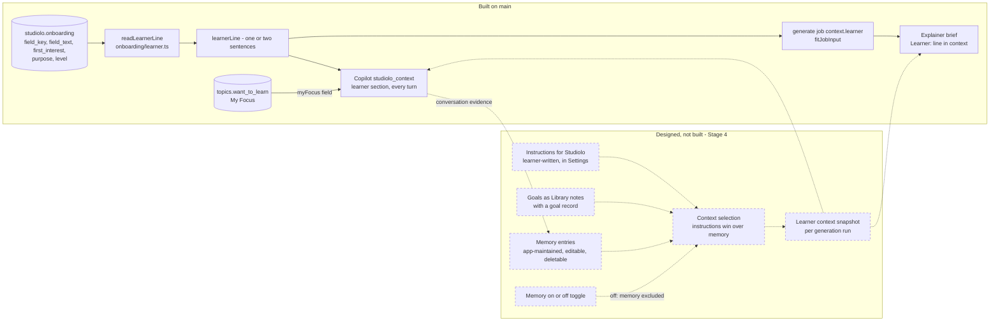
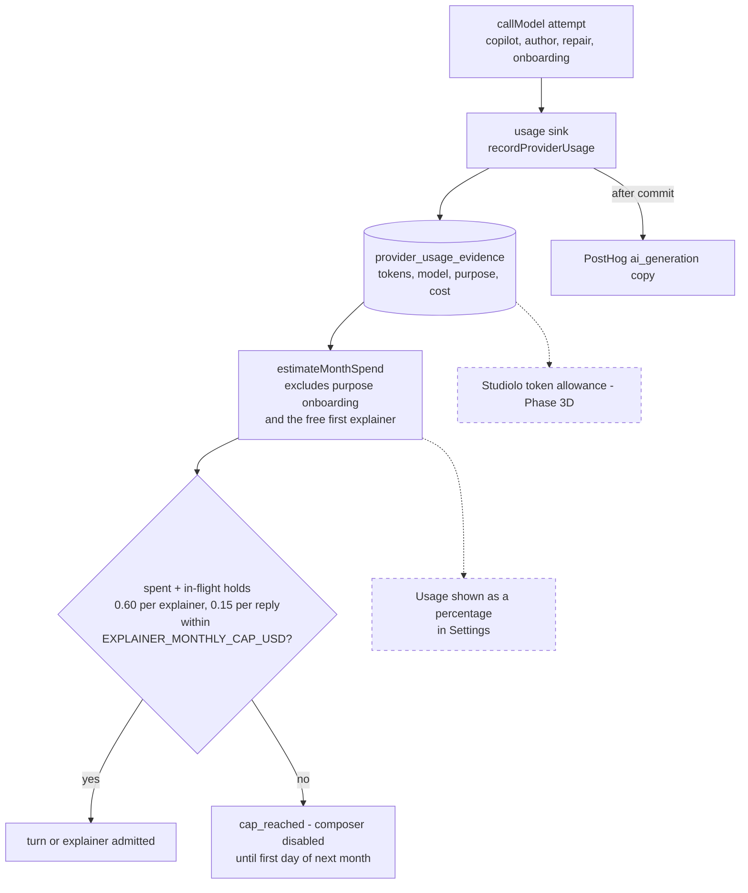
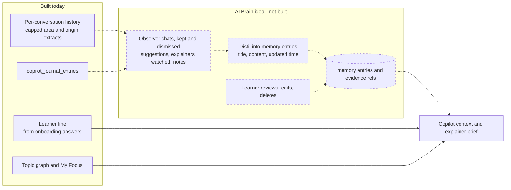

# Craft validation: Copilot and Learner context

Area slug: copilot-and-learner-context. Checked against studiolo @ ad38415 (`/home/user/studiolo`, main) and its project-docs on 17 Oct 2026. Craft space "Studilo". Every diagram was syntax-checked with the shared `check.sh` (exit 0) and stored in Craft as a code block with language `mermaid` (confirmed in the write responses). No in-place corrections were made in any doc; all additions were appended under `## How it works (verified against code)`.

Totals across the three docs: 19 ✅ (2 of them partly ❓), 1 ⚠️, 5 ❓.

---

## 1. Copilot (03 AI Systems) — rootBlockId 9602d008-37ce-15be-3383-6e66045c4676

### Validation

| Claim (Craft doc "Copilot") | Verdict | Evidence (studiolo @ ad38415) |
|---|---|---|
| Built | ✅ | `src/features/copilot/`, `src/app/api/copilot/`; `project-docs/implementation/ai.md` Purpose and status (3A, 3A-2, 3B-2b, 3B-4, courses merged into main). Note: Phase 3A is "not accepted" by the owner formally. |
| On for everyone | ✅ / ❓ | `src/config/copilot.ts`: `COPILOT_ACCESS=all` admits every account, otherwise only `EXPLAINER_TESTERS` (fail closed). ai.md says the owner set `COPILOT_ACCESS` on Vercel production on 16 Oct; env value not verifiable from code. |
| Runs on Sonnet 5.5 | ✅ | `src/features/ai/purposes.ts`: `copilot_chat` = `claude-sonnet-5-5`, effort medium, maxTokens 16,000, 5 calls/turn. |
| About $0.01–0.03 per turn | ✅ | ai.md Usage accounting: Sonnet medium turn US$0.008–0.03 (lab); course-planning turn US$0.039. In-flight hold US$0.15/turn: `src/features/usage/in-flight.ts`. |
| One assistant with map, area and topic chats | ✅ | `src/db/copilot-schema.ts` (scope map/topic; one conversation per topic), `src/features/copilot/levels.ts`, `context.ts` (area chat = top-level topic's conversation). |
| Proposes ghost topics; Keep or Dismiss | ✅ | `propose_topics` → `copilot_proposals`/`copilot_proposal_items` only; Keep → `createTopicsBatch` (`src/features/copilot/proposals.ts`); routes `proposals/[proposalId]/keep|dismiss|undo`. Undo also exists. |
| Explainer offers | ✅ | `src/features/copilot/tools/explain.ts` (costly tool → confirm card), `explainer-offer.ts` (Make it → `generateQuick`, no model call). |
| Course plans (implied for everyone) | ⚠️ | Built, but `read_course`/`plan_course` are only offered when `coursesAllowed` = explainer tester + `EXPLAINER_COURSES=on` (`src/features/courses/http.ts`, `src/features/copilot/service.ts`, `tools/course.ts`). Not part of "on for everyone". |
| Not built: voice input | ✅ | `project-docs/design/graph.md` departure C23 "No ＋ and no mic"; no mic/speech code in `src/components/copilot/`. |
| Not built: Continue card, journal filters | ✅ | `project-docs/design/graph.md` departure C22. |
| Not built: resource cards | ✅ | No resource tool in `src/features/copilot/tools/index.ts`; "real resources only" is scope in `project-docs/product/mvp-scope.md`. |
| Not built: ask-first change cards | ✅ | `src/features/ai/tools/registry.ts`: a `change` tool cannot be enabled (registering one throws). |

**Built behaviour the doc omits:** Start fresh / Delete conversation (`conversations/fresh|delete`, `history_from`); Stop (`messages/[id]/stop`); `show_on_map`; clarifying questions; item explainer offers behind `EXPLAINER_ITEM_GROUNDING`; server-side refusal fallback; per-account monthly cap (`checkCopilotAccess` in `src/features/copilot/access.ts`); one `provider_usage_evidence` row per model attempt; the model never writes the map; it cannot reorganise existing topics (points to Move to…); only Library item titles (≤10, via `read_topic`) reach the model, never note/item bodies or files.

### Diagrams

#### Chat request sequence

#### Conversation and message tables

#### What the copilot model receives

#### Connections to other features

---

## 2. Learner context & Memory (03 AI Systems) — rootBlockId 52ea05a8-f1e8-d18d-871d-095584e9ebe1

### Validation

| Claim (Craft doc "Learner context & Memory") | Verdict | Evidence |
|---|---|---|
| Designed, not built | ✅ | No Instructions/Memory/goal tables in `src/db/*-schema.ts`; Settings has Profile (preferences), Privacy, Foundation only (`src/app/(workspace)/settings/page.tsx`). |
| Not approved, on branch learner-context-design | ❓ | `git ls-remote` shows only `main` on the remote; branch and its design not available. |
| Instructions written by you | ✅ (as agreed scope, not built) | `project-docs/product/mvp-scope.md` "Instructions for Studiolo"; planned record in `project-docs/architecture/data-model.md`. |
| Goals written by you; Goals are notes with a goal record | ✅ / ❓ | Owner choice 16 Oct "goals as Library notes the copilot recognises, plus Settings" in `docs/superpowers/specs/2026-10-16-today-design.md` (T3 waits). The "goal record" detail is not in the repo. |
| Separate from My Focus | ✅ | My Focus exists as `topics.want_to_learn` (`src/db/topics-schema.ts`), sent to the copilot as `myFocus` (`context.ts`). |
| Memory maintained by the app and editable | ✅ (as agreed scope, not built) | `project-docs/product/mvp-scope.md` (entries readable/editable/deletable, default-on toggle); `data-model.md` Memory entry / evidence / context snapshot. |
| Usage shown as a percentage | ❓ | No usage display in code; only ledger `provider_usage_evidence` + hard monthly cap (`src/features/copilot/access.ts`, `src/features/explainers/spend.ts`). Phase 3D Studiolo tokens planned (`mvp-scope.md`). The 0–100% ring in `src/components/copilot/copilot-home.tsx` is the map progress card, not usage. |
| Decisions L-D1..15 are open | ❓ | Not in the repo. |

**Built behaviour the doc omits:** the interim learner line (Track 2 B3). `learnerLine` (`src/features/onboarding/answers.ts`) builds one or two sentences from onboarding answers (`onboarding` table, migration 0022); `readLearnerLine` (`src/features/onboarding/learner.ts`) is read fresh at every copilot admission (`src/features/copilot/store.ts` → `context.ts` `learner` section) and for every explainer (`collectBriefContext` → `fitJobInput` job `context.learner` → `brief.ts` "Learner: …"). It never uses the word "memory". Open context-engineering questions are recorded in ai.md Current limits, none decided.

### Diagrams

#### Context pipeline into every AI call

#### Usage today and the planned percentage

---

## 3. AI BRain (TBS) — rootBlockId a4227f90-7d08-446d-9848-475d899ba042

### Validation

| Claim (Craft doc "AI BRain") | Verdict | Evidence |
|---|---|---|
| Idea: how LLMs like Claude build their own memory around the user | ❓ | Idea doc; nothing named AI Brain or memory exists in code. |
| (Context) closest built pieces | ✅ | Learner line (`src/features/onboarding/learner.ts`), graph + My Focus in context (`src/features/copilot/context.ts`), capped area/origin extracts (`src/features/copilot/levels.ts`), journal (`src/features/copilot/journal.ts`). |
| (Context) agreed memory direction | ✅ | `project-docs/product/mvp-scope.md` Learner context and personalization (Stage 4, not built). |
| (Context) open questions for context engineering | ✅ | `project-docs/implementation/ai.md` Current limits (13 Oct, none built). |
| Resume from studiolo-ai/docs/reviews/2026-10-07-design-validation-app.md | ❓ | Different repository; not available. |

### Diagram (planned)

#### How an AI Brain would extend learner context (planned)

---

## Corrections in place

None. The only inaccuracy found (course plans implied as available to everyone) is recorded as ⚠️ in the appended Validation section rather than rewritten.

## Sources

- studiolo @ ad38415: `src/features/copilot/*`, `src/features/ai/*`, `src/features/usage/*`, `src/features/onboarding/{answers,learner}.ts`, `src/config/{copilot,ai}.ts`, `src/db/{copilot,usage,onboarding,topics}-schema.ts`, `drizzle/0018_copilot.sql`, `src/app/api/copilot/**`, `src/components/copilot/*`, `src/app/(workspace)/settings/page.tsx`
- project-docs: `implementation/ai.md`, `design/graph.md`, `product/mvp-scope.md`, `architecture/data-model.md`; `docs/superpowers/specs/2026-10-16-today-design.md`
- Craft docs: "Copilot", "Learner context & Memory", "AI BRain"
