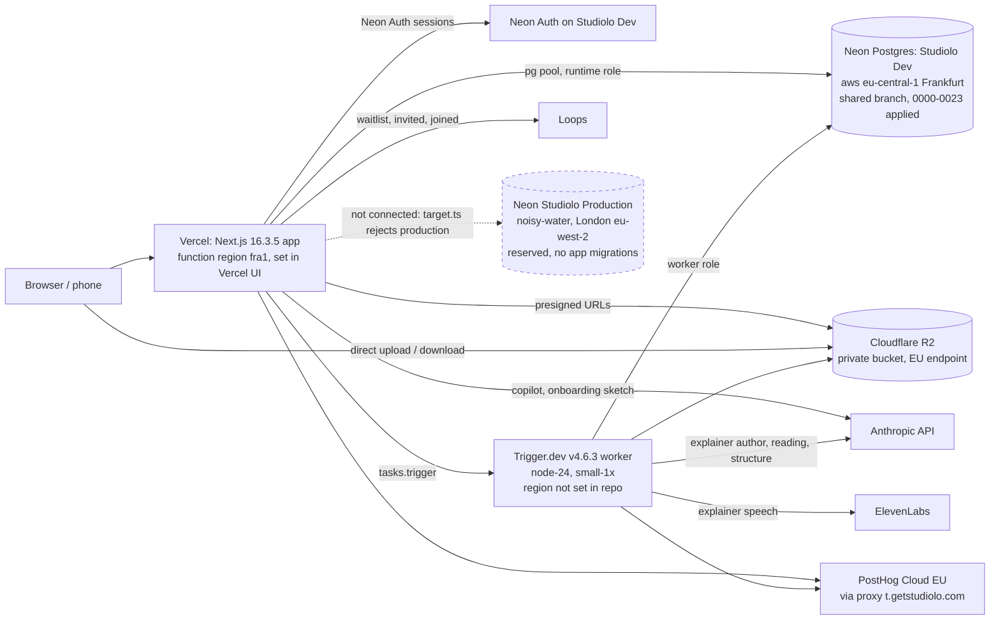
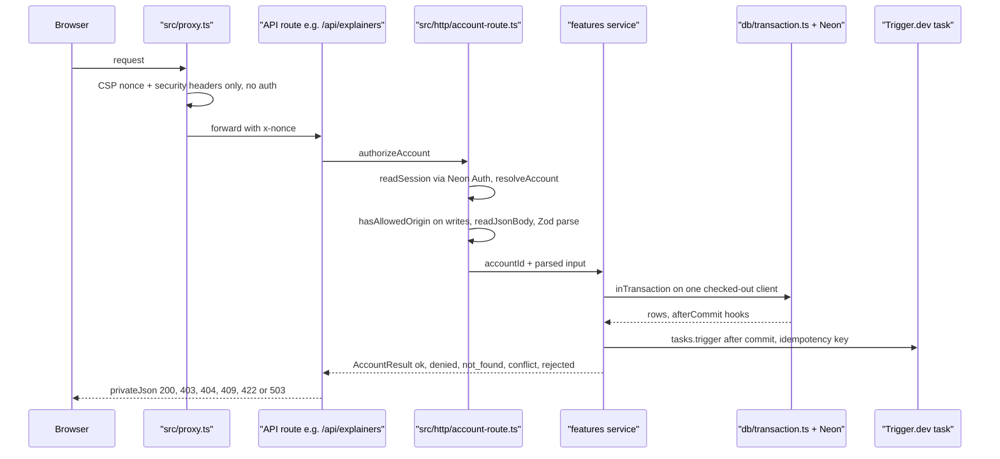
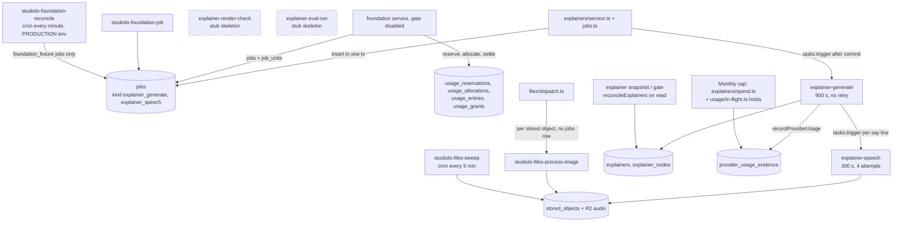
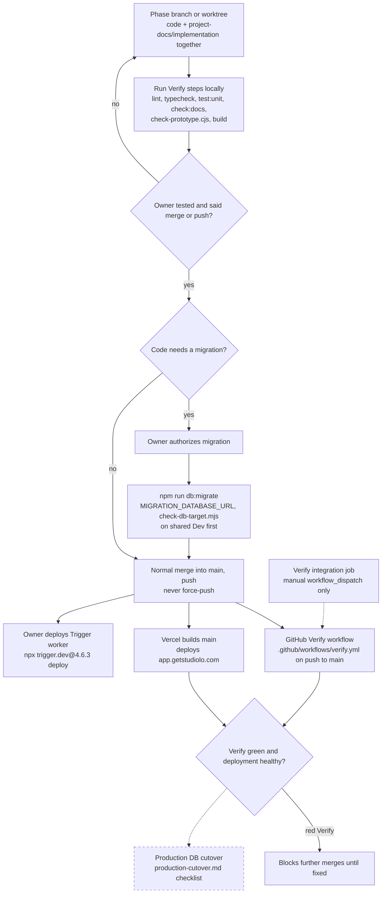
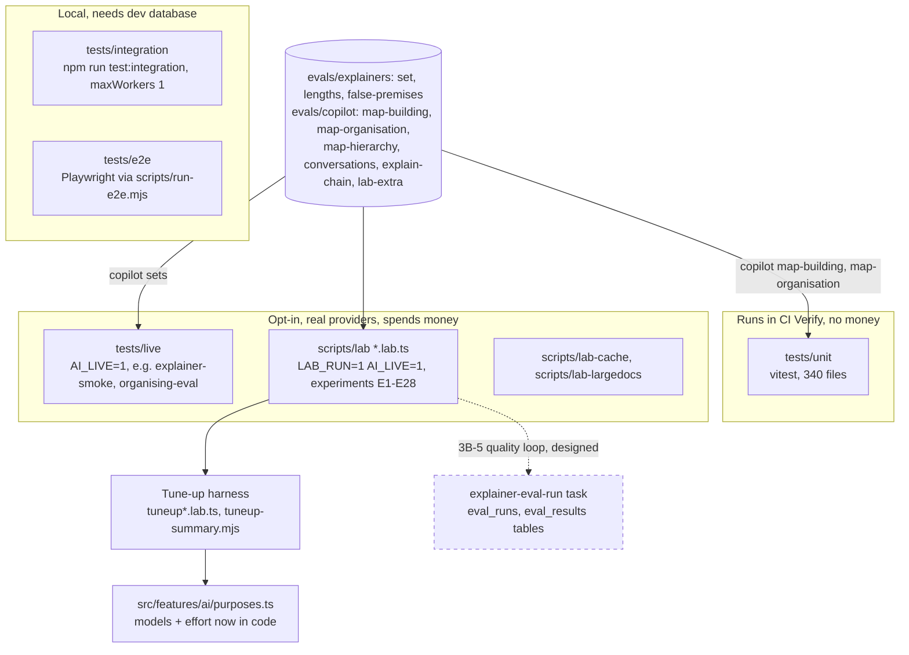
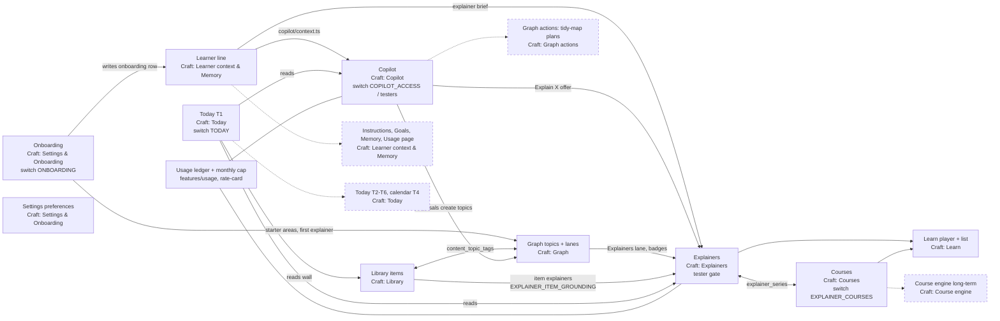
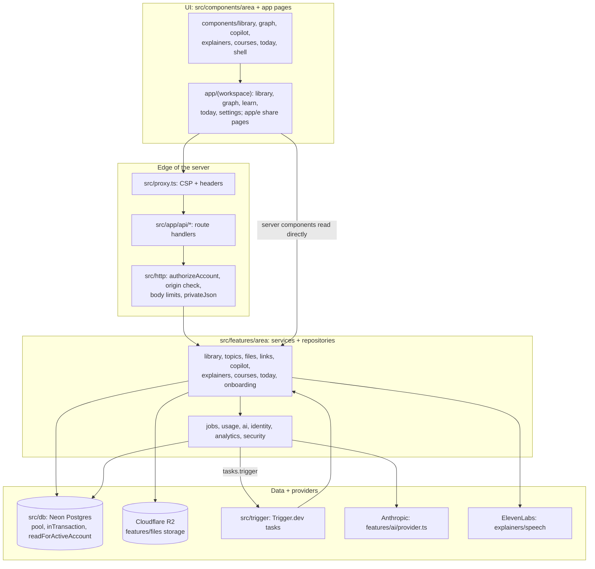
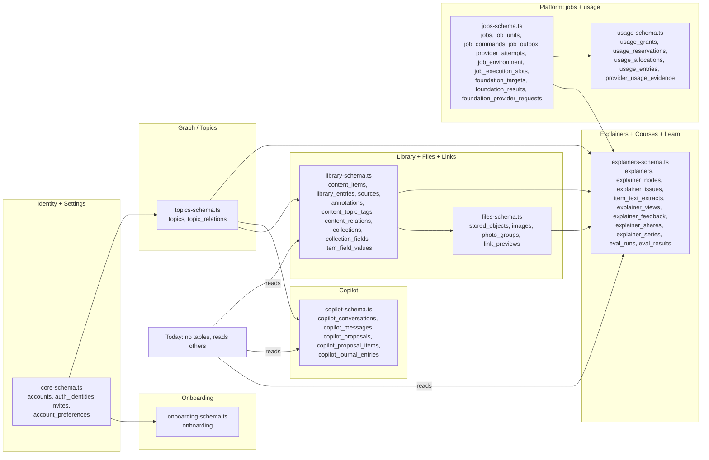

# Engineering and System Map: Craft validation

Sources: studiolo @ ad38415 (`/home/user/studiolo`, read-only) and its `project-docs/`; Craft space "Studilo". Checked 17 Oct 2026. No secrets or env values are reproduced. Every diagram below was validated with `scratchpad/mmd/check.sh` (exit 0) and written to Craft as a code block with language `mermaid` (confirmed in the write results).

## 1. Stack & Architecture (04 Engineering), rootBlockId 23ece942-6840-c147-5330-f7934f51b35f

| Claim | Verdict | Evidence |
|---|---|---|
| Next.js 16 | ✅ | `package.json`: next 16.3.5, React 19.3.0, Node 24.x |
| Vercel in Frankfurt | ✅ (set in Vercel UI, not in repo) | `project-docs/implementation/database.md` "Function region": owner set `fra1`; nothing in repo sets a region |
| Neon Postgres + Neon Auth | ✅ | `pg` 8.23.0, `drizzle-orm` 0.45.2, `@neondatabase/auth` 0.5.0-beta, `neon.ts` `auth: true`; auth integration still "not accepted" (`project-docs/architecture/tech-stack.md`) |
| Cloudflare R2 | ✅ | `@aws-sdk/client-s3`; `project-docs/implementation/backend.md` (EU jurisdiction endpoint, region auto) |
| Trigger.dev workers in us-east-1 | ❓ | `trigger.config.ts` sets runtime node-24, small-1x, maxDuration 120, retries; no region anywhere in repo or docs |
| Anthropic API | ✅ | `@anthropic-ai/sdk` 0.133.0; `src/features/ai/purposes.ts` |
| ElevenLabs | ✅ | `src/features/explainers/speech/`, `src/trigger/explainer-tasks.ts` (explainer-speech) |
| PostHog EU | ✅ | `src/features/analytics/config.ts` (`eu.i.posthog.com`), proxy t.getstudiolo.com (`backend.md`) |
| Loops | ⚠️ | Code on main (`src/features/marketing/loops.ts`, `/api/invitation-requests`, `scripts/invite-core.mjs`), but docs say keys not set on Vercel (`backend.md`, `production-cutover.md` Loops) and backend.md still calls it "branch phase-signin-loops, not merged" (docs lag code) |
| 24 migrations on shared Dev | ✅ | `drizzle/0000_huge_reptil.sql` … `drizzle/0023_explainer_series.sql`; 0023 applied to shared Dev 17 Oct (`database.md` Courses) |
| Production DB reserved in London | ✅ | `database.md` table: Studiolo Production noisy-water (reserved); `tech-stack.md`: London `free_v3` |
| Nothing applied to production | ✅ | All production lines unticked in `production-cutover.md`; `src/config/target.ts` rejects `production` |
| (omitted) Dev DB region | ⚠️ | Shared Dev is in Frankfurt `aws-eu-central-1` (fancy-smoke), not London (`database.md`) |
| (omitted) proxy does no auth | ✅ | `src/proxy.ts` only CSP nonce + security headers; auth in `src/http/account-route.ts` `authorizeAccount` and workspace layout `requireAccount` |
| (omitted) Trigger tasks | ✅ | 8 tasks; crons `studiolo-foundation-reconcile` (every minute) and `studiolo-files-sweep` (every 5 min) only in Trigger PRODUCTION env (`src/trigger/*.ts`) |

In-place corrections: none.

Diagrams:

### Deployment and infrastructure

### Request lifecycle

### Background job architecture

### Database overview

```mermaid
erDiagram
  accounts ||--o{ auth_identities : "core-schema"
  accounts ||--o| account_preferences : "core-schema"
  accounts ||--o{ invites : "redeemed_account_id"
  accounts ||--o| onboarding : "onboarding-schema"
  accounts ||--o{ topics : "topics-schema"
  topics ||--o{ topics : "parent_id"
  topics ||--o{ topic_relations : "topic_a_id, topic_b_id"
  accounts ||--o{ content_items : "library-schema"
  content_items ||--o| sources : "item_id"
  content_items ||--o{ annotations : "item_id"
  content_items ||--o{ content_topic_tags : "item_id"
  topics ||--o{ content_topic_tags : "topic_id"
  content_items ||--o{ content_relations : "from_item_id, to_item_id"
  collections ||--o{ collection_fields : "collection_id"
  content_items ||--o{ item_field_values : "item_id"
  content_items ||--o{ images : "files-schema"
  content_items ||--o{ stored_objects : "item_id"
  stored_objects ||--o{ link_previews : "image_object_id"
  topics ||--o{ copilot_conversations : "copilot-schema"
  copilot_conversations ||--o{ copilot_messages : "conversation_id"
  copilot_conversations ||--o{ copilot_proposals : "conversation_id"
  copilot_proposals ||--o{ copilot_proposal_items : "proposal_id"
  topics ||--o{ copilot_journal_entries : "topic_id"
  explainers ||--o{ copilot_journal_entries : "explainer_id"
  topics ||--o{ explainers : "anchor_topic_id"
  content_items ||--o{ explainers : "anchor_item_id"
  explainers ||--o{ explainer_nodes : "explainers-schema"
  stored_objects ||--o{ explainer_nodes : "audio_object_id"
  explainers ||--o{ explainer_shares : "explainer_id"
  content_items ||--o{ item_text_extracts : "item_id"
  topics ||--o{ explainer_series : "anchor_topic_id"
  content_items ||--o{ explainer_series : "anchor_item_id"
  jobs ||--o{ explainers : "job_id"
  jobs ||--o{ job_units : "jobs-schema"
  jobs ||--o{ provider_attempts : "job_id"
  jobs ||--o{ usage_reservations : "usage-schema"
  usage_reservations ||--o{ usage_allocations : "reservation_id"
  usage_grants ||--o{ usage_allocations : "grant_id"
  usage_allocations ||--o{ usage_entries : "allocation_id"
  provider_attempts ||--o{ provider_usage_evidence : "attempt_id"
```

## 2. Runbooks (04 Engineering), rootBlockId 7f56312b-3e59-2748-0c32-2c21fbb47ada

| Claim | Verdict | Evidence |
|---|---|---|
| Trigger worker deploy `npx trigger.dev@4.6.3 deploy` | ✅ | devDependency `trigger.dev` 4.6.3 in `package.json`; used by owner for worker 20261016.3 (`production-cutover.md`) |
| Neon setup prompt, invite command, 1B test script are in TBS | ✅ | Craft TBS docs "neon - database prompt" and "1B testing" |
| (added) package.json scripts | ✅ | dev, build, typecheck, lint, test:unit, test:integration, test:e2e, check:docs, db:generate, db:migrate, invite, analytics:forget, foundation:fixtures |
| (added) db:migrate needs MIGRATION_DATABASE_URL + approved target | ✅ | `scripts/migrate.mjs`, `scripts/check-db-target.mjs`, `src/config/target.ts` |
| (added) invite flags | ✅ | `scripts/invite.mjs`: --environment, --email, --expires-at, --no-expiry, --revoke-expired |
| (added) reconcile-jobs is dry-run only | ✅ | `scripts/reconcile-jobs.mjs` throws on --execute |
| (added) library-audit refuses production | ✅ | `production-cutover.md` |
| (gap) lab and live test commands not documented | ❓ | `scripts/lab/vitest.config.ts`, `tests/live` |

In-place correction: block f2469cfa-c0ac-5d9f-31a2-0e8eb50b0180.
- Before: `**Trigger worker deploy:** npx [trigger.dev@4.6.3](mailto:trigger.dev@4.6.3) deploy` (Craft had auto-linked the version as an email address).
- After: ``**Trigger worker deploy:** `npx trigger.dev@4.6.3 deploy` `` (code formatting, no link).

### Release and CI flow

## 3. AI Lab & Test Results (04 Engineering), rootBlockId 45a622b0-dca4-7f1c-dce8-2b0692ca1730

| Claim | Verdict | Evidence |
|---|---|---|
| Opus low (E9) now live | ✅ | `src/features/ai/purposes.ts` explainer_author claude-opus-5-5 effort low; contract 1.3 section 11 from E9 (`project-docs/implementation/ai.md`) |
| Opus low matches baseline at about a third of the cost | ❓ | tune-up plan quotes ~US$0.13 and 26 s for E9 (`docs/superpowers/plans/2026-10-16-ai-tune-up.md`); baseline ratio in uncommitted lab records |
| Sonnet is the better copilot (E5, E18, E19) | ✅ | purposes.ts copilot_chat claude-sonnet-5-5 medium; ai.md cites E5, E18, E19, E28; T3 66/78 vs Opus 61/78 |
| Sonnet at about a third of the cost | ⚠️ | rate card: Sonnet 5.5 is half of Opus 5.5 per token (`src/features/usage/rate-card.ts`); further savings not evidenced in repo |
| 15k tokens of ranked passages enough (E7) | ✅ | `SOURCE_BUDGET_CHARS = 60_000` (`src/features/explainers/sources/budget.ts`); E7 in `scripts/lab/catalogue.mjs` |
| (omitted) T5 faithfulness fail at that budget | ⚠️ | ai.md tune-up table: 33/40 supported vs E7 41/43; citations 47/47 |
| Splitting writer and drawer always loses (E25–27) | ❓ | experiments exist (`scripts/lab/split.lab.ts`, `split.ts`, `split-analyse.py`, catalogue E25/E26/E27) but results not committed |
| Ratings of 12 explainers unfinished | ✅ | `scripts/lab/calibration.mjs` (12 explainers), `scripts/lab/review.mjs`; no owner-ratings.json; ai.md lists owner ratings as not covered |
| (omitted) E-ids collide with spec assumption ids | ✅ | e.g. E27 retry ladder in `docs/superpowers/plans/2026-10-13-phase-3b2a-assumptions.md` |
| (omitted) in-product eval is a stub | ✅ | `explainer-eval-run` runs `runStubJob` (`src/trigger/explainer-tasks.ts`); `eval_runs`, `eval_results` tables |

In-place corrections: none.

### Test and evaluation layers

## 4. neon - database prompt (TBS), rootBlockId c2bd7fbc-6c8f-4e8e-9db2-b5649138da89 (validation section only)

| Claim | Verdict | Evidence |
|---|---|---|
| Steps 1–3 neon CLI install/login/skills/mcp | ❓ | outside repo; `skills-lock.json` records the neon agent skill |
| Step 4 neon link to the production project/branch | ✅ | `project-docs/implementation/README.md` (repo `.neon` link) |
| Step 4 caveat: that is not the app database | ⚠️ | app uses Studiolo Dev (Frankfurt); unqualified `neon env pull` gives a split runtime (`README.md`, `database.md`) |
| Steps 5–6 neon config init + neon.ts | ✅ | `neon.ts` = `defineConfig({ auth: true })`, `@neon/config` 1.7.2 |
| Step 7 neon deploy | ⚠️ | production setup not authorized (`tech-stack.md`); migrations go via `npm run db:migrate` to an approved non-production target |
| Invitation command flags | ✅ | `scripts/invite.mjs` |
| `.worktrees/phase-1a/.env.local` path | ❓ | local, not in repo |
| Invitation block contains a real email address | ⚠️ | privacy note only (address not repeated here) |
| Closing tagline | ❓ | product copy |

In-place corrections: none.

## 5. New doc: System Map (verified) (04 Engineering), rootBlockId bcf156ad-c8d0-7e46-4674-28624d07a215

Contents: intro; Feature connections; Layered architecture; Data ownership; Feature docs and status per code (table); Key code; Connected docs.

### Feature connections

### Layered architecture

### Data ownership

### Status table (as written to Craft)

| Craft doc | Folder | Status per code | Evidence |
|---|---|---|---|
| Library | 02 Product | built | `src/features/library`, `library-schema.ts`, `files-schema.ts` |
| Graph | 02 Product | built | `src/features/topics`, `topics-schema.ts` |
| Learn | 02 Product | built; course parts behind switch | `src/app/(workspace)/learn` |
| Today | 02 Product | T1 behind `TODAY`; T2–T6 designed | `src/config/today.ts`, `src/features/today` |
| Settings & Onboarding | 02 Product | Settings built; onboarding behind `ONBOARDING` | `src/features/settings`, `src/config/onboarding.ts` |
| Features & Ideas | 02 Product | idea backlog | — |
| Changelog | 02 Product | record only | — |
| Copilot | 03 AI Systems | behind switch (`EXPLAINER_TESTERS` or `COPILOT_ACCESS=all`, needs Anthropic key) | `src/config/copilot.ts` |
| Graph actions | 03 AI Systems | designed | no code |
| Explainers | 03 AI Systems | behind switch (tester gate / `EXPLAINER_ACCESS=all`; items behind `EXPLAINER_ITEM_GROUNDING`) | `src/config/explainers.ts` |
| Courses | 03 AI Systems | behind `EXPLAINER_COURSES` | `src/features/courses` |
| Learner context & Memory | 03 AI Systems | learner line built (behind `ONBOARDING`); rest designed | `src/features/onboarding/learner.ts` |
| Course engine (long-term) | 03 AI Systems | designed | `project-docs/architecture/course-engine.md` |
| Usage and metering (no doc) | — | built | `src/features/usage`, `src/features/explainers/spend.ts` |
| Stack & Architecture / Runbooks / AI Lab | 04 Engineering | reference | — |

## Counts

- Stack & Architecture: 12 ✅, 2 ⚠️, 1 ❓
- Runbooks: 7 ✅, 0 ⚠️, 1 ❓
- AI Lab & Test Results: 6 ✅, 2 ⚠️, 2 ❓
- neon - database prompt: 3 ✅, 3 ⚠️, 3 ❓
- Total: 28 ✅, 7 ⚠️, 7 ❓
