# Craft validation: Explainers and courses

Sources: studiolo @ ad38415 (read-only clone at /home/user/studiolo) and its `project-docs/`, checked 17 Oct 2026. Craft space "Studilo". Each Craft doc got an appended "How it works (verified against code)" section with the same validation and diagrams. All diagrams passed the mmd check.sh syntax check.

Totals (as written to Craft): 44 ✅, 7 ⚠️, 3 ❓ across four docs.

## 1. Explainers (03 AI Systems) — rootBlockId df9cae40-8e15-20f5-475e-0922478c14d7

In-place corrections: none.

| Claim | Verdict | Evidence (studiolo @ ad38415) |
|---|---|---|
| Built | ✅ | `src/trigger/explainer-tasks.ts`, `src/features/explainers/run.ts`, `project-docs/implementation/ai.md` (Purpose and status) |
| Testers only | ✅ default / ⚠️ | `EXPLAINER_TESTERS` fail-closed in `src/config/explainers.ts`; but `EXPLAINER_ACCESS=all` admits every signed-in account (`readExplainerAccess`), so it is a switch, not a rule |
| Drawn live in the browser | ✅ | `src/features/explainers/player/`, `project-docs/architecture/overview.md` |
| 2–6 minutes | ✅ (target) | `project-docs/architecture/overview.md` (length target, ~1,500 narration words hard limit) |
| With citations | ⚠️ | Only item explainers (grounding `strict`, contract 1.2 `<sources>`) carry checked citations; topic explainers are `open` with no source text — `src/features/explainers/service.ts`, `src/features/explainers/ingest/citations.ts` |
| Opus 5.5 low writes | ✅ | `src/features/ai/purposes.ts` `explainer_author` (repairs: Opus 5.5 medium) |
| ElevenLabs voices | ✅ | `src/features/explainers/speech/elevenlabs.ts`, `src/config/speech.ts` (estimated timings without key) |
| Hosted voice actually on | ❓ | ai.md (Explainer speech) still says no hosted ElevenLabs key is set; not verifiable from code |
| ~$0.09 per topic explainer without voice | ✅ | ai.md Tune-up verification: US$0.087 (run 3) |
| First slide median ~20 s | ✅ | same: 20.5 s (run 3) |
| Item faithfulness dropped (33/40) | ✅ | same: 33 of 40 supported vs E7 41 of 43 |
| 1 in 3 first slides 14–34 s | ❓ | not found in code or project-docs |
| Phone text tiny | ❓ | not found in code or project-docs |
| Voice cost unmeasured | ✅ | ai.md Evaluation harness, Limits (voice not measured) |
| (omitted) 2 in flight per account + monthly cap | ✅ | `MAX_ACTIVE_EXPLAINERS_PER_TESTER`, `src/features/explainers/gate.ts` |
| (omitted) entry points: topic dialog, Library item, copilot Make it, free onboarding explainer | ✅ | `src/app/api/explainers/route.ts`, `src/app/api/copilot/messages/[messageId]/explainer/route.ts`, `src/features/onboarding/service.ts` (`free: true`) |
| (omitted) share, feedback, Retry voice, Cancel, Try again | ✅ | `src/app/api/explainers/[explainerId]/*`, `src/features/explainers/player/actions.ts` |
| (omitted) stuck runs reconciled on read (snapshot/gate), not by cron | ✅ | `src/features/explainers/reconcile.ts`; `src/trigger/reconcile-task.ts` is the foundation-job cron |
| (omitted) render-check and eval tasks are skeletons | ✅ | `src/trigger/explainer-tasks.ts` |

### Generation pipeline

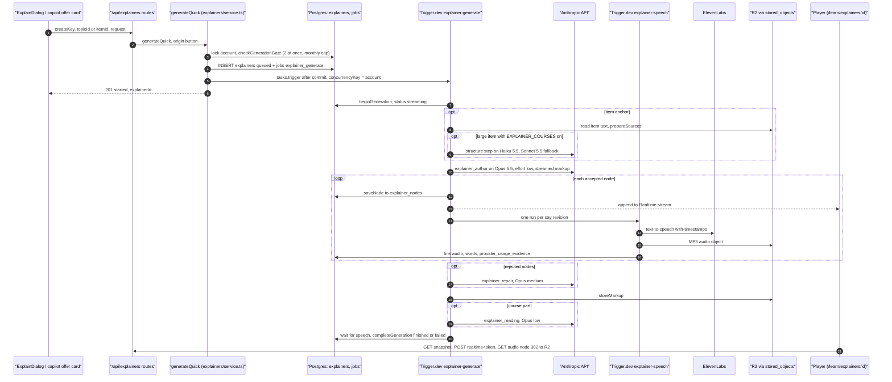

### Explainer lifecycle

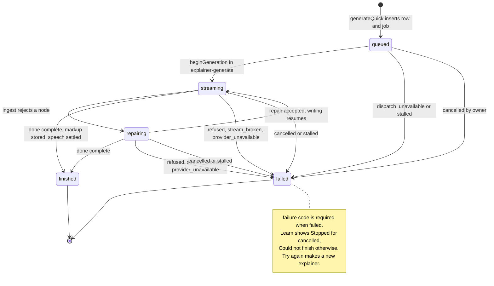

### Explainer tables

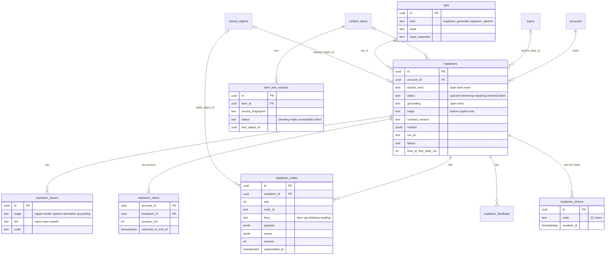

### Connections

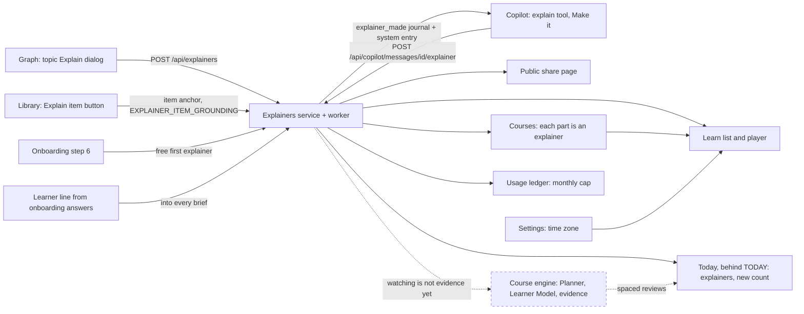

## 2. Learn (02 Product) — rootBlockId 6069a260-6d64-092a-9d1f-09947cd8b281

In-place corrections: none.

| Claim | Verdict | Evidence |
|---|---|---|
| Built | ✅ | `src/app/(workspace)/learn/(list)/page.tsx` |
| Explainers list Today / This week / Earlier | ✅ | `src/features/explainers/learn/model.ts` `groupByDay`, `dayGroup` (account time zone, else browser; This week = six days before today) |
| Course cards | ✅ / ⚠️ | `CourseCard` in `src/components/explainers/explainer-list.tsx`; only for an explainer tester with `EXPLAINER_COURSES` on (`EXPLAINER_ACCESS=all` does not widen) |
| Continue | ✅ | `pickContinue`, `ContinueCard` (course-aware) |
| (omitted) status labels New/Continue/Watched/Making…/Stopped/Couldn't finish | ✅ | `model.ts` `listStatus` |
| (omitted) topic filter chips `?topic=`, 4 s snapshot poll, refresh on return | ✅ | `explainer-list.tsx` (`MAKING_POLL_MS`, `SETTLE_REFRESH_MS`) |
| (omitted) placeholder for non-makers with no explainers | ✅ | `learn/(list)/page.tsx` |
| (omitted) old Courses/Learning paths/Planner tabs redirect to /learn | ✅ | `src/app/(workspace)/learn/[section]/page.tsx` |
| (omitted) jobs card lives in workspace layout | ✅ | `src/app/(workspace)/layout.tsx`, `src/components/explainers/jobs-card.tsx` |
| (omitted) list capped at 200, no search | ✅ | `src/features/explainers/learn/repository.ts` `LIST_LIMIT` |

### Page composition and data sources

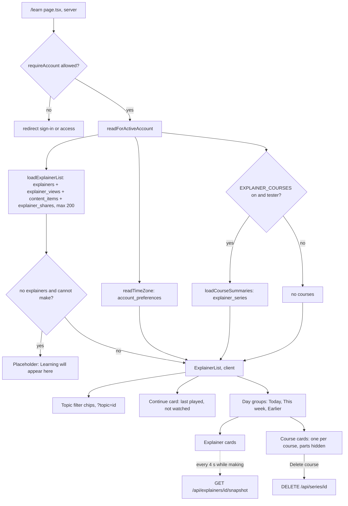

### Card status rules

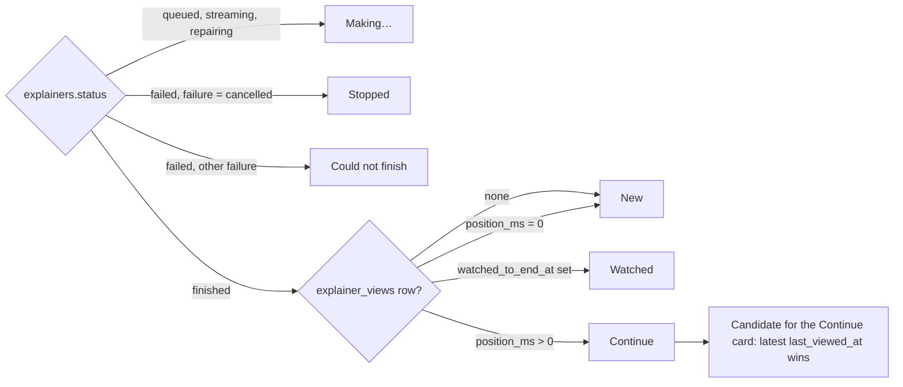

## 3. Courses (03 AI Systems) — rootBlockId 400b1254-7d0b-d4c4-241e-69e2527ae8f4

In-place correction (block e70e1726-bb63-3734-90d5-81a192ddddab):
- Before: "Large items or topics become a course: Part 0 overview plus 3–6 parts, each an explainer with a 400–700 word Reading. Parts are made when opened. A 6-part course costs about $2."
- After: "Large items or topics become a course: Part 0 overview plus parts, each an explainer. A large item gets 3–6 parts from the structure step; a topic course follows the map (its sub-topics, up to 24 parts in all) or a copilot plan. Each course part gets a 400–700 word Reading. Parts are made when opened. A 6-part item course costs about $2 (spec estimate)."

| Claim | Verdict | Evidence |
|---|---|---|
| Built (merged 84f1697e, worker 20261017.3, not formally accepted) | ✅ | `project-docs/implementation/ai.md` (Purpose and status) |
| Behind EXPLAINER_COURSES | ✅ | `src/config/explainers.ts` `isCoursesOn` |
| Testers only | ✅ | `src/features/courses/http.ts` (EXPLAINER_TESTERS; ACCESS=all does not widen); item courses also need `EXPLAINER_ITEM_GROUNDING` |
| Large items or topics become a course | ✅ | `src/features/courses/service.ts` `startCourse` |
| Part 0 overview | ✅ | `src/features/courses/plan.ts` ("The whole thing" / "The whole topic") |
| plus 3–6 parts | ⚠️ | true for item courses only (`MIN_SERIES_PARTS` 3, `MAX_SERIES_PARTS` 6); topic courses = Part 0 + children/grandchildren up to `MAX_TOPIC_COURSE_PARTS` 24; copilot plans 4–12 (≤39) — `plan.ts`, `types.ts`, ai.md (Course plans). Corrected in place |
| Each part an explainer with a 400–700 word Reading | ✅ | `src/features/explainers/run.ts` `writeReading`, `reading.ts`, purpose `explainer_reading` (Opus low); not measured live |
| Parts made when opened | ✅ | `src/components/courses/course-viewer.tsx` `go` → `POST /api/series/[seriesId]/parts/[key]` |
| 6-part course ≈ $2 | ✅ (estimate) | `docs/superpowers/specs/2026-10-16-large-documents-design.md` §6: USD 2.05 |
| (omitted) structure step Haiku 5.5 → Sonnet 5.5 inside a large item explainer | ✅ | `src/features/explainers/sources/structure.ts`, `purposes.ts` |
| (omitted) three entry points | ✅ | `GET /api/items/[itemId]/course-offer`, `POST /api/series`, `POST /api/copilot/messages/[messageId]/course` |
| (omitted) stale item courses refuse new parts | ✅ | `service.ts` `isStale`, `STALE_COURSE_MESSAGE` |
| (omitted) "Also on this book" one-chapter extras | ✅ | `service.ts` `listExtras` |
| (omitted) `intro` column never written (Sonnet intro not built) | ⚠️ | `service.ts` `newCourse` sets `intro: null`; spec §3 planned a Sonnet intro |
| Voice for course parts | ❓ | not run before merge — `docs/superpowers/plans/2026-10-16-courses-report.md` |

### Starting a course and making parts

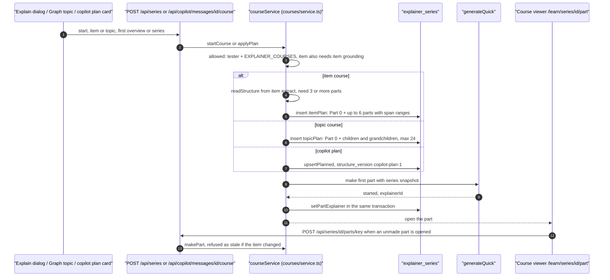

### Course tables

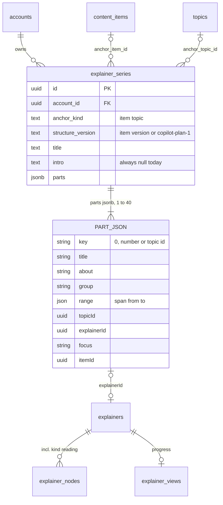

### Part states

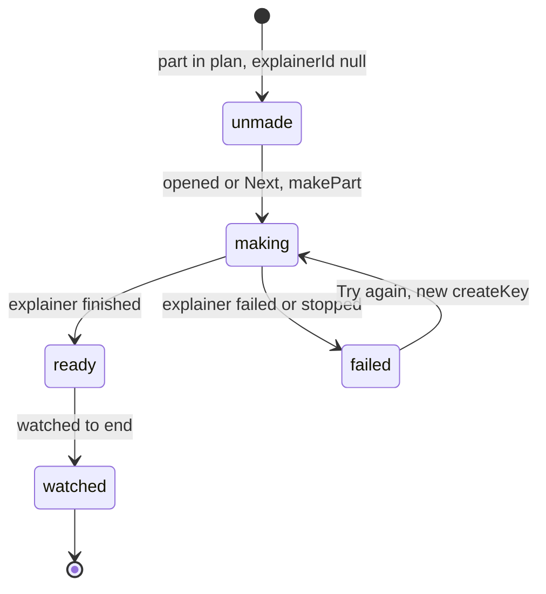

## 4. Course engine (long-term) (03 AI Systems) — rootBlockId fa2bd429-ffbc-547a-cacf-421115709065

In-place corrections: none. Compared with `project-docs/architecture/course-engine.md`.

| Claim | Verdict | Evidence |
|---|---|---|
| Proposed for Stage 4, spec v1.1, 12 Oct | ✅ | `course-engine.md` Status; `project-docs/product/mvp-scope.md` Stage 4 |
| Course Planner | ✅ (planned) | §3, §5: copilot tools `draft_course`, `revise_course`, `accept_course`, `get_next_step` |
| Explainer Service one lesson ahead | ✅ (planned) | §0, §5.4 R1 |
| Learner Model unseen → exposed → assumed → self-explained → retrieved → retained | ✅ (planned) | §6.2 (plus `shaky` flag, levels only go up) |
| Spaced reviews | ✅ (planned) | §5.5 (1, 3, 7, 21 days, review lessons) |
| ...feeding Today | ⚠️ | engine spec never mentions Today; reviews feed the Planner as review lessons. Today design plans a course Continue (T2), not reviews — `docs/superpowers/specs/2026-10-16-today-design.md` |
| (omitted) nothing of the engine is in code | ✅ | no concept/evidence/quiz tables in `drizzle/`, no planner in `src/features/` |
| (omitted) built Courses is a simpler, different thing; course-engine.md status "none of it is implemented" predates it | ⚠️ | `src/features/courses/`, `drizzle/0023_explainer_series.sql`, copilot `plan_course` (not `draft_course`) |
| (omitted) Phase 3B departures (video only, open/strict grounding, MP3, landscape, Learn not Library) | ✅ | `course-engine.md` "What Phase 3B takes from it" |

### Designed engine versus what is built

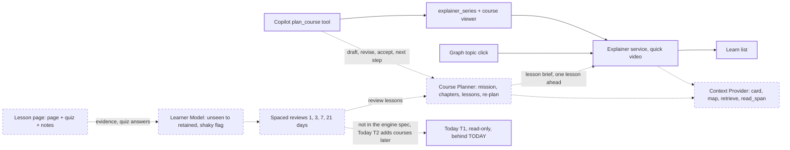

### Learner Model levels (planned)

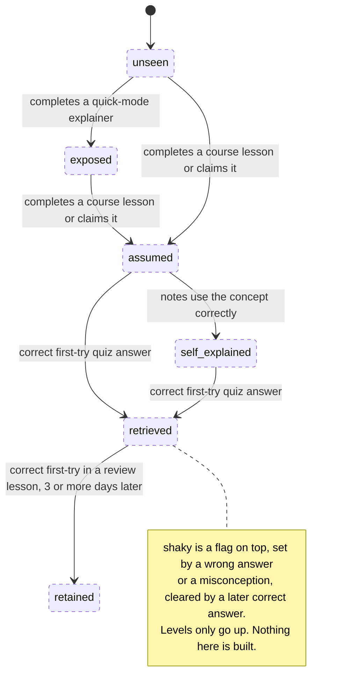
