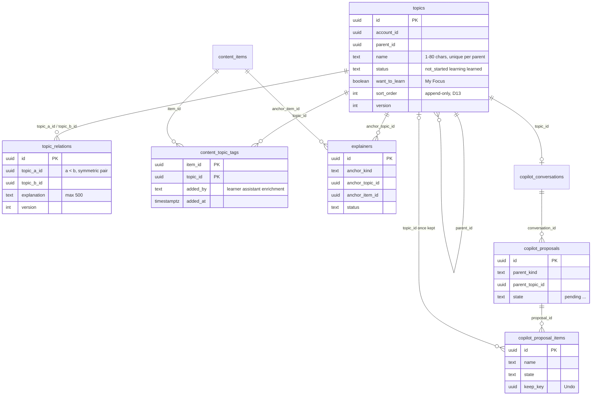
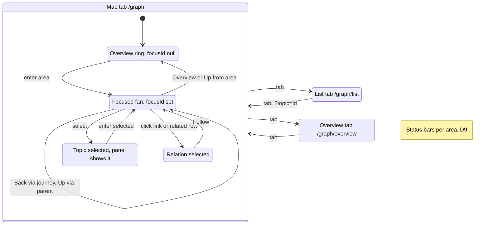
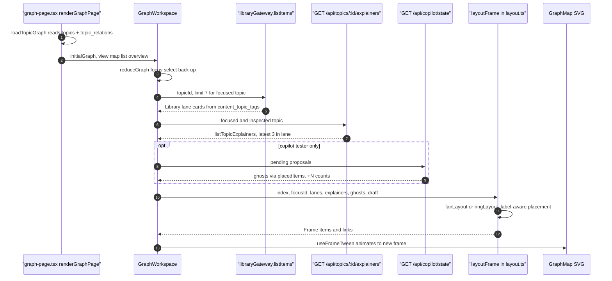
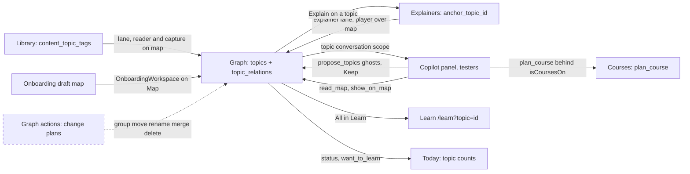
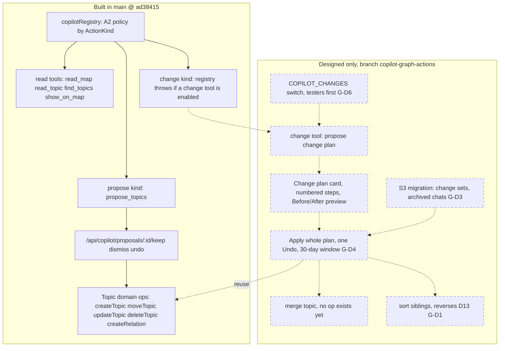
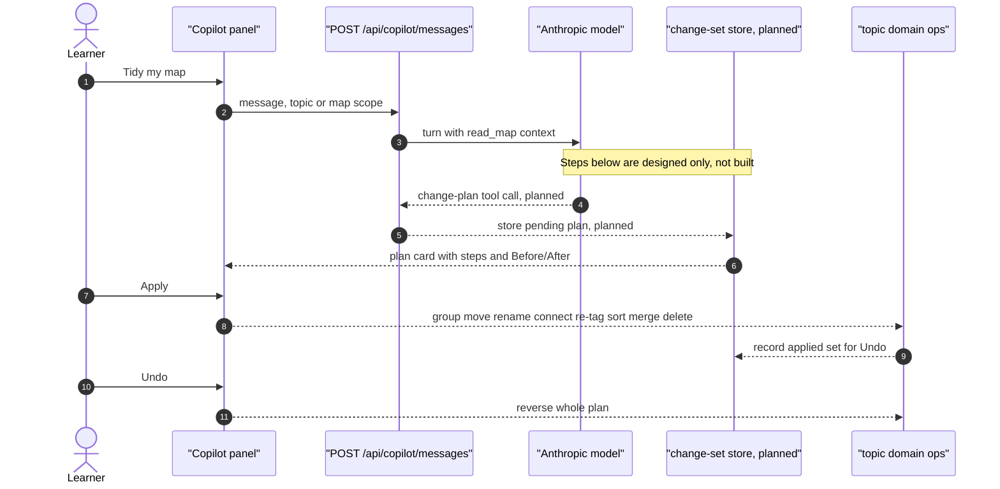

# Graph: Craft validation report

Sources: studiolo @ ad38415 (`/home/user/studiolo`, read-only), project-docs at the same commit, Craft space "Studilo" (docs "Graph" and "Graph actions", plus "Decisions" for G-D1..G-D9). Checked 17 Oct 2026.

Legend: ✅ confirmed · ⚠️ wrong or outdated · ❓ cannot be verified from code · ➕ built behaviour the doc leaves out

---

## 1. Graph (02 Product): rootBlockId `92fc112a-2789-9164-65d3-2d7905370739`

### Validation

| Claim | Verdict | Evidence (studiolo @ ad38415) |
|---|---|---|
| Status: Built | ✅ | `src/app/(workspace)/graph/graph-page.tsx`, `src/app/(workspace)/graph/[section]/page.tsx`, `src/components/graph/graph-workspace.tsx`; `project-docs/design/graph.md` (Phase 2A–2D merged) |
| Radial focus-based map | ✅ | `src/features/topics/layout.ts` (layoutFrame, overview/focused), `src/features/topics/label-layout.ts` (ringLayout, fanLayout) |
| Map / List / Overview | ✅ | `[section]/page.tsx` accepts `list` and `overview`; `src/components/graph/topic-tree.tsx`, `status-overview.tsx`, `topic-inspector.tsx`; design D9, D10 |
| Library lane | ✅ | `graph-workspace.tsx` loadLane → `libraryGateway.listItems({ topicId, limit: LANE_LIMIT })`; `LANE_LIMIT = 7` in `src/features/library/limits.ts`; tags in `content_topic_tags` (`src/db/library-schema.ts`) |
| Explainer lane | ✅ | `GET /api/topics/[topicId]/explainers` → `listTopicExplainers` (`src/features/explainers/topic-explainers.ts`, recursive over sub-topics, item explainers via `content_topic_tags`, cap 300); `EXPLAINER_LANE_MAX = 3` in `layout.ts` |
| Related topics | ✅ | `topic_relations` with `topic_a_id < topic_b_id` check (`src/db/topics-schema.ts`); `MAP_RELATED_LIMIT = 6`; `src/components/graph/related-section.tsx`, `edge-panel.tsx`; routes `/api/topic-relations` |
| Ghost suggestions | ✅ (with a gate) | `ghost-node.tsx`, `GhostInput` in `layout.ts`, `placedItems` in `src/features/copilot/nesting.ts`, tables `copilot_proposals` and `copilot_proposal_items`. Drawn only when `seesCopilot(access)` is true (copilot testers); everyone else gets no ghosts |
| Label-aware layout | ✅ | `src/features/topics/label-layout.ts`, `label-advances.ts`; design says built and merged 17 Oct, but W-D1 and W-D3 still await the owner's decision |
| No drag-to-reparent (D13) | ✅ | No reorder or reparent-by-drag route; createTopic and moveTopic write the next `sort_order` (`src/features/topics/repository.ts`); design D4, D13 |
| Copilot reorganising is designed only | ✅ | `src/features/ai/tools/registry.ts` throws if a `change` tool is enabled; `src/features/copilot/tools/index.ts` registers only read, ask, propose, explain and course tools |
| (omitted) Hierarchy and account limits: 10 levels, 2,000 topics, 4,000 links, 24 children and 6 related drawn, names of 80 characters | ➕ | `src/features/topics/limits.ts` |
| (omitted) Snapshot-checked branch delete, including tagged Library items | ➕ | `/api/topics/[topicId]/dependents`, `deleteTopic` in `repository.ts`; design D3 |
| (omitted) Per-account advisory lock serialises structural writes (D16) | ➕ | `lockTopicTree` in `repository.ts` |
| (omitted) Phones: lanes leave the map and go into the sheet; iPads fit the whole drawing | ➕ | `project-docs/design/graph.md` "Phones and iPads" |
| (omitted) Onboarding replaces the Map while onboarding is in progress | ➕ | `graph-page.tsx` (onboardingRouteOrNull → OnboardingWorkspace) |

In-place corrections: none. The status and summary sentences are accurate.

### Diagrams

#### Topics, relations and what hangs off them

#### Focus navigation and view states

#### Layout pipeline and how the lanes are filled

#### How the Graph connects to other features

---

## 2. Graph actions (03 AI Systems): rootBlockId `e3edc809-a722-0cbd-cd91-bd74585c7dd7`

### Validation

| Claim | Verdict | Evidence |
|---|---|---|
| Not built | ✅ | No change tool exists. `ActionKind` includes `change`, but `createRegistry` throws when a change tool is enabled (`src/features/ai/tools/registry.ts`); `src/features/copilot/tools/index.ts` |
| Designed | ✅ in principle, ❓ in detail | The A2 ask-first rule for rename, move, delete and status, and "ask-first change cards" planned for Stage 4, are in `docs/superpowers/specs/2026-10-05-ai-direction-graph-copilot-design.md`, `docs/superpowers/specs/2026-10-13-phase-3a-copilot-core-design.md` (§ deferred) and `project-docs/design/graph.md` ("Still planned"). The change-plan design itself is not on main |
| Not approved | ✅ | Craft "Decisions": G-D1..G-D9 are all Open |
| Branch copilot-graph-actions | ❓ | `git ls-remote --heads origin` lists only `main`, so the branch is not reachable from this clone |
| One plan card, numbered steps (group, move, rename, connect, move explainer, re-tag, sort, merge, delete), Before/After preview | ❓ | Not in code or project-docs |
| Nothing changes until Apply; one Undo for the whole plan | ❓ | Not in code. The nearest built pattern is ghost Keep/Undo per proposal (`/api/copilot/proposals/[proposalId]/keep|dismiss|undo`, `keep_key`) |
| Merge and delete need a migration (S3) | ❓ | No change-set table exists (`src/db/copilot-schema.ts`; latest migration `drizzle/0023_explainer_series.sql`). No merge operation exists. Manual delete exists without a migration but cannot be undone (D3, G-D9) |
| G-D1 "no migration, sort_order exists" | ✅ | `topics.sort_order` in `src/db/topics-schema.ts`; only create and move write it today |
| G-D6 COPILOT_CHANGES switch | ❓ (planned) | No such variable in `src/` |
| (omitted) Domain ops a plan could reuse: create, batch create, rename (updateTopic), move, status, relation create/update/delete, delete | ➕ | `src/features/topics/repository.ts` |

In-place corrections: none. The status sentence ("Designed, not approved, not built") is consistent with the code.

### Diagrams

#### What exists versus what is planned

#### Proposed change-plan flow (planned)

---

## Counts
- Graph: 10 ✅, 0 ⚠️, 0 ❓, 5 ➕
- Graph actions: 4 ✅ (one of them "in principle"), 0 ⚠️, 5 ❓, 1 ➕

All 6 diagrams passed `mmd/check.sh` and are stored in Craft as code blocks with language mermaid.
