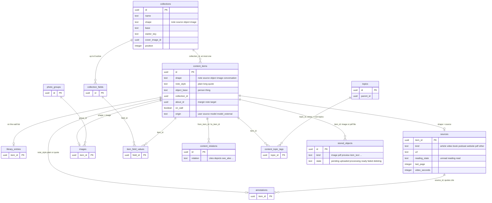
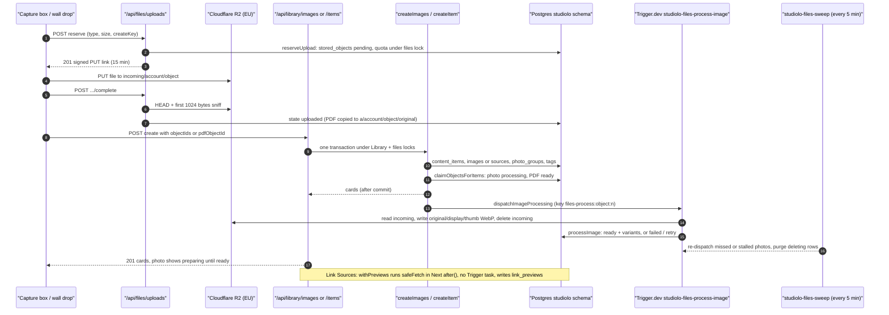
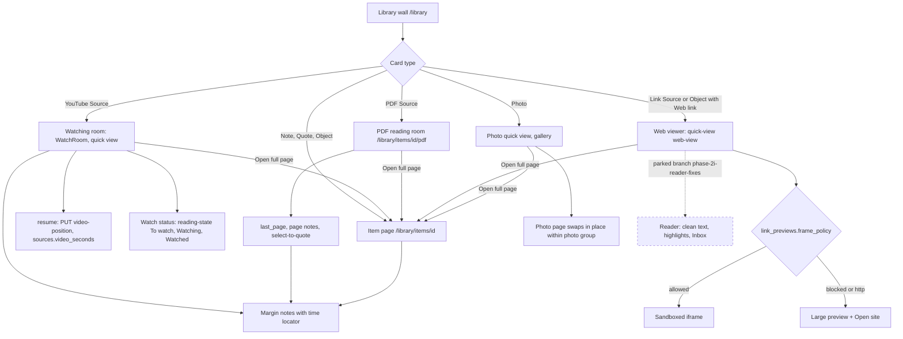
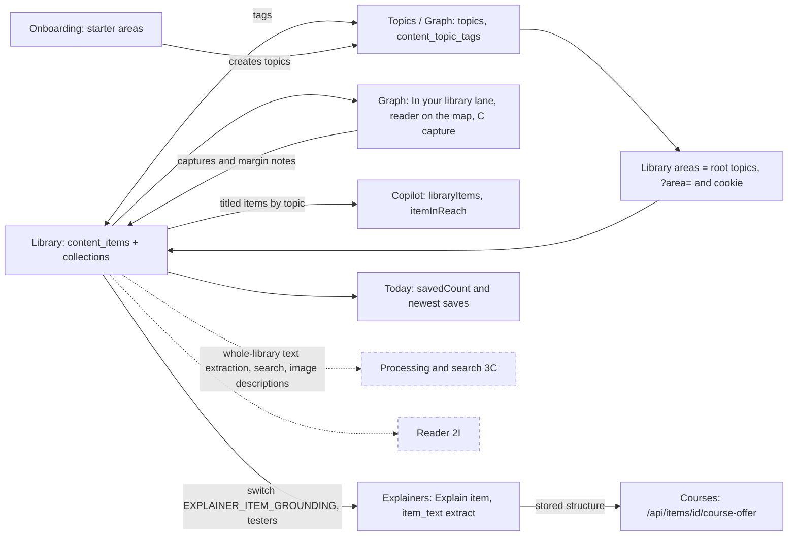
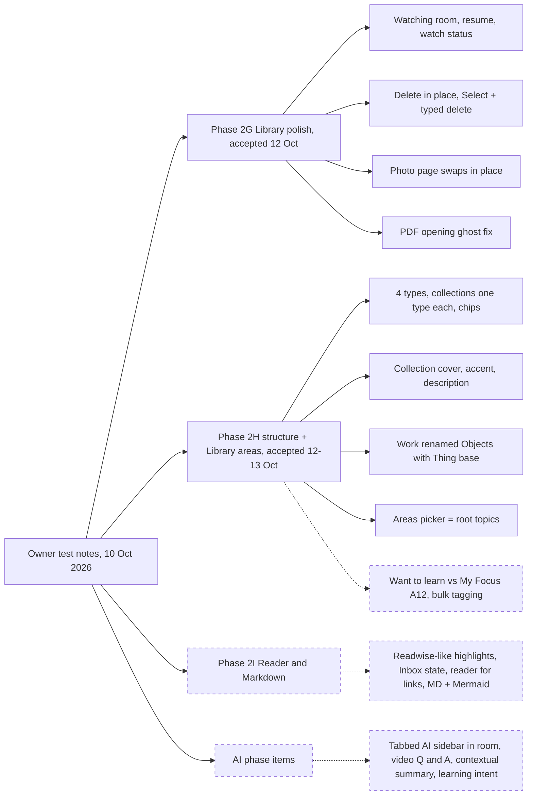
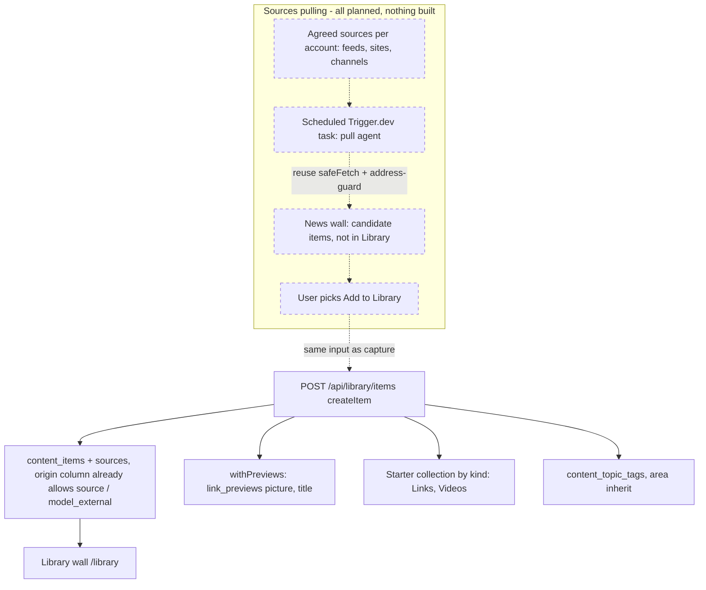

# Craft validation: Library area

Sources: studiolo @ ad38415 (read-only clone `/home/user/studiolo`), its `project-docs/` and `docs/superpowers/specs/`, and the Craft space "Studilo". Checked 17 Oct 2026. Every Mermaid diagram below passed `mmd/check.sh`. Nothing was deleted in Craft; each doc got an appended "How it works (verified against code)" section. No in-place corrections were made.

Legend: ✅ confirmed · ⚠️ wrong/outdated/partial · ❓ cannot verify from code · ❌ (polish doc only) still open / not built

## 1. Library (02 Product), rootBlockId 5dc8d229-7fdd-78fd-49a1-c834e7afb944

| Claim | Verdict | Evidence |
|---|---|---|
| Status: Built | ✅ 2B–2H and Library areas merged into main and owner-accepted (2H 12 Oct, areas 13 Oct). Migrations 0010–0015 are on Studiolo Dev only, not production | `project-docs/product/mvp-scope.md`, `project-docs/product/library.md`, `project-docs/workflow/production-cutover.md` |
| Reader parked | ✅ only on branch `phase-2i-reader-fixes`; no `src/features/source-content/` on main; 3B-4 wrote its extractors fresh (B12) | `project-docs/implementation/database.md`, `project-docs/implementation/backend.md` |
| "after the 14 Oct revert" | ❓ no revert and no date recorded in code or docs | (none) |
| 3C not started | ✅ no 3C spec or plan; whole-Library extraction, search and image descriptions are "Not built (3C)"; 3B-4 extracts one item's text only when it is explained (`item_text`) | `project-docs/product/mvp-scope.md`, `project-docs/product/library.md`, `drizzle/0021_item_text_extracts.sql` |
| Four item types Notes, Sources, Photos, Objects | ✅ shapes note/source/object/image, note styles plain/long/quote, object base person/thing. Also a fifth stored shape, `conversation`, which the doc leaves out | `src/db/library-schema.ts` (`content_items_shape_check`) |
| One collection per item | ✅ `content_items.collection_id`: at most one, of the item's own type, required for Objects; six starters | `src/db/library-schema.ts`, `src/features/library/starters.ts` |
| Typed links | ✅ `content_relations`, 11 relation names, rules per kind | `src/features/library/relations.ts` |
| Areas | ✅ an area is a top-level Graph topic; `?area=` plus a cookie; a filter, not a workspace; captures inherit the area (17 Oct) | `src/features/library/areas.ts` |
| Rooms for YouTube, PDF, web, photos | ✅ watching room; PDF reading room; web viewer (iframe only when `frame_policy` allows, otherwise a large preview; no reading text); photo quick view and pages that swap in place | `src/components/library/watch-room.tsx`, `src/app/(workspace)/library/items/[itemId]/pdf/page.tsx`, `src/components/library/quick-view/web-view.tsx`, `src/components/library/image-page.tsx` |
| Polish notes are in TBS | ✅ (Craft cross-link) | Craft "Library - polishment Phase" |
| Built but not in the doc | link previews run in the web function with `after()`, not Trigger; margin notes and `on_wall`; `/library/to-read`; bulk delete up to 500 with a typed word; Explain… behind `EXPLAINER_ITEM_GROUNDING` for testers | `src/features/links/refresh.ts`, `src/features/library/bulk-delete.ts`, `src/app/api/items/[itemId]/course-offer/route.ts` |

Count: 9 ✅, 0 ⚠️, 1 ❓.

### Diagrams

#### Item types, collections and links (ER)

#### Capture and file processing (sequence)

#### Rooms by item type (flow)

#### Connections to other features

## 2. Library - polishment Phase (TBS), rootBlockId 3f23017a-a7df-46f4-a2cb-3af132de9ea9

These notes are quoted in `docs/superpowers/specs/2026-10-10-phase-2g-library-polish-design.md`. That spec split them into 2G (built), 2H (built), 2I (Reader, parked) and the AI phase.

| Note | Verdict | Evidence |
|---|---|---|
| Video resume | ✅ done (G2); the real YouTube embed is still unverified | `src/app/api/library/items/[itemId]/video-position/route.ts`, `sources.video_seconds` (0012) |
| Wide video in a focus mode | ✅ done (G1) | `src/components/library/watch-room.tsx` |
| Full-page video click opens the room | ✅ done (G1) | `src/components/library/video-hero.tsx` |
| Watch status To watch / Watching / Watched, automatic plus manual | ✅ done (G3); stored as unread/reading/read | `reading-state` route, `sources.reading_state` |
| Tabbed AI sidebar in the room | ❌ open (AI phase) | no copilot code in `src/components/library/` |
| AI questions about a YouTube video, Gemini | ❌ open; no Gemini or transcript code | grep of `src/` |
| AI summary in the learner's context | ❌ open | (none) |
| Areas across Graph and Library | ✅ done | `src/features/library/areas.ts` |
| Collections as data types, not folders | ✅ done (2H): one type per collection, at most one per item, no folders | `src/db/library-schema.ts`, migration 0015 |
| A new collection appears in the filters | ✅ done | `src/features/library/wall-chips.ts` |
| Sub-types (Photos → Renders; PDFs → Books) | ✅ done through typed collections and starters | `src/features/library/starter-collections.ts` |
| Top filter shows system types with collections under them | ⚠️ partly: one flat chip row, collections then types, not nested | `project-docs/product/library.md` (Collections) |
| "I want to learn X" note sorted automatically | ❌ open; one flag `topics.want_to_learn` = My Focus (A12 open) | `src/db/topics-schema.ts` |
| PDF reader: highlight, notes on a page, remember the page, reading state | ✅ the basics (page notes, select-to-quote, `last_page`, To read/Reading/Read); ❌ Readwise-like highlights | `src/components/library/pdf-viewer.tsx`, `select-to-quote.tsx` |
| Inbox state | ❌ open; the states are unread/reading/read only | `sources_reading_state_check`, `reading-queue.tsx` |
| Wide e-reader for links, handling sites that block iframes | ⚠️ partly: web viewer with a sidebar; a blocked site gets a large preview; no reader text | `src/components/library/quick-view/web-view.tsx`, `src/features/links/frame-policy.ts` |
| Save image, video or text from the reader | ❌ open | (none) |
| MD files with code blocks and Mermaid | ❌ open; uploads take JPEG/PNG/WebP and PDF only; the Markdown subset has no code blocks or Mermaid | `src/features/files/types.ts`, `src/features/library/markdown.ts` |
| Work collection editorial, hero image, transferable name | ✅ mostly (Objects/Thing base, preview picture as hero, photos depict it); ❌ the slideshow editorial page | `project-docs/product/library.md` (F8, 2H) |
| Delete from the wall in a popup | ✅ done (G5) | `src/components/library/wall-delete-dialog.tsx` |
| Multi-select, delete all, typed word | ✅ done (G6): up to 500; typed `delete` at 10 or more items or with Select all | `src/features/library/bulk-delete.ts`, `bulk-delete-dialog.tsx` |
| Collection cover or colour | ✅ done (2H) | `collections.cover_image_id`, `accent` |
| Photo group page reloads instead of swapping | ✅ fixed (G7) | `src/features/library/photo-swap.ts` |
| PDF opening animation lags | ✅ fixed at the cause (G8); not a server problem | the G8 spec |

Count: 16 ✅ (done), 2 ⚠️ (partly), 9 ❌ open, counting the ❌ parts of mixed rows. No ❓.

### Diagram: where each note went

## 3. Sources pulling (TBS), rootBlockId 5ad9ed4d-45d2-4aff-9f20-646d3eadf60b

| Claim | Verdict | Evidence |
|---|---|---|
| Cloud agents pull from agreed sources into a news wall; the user picks what goes to the Library | ❓ idea only: no code, table, task, route or spec. `src/trigger/` has only the files, explainer, foundation and reconcile tasks | `src/trigger/`, `project-docs/product/mvp-scope.md` |
| Reusable pieces exist | ✅ `safeFetch` with the address guard, `parse-html`, `oembed`, scheduled Trigger tasks | `src/features/links/*`, `src/trigger/files-tasks.ts` |
| The schema can mark non-user items | ✅ `content_items.origin` takes user/source/model/model_external | `src/db/library-schema.ts` |
| Matches the "Save to Library only by choice" principle | ✅ | `project-docs/product/mvp-scope.md` |
| Plan limit on schedules | ❓ Free-plan schedules fire at most hourly | `project-docs/architecture/tech-stack.md` |

Count: 3 ✅, 0 ⚠️, 2 ❓.

### Diagram: how it would plug into capture (everything dashed is planned)

