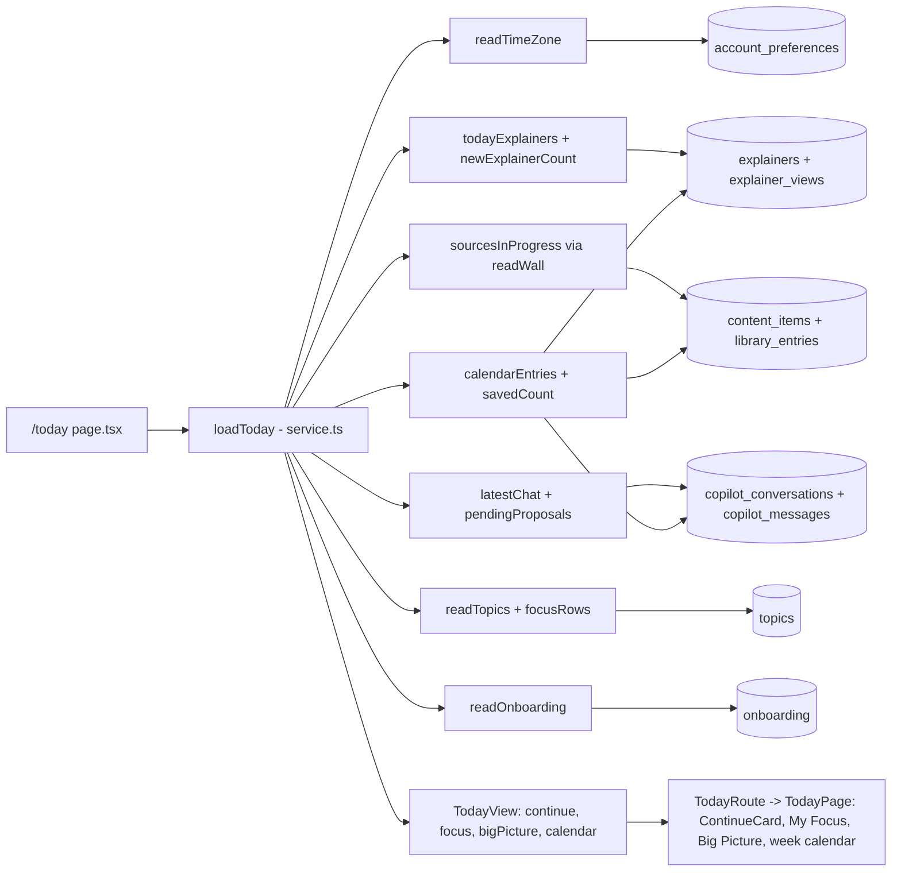
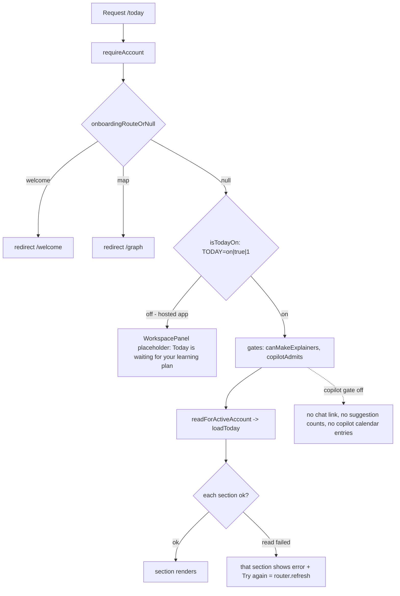
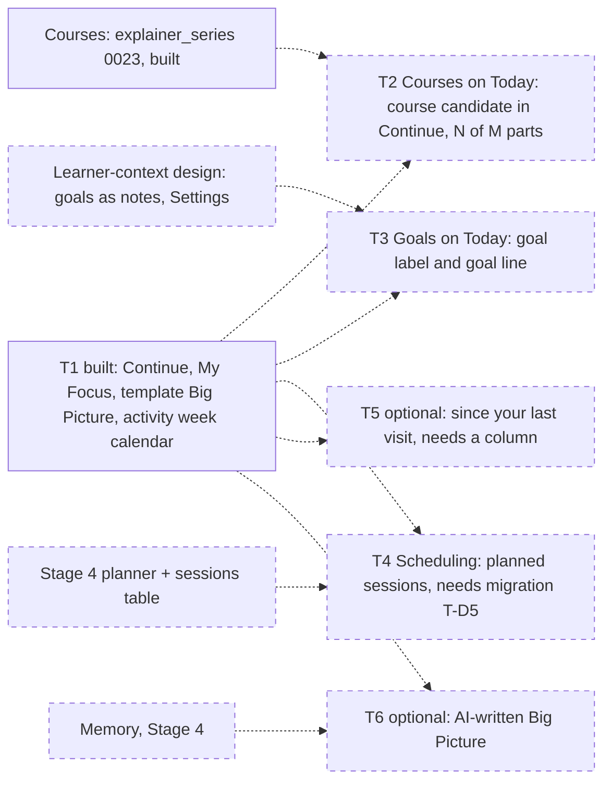
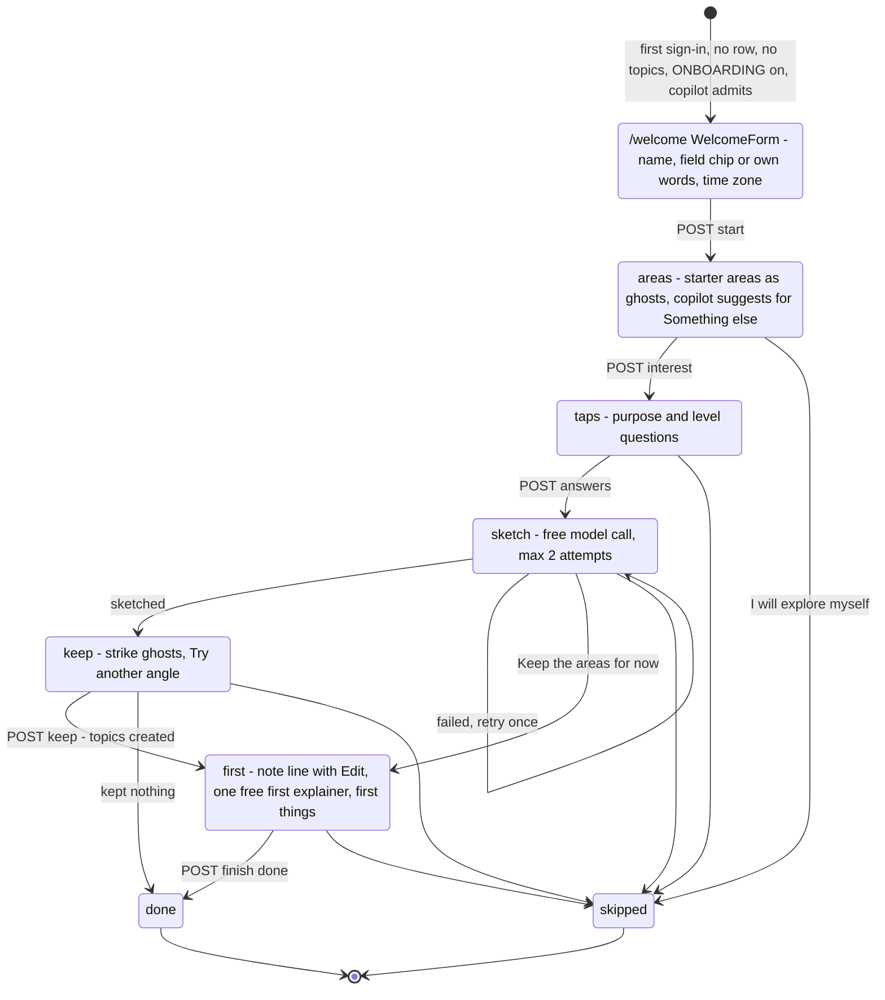
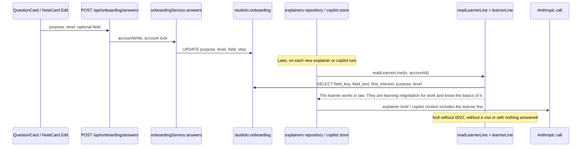
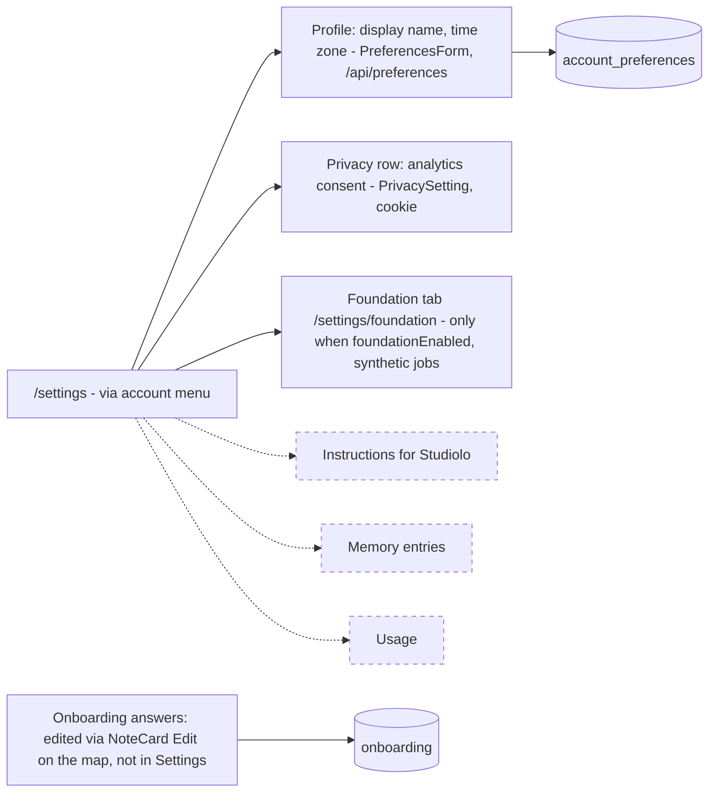
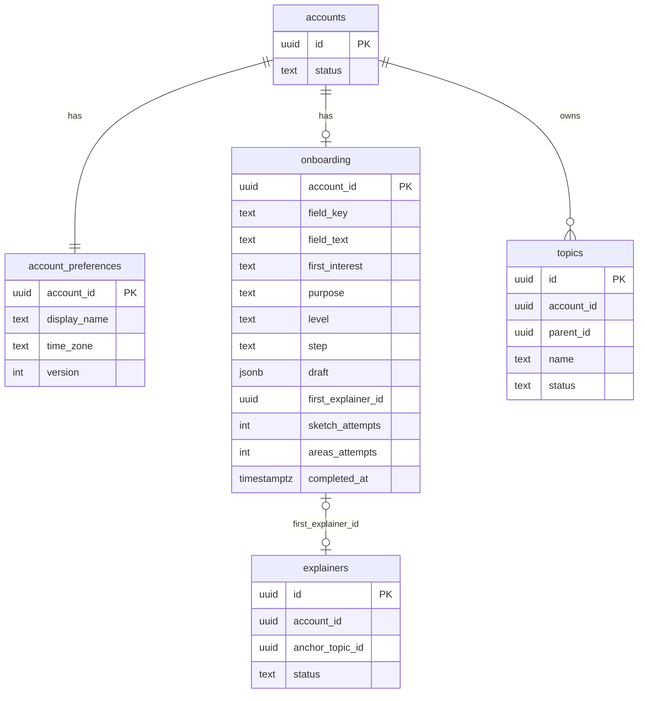

# Craft validation: Today, Settings & Onboarding, Features & Ideas

Sources: studiolo @ ad38415 (`/home/user/studiolo`, read-only) and its `project-docs/`; Craft space "Studilo". Checked 17 Oct 2026.
No in-place corrections were made to existing Craft text in any of the three docs (no clear factual errors in the Status lines). All additions were appended under "How it works (verified against code)" (Today, Settings & Onboarding) or as one callout at the end (Features & Ideas).

## 1. Today (02 Product) — rootBlockId 4962ea2f-061c-c387-f779-76f2c91ae487

| Claim | Verdict | Evidence (studiolo @ ad38415) |
|---|---|---|
| T1 built | ✅ | `src/features/today/*`, `src/components/today/*`; merged 17 Oct 2026, not accepted (`project-docs/implementation/frontend.md#today-t1`) |
| Behind the TODAY switch | ✅ | `src/config/today.ts` `isTodayOn` (on/true/1); `src/app/(workspace)/today/page.tsx` shows the placeholder otherwise; not set on hosted app (`project-docs/implementation/README.md`) |
| T2–T6 designed | ✅ (nuance) | `docs/superpowers/specs/2026-10-16-today-design.md` §7; T2 is partly scaffolded: `course` ContinueCandidate type in `model.ts` and rendering in `continue-card.tsx`, but `continueView()` never produces it |
| Continue, My Focus, The Big Picture | ✅ | `TodayView` in `src/features/today/model.ts`; `continueView`, `focusTopics`, `bigPicture` |
| Big Picture = template sentences, no AI | ✅ | `bigPicture()` in `model.ts` (T-D2); no model call in `src/features/today` |
| Week calendar of activity | ✅ | `calendarEntries` in `src/features/today/repository.ts` (explainer views, saves, copilot chats per conversation/hour), Mon–Sun in Settings time zone, 6:00–23:00 |
| Direction: learning-planning calendar = T4 | ✅ | Spec §0 and §7 |
| T4 needs a migration | ✅ | Spec T-D5; no sessions table in `src/db/*-schema.ts`; `CalendarEntry.kind` reserves `planned` |
| Open: does activity log stay beside the plan | ❓ | Owner decision, spec §0 |
| (omitted) onboarding redirects before switch | ➕ | `today/page.tsx` → `onboardingRouteOrNull` → `/welcome` or `/graph` |
| (omitted) per-section failure + Try again; copilot gate hides chat/suggestions/copilot entries | ➕ | `src/features/today/service.ts` `loadToday`; `today-route.tsx` `router.refresh()` |
| (omitted) Continue falls back to onboarding's first explainer; welcome back after 14 days | ➕ | `continueView`, `AWAY_DAYS` in `model.ts` |
| (omitted) "Later today" (localStorage until local midnight) | ➕ | `src/components/today/today-page.tsx` |

Counts: ✅ 8 (one with ⚠️ nuance on T2), ⚠️ 1, ❓ 1, ➕ 4.

### Diagrams
#### Page composition and data sources

#### Feature-switch gating

#### Planned slices T2–T6 (dashed = not built)

## 2. Settings & Onboarding (02 Product) — rootBlockId bb8e0415-798e-19f6-cd98-55cf155f9cb0

| Claim | Verdict | Evidence (studiolo @ ad38415) |
|---|---|---|
| Onboarding built | ✅ | Merged 16 Oct 2026, not accepted; behind `ONBOARDING=on` (on on hosted app since 16 Oct), migration 0022, copilot-admitted accounts only. `src/config/onboarding.ts`, `src/features/onboarding/eligibility.ts`, `project-docs/implementation/README.md` |
| Step: name | ✅ | `/welcome` `src/components/onboarding/welcome-form.tsx`; saved to `account_preferences.display_name` + `time_zone` by `service.ts` `start` |
| Step: field | ✅ | Five chips + "Something else…" (`FieldKey` in `src/features/onboarding/types.ts`) |
| Step: interests (plural) | ⚠️ | One first interest only (`onboarding.first_interest`), placed by `placeInterest` (`starter-areas.ts`) |
| (omitted) two taps: purpose + level | ➕ | `src/features/onboarding/answers.ts` `PURPOSE_OPTIONS`, `LEVEL_OPTIONS`, Decide for me / Skip |
| Ghost starter areas | ✅ | `starter-areas.ts`, `draft-graph.ts`; "Something else" areas from the model via `suggestAreas` (max 2 attempts) |
| Copilot sketches | ✅ | `sketch.ts` `sketchBranch`; purpose `onboarding` on Sonnet 5.5 (`src/features/ai/purposes.ts`); free, 2 attempts (`FREE_ATTEMPTS`); Keep creates topics (`service.ts` `keep`) |
| One free first explainer | ✅ | `service.ts` `explain`: `generateQuick({free: true})`, deterministic create key, `first_explainer_id` claim |
| Answers → learner line the AI receives | ✅ | `src/features/onboarding/learner.ts` `readLearnerLine` (field, first interest, purpose, level; not the name), used in `src/features/explainers/repository.ts` and `src/features/copilot/store.ts` |
| Settings partly built | ✅ | `src/app/(workspace)/settings/page.tsx`: Profile (display name, time zone; versioned save via `/api/preferences`), Privacy row (analytics consent), Foundation tab only when `foundationEnabled()` |
| Instructions, Memory, Usage tabs designed only | ✅ | No code in `src/features/settings` or routes; design in `project-docs/design/interface.md` (Stage 4) |
| (omitted) answers edited later via NoteCard Edit, not Settings | ➕ | `src/components/onboarding/first-things.tsx`; `answers` action accepts `field` |
| (omitted) skip at any step; never shown twice | ➕ | `machine.ts` `nextStep`, `service.ts` `finish`, `eligibility.ts` |

Counts: ✅ 9, ⚠️ 1, ❓ 0, ➕ 3.

### Diagrams
#### Onboarding flow

#### How answers become the learner line

#### Settings tabs status (dashed = designed only)

#### Onboarding and preferences tables

## 3. Features & Ideas (02 Product) — rootBlockId b24f1953-937a-ae3e-094c-b7cd64d34312

Collection items were not modified. One callout block was appended at the end of the page listing the partial-build mismatches below.

| Item | Stage in Craft | Code check | Evidence |
|---|---|---|---|
| AI Brain: memory around the user | Idea | ✅ not built | no memory tables/routes |
| Sources pulling / news wall | Idea | ✅ not built | — |
| Mastery overlay / planning view / drag-to-reorder on map | Idea | ✅ not built | no mastery/reorder in `src/components/graph` |
| Explainers on phones | Idea | ✅ open idea (player has responsive phone layout only) | `src/features/explainers/player/player.tsx` |
| Toned-down MVP | Idea | ❓ product decision | — |
| Cost-per-video study with voice | Idea | ❓ study, not code | — |
| Opus only for drawing; empowered Haiku | Idea | ✅ not built (author/repair on Opus, structure on Haiku today) | `src/features/ai/purposes.ts` |
| Public home of explainers | Idea | ⚠️ related part built: public share links | `src/app/e/[code]/page.tsx`, `drizzle/0020_explainer_shares.sql` |
| HTML under explainer videos: readings, quizzes | Idea | ✅ not built | no quiz code |
| Agent layers | Idea | ✅ not built | — |
| Reader v2 on explainer text extraction | Parked | ✅ not built (extraction exists for explainers) | `drizzle/0021_item_text_extracts.sql` |
| 3C Library processing and search | Idea | ⚠️ partly built: single-item text extraction (3B-4) + keyword ILIKE wall search | `item_text_extracts`, `src/features/library/search.ts` |
| Today T2, T3, T5, T6 | Designed | ⚠️ T2 scaffolded (type + card rendering, no data path) | `src/features/today/model.ts`, `src/components/today/continue-card.tsx` |
| Learning-planning calendar (T4) | Designed | ✅ not built | no sessions table |
| Markdown upload into copilot | Parked | ✅ not built | — |
| Explainer first-slide speed fix | Designed | ✅ not built | — |
| 3B-5 quality loop | Designed | ✅ not built (eval-origin explainers and a by-hand copilot organising eval script exist) | `scripts/copilot-organising-eval.mjs` |
| Learner context: Instructions, Goals, Memory, Usage | Designed | ⚠️ precursor built: onboarding learner line | `src/features/onboarding/learner.ts` |
| Copilot graph actions: tidy-map change plans | Designed | ✅ not built (copilot tools: propose_topics, read_map, explain, plan_course…; no move/rename) | `src/features/copilot/tools/*` |

Callout text added (block eb127c45-eacb-11d3-5a6b-d15ad9f23891): lists items (1) Today T2 scaffold, (2) 3C partial, (3) public share links, (4) learner line precursor.
