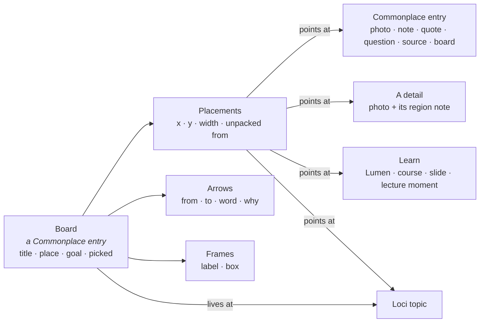

HIGH (a programme of four phases; each phase states its own tier)

# Boards: thinking on a canvas, inside Commonplace

**For:** the owner, to decide the direction, and the agent who later builds it in `studiolo`.
**Status:** Proposed. Claude, 24 October 2026. Nothing here is approved until the owner says so in the conversation.
**Comes after:** the seven phases of [Commonplace photos and header](2026-10-24-commonplace-photos-roadmap-design.md). Boards reuse that roadmap's header, wall, viewer, Picks, detail notes and Loci inspector, so they start once Phase 7 has merged (§3 says exactly which phase each Boards phase needs).
**Design reference:** the prototype **Commonplace Boards** (`Studiolo_Manage/prototypes/boards/`, published at `https://claude.ai/artifact/CVVpm4kM6pshfmURATKXvi`). It is a copy of the approved **Commonplace Photos** prototype (version 4, the header the owner called "perfect") with Boards built in. Nothing of that prototype was restyled; Boards plug into it.
**Builds on:**
- [Commonplace photos design](2026-10-24-commonplace-photos-design.md): three questions instead of folders; the viewer; Picks; notes on a detail.
- [Lumen pictures](2026-10-24-lumen-pictures-design.md): the picture shelf, typed picture blocks, "when nothing of yours fits".
- [Learner memory](2026-10-24-learner-memory-and-settings-design.md): what Loci reads for a place on the map.
- [Learn roadmap](2026-10-23-learn-roadmap-design.md): Lumens, courses, and "the model writes typed content, Studiolo renders it".

**Checked against:** not re-read for this document. Facts about `studiolo` come from the photos design's §1 (main @ `3c2f744`). Each phase spec re-checks paths before it is written.

## 0. In short

The owner's idea (24 Oct): an infinite board where people place a photo, a link, a video, a note, a course or a Lumen, draw arrows between them, write their learning goal, and think freely. The board lives in the graph, at an area, topic or sub-topic. It is a Commonplace item, it holds other Commonplace items, and it can be turned into a Lumen.

**The proposal in one line:** a **board** is a Commonplace entry of its own type. It sits beside Notes, Sources and Photos, and its page is a canvas. Every card on it is a **placement** of an existing entry, drawn with the wall's own card, and it opens in the same viewer. Arrows carry a word and a *why*. The board feeds Learn (Make a Lumen) and Loci (the goal, suggested links, open questions).

Five rules:
1. **Placed, never copied.** A photo on a board is the photo. Its picks, topics and notes on details are the same everywhere, and a change on the board is a change in Commonplace.
2. **What you write is saved to Commonplace.** A note or question written on a board becomes a Note, tagged with the board's place. A pasted link becomes a Source › Link.
3. **Only four things belong to the board alone:** placements (where a card sits), arrows, frames and the goal.
4. **It inherits Commonplace's look.** The header, cards, viewer, selection bar and pop-overs are the ones the photo roadmap builds, unchanged (§1).
5. **It drives the app, through four outlets:**
   - **Make a Lumen** follows the arrows, and its pictures become the Lumen's picture shelf.
   - **The goal** is what Loci reads as *why you're learning* the place.
   - **Arrows between topics** become suggested links on the map.
   - **Questions** become the Lumen's check.

| # | Phase | What the learner gets | Needs (photo roadmap) | Tier | Migration |
|---|---|---|---|---|---|
| B1 | **Boards as entries** | A **Boards** type with its wall card and shelf. The board page: the canvas, cards placed from a small Commonplace, arrows with a word and a why, frames, notes and questions written on the board | 1 header · 3 uncropped cards · 4 Picks | HIGH | yes (boards, placements, arrows) |
| B2 | **The board and the viewer** | Photos open in the viewer, stepping in arrow order, with *On boards* and *On this board*. **Place a detail** as its own card. Lectures unpack into their moments | 2 viewer · 6 notes on a detail | MEDIUM | no |
| B3 | **Learn on a board** | Lumens and courses as cards that unpack into slides and parts. **Make a Lumen** or a course from a board, a frame or a selection. **Recall**. **Ask Loci**, where you write first | Lumen pictures phase A | HIGH | yes (Lumen source) |
| B4 | **Boards in Loci** | The board's square on its topic. A Boards section in the inspector. The goal as *why you're learning it*. Suggested links. Open questions with *Explain…* | 7 photos in Loci · learner memory | HIGH | yes (topic links) |

**Why this order:**
- **B1 is useful alone.** A board you can place things on, connect and write on is already the thinking tool. Everything after it adds outlets.
- **B2 needs no data.** It joins B1 to the viewer and detail notes that the photo roadmap has already shipped.
- **B3 needs Lumen pictures.** *Make a Lumen* hands the board's pictures to the writer as its picture shelf. That shelf, and the typed `photo` and `photo_pair` blocks, are Lumen pictures phase A. B3 is also the first Boards phase that calls a model (Ask Loci and Make a Lumen).
- **B4 touches the map and memory.** It writes to two systems other designs own, so it goes last.

## 1. What Boards inherit, part by part

The rule: **if the photo roadmap already has it, Boards use it as it is.** The table is also the checklist for visual review against the prototype.

| Part | From the photo roadmap | On Boards |
|---|---|---|
| **Header** | Phase 1: `dest-head`, tabs with **Select**, the search box (area scope, search, Views, Wall/Shelves), the type row | **Boards** is a fifth type in the type row, with its count. Its placeholder is "Search boards by title, goal or what's on them…". A board page keeps the `dest-head`: *Commonplace / Boards / title* |
| **Slim bar** | Phase 1: All · Unsorted · ★ Picks, Topic, the type's own filter, count, Display | Boards' own filter is **Questions ▾** (*With open questions*), then **+ New board**. Unsorted means *no place on Loci yet* |
| **Wall card** | Today's `mcard` anatomy: picture, kicker, title, description, topic foot | The picture is the board's **cover**: its own photo thumbs and cards, in place and scaled, with its arrows. The kicker reads *Board · 17 entries · 9 arrows*; the description is the goal; the foot is the place |
| **Shelves** | The shelf with meta and a board of prints | A **Boards** section with one shelf, *Pinned up*, holding each board as a pinned print, and **Open as a wall →** |
| **Cards on the canvas** | Phase 3: photos whole, not cropped, on their palette colour while loading, with the ★ pick on hover and the source tag. Today's `notecard`, `quote`, `paper` (links), `video`, `cover` (books) | Exactly these cards, placed. A photo's tag reads *▣ 2 on details* when it has notes on a detail. A question is a `notecard` with a *? Question* kicker |
| **Frames** | The wall's group headers (Group by): uppercase label, then a count | A frame's label *is* a group header (*HOW AIR MOVES · 6*) over a soft panel |
| **Viewer** | Phase 2: zoom, 1:1, full screen, strip, the panel with facts | Double-click a photo (or Space): the same viewer, stepping through the board's photos **in arrow order**. The panel adds **On boards** (open any of them) and **On this board** (the arrows as sentences) |
| **Notes on a detail** | Phase 6: the white region box with its number | **Place detail N on the board** makes a *detail card*: a crop with the region box drawn in the viewer's style, and the note under it. It is linked to its photo by a *part of* arrow |
| **Selection** | Phase 4: the bottom `bulk` bar | The same bar, with board actions: Open, Play, Unpack, ★ Pick, Connect, Ask Loci, Frame them, Make a Lumen from these, **Remove from board** (never Delete) |
| **Pop-overs** | The `.pop` (area, topic, Views…) and the sort-mode `keychip`s | An arrow's pop-over: keychips for the word, the viewer's composer for the *why* |
| **Add drawer** | The header itself | A small Commonplace on the canvas: the same search box (area scope and search), the same type tabs (plus Lumens and Loci), and the photo wall in the learner's own layout (Rows, Masonry or Grid). Drag a card in, or tap it. *On board* marks what's already placed |
| **Overlays** | Decision D24: the light, blurred scrim | Make a Lumen and the player sit on the same scrim |
| **Loci** | Phase 7: the inspector (key picture, mood, colours, See all) and the map's nodes | A square on the node counts its boards. The inspector gains **Boards**, *Loci reads* (the goal), **From your boards** and **Open questions on boards** (§3, B4) |
| **Tokens and type** | `tokens.css`; Newsreader for reading, Instrument Sans for UI | No new colours. Canvas = `--board` with a dot grid in `--line`. Arrows `--ink-3`, selection `--accent`, questions `--pick`, the goal `--accent-soft` |

What is new: the canvas (pan, pinch, zoom, minimap, the float tool rail), placements, arrows, frames, the goal card and Loci's card.

## 2. The model

- **A board is an entry.** It has a title, **one place** (an area, topic or sub-topic), a goal, and a pick. It shows up in search, Views, Picks and Group by like any other type.
- **A placement points at something; it never holds a copy.** It can point at a Commonplace entry, a detail (a photo and one of its region notes), a Lumen, a course, one slide of a Lumen, a lecture's saved moment, a Loci topic, or another board. Removing a placement never deletes what it points at.
- **Unpacking** places a course's parts, a Lumen's slides or a lecture's moments. Each one remembers its parent (a dotted line). *Fold* takes them back, except the ones you moved or connected.
- **An arrow** has a word from a fixed list (*leads to, explains, example of, contrasts with, causes, raises, part of*) and an optional *why* of one line. The word lets Learn and Loci read it; the why is the learner's own sentence.
- **Writing on a board** creates the Commonplace entry first, then places it.

**Data, for the B1 spec to settle** (*new*, names indicative):
- a new `content_items.shape` value `board`, with its place as its one topic;
- `board_placements` (board, ref kind, ref id, region note id, x, y, width, parent placement);
- `board_arrows` (board, from placement, to placement, verb, why);
- `board_frames` (board, label, x, y, width, height).

All four are hand-written SQL, applied only on the owner's word.

## 3. The phases

### B1. Boards as entries (HIGH, migration)

**Goal:** a learner can make a board at a place, put their own things on it, connect them and say why.

- **The type.** Boards in the type row, the slim bar (§1), the wall card with its cover, the Boards shelf.
- **Making one.** + New board on the Boards slim bar, or *New board here* from a topic (B4 adds that one). It opens with the goal card waiting to be written.
- **The canvas.**
  - Drag on empty space to pan; Ctrl/⌘ + scroll or pinch to zoom; the minimap; Fit (0).
  - Tools: Select (V), Pan (H), Note (N), Question (Q), Arrow (A), Frame (F). Double-click empty space for a note.
  - Shift-drag a box to select several.
- **Placing.** The drawer (§1). Drop where you let go; a tap places it at the nearest free spot. Pasting a link saves it as a Source first.
- **Arrows.** Drag a card's edge dot onto another card (or press A, then tap two cards), then pick a word and say why. Dropping the dot on empty canvas makes a new note that's already connected.
- **Writing.** Double-click a note to edit it. It saves to Commonplace, and the toast says so.
- **Keys and undo.** Delete removes from the board. Ctrl/⌘ Z undoes board changes.
- **Done when:**
  - a board made, filled and connected shows its cover on the wall and shelf;
  - a note edited on a board reads the same in Commonplace;
  - removing a photo from a board leaves it on the wall;
  - the board works at 390 px with the bottom bar, in light and dark;
  - every tool and card is reachable by keyboard.

### B2. The board and the viewer (MEDIUM, no migration)

**Goal:** a board is a way into the pictures, not a second place to look at them.

- **The viewer.** Double-click or Space on a photo opens the Phase 2 viewer. Its list is the board's photos **in arrow order**, so ← → walks the board's argument.
- **The viewer's panel** adds:
  - **On boards**: each board that holds the photo, with *this board* marked;
  - **On this board**: the arrows as sentences, e.g. *"Courtyard house, aerial* example of *Courtyard toward the prayer hall*, because same court, but here the tall wing holds the tower."
- **Details.** Each note on a detail gets **Place detail N on the board**, which adds a detail card linked to its photo by *part of*.
- **Lectures.** A lecture unpacks into its saved moments.
- **Done when:** ← → in the viewer follows the arrows; a placed detail shows its region box at any zoom; closing the viewer returns to the board exactly where it was.

### B3. Learn on a board (HIGH, migration: a Lumen's source)

**Goal:** the board is the brief for a Lumen, and a place to test yourself.

**Lumens and courses as cards.** A Lumen card plays in place and unpacks into its slides. A course card shows its progress and unpacks into its parts (each part is a Lumen).

**Make a Lumen,** from the whole board, a frame or a selection:
- **The brief.** The goal is the brief. The level comes from what Loci knows about the place.
- **The picture shelf** (Lumen pictures) is the board's own photos and detail crops, in arrow order. Each one is *Use* or *Leave out*, and the learner chooses *When nothing of yours fits: Ask · Generate · Words only*.
- **The order.** *Follow my arrows* (the default) or *Let Loci order it*. Frames become sections; with *A course*, each frame is one part.
- **The writing.**
  - The arrows' whys are quoted in the learner's words.
  - Two connected cards where at least one is a picture become a `photo_pair` slide, with the word between them.
  - Lumens and courses on the board are context the new Lumen *builds on*, not repeats.
- **The check.** Questions become the check at the end, answered after the learner tries. Afterwards each question card shows *Answered in "…"*.
- **Length.** *Connected cards* (the default) leaves out anything with no arrow; *Everything* keeps them all.
- **Where it lands.** The Lumen appears on the board, linked to its frames by dashed arrows. It is also in Learn.

**Recall** covers the learner's own words: notes, quotes, the goal, detail notes, and each arrow's word and why. Say one aloud, tap to check, then mark *Got it* or *Not yet*. *Not yet* goes to *To revisit* in Loci's memory for the place.

**Ask Loci** works on a selection, and you go first:
1. Loci asks *What connects these?*
2. You write a sentence, then **Compare**.
3. Loci shows its version next to yours. You keep yours, theirs, or both as notes; it can also offer to place a topic.
4. Nothing is added without a tap. *Just tell me* skips your turn.

**Data.** A Lumen records its source board, frame or selection, so the board can show it and Learn can say where it came from.

**Done when:**
- a Lumen made from the sample board follows its arrows, uses its pictures, and quotes its whys;
- each question gets a check;
- the words-only fallback works with every picture left out.

### B4. Boards in Loci (HIGH, migration: topic links)

**Goal:** a board changes what the map knows.

- **On the map.** A small square under a topic counts the boards there and below it.
- **In the inspector** (Phase 7), a **Boards** section:
  - the boards' covers as tiles, and *+ New board here*;
  - **Loci reads**: the goal of the board placed at this topic, shown as *why you're learning it*;
  - **From your boards**: when an arrow joins two topics the map doesn't link, the inspector suggests the link and shows the arrow that implies it, with *Link them* or *Not now*;
  - **Open questions on boards**, each with *Explain…*.
- **Which arrows count.** An arrow into the board's own topic, or between a topic and one of its own parents, never suggests anything.
- **Done when:**
  - linking from a suggestion adds the link to the map, and *Not now* never asks again for that pair;
  - the goal appears in the place's memory card under *Why you're learning it* (learner memory §4);
  - *Explain…* starts a short Lumen whose check is that question.

## 4. Decisions for the owner

| # | Question | Proposal |
|---|---|---|
| BD-1 | **The name "board" is already taken.** The *Lumen board* proposal (19 Oct, branch `claude/serene-franklin-bif1cg`) uses *board* for a whiteboard-sketch slide | Keep **Board** for this, the learner's canvas. Call the slide type a **sketch** |
| BD-2 | A board as a Commonplace **type**, or its own destination in the rail | A type. It keeps one library, and it inherits Search, Views, Picks and the viewer for free. Loci and Learn link into it |
| BD-3 | One place per board, or several | One. It is where the board lives; its cards keep their own topics |
| BD-4 | Arrow words: a fixed list, or free | A fixed list of seven, plus a free *why*. The list lets a Lumen and the map read arrows |
| BD-5 | Does Recall's *Not yet* write to memory without asking? | Yes, as *To revisit*, the same as a missed check; the learner can remove it |
| BD-6 | Size limit | At most 300 placements per board in v1; the canvas stays fast and the cover readable |
| BD-7 | Sharing a board | Not in this programme. It follows Learn's sharing design (Learn roadmap phase 3) |

## 5. Not in this programme

- Shared or live boards, comments, or several people on one board.
- Drawing freehand, shapes or connectors with elbows. Arrows are straight; frames are boxes.
- Pictures uploaded straight onto a board. Capture saves them to Commonplace first, which keeps rule 1.
- AI arranging a board on its own. Loci answers when asked (B3).

## 6. The prototype

`prototypes/boards/index.html` (published as **Commonplace Boards**). Its README lists what to try. In short:
- it opens on *Cooling the prayer-hall courtyard*, the same learner and pictures as Commonplace Photos and Lumen pictures;
- **Boards** in the type row; **Shelves**;
- double-click a photo for the viewer, then **Place detail 2 on the board**;
- **+** for the drawer; drag a card's dot onto another;
- select three cards, then **Ask Loci**;
- **Make a Lumen**, then **Play**;
- **Recall**;
- Loci › Climate-responsive design.

Nothing calls a model. Ask Loci's replies, the Lumen and its answers are written from the board's real contents.
