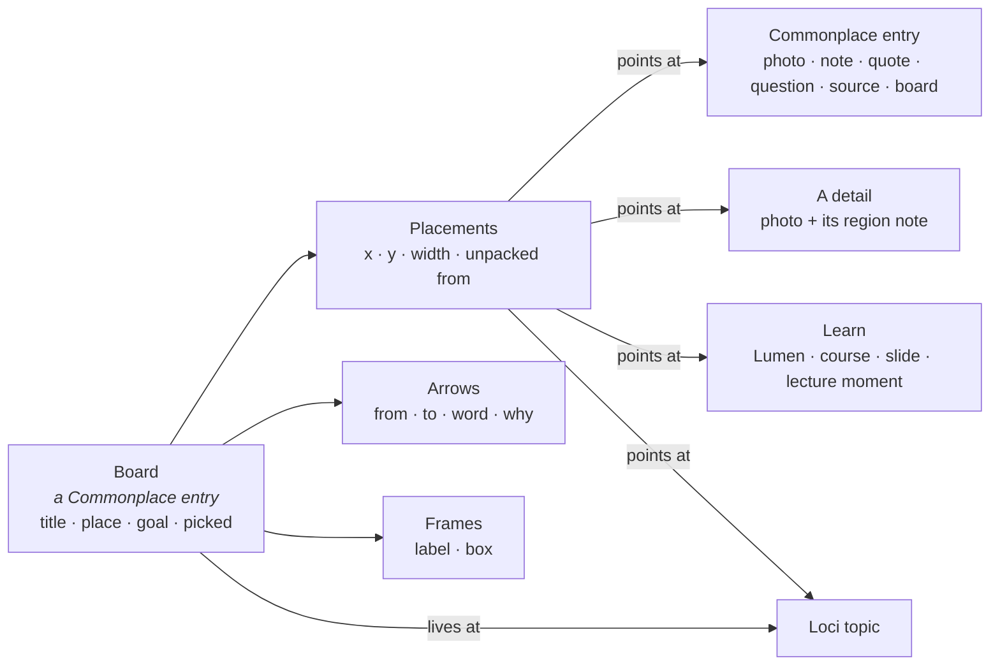
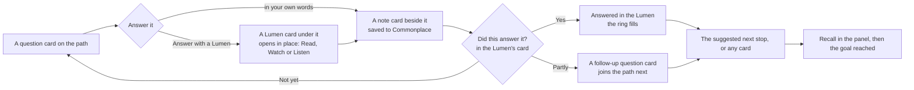

HIGH (a programme of four phases; each phase states its own tier)

# Boards: thinking on a canvas, inside Commonplace

**For:** the owner, to decide the direction, and the agent who later builds it in `studiolo`.
**Status:** Proposed. Claude, 24 October 2026. Nothing here is approved until the owner says so in the conversation.
**Comes after:** the seven phases of [Commonplace photos and header](2026-10-24-commonplace-photos-roadmap-design.md). Boards reuse that roadmap's header, wall, viewer, Picks, detail notes and Loci inspector, so they start once Phase 7 has merged (§3 says exactly which phase each Boards phase needs).
**Design reference:** the prototype **Commonplace Boards** (`Studiolo_Manage/prototypes/boards/`, published at `https://claude.ai/artifact/CVVpm4kM6pshfmURATKXvi`). It is a copy of the approved **Commonplace Photos** prototype (version 4, the header the owner called "perfect") with Boards built in. Nothing of that prototype was restyled; Boards plug into it.
**Builds on:**
- [Commonplace photos design](2026-10-24-commonplace-photos-design.md): three questions instead of folders; the viewer; Picks; notes on a detail.
- [Lumen pictures](2026-10-24-lumen-pictures-design.md): the picture shelf, typed picture blocks, "when nothing of yours fits".
- [Learner memory](2026-10-24-learner-memory-and-settings-design.md): what Loci reads for a place on the map.
- [Learn roadmap](2026-10-23-learn-roadmap-design.md): Lumens, courses, and "the model writes typed content, Studiolo renders it".

**Checked against:** Commonplace facts come from the photos design's §1 (main @ `3c2f744`). The Palace and Map facts in §2.2 and B4 were read from `studiolo` main @ `6f8d396` (24 Oct): `src/features/palace/extras.ts`, `room.ts`, `room-types.ts`, `scene.ts`, `src/components/graph/palace/palace-engine.ts`, `src/components/graph/graph-map.tsx`, `src/features/topics/layout.ts` and `src/features/explainers/topic-gateway.ts`. Each phase spec re-checks paths before it is written.

## 0. In short

The owner's idea (24 Oct): an infinite board where people place a photo, a link, a video, a note, a course or a Lumen, draw arrows between them, write their learning goal, and think freely. The board lives in the graph, at an area, topic or sub-topic. It is a Commonplace item, it holds other Commonplace items, and it can be turned into a Lumen.

**The proposal in one line:** a **board** is a Commonplace entry of its own type. It sits beside Notes, Sources and Photos, and its page is a canvas. Every card on it is a **placement** of an existing entry, drawn with the wall's own card, and it opens in the same viewer. Arrows carry a word and a *why*. The board feeds Learn (Make a Lumen) and Loci (the goal, suggested links, open questions).

**What a board is for.** Its job is **understanding**: working a question through until you can state what you now know, toward a goal you wrote first (*"Understand how to keep the prayer hall's courtyard cool without machines, well enough to brief the engineer"*).
- **Thinking is the activity, learning is the purpose, and work is often where it points.** The sample board is all three: you think by arranging and connecting, you learn because the goal and the questions ask you to, and the brief to the engineer is the work it serves.
- **So the design leans to learning.** The goal card comes first. An arrow asks for a word and a *why*. Questions are their own cards. Recall and Make a Lumen test and teach what is on it. Loci reads the goal.
- **It is not a moodboard or a task board.** No columns, statuses, owners or due dates. A board in a Practice area (a project, a competition entry) is the same board with a work goal, not a separate mode.

**An entry type, not a collection.** A board sits on the wall and on the shelves like a photo, and it shows other entries, but it does not *own* them the way a folder or collection would:
- every card is a pointer to an entry that stays where it is, with its own topics;
- one photo can be on three boards;
- deleting a board deletes only its placements, arrows, frames and goal.

That is why a board can live at **one** place on Loci while its cards keep theirs, and why it is just another Commonplace item in the Palace and on the Map (§2.2).

Five rules:
1. **Placed, never copied.** A photo on a board is the photo. Its picks, topics and notes on details are the same everywhere, and a change on the board is a change in Commonplace.
2. **What you write is saved to Commonplace.** A note or question written on a board becomes a Note, tagged with the board's place. A pasted link becomes a Source › Link.
3. **Only four things belong to the board alone:** placements (where a card sits), arrows, frames and the goal.
4. **It inherits Commonplace's look.** The header, cards, viewer, selection bar and pop-overs are the ones the photo roadmap builds, unchanged (§1).
5. **It drives the app, through four outlets:**
   - **Make a Lumen** follows the arrows, and its pictures become the Lumen's picture shelf.
   - **The goal** is what Loci reads as *why you're learning* the place.
   - **Arrows between topics** become suggested links on the map.
   - **Questions** become the Lumen's check.

| # | Phase | What the learner gets | Needs (photo roadmap) | Tier | Migration |
|---|---|---|---|---|---|
| B1 | **Boards as entries** | A **Boards** type with its wall card and shelf. The board page: the canvas, cards placed from a small Commonplace, arrows with a word and a why, frames, notes and questions written on the board | 1 header · 3 uncropped cards · 4 Picks | HIGH | yes (boards, placements, arrows) |
| B2 | **The board and the viewer** | Photos open in the viewer, stepping in arrow order, with *On boards* and *On this board*. **Place a detail** as its own card. Lectures unpack into their moments | 2 viewer · 6 notes on a detail | MEDIUM | no |
| B3 | **Learn on a board** | Lumens and courses as cards that unpack into slides and parts. **Make a Lumen** or a course from a board, a frame or a selection. **Recall**. **Ask Loci**, where you write first | Lumen pictures phase A | HIGH | yes (Lumen source) |
| B4 | **Boards in Loci** | The board's square on its topic. A Boards section in the inspector. The goal as *why you're learning it*. Suggested links. Open questions with *Explain…* | 7 photos in Loci · learner memory | HIGH | yes (topic links) |

**Why this order:**
- **B1 is useful alone.** A board you can place things on, connect and write on is already the thinking tool. Everything after it adds outlets.
- **B2 needs no data.** It joins B1 to the viewer and detail notes that the photo roadmap has already shipped.
- **B3 needs Lumen pictures.** *Make a Lumen* hands the board's pictures to the writer as its picture shelf. That shelf, and the typed `photo` and `photo_pair` blocks, are Lumen pictures phase A. B3 is also the first Boards phase that calls a model (Ask Loci and Make a Lumen).
- **B4 touches the map and memory.** It writes to two systems other designs own, so it goes last.

## 1. What Boards inherit, part by part

The rule: **if the photo roadmap already has it, Boards use it as it is.** The table is also the checklist for visual review against the prototype.

| Part | From the photo roadmap | On Boards |
|---|---|---|
| **Header** | Phase 1: `dest-head`, tabs with **Select**, the search box (area scope, search, Views, Wall/Shelves), the type row | **Boards** is a fifth type in the type row, with its count. Its placeholder is "Search boards by title, goal or what's on them…". A board page keeps the `dest-head`: *Commonplace / Boards / title* |
| **Slim bar** | Phase 1: All · Unsorted · ★ Picks, Topic, the type's own filter, count, Display | Boards' own filter is **Questions ▾** (*With open questions*), then **+ New board**. Unsorted means *no place on Loci yet* |
| **Wall card** | Today's `mcard` anatomy: picture, kicker, title, description, topic foot | The picture is the board's **cover**: its own photo thumbs and cards, in place and scaled, with its arrows. The kicker reads *Board · 17 entries · 9 arrows*; the description is the goal; the foot is the place |
| **Shelves** | The shelf with meta and a board of prints | A **Boards** section with one shelf, *Pinned up*, holding each board as a pinned print, and **Open as a wall →** |
| **Cards on the canvas** | Phase 3: photos whole, not cropped, on their palette colour while loading, with the ★ pick on hover and the source tag. Today's `notecard`, `quote`, `paper` (links), `video`, `cover` (books) | Exactly these cards, placed. A photo's tag reads *▣ 2 on details* when it has notes on a detail. A question is a `notecard` with a *? Question* kicker |
| **Frames** | The wall's group headers (Group by): uppercase label, then a count | A frame's label *is* a group header (*HOW AIR MOVES · 6*) over a soft panel |
| **Viewer** | Phase 2: zoom, 1:1, full screen, strip, the panel with facts | Double-click a photo (or Space): the same viewer, stepping through the board's photos **in arrow order**. The panel adds **On boards** (open any of them) and **On this board** (the arrows as sentences) |
| **Notes on a detail** | Phase 6: the white region box with its number | **Place detail N on the board** makes a *detail card*: a crop with the region box drawn in the viewer's style, and the note under it. It is linked to its photo by a *part of* arrow |
| **Selection** | Phase 4: the bottom `bulk` bar | The same bar, with board actions: Open, Play, Unpack, ★ Pick, Connect, Ask Loci, Frame them, Make a Lumen from these, **Remove from board** (never Delete) |
| **Pop-overs** | The `.pop` (area, topic, Views…) and the sort-mode `keychip`s | An arrow's pop-over: keychips for the word, the viewer's composer for the *why* |
| **Add drawer** | The header itself | A small Commonplace on the canvas: the same search box (area scope and search), the same type tabs (plus Lumens and Loci), and the photo wall in the learner's own layout (Rows, Masonry or Grid). Drag a card in, or tap it. *On board* marks what's already placed |
| **Overlays** | Decision D24: the light, blurred scrim | Make a Lumen and the player sit on the same scrim |
| **Loci** | Phase 7: the inspector (key picture, mood, colours, See all) and the map's nodes | A square on the node counts its boards. The inspector gains **Boards**, *Loci reads* (the goal), **From your boards** and **Open questions on boards** (§3, B4) |
| **Tokens and type** | `tokens.css`; Newsreader for reading, Instrument Sans for UI | No new colours. Canvas = `--board` with a dot grid in `--line`. Arrows `--ink-3`, selection `--accent`, questions `--pick`, the goal `--accent-soft` |

What is new: the canvas (pan, pinch, zoom, minimap, the float tool rail), placements, arrows, frames, the goal card and Loci's card.

## 2. The model



- **A board is an entry.** It has a title, **one place** (an area, topic or sub-topic), a goal, and a pick. It shows up in search, Views, Picks and Group by like any other type.
- **A placement points at something; it never holds a copy.** It can point at a Commonplace entry, a detail (a photo and one of its region notes), a Lumen, a course, one slide of a Lumen, a lecture's saved moment, a Loci topic, or another board. Removing a placement never deletes what it points at.
- **Unpacking** places a course's parts, a Lumen's slides or a lecture's moments. Each one remembers its parent (a dotted line). *Fold* takes them back, except the ones you moved or connected.
- *Superseded on 29 October by §7.10: a link is a line with an optional label; the fixed list below is withdrawn.*
- **An arrow** has a word from a fixed list (*leads to, explains, example of, contrasts with, causes, raises, part of*) and an optional *why* of one line. The word lets Learn and Loci read it; the why is the learner's own sentence.
- **Writing on a board** creates the Commonplace entry first, then places it.

### 2.1 What an arrow means

An arrow is **a claim the learner makes about two things, on this board**: *A* [word] *B*, because [why]. For example: *"Courtyard house, aerial"* **example of** *"Courtyard toward the prayer hall"*, because "same court, but here the tall wing holds the tower".

- **It belongs to the board, not to the entries.** The same two photos can be joined differently on another board, or not at all. The viewer's *On this board* shows only this board's arrows.
- **It is not a hyperlink, and not a link on the map.** It never changes Loci by itself (below).
- **The word is for the app; the why is for the learner.** The word comes from the fixed list so Learn and Loci can read it. The why is kept in the learner's own words, quoted back by the Lumen, and covered by Recall.

Who reads arrows:

| Reader | What it takes from them |
|---|---|
| **The viewer** (B2) | The order: ← → walks the board's photos along the arrows |
| **Make a Lumen** (B3) | The order (*Follow my arrows*); which cards matter (*Connected cards* leaves out the unconnected); the whys, quoted; two connected cards with a picture become a `photo_pair` slide with the word between them; *raises* joins a question to what it asks about, so the check sits after it |
| **Recall** (B3) | Each arrow's word and why are covered, like a note |
| **Loci** (B4) | When the two cards' topics are not linked on the map, the arrow becomes a **suggested** link, with the why as its reason. *Link them* adds a `related` link; *Not now* never asks again |
| **The Palace** (B4) | An opened board draws its arrows between the cards' topics as `related` links, with the why as the link's text |

The words, in the prototype's order: *leads to* (sequence), *explains* (B is the explanation of A), *example of* (A shows B), *contrasts with* (compare), *causes* (cause and effect), *raises* (A raises the question B), *part of* (a detail and its whole). The B3 spec decides how each word changes a Lumen beyond order and pairs; the prototype reads only the order, the pairs, *raises* and the whys.

### 2.2 How a board lives in Loci

A board is **a Commonplace item**, so the Palace and the Map treat it as they treat a photo or a note. Nothing about the Palace or the Map changes shape. A board only brings its own card and, when opened, its own satellites.

- **Its place.** A board's one place is its topic (`content_items` topics, as for any item). In the Palace, its area's room counts it in the **Commonplace stack** (`stack:commonplace:<area>`, `room.ts`), newest first, beside the photos and notes.
- **Opened in the Palace** (`item:<id>`, the slot card on the right):
  - the board's square sits near its topic and serves it, as any item serves its topics;
  - its cards appear as small marks near **their own** topics, held by the board (`holds`, not drawn) and serving those topics, so you see where the board reaches across the map. A Loci topic placed on the board is tied to the board directly;
  - its arrows are drawn between them as `related` links carrying the why;
  - Lumens made from it are tied to it (`serves`), exactly as the app already ties a Lumen anchored to an item (`extras.ts`: `anchor.kind === "item"`).
- **Its slot card** reads *Commonplace · Board*: the cover, the goal, *Lives at*, *Reaches, through what's on it*, *On it*, *Its arrows* (as sentences), *Lumens made from it*, then **Open board** and *Open in your Commonplace →*.
- **On the Map,** the topic's Commonplace lane lists the board first with its cover and the kind line *BOARD*.
  - A Lumen made from the board appears in the Lumens lane as *From board*, because its anchor is the board (an item).
  - The board's lane card gets the ▶ badge: *1 Lumen made from Cooling the prayer-hall courtyard*, with the app's own peek and Play. This is the lane's existing `itemCounts`, keyed by the board's id (`topic-gateway.ts`).
- **The explainer link is the existing one.** A Lumen made from a board is anchored to the board as an item. Learn, the Map lane, the badge and the Palace already read that anchor, so the board joins all of them without new plumbing.
- **What is new for Loci** is the item kind `board` (its label and lane card, in `item-kinds.ts`), the satellites for an opened board, and the inspector's Boards section (B4).

**Data, for the B1 spec to settle** (*new*, names indicative):
- a new `content_items.shape` value `board`, with its place as its one topic;
- `board_placements` (board, ref kind, ref id, region note id, x, y, width, parent placement);
- `board_arrows` (board, from placement, to placement, verb, why);
- `board_frames` (board, label, x, y, width, height).

All four are hand-written SQL, applied only on the owner's word.

## 3. The phases

### B1. Boards as entries (HIGH, migration)

**Goal:** a learner can make a board at a place, put their own things on it, connect them and say why.

- **The type.** Boards in the type row, the slim bar (§1), the wall card with its cover, the Boards shelf.
- **Making one.** + New board on the Boards slim bar, or *New board here* from a topic (B4 adds that one). It opens with the goal card waiting to be written.
- **The canvas.**
  - Drag on empty space to pan; Ctrl/⌘ + scroll or pinch to zoom; the minimap; Fit (0).
  - Tools: Select (V), Pan (H), Note (N), Question (Q), Arrow (A), Frame (F). Double-click empty space for a note.
  - Shift-drag a box to select several.
- **Placing.** The drawer (§1). Drop where you let go; a tap places it at the nearest free spot. Pasting a link saves it as a Source first.
- **Arrows.** Drag a card's edge dot onto another card (or press A, then tap two cards), then pick a word and say why. Dropping the dot on empty canvas makes a new note that's already connected.
- **Writing.** Double-click a note to edit it. It saves to Commonplace, and the toast says so.
- **Keys and undo.** Delete removes from the board. Ctrl/⌘ Z undoes board changes.
- **Done when:**
  - a board made, filled and connected shows its cover on the wall and shelf;
  - a note edited on a board reads the same in Commonplace;
  - removing a photo from a board leaves it on the wall;
  - the board works at 390 px with the bottom bar, in light and dark;
  - every tool and card is reachable by keyboard.

### B2. The board and the viewer (MEDIUM, no migration)

**Goal:** a board is a way into the pictures, not a second place to look at them.

- **The viewer.** Double-click or Space on a photo opens the Phase 2 viewer. Its list is the board's photos **in arrow order**, so ← → walks the board's argument.
- **The viewer's panel** adds:
  - **On boards**: each board that holds the photo, with *this board* marked;
  - **On this board**: the arrows as sentences, e.g. *"Courtyard house, aerial* example of *Courtyard toward the prayer hall*, because same court, but here the tall wing holds the tower."
- **Details.** Each note on a detail gets **Place detail N on the board**, which adds a detail card linked to its photo by *part of*.
- **Lectures.** A lecture unpacks into its saved moments.
- **Done when:** ← → in the viewer follows the arrows; a placed detail shows its region box at any zoom; closing the viewer returns to the board exactly where it was.

### B3. Learn on a board (HIGH, migration: a Lumen's source)

**Goal:** the board is the brief for a Lumen, and a place to test yourself.

**Lumens and courses as cards.** A Lumen card plays in place and unpacks into its slides. A course card shows its progress and unpacks into its parts (each part is a Lumen).

**Make a Lumen,** from the whole board, a frame or a selection:
- **The brief.** The goal is the brief. The level comes from what Loci knows about the place.
- **The picture shelf** (Lumen pictures) is the board's own photos and detail crops, in arrow order. Each one is *Use* or *Leave out*, and the learner chooses *When nothing of yours fits: Ask · Generate · Words only*.
- **The order.** *Follow my arrows* (the default) or *Let Loci order it*. Frames become sections; with *A course*, each frame is one part.
- **The writing.**
  - The arrows' whys are quoted in the learner's words.
  - Two connected cards where at least one is a picture become a `photo_pair` slide, with the word between them.
  - Lumens and courses on the board are context the new Lumen *builds on*, not repeats.
- **The check.** Questions become the check at the end, answered after the learner tries. Afterwards each question card shows *Answered in "…"*.
- **Length.** *Connected cards* (the default) leaves out anything with no arrow; *Everything* keeps them all.
- **Where it lands.** The Lumen appears on the board, linked to its frames by dashed arrows. It is also in Learn.

**Recall** covers the learner's own words: notes, quotes, the goal, detail notes, and each arrow's word and why. Say one aloud, tap to check, then mark *Got it* or *Not yet*. *Not yet* goes to *To revisit* in Loci's memory for the place.

**Ask Loci** works on a selection, and you go first:
1. Loci asks *What connects these?*
2. You write a sentence, then **Compare**.
3. Loci shows its version next to yours. You keep yours, theirs, or both as notes; it can also offer to place a topic.
4. Nothing is added without a tap. *Just tell me* skips your turn.

**Data.** A Lumen records its source board, frame or selection, so the board can show it and Learn can say where it came from.

**Done when:**
- a Lumen made from the sample board follows its arrows, uses its pictures, and quotes its whys;
- each question gets a check;
- the words-only fallback works with every picture left out.

### B4. Boards in Loci (HIGH, migration: topic links)

**Goal:** a board changes what the map knows.

- **In the Palace and on the Map**, as §2.2: the board is a Commonplace item in its area's stack and its topic's lane. Opened, it shows its cards near their own topics, its arrows as `related` links with their whys, and the Lumens made from it. The Map's lane card carries the ▶ badge for those Lumens.
- **In the inspector** (Phase 7), a **Boards** section:
  - the boards' covers as tiles, and *+ New board here*;
  - **Loci reads**: the goal of the board placed at this topic, shown as *why you're learning it*;
  - **From your boards**: when an arrow joins two topics the map doesn't link, the inspector suggests the link and shows the arrow that implies it, with *Link them* or *Not now*;
  - **Open questions on boards**, each with *Explain…*.
- **Which arrows count.** An arrow into the board's own topic, or between a topic and one of its own parents, never suggests anything.
- **Done when:**
  - a new board shows in its area's Commonplace stack and its topic's lane, with no change to how other items show;
  - opening it in the Palace places its cards near their own topics and never moves a topic (the Palace's rule C-17);
  - a Lumen made from it shows *From board* in the Lumens lane and the ▶ badge on the board's card;
  - linking from a suggestion adds the link to the map, and *Not now* never asks again for that pair;
  - the goal appears in the place's memory card under *Why you're learning it* (learner memory §4);
  - *Explain…* starts a short Lumen whose check is that question.

## 4. Decisions for the owner

| # | Question | Proposal |
|---|---|---|
| BD-1 | **The name "board" is already taken.** The *Lumen board* proposal (19 Oct, branch `claude/serene-franklin-bif1cg`) uses *board* for a whiteboard-sketch slide | Keep **Board** for this, the learner's canvas. Call the slide type a **sketch** |
| BD-2 | A board as a Commonplace **type**, or its own destination in the rail | A type. It keeps one library, and it inherits Search, Views, Picks and the viewer for free. Loci and Learn link into it |
| BD-3 | One place per board, or several | One. It is where the board lives; its cards keep their own topics |
| BD-4 | Arrow words: a fixed list, or free | *Withdrawn 29 Oct (LB-D10):* no list; a link is a line with an optional free label |
| BD-5 | Does Recall's *Not yet* write to memory without asking? | Yes, as *To revisit*, the same as a missed check; the learner can remove it |
| BD-6 | Size limit | At most 300 placements per board in v1; the canvas stays fast and the cover readable |
| BD-7 | Sharing a board | Not in this programme. It follows Learn's sharing design (Learn roadmap phase 3) |
| BD-8 | Board as a Commonplace item in the Palace and Map, or a mark of its own | An item. It sits in the Commonplace stack and lane, and opening it shows what it reaches (§2.2). No new kind of node |
| BD-9 | Does an arrow change the map? | Never by itself. It is a suggestion until the learner taps *Link them* |
| BD-10 | What a board is for | Understanding toward a written goal. Not a moodboard or a task board; work boards are the same board in a Practice area |

## 5. Not in this programme

- Shared or live boards, comments, or several people on one board.
- Drawing freehand, shapes or connectors with elbows. Arrows are straight; frames are boxes.
- Pictures uploaded straight onto a board. Capture saves them to Commonplace first, which keeps rule 1.
- AI arranging a board on its own. Loci answers when asked (B3).

## 6. The prototype

`prototypes/boards/index.html` (published as **Commonplace Boards**). Its README lists what to try. In short:
- it opens on *Cooling the prayer-hall courtyard*, the same learner and pictures as Commonplace Photos and Lumen pictures;
- **Boards** in the type row; **Shelves**;
- double-click a photo for the viewer, then **Place detail 2 on the board**;
- **+** for the drawer; drag a card's dot onto another;
- select three cards, then **Ask Loci**;
- **Make a Lumen**, then **Play**;
- **Recall**;
- **The place pill** under the board's title (*Architecture › Climate-responsive design*): the app's own Palace, with the board opened. Then **Map**: the board in the Commonplace lane, and after Make a Lumen, *From board* in the Lumens lane with the ▶ badge.

The Palace and Map are the app's own code, bundled from `studiolo` main @ `6f8d396` (see `prototypes/boards/loci/README.md`).

Nothing calls a model. Ask Loci's replies, the Lumen and its answers are written from the board's real contents.

## 7. Addendum, 28 October: the board as a learning space

**The owner's idea (28 Oct):**
- a board starts from a goal ("learn X") and the questions that lead to it;
- AI answers those questions with Lumens, to read, watch or listen to;
- the learner takes notes around the same ideas;
- so the board becomes a learning space with a linear learning process.

**The owner's conditions:**
- fluid, not restrictive, but guided;
- **the board is the centre of learning**, so there's no separate learning window: Lumens play, and notes are written, on the board itself;
- placing things must be quick: **double-click empty space and type to search**, or **drag from a visual shelf**.

**Prototype:** [`prototypes/objects-boards-questions/`](../../../prototypes/objects-boards-questions/README.md). Open **Board**. Each sample board starts with one Lumen already made; press **▶ Play the Lumen** on its question.

### 7.1 Guided, never fenced in

| What guides | What stays free |
|---|---|
| The questions form a **path to the goal**: numbered stops on the cards, joined by a faint dotted route that ends at the goal card | The canvas is unchanged: place, move, connect and write anywhere, at any time |
| One stop is the **suggested next** (the first open one): its number is filled and its card glows softly. **Show me the next stop** pans the board to it | Every card works at any time, in any order. Nothing is locked, greyed out or hidden |
| **▶ Answer with a Lumen** on every open question card | Answer it yourself in a note, place a source that answers it, or leave it open |
| **Did this answer it?** in the Lumen's card | Only you mark a question answered. *Partly* asks a follow-up; *Not yet* keeps it open with no penalty |
| The goal's ring fills as stops are answered | Reorder stops (↑), take one off the path (×; it stays on the board under **Side questions**), add any question to the path (**+ Add to path**). A question you ask on the board joins the path on its own |
| **Recall** in the board's panel, then **Mark the goal reached** | Recall is there whenever you want it |

The rule: **the path suggests an order, the learner owns it.** The app never hides, locks or reorders anything by itself, and never takes the learner off the board.

### 7.2 The loop at each stop, all on the board



### 7.3 Learning in place

- **The path layer:**
  - each question on the path carries its number (✓ once answered);
  - a dotted route joins the stops in order, ending at the goal card;
  - the suggested next stop is filled and glows.
  
  The path is drawn under the arrows, so arrows keep their meaning.
- **A question card** shows **▶ Answer with a Lumen** while it's open and has none, and **▶ Play the Lumen** once it has one. Answering offers *Read · Watch · Listen*. The new Lumen lands under the question with an *explains* arrow, whose why is "made to answer it".
- **A Lumen card opens in place.** **▶ Play** (or a double-click) grows the card into a player, and the board zooms to 100% and centres it:
  - *Read · Watch · Listen* switch views of the same Lumen: slides; a narrated video with captions; or audio with a transcript;
  - ← → and dots step through it, ending at a *Check* slide with the question;
  - the card's foot: **Did this answer it?** *Yes · Partly · Not yet*, and **✎ Note**;
  - × or Escape folds it back to a card.
  
  Everything around it stays where it is.
- **✎ Note** puts an empty note card beside the Lumen, with the caret in it. The note is an ordinary Commonplace note, remembers its stop, and is joined to its question by a faint dotted line.
- **Partly** puts an empty question card under the Lumen, and it joins the path right after this stop.
- **The panel** (right) is **Learning on this board**:
  - the goal and its ring ("1 of 3 stops answered"), the suggested next question, and **Show me the next stop**;
  - **Path to the goal**: each stop with its number, its Lumens (**▶ Watch**, **▶ Read**), or **▶ Answer with a Lumen**, its note count, ↑ and ×;
  - **Answer the open stops with Lumens**, when several have none;
  - **Side questions**, each with **+ Add to path**;
  - **Recall**: **Test yourself** covers your notes and your labelled links ("Hassan Fathy → New Gourna Village: how are they linked?"). Each has **Show**, then *Got it* or *Not yet*, and *Not yet* goes to *To revisit* (BD-5). Then **Mark the goal reached**.
- **Make a Lumen** (of the whole board, B3) follows the path and the arrows, and its check is built from your notes.

### 7.4 One infinite canvas, full screen

**The owner's direction (28 Oct):** one infinite screen, like Miro, not a canvas inside a box.

- **The board fills the whole stage**, edge to edge beside the app's rail; on a phone, everything under the phone's top bar. Commonplace's header, tabs and page margins step aside while a board is open, and **←** goes back.
- **Everything else floats on the canvas** as rounded panels with the app's float shadow:
  - **top left:** ← and the board's title and place;
  - **top right:** *Field links*, **Make a Lumen**, **Panel** and **⤢ Focus**;
  - **left edge, centred:** the tools (↖ select, ✎ note, ? question, + Your Commonplace);
  - **right:** one side panel with two tabs, **Learning** (with its ring) and **Your Commonplace** (the shelf), and × to hide it. Hidden, it leaves a small chip with the ring ("0 of 2 stops · Panel"). **+** and the + key open it on *Your Commonplace*;
  - **bottom right:** zoom and Fit;
  - **bottom centre:** the hint.
- **The canvas runs under the panels**, and **Fit** frames the cards in the space between them. The panel opens by default on wide screens and hides with one tap. On a phone, it opens as a sheet from the bottom, and the tools move to the bottom.
- **Focus mode** (**⤢ Focus**, or F): everything but the canvas steps aside: the app's rail, the title, the panel, the tools, zoom and the hint. Only a faint **Leave focus** stays in the corner, and F or Esc brings everything back. Pan, zoom, double-click to place and drag dots to link all still work. **Fit** uses the whole screen.

### 7.5 Placing things: double-click to search, or drag from the shelf

This replaces the *Add drawer* (§1, *Add drawer* row): the way in is wherever you're looking.

- **Double-click empty board.** A search box opens right there ("Search your Commonplace, or type a note…"):
  - typing searches titles first, then text; it ignores accents ("Cord" finds Córdoba);
  - the results include open questions written elsewhere;
  - the last two rows are always **New note: "…"** and **New question: "…?"**, made from what you typed.
  
  ↑ ↓ choose, Enter places it at that spot, Esc closes. With nothing typed, the two *New* rows come first. Something already on the board isn't placed twice: the board shows where it is.
- **The shelf: Your Commonplace**, a tab of the side panel, beside *Learning* (opened with **+** or the + key):
  - a search box and kind chips (*All · Objects · Notes · Sources · Photos · Questions*);
  - visual tiles: photos show their picture; Objects their kind and card line; notes and quotes their words; questions as amber tiles;
  - **drag a tile onto the board** to place it where you drop it, or click to place it in the middle;
  - a tile already on the board is faded and marked *On board*.
- **The tools stay**: ✎ (N) and ? (Q), then click the board. Placed things are always placements, never copies, as §2.3 says.

### 7.6 What Loci does, and doesn't

- **Answers only when asked**: one question at a time, or **Answer the open stops** in one go. It never adds Lumens by itself (A2).
- **Never marks a question answered.** Only *Did this answer it?* does, so the ring measures understanding, not viewing.
- **A Lumen's brief is the question**, with the board as context:
  - the cards linked to the question, and any labels;
  - the goal;
  - the learner's notes so far.
  
  It builds on Lumens already on the board and doesn't repeat them (B3). In law and medicine, a Lumen says it's a teaching sketch, not advice.
- **Formats are views of one Lumen.** *Read* is its slides. *Watch* is the same slides narrated with captions (the voice Lumen design). *Listen* is narration with a transcript.

### 7.7 Data

- **The path:**
  - *new* `board_path(board_id, inline_id, position)`;
  - a question asked on the board joins it at the end;
  - a question taken off the path keeps a `skipped` row, so it doesn't come back by itself.
- **A Lumen placement** is §2.3's existing kind. A Lumen made for a stop records its source as `{ board, inline }` (B3's *Lumen source*, widened by one field).
- **Answered in** a Lumen is `inline_answers.explainer_id`, already in the Questions design.
- **A note written at a stop** is a Note placed on the board. Its stop is kept in the placement (`board_placements.stop_inline_id`, *new*), not in the note, so the same note can sit on other boards too.

### 7.8 Phases

These replace B3's single phase with three, in Stage 4, after B1 and B2. They need Q5 (*Explain this*) and the Lumen formats. B1 gains the full-screen canvas with floating panels (§7.4), and the double-click search and the shelf in place of the Add drawer.

| ID | What | Tier | Migration |
|---|---|---|---|
| **LB1** | **The path**: numbers on question cards, the dotted route, the suggested next, the *Learning on this board* panel (reorder, take off, add, side questions) | MEDIUM | yes: `board_path` |
| **LB2** | **Lumens on the board**: **Answer with a Lumen** on question cards and in the panel; Lumen cards that open in place (Read, Watch, Listen); *Did this answer it?* | HIGH | yes: the Lumen's source |
| **LB3** | **Notes and Recall on the board**: ✎ Note from a Lumen, *Partly* as a follow-up question card, Recall in the panel, *Mark the goal reached*; Make a Lumen of the whole board follows the path | HIGH | yes: `board_placements.stop_inline_id` |
| **LB5** | **Reading on the board**: entries open in the side panel beside their card; a long-note editor; a photo viewer; a PDF reader; a video player; notes at a page or a time; ↗ On the board; Note beside it (§7.12) | HIGH | no (uses `margin`, which exists) |
| **LB4** | **Board craft**: fluid movement and curved links; Focus mode; the add-and-link menu; the selection bar; selecting several, tidy and align; snapping guides; undo and redo; the minimap; shortcuts (§7.11) | MEDIUM | no |

### 7.10 Links: a link and a backlink

**The owner's direction (29 Oct):** arrows with words like *leads to* and *causes* ask too much of the learner. Make them as simple as Miro's and Scrintal's: just a link, and a backlink.

- **A link is a line between two cards.** Drag a card's blue dot onto another card and they're linked. Nothing to choose, nothing to fill in. The line has a small arrowhead showing which card you started from; **⇄ Reverse** flips it.
- **A label is optional.** Click a line to add one, in any words ("explains", "same climate", "contrast"). No list, no *why* field. Most links have no label.
- **Every link is a backlink.** Both cards' entries list it under **Appears in › On boards**: "Linked: → New Gourna Village (explains) · ← Hassan Fathy". The link belongs to the board, as before (C1: made in one place).
- **Offers stay, without words.** Linking two Objects whose collections have a matching relation field offers **Keep as a field**. Linking a card and a question offers **Mark answered in…** (the old *explains* rule). The pop-over opens by itself only when there's an offer; otherwise a small toast says "Linked. Click the line to label it, if you like."
- **What reads links:**
  - Make a Lumen follows the links in path order;
  - Recall covers labelled links ("A → B: how are they linked?");
  - Loci treats a link as `related`, and quotes its label when there is one.
- **Data:** `board_arrows` keeps `from`, `to` and a nullable `label`. The `word` and `why` columns are dropped from B1's migration before it ships.

### 7.11 Board craft: quick, forgiving, a little fun

**The owner's direction (29 Oct):** dragging a link from a card and letting go should open a small menu of what can be added. Plus the small things that make a board quick, productive and a pleasure to work on. All of it is phase **LB4**; none of it needs a migration.

**The add-and-link menu.** Drag a card's blue dot and let go on empty board (or select a card and press **Tab**, or **→ Add linked** in its bar). A small menu opens where you let go, with a dashed line from the card to that spot:

```
 Add and link from Hassan Fathy
 ┌────────┐ ┌──────────────┐ ┌────────┐
 │ ✎ Note │ │ ? Ask about it│ │ ▶ Lumen│   ← big tiles; 1, 2, 3 pick one
 └────────┘ └──────────────┘ └────────┘     (Lumen only from an open question)
 [⌕ …or find something in your Commonplace ]
 RELATED, NOT ON THIS BOARD
 ¶ Lecture notes: passive cooling, week 3
 ▤ Natural Energy and Vernacular Architecture
```

- **Note**: a new note, saved to Commonplace, placed there, linked, and open to write.
- **Question** (on an entry, **Ask about it**): a question that belongs to the board, linked, and on the path.
- **Lumen**, offered only from an open question: it is made and plays in its card where you let go, linked as that question's answer.
- **Related, not on this board**: up to four entries linked to it by a relation field, or sharing its topics. One click places and links it.
- **Search**: typing finds anything in Commonplace, as double-click does. Enter places and links the highlighted result, or makes the text a note when nothing matches.
- A new card never lands on another: it slides down to the first clear space. If the entry is already on the board, the menu links to that card instead of placing a copy.
- Esc, or a click away, cancels; nothing is made.

**Selecting.**
- A click selects a card; **⇧ click** adds or removes one; **⇧ drag** on empty board draws a box; **⌘A** selects all. A click on empty board clears the selection.
- **The selection bar** floats over what's selected.
  - For one card: **Open ↗** (or **Edit** for a question, **▶ Play** for a Lumen), **→ Add linked**, **? Ask about it** on entries, **▶ Lumen** on open questions without one, and **Remove**.
  - For several: **Align left**, **Align top**, **Tidy** (a neat grid in reading order), **Link in order** (links them left to right, top to bottom; useful for a path) and **Remove**.
- Dragging any selected card moves them all.

**Moving.**
- A dragged card snaps to the edges and centres of the others, and a thin guide shows what it lined up with. Hold ⌥ to place it freely.
- The arrow keys nudge the selection (⇧ for bigger steps).

**Forgiving.**
- **⌘Z** undoes, and **⇧⌘Z** redoes, anything done on the board: place, add, move, link, remove, tidy, align, a Lumen made.
- Remove says what it did ("Removed from the board. It's still in your Commonplace. ⌘Z to undo.").
- Linking two cards that are already linked says so, instead of drawing a second line.

**Fluid, not rigid.** *(The owner's direction, 29 Oct: movement and links should feel less rigid.)*
- **Cards have weight.**
  - A picked-up card lifts: a deeper shadow and a touch larger.
  - It follows the pointer a little behind it, leaning a few degrees the way it's moving.
  - Let go, and it settles into place with a small spring.
  - Selected cards move together the same way.
- **Nothing jumps.**
  - Tidy, align, nudge, undo and redo glide cards to their new places, and their links follow as they go.
  - Fit, ⇧2, *Show me the next stop*, a card picked in the panel, and opening an entry beside its card all ease the view there instead of cutting to it.
- **The board drifts.** Flick it while panning and it keeps moving, then slows to a stop. Zoom (pinch, ⌘ scroll, − and +) glides, too.
- **Links are soft curves.**
  - Each link leaves its card from the side facing the other card and arrives at the near side of that card. It bends gently, so links fan out rather than cross in straight spokes.
  - The arrowhead is small and notched, and a label sits at the curve's middle.
  - The path to the goal is one smooth dotted curve through its stops. Field links and the lines from notes to their stop curve the same way.
- **Linking feels alive.**
  - While you drag a blue dot, a dashed curve flows from the card. Over another card it snaps to that card's edge, and the card lights up to show where it will land.
  - When you let go, the new link draws itself in.
  - A selected link shows its direction with a slow flowing dash.
- All of it respects *reduce motion*: cards and the view then move at once, and nothing leans, flows or draws in.
- **In the app:** this is the canvas library's job (for example, CSS transforms with a spring, and SVG cubic paths for links). It needs no data, because only the final positions are saved.

**Finding your way.**
- **The minimap**, bottom left, shows every card as a block and the visible area as a frame. Click or drag it to go there. Questions, Lumens and the goal take their colours; the selection is blue.
- **⇧1** fits everything, and **⇧2** zooms to the selection.
- Hovering a link lights up the two cards it joins.
- **?** (or the ? beside Fit) opens a short sheet of every shortcut.

**A little fun, never in the way.**
- New cards arrive with a small pop.
- When a stop is answered, its number turns to ✓ with a short pulse, and the ring moves.
- Both respect *reduce motion*.

**On a phone:**
- the add-and-link menu and the selection bar work by touch;
- the minimap and the shortcut sheet are hidden;
- selecting several, nudging and the keys need a keyboard and a pointer, and are left out.

**Data.**
- Undo is client-side: a stack of the board's placements, links and own questions. It goes back up to 80 steps and is lost on reload.
- Nothing new is stored. *Related* reads relation fields and shared topics that already exist.

### 7.12 Reading and writing on the board: the board is the focus zone

**The owner's direction (29 Oct):** open notes, photos, PDFs and videos *on* the board. View, watch, read and write there, without going back and forth between pages.

**One rule: opening never leaves the board.** On a board, everything that opens an entry opens it in the **side panel**, beside its card:
- double-clicking a card;
- **Open** in the selection bar, or Enter;
- **Open** on a tile in *Your Commonplace*, to read before you place it;
- a mention or an entry card inside a note;
- a row in **Appears in**.

The panel widens to 560 px. You can drag its edge to resize it, or use **Wider**. The open entry's card on the canvas is outlined, and the board pans so the card stays in view beside the panel. **Full page ↗** is the one way out, for when you want the whole page. ← brings you back to the board as you left it.

**Tabs, so you can flip between things.**
- Each entry you open becomes a tab after *Learning* and *Your Commonplace*: its glyph (▣ Object, ¶ note, ◫ photo, ▤ PDF, ▷ video, ❝ quote), its name and ×.
- Up to five stay open; the oldest closes first. Esc closes the one you're on.
- In **Focus mode**, the panel stays if you're reading, with only that tab showing, so Focus becomes the canvas plus the thing you're working from.

**What each kind shows, and where you write:**

| Kind | You see | You write |
|---|---|---|
| Long or short note | Its title and the same block editor as the note page (`/`, `@`, images, cards) | In it, saved as you type; the card on the board fills in as you type |
| Object | Portrait or photo, the card's facts, the description, relation fields as pills (they open as tabs too) | *What I took from it*, in the block editor |
| Photo | The photo large; a click zooms in, to look at detail | Your notes on it |
| PDF | A page reader: ‹ › through the pages; your notes are pinned to the page they're on ("✎ 2 of your notes here") | A note **at this page** ("p. 2") |
| Video | A player; your notes are marks on the timeline | A note **at this time** ("12:40"); click a mark or a note's time to jump there |
| Book, quote | Its details, or the quote large | Your notes on it |

**From reading to the board:**
- **Your notes on it** (the entry's margin notes) each have **↗ On the board**. It puts the note on the canvas beside the entry's card, linked: a question becomes a question card on the path, and anything else becomes a note card ("p. 2: Shade before mass").
- **? Ask it as a question** saves a note as a question at that page or time. It shows in Questions and goals, and among the board's side questions.
- **✎ Note beside it** makes a new note about the entry, placed and linked beside its card, and opens it in a tab to write.
- **? Ask about it** puts a linked question card next to it.
- **Place it**: an entry opened from *Your Commonplace* that isn't on the board yet says so, with one button to place it.
- **Appears in** sits at the foot of every entry, so you can see where else it lives without leaving.

**What it isn't:**
- The panel is not a second app. It shows the entry itself, not a copy, so a change made there is the change, everywhere.
- Lumens still play inside their own cards (LB2), because they belong to a question on the board.

**Data.**
- Nothing new is stored. Notes at a page or a time are the entry's existing margin notes, with `at` set ("p. 2", "12:40"), which Questions and goals already reads.
- The open tabs, the panel width and the PDF page or video time are kept per person and per board, in the client.

**In the app:**
- the PDF reader is the app's own PDF viewer (pdf.js), opened at a page;
- the video player is the embed the source already uses, and the time comes from its player API;
- both need the source's file or URL to be reachable, as the full page does today.

### 7.9 Decisions

| ID | Decision | Recommendation |
|---|---|---|
| **LB-D1** | A board's questions form a suggested path; the canvas stays free | **Yes** |
| **LB-D2** | Nothing is ever locked: any card works at any time, and the learner reorders, skips and adds | **Yes**: guided, not restrictive |
| **LB-D3** | Loci answers with a Lumen only when asked | **Yes** |
| **LB-D4** | Only the learner marks a stop answered (*Did this answer it?*) | **Yes**: the ring measures understanding |
| **LB-D5** | Read, Watch and Listen are views of one Lumen | **Yes** |
| **LB-D6** | Notes are ordinary Commonplace notes, placed beside their stop | **Yes** |
| **LB-D7** | **No separate learning mode**: Lumens play inside their cards, and notes and Recall stay on the board | **Yes**: the board is the centre of learning |
| **LB-D8** | Placing is a double-click search at the spot, or a drag from the visual shelf; the Add drawer goes | **Yes** |
| **LB-D9** | A board opens as one full-screen, infinite canvas, with its title, tools, shelf, panel and zoom floating on it | **Yes**: like Miro, never a box inside a page |
| **LB-D10** | Board links are just a line and a backlink, with an optional label; the fixed word list and *why* go | **Yes**: simple, like Miro and Scrintal |
| **LB-D11** | The shelf is a tab of the one side panel, beside Learning; the left side stays clear | **Yes** |
| **LB-D12** | A board has a **Focus mode** that hides everything but the canvas (F or Esc) | **Yes** |
| **LB-D13** | Letting go of a link on empty board opens the **add-and-link menu**: Note, Question, Lumen (from an open question), related entries, search | **Yes** |
| **LB-D15** | On a board, opening an entry never leaves the board: it opens in the side panel beside its card, as a tab; **Full page ↗** is the way out | **Yes** |
| **LB-D16** | You write where you read: the block editor for notes and Objects; notes at a page or a time for PDFs and videos; **↗ On the board** turns any of them into a linked card | **Yes** |
| **LB-D17** | The board moves fluidly: cards lift, lean and settle; the view eases and drifts; links are soft curves that snap to their target and draw themselves in; everything respects *reduce motion* | **Yes** |
| **LB-D14** | Board craft ships as **LB4**: the selection bar; selecting several, tidy and align; snapping guides; undo and redo; the minimap; shortcuts | **Yes** |
