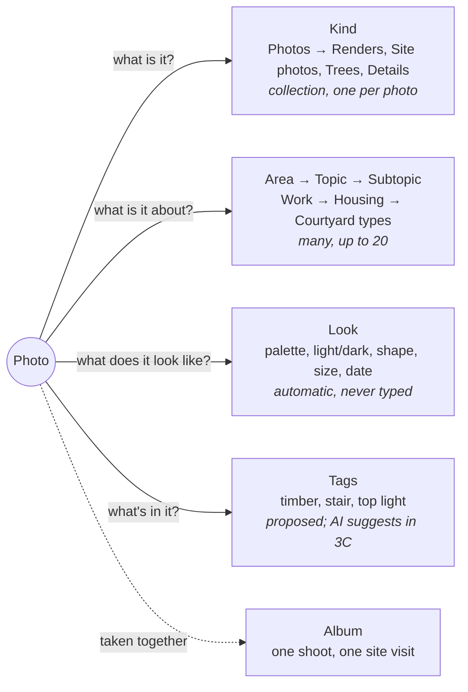

HIGH (a programme of six phases; each phase states its own tier)

# Commonplace photos: an inspiration library, as one system

**For:** the owner, to decide the direction, and the agent who later builds it in `studiolo`.
**Status:** Proposed. Claude, 24 October 2026. Nothing here is approved until the owner says so in the conversation.
**Checked against:** `studiolo` main @ `3c2f744` (24 Oct 2026), read only. Paths below exist on that commit unless marked *new*.
**Builds on:** the owner's notes in Craft, *TBS → Library – polishment Phase* ("collections are data types rather than folders"; "a photo as data type can have multiple sub data types, like site photos, renders, trees"; "collections need a cover or nice colour, similar to mymind"). Also builds on `docs/superpowers/specs/2026-10-23-commonplace-albums-design.md` and `docs/superpowers/specs/2026-10-23-loci-palace-design.md` in `studiolo`.

## 0. In short

Eagle is excellent at one job: you throw a thousand pictures at it and can find, look at and compare any of them in seconds. Its structure is folders. Ours stays **what it is · what it's about · what it looks like**. Commonplace already has the first two. This proposal adds the third, plus an Eagle-grade viewer and wall, and lets photos give Loci a face.

| # | Phase | What the architect or designer gets | Tier | Migration |
|---|---|---|---|---|
| 1 | **The viewer** | Zoom to full resolution, pan, fit / 1:1, full screen, Space to look, a real info panel, copy and download | MEDIUM | no |
| 2 | **The photo wall** | Uncropped photos, three layouts with a size slider, sort and group, colour and shape filters, colour placeholders while loading | HIGH | yes (palette) |
| 3 | **Sorting a pile** | An **Unsorted** view and a keyboard **Sort mode** to tag 200 site photos fast; **Picks**; saved **Views**; import from the web with its source; HEIC | HIGH | yes |
| 4 | **Notes on a detail** | Draw a box on a photo and write a note about that part ("this soffit junction") | MEDIUM | yes |
| 5 | **Photos in Loci** | Each topic and area gets a key picture and a mood strip on the Map; photos appear as small prints in an open Palace room; "Show on Loci" from any photo search | HIGH | yes (topic cover) |
| 6 | **Seeing photos (Phase 3C)** | Searching by what's *in* a photo ("timber stair, top light"), suggested topics and tags, "More like this" | HIGH | yes |

**Why this order:**
- **No data change first.** Phase 1 fixes the thing people feel every time they open a photo, and uses only what exists.
- **Look, then organize.** The wall (2) needs the palette data; sorting (3) builds on the wall's filters and selection.
- **Loci last of the non-AI phases.** It needs Picks (3) to choose good key pictures, and it touches the Palace while P2 is still being designed.
- **AI last**, and already scheduled as Phase 3C in `project-docs/product/mvp-scope.md:212`.

## 1. What exists today (main @ 3c2f744)

| Area | Today | Where |
|---|---|---|
| **Photo item** | `content_items.shape = 'image'`; caption is `description`; one `images` row with `width`, `height`, `taken_at`, `camera`, `group_id`, `group_position` | `src/db/library-schema.ts:30-83`; `src/db/files-schema.ts:31-51` |
| **Sizes** | `original` (re-encoded, ICC only), `display` WebP 2048 px, `thumb` WebP 640 px. Two renderers: sharp on Trigger.dev, and the media Worker (deployed, switched off) | `src/features/files/limits.ts:22-46`; `processing.ts:44-78`; `workers/media/src/ingest.ts` |
| **On ingest** | Orientation, size, date taken, camera. GPS never read. **No colour, placeholder, tags, description or embedding** | `src/features/files/photo-facts.ts`; `processing.ts:112-216` |
| **Card** | Frameless picture + caption. Photos are **cropped** into one of three buckets (3:2, 4:3, 3:4) with `object-fit: cover`. Always the 640 px `thumb`, no `srcset` | `src/features/library/media.ts:114-121`; `src/components/library/card-media.tsx:72-188`; `src/styles/library.css:762-767` |
| **Wall** | Measured CSS-grid masonry, ~260 px columns, 60 per page, infinite scroll. **Newest first only**, no density control. Views: Wall · Shelves | `src/components/library/library-wall.tsx`; `use-masonry.ts`; `search.ts:172` |
| **Filters** | Chips: All, the learner's collections, the types, More ▾; a Topic chip, Area, "Not on a shelf" | `src/features/library/wall-chips.ts` |
| **Search** | ILIKE substring over title, caption, body, topics, notes, group title. Nothing searches what's in a picture | `src/features/library/search.ts:53-85` |
| **Selection** | Select mode, Shift-range, Select all (cap 500). Bulk: Move to collection, Delete. No drag to reorder or to tag | `library-wall.tsx:429-486, 711-751` |
| **Quick view** | Light blurred dialog (D24), grows from the card. Prev/next, thumbs, ← →, swipe. Panel: title, caption, date · camera, topics, collection, margin notes. **No zoom, pan, full screen or download** | `src/components/library/quick-view.tsx`; `quick-view/photo-view.tsx` |
| **Image page** | `display` copy at max 820 px; `cursor: zoom-in` that only opens the quick view; specs line, Download original; group strip swaps in place | `src/components/library/image-page.tsx`; `library.css:905` |
| **Zoom we already own** | The PDF reading room: zoom 50–300 %, desk pan | `src/features/library/viewer-state.ts`; `pdf-pan.ts`; `src/components/library/use-desk-pan.ts` |
| **Organizing** | **Collection** = one type (`image` for photos), at most one per item: this is the owner's "sub data type" (Renders, Site photos, Trees). **Topics** = a tree up to 10 levels, many-to-many through `content_topic_tags`, max 20 per item. **Area** = a root topic, used as a filter. **Album** = a photo group. **Descriptive tags** = proposed only | `library-schema.ts:147-235`; `src/db/topics-schema.ts`; `src/features/library/areas.ts`; `project-docs/architecture/data-model.md:111-117` |
| **Collection identity** | `accent` (three blues) and an optional cover; else the newest member's picture | `src/features/library/collection-view.ts:78-99` |
| **Photos in Loci** | Only the Map's lane: up to 7 cards with 22 px thumbs, and the reader's 44 px strip. Topics and areas have **no** cover, colour or icon. Palace draws no images; planned P2 item marks are plain squares | `src/components/graph/map-node.tsx:199-270`; `src/features/library/limits.ts:31`; `src/components/graph/palace/draw.ts` |
| **Capture** | Add files, drop on the wall, paste, `/photo`; "Separate photos / One group". JPEG, PNG, WebP up to 20 MB; HEIC refused. **No import by URL, no extension, no source link on a photo** | `src/components/library/capture-body.tsx`; `src/features/files/sniff.ts` |

## 2. The model: three questions, never folders

An architect looking for a picture asks one of three things. Each has its own place in the data, and none of them is a container.

| Question | Answered by | Who fills it | Today |
|---|---|---|---|
| **What is it?** | **Kind**: a Photos collection (Renders, Site photos, Trees) | The learner, once per kind; the photo picks one | Exists. Shown as a chip |
| **What is it about?** | **Area → Topic → Subtopic** | The learner; AI suggests in 3C | Exists |
| **What does it look like?** | **Look**: palette, brightness, orientation, ratio, resolution, date taken, camera, source site | The machine, on ingest. Never typed | Partly (size, date, camera). **Palette is new (Phase 2)** |
| **What's in it?** | **Tags**: materials, elements, qualities | The learner; AI suggests in 3C | Proposed in `data-model.md:111` |
| **Taken together?** | **Album** | Chosen on upload | Exists |

Two lightweight additions do the work Eagle's folders and smart folders do, without being containers:

- **Pick** (★): one flag, "this one is a keeper". A designer's pile is 90 % reference noise and 10 % the image that matters. Picks drive key pictures in Loci (Phase 5). *New, Phase 3.*
- **Views**: a saved search, e.g. *Picks · Renders · Housing · warm palette*, pinned in the chip row. A View holds no photos, only a question, so a photo can never be "in the wrong view". This is the answer to "searched for later easily". *New, Phase 3.*

**Group by** turns any of the three questions into sections on the wall (by area, topic, kind, month or colour). That gives the browsing feeling of folders while every photo stays in one place.

## 3. Phase 1: the viewer (MEDIUM, no migration)

**Goal:** opening a photo feels like Eagle or Lightroom: instant, sharp at any zoom, nothing in the way.

**Zoom and pan, in the quick view and on the image page**
- Wheel or pinch zooms around the cursor; drag pans. Double-click or **Z** toggles *Fit ↔ 100 %*. **+ / − / 0** step zoom and reset.
- A small zoom readout ("Fit", "100 %", "240 %") sits in the stage corner on `--media-control`.
- **Resolution follows zoom.** Show `display` (2048 px) until the shown size exceeds it, then swap in `original` with no flash (keep the `display` copy underneath until the new one decodes). No new variant, so no extra Images transformations.
- Reuse the PDF room's zoom state and desk pan (`viewer-state.ts`, `use-desk-pan.ts`) rather than writing a second one.
- The image page's `cursor: zoom-in` (`library.css:905`) becomes true: a click zooms in place.

**Full screen (F)**
- The stage fills the screen and the panel hides; ← → and the thumbs still work; Esc steps back.
- Background: see decision **PH-D1**. D24 chose the light blurred quick view; full screen is where a dark mat earns its place for judging renders.

**Space to look**
- On the wall, **Space** opens the focused card in the quick view and Space closes it, as in Eagle and macOS Quick Look. Arrow keys keep moving focus on the wall underneath.

**Info panel, made useful**
- Today's title, caption, topics, collection and margin notes stay as they are.
- Add a **facts block**: W × H and megapixels, ratio (e.g. "3:2"), file size and type, date taken, camera.
- Add **Copy image** (to the clipboard, for dropping into Miro, InDesign or a deck), **Download original** (in the quick view too, closing the gap noted in `library.md:156`), and **Copy link**.

**Done when:** a 6000 px render can be inspected at 100 % in the quick view and on the page; Space-look works from the wall; reduced motion still settles at once; the keyboard hint in the panel lists the new keys.

## 4. Phase 2: the photo wall (HIGH, migration)

**Goal:** a wall of 2,000 photos you can actually scan, in their true shapes.

**A Photos mode for the wall**
When the type chip is **Photos**, or a Photos kind (Renders, Site photos) is chosen, the wall switches into Photos mode. Mixed walls (notes, sources and photos together) keep today's look.

| Control | Options | Notes |
|---|---|---|
| **Layout** | **Rows** (justified, like Eagle / Flickr) · **Masonry** (today's, but uncropped) · **Grid** (square crops, for fast scanning) | Rows is the default for Photos mode: every photo keeps its shape, edges line up, nothing cropped |
| **Size** | A slider (about 120–480 px row or column), plus **Ctrl + / Ctrl −** | Remembered per account in localStorage. Above ~320 px CSS (640 px on 2× screens) cards use `display` through `srcset`, so no new variant is needed |
| **Sort** | Newest · Oldest · Date taken · Colour · Shape (wide → tall) · Resolution · Title · Shuffle | Shuffle gives a fresh mix on each visit, for inspiration |
| **Group by** | None · Area · Topic · Kind · Month taken · Colour | Section headers on the wall, collapsible |
| **Captions** | Show · Hover · Hide | Hide gives a pure picture wall |

**Uncropped**
- In Photos mode a card takes its photo's real ratio instead of the three buckets (`aspectClass`, `media.ts:114`). Very tall or very wide photos are clamped to 1:3 and 3:1 so a panorama can't take over a row.

**New filters, in Photos mode only**
- **Colour**: a swatch row (about 12 hues plus black, white and grey) and a "pick a colour" input. A photo matches when one of its palette colours is close (ΔE in Lab space).
- **Shape**: Landscape · Portrait · Square · Panorama.
- **Light**: Light · Dark (from the palette's mean lightness).
- **Size**: "At least 2000 px", for print work.
- **Unsorted**: photos with no topic (see Phase 3).
- All filters AND with today's chips, topic, area and search (`search.ts:101-152`).

**While loading: the photo's own colour**
- Each card's mat shows the photo's dominant colour until the thumb fades in, instead of grid paper. The wall reads as the right picture before it arrives. This fits "content is not tinted" (`interface.md:150`): it is the content's own colour, shown for content.

**Data (migration)**

*New* columns on `images`:
- `palette jsonb`: up to 6 entries `{ hex, lab: [L,a,b], share }`, ordered by share.
- `dominant text`: the first hex, for the placeholder.
- `lightness smallint`: 0–100.

*New* index: a btree on `(account_id, width::float/height)` for Shape and ratio sort. Colour search can start as a scan over the account's photos (thousands, not millions). Add a hue-bucket array column with GIN only if measured slow.

How the colours are computed:
- In `processImage` (`processing.ts`), from the already-decoded `thumb` buffer: sharp `stats()` for the dominant colour, plus a small k-means (k = 6) over a 64 px resize for the palette. This is pure CPU in the existing task, with no paid service.
- The media Worker path needs the same step; it can read the palette from the 64 px resize the Images binding already makes.
- **Backfill:** extend `scripts/media-backfill.mjs` with a `--palette` mode that reads each `thumb` and fills the columns. Idempotent and resumable.

**Selection, a little further**
- **Lasso**: drag on empty wall to box-select.
- Bulk actions add **Add topics…**, **Set kind…** (today's Move to collection, renamed for photos), **Add to album…**, and **Pick / Unpick** (once Phase 3 lands).

**Done when:** a 2,000-photo account scrolls smoothly in Rows at the smallest size on a mid-range laptop; nothing is cropped in Rows or Masonry; colour filters return the expected photos on a hand-checked set of 50; the backfill has run on the owner's account.

## 5. Phase 3: sorting a pile (HIGH, migration)

**Goal:** an architect back from a site visit with 200 photos, or a designer who saved 40 references this week, can make them findable in minutes, not never.

**Unsorted**
- A built-in View: photos with no topic, oldest first. Its count shows on the Photos chip ("Photos · 38 unsorted"). This is the inbox. Nothing forces sorting (`library.md:93`: no organization choice blocks saving), but it stays visible.

**Sort mode**
- Opened from Unsorted, or from any selection. One photo large, the next ones in a strip.
- Keys:
  - **1–9**: the learner's recent and suggested topics, shown as numbered chips; **T** opens the full topic picker.
  - **K**: set kind (Renders, Site photos…).
  - **P**: Pick.
  - **A**: add to the current album.
  - **→**: next; **Backspace**: undo the last change.
- **Apply to the rest of the album**: one key gives the whole shoot the same topics (this also answers AL-D1 for the common case, without forcing it).
- In 3C the numbered chips become AI suggestions; the gesture doesn't change.

**Picks**
- *New* column `images.picked_at timestamptz null`. Shown as a small ★ on the card (Hover captions) and in the info panel. A **Picks** chip appears once any exist.
- One flag, not stars: see **PH-D2**.

**Views (saved searches)**
- *New* table `library_views`: `id, account_id, name, query jsonb, layout jsonb, position`.
- `query` is exactly today's `WallQuery` plus the new filters. `layout` holds Rows / Masonry / Grid, size, sort and group.
- Pinned Views sit in the chip row after the collections. A View can also be pinned to **Today** later.

**Capture from the web, keeping where it came from**
- Drag an image from another browser tab onto the wall: the drop carries a URL, not a file. The server fetches it, using the same SSRF-safe path as link previews (`src/features/links/preview-image.ts`), and runs the normal ingest.
- Paste an image URL into the composer: the same.
- *New* columns `images.source_url text`, `images.source_title text`: shown in the info panel as "From archdaily.com ↗", searchable, and filterable by site. Attribution matters to designers.
- **HEIC**: accept it and convert to JPEG. Prebuilt sharp can't decode HEIC (no HEVC codec), so either convert in the browser before upload (a WASM decoder such as `libheif-js`, or the browser's own decoder in Safari) or add a decoder to the task. Choose in the phase spec; `library.md:134` notes the iPhone path is unverified.
- A browser extension and a share target are later work, not this phase.

**Done when:** 200 photos can be given topics in under 10 minutes with the keyboard alone; a dragged web image keeps its source link; Views survive reload and show live counts.

## 6. Phase 4: notes on a detail (MEDIUM, migration)

**Goal:** "this junction", "this light", "this planting edge": a note about *part* of a photo.

- In the viewer, **N** or the *Note on a detail* button lets the learner drag a box on the photo, then write. The note is today's canonical margin Note (`about_id` = the photo); it just also has a region.
- *New* column on `content_items`, or a *new* side table `note_regions(item_id, x, y, w, h)` with fractions 0–1 of the original, so it survives every size. A side table keeps `content_items` untouched; recommended.
- The viewer shows the boxes as numbered outlines (toggle **R**); hovering a note lights its box, and clicking a box scrolls to its note. Zoom and pan keep the boxes in place.
- The detail can be cut out as its own **crop**: a *new* Photo item made from the region, linked back with `depicts`-style provenance. That crop then takes topics and kinds like any photo. (Optional within the phase.)
- Region notes show in Loci as ordinary "Note on" links (Palace spec, edge types).

## 7. Phase 5: photos in Loci (HIGH, migration)

**Goal:** the graph stops being a diagram of words. A topic you've collected 80 pictures for *looks* like them, and the photo library and the knowledge map feed each other.

Three rules from the existing designs hold throughout:
1. **No recolouring of nodes.** Status colours stay (owner decision D-2, Palace spec :433).
2. **Nothing fills the scene before you open it.** Palace anti-goal (spec :46).
3. **Calm reading surfaces, a visually rich graph** (`interface.md:17`). Photos are allowed to be the richness, in measured places.

**Key picture for every topic and area**
- *New* column `topics.cover_image_id uuid null`: the learner can set it ("Use as topic picture" in the viewer's ⋯ menu and in the topic inspector).
- When it's empty, use a fallback, the same pattern as collections (`collection-view.ts:78-99`): the most recent **Pick** tagged on the topic or below it; else the most recent photo; else none.
- A *new* pure helper, `topicKeyPicture`, lives in `src/features/topics/` and is unit-tested.

**Map**
- **Focused topic:** the centre disc can show the key picture, clipped round, behind the name. Off by default; a Map setting switches it on (see **PH-D4**).
- **Inspector:** a **mood strip** under the topic's name: the 5 top photos (Picks first) at about 64 px with a "See all 80 photos" link. That link opens Commonplace in Photos mode, filtered to the topic and its subtopics, in Rows.
- **Lane:** today's 22 px thumbs grow to 30 px for photos only, within the same 170 × 30 card (`layout.ts:20-32`).
- **Overview:** hovering an area shows its key picture and photo count in the hover card. Area dots stay deep blue.
- **The topic's palette:** the inspector shows a thin bar of the topic's combined palette, built from its photos' palettes, weighted by share and Picks. Clicking a swatch opens the topic's photos filtered to that colour. The bar describes the topic and never tints the node.

**Palace (fits into P2 rooms, not before)**
- When a room is open and the camera is near, photo items draw as small **prints** (their thumb, about 18–28 px, with a 1 px paper edge) instead of plain `--ink-3` squares. Far away, or with more than 60 items, they stay squares. This is level of detail; it fits the 60-item room cap (spec C-12).
- The rooms read (`GET /api/loci/palace/rooms/:areaId`, spec :368) gains `thumb: { url, w, h, dominant } | null` per photo item.
- Load with `createImageBitmap` from the signed `thumb` link once per room, and keep the bitmaps for the room's life. The canvas never reads pixels back, so a cross-origin taint is harmless. Signed links last 15 minutes (`files/limits.ts:13`): refresh on room reopen.
- Performance stays within the spec's budget: at least 50 fps at 2,000 topics on a mid-range laptop, and the loop sleeps when still (`loop-policy.ts`). Until a print's bitmap arrives, its `dominant` colour fills the square.
- A photo tagged on several topics already settles between them (spring rule, spec :125-137). Seeing those bridge photos as prints is the most "system" moment: you see *why* two topics belong together.

**Show on Loci**
- From any photo search or View in Commonplace (e.g. *colour: terracotta · tag: brick*), **Show on Loci** opens the Map or Palace with the topics that hold matching photos highlighted (a ring, the same treatment as My Focus but solid) and the rest dimmed. It is the reverse of "See all 80 photos". Each side leads to the other.

**Done when:** every topic with photos shows a key picture in the inspector; the mood strip opens the right filtered wall; an open Palace room with 60 items draws prints within the frame budget on the owner's laptop and iPhone; Show on Loci highlights the right topics on a hand-checked search.

## 8. Phase 6: seeing photos (Phase 3C, HIGH)

Already in MVP scope (`mvp-scope.md:133, 142, 212`). This proposal only shapes how it lands on the photo system.

- **Description and tags on ingest:** a vision model writes a short description ("Timber stair with a roof light, white walls") and suggests **tags** (materials, elements, qualities) and **topics** from the learner's own tree. The learner owns the result: suggestions show as dashed chips in Sort mode and the info panel until accepted. Enrichment never creates topics (`mvp-scope.md:125-130`).
- **Search by meaning:** the description and tags join the planned hybrid lexical and semantic index (`data-model.md:319-321`), so "courtyard with deep shade" finds photos with no caption at all.
- **More like this:** the planned route is a text embedding of the description, with no pixel similarity (`tech-stack.md:307`). For a designer, "looks like this" matters as much as "is about this". See **PH-D5**.
- **Lumens:** photos are explained from general knowledge today (`ai.md:114`). Once descriptions exist, a Lumen made from a topic can name and show the learner's own photos. Learn owns that design; it is noted here only.

## 9. Decisions for the owner

| ID | Question | Recommendation |
|---|---|---|
| **PH-D1** | Full-screen viewer background: keep the light blurred look of D24, or a dark neutral mat for full screen only? | **Dark mat in full screen only** (`--surface-mat` dark value, untinted). Renders and site photos are judged better on dark; the everyday quick view stays light |
| **PH-D2** | Picks: one flag, or a 1–5 rating like Eagle? | **One flag.** Faster in Sort mode, and enough to drive key pictures. Ratings can come later if asked for |
| **PH-D3** | Default wall layout in Photos mode: Rows, Masonry or Grid? | **Rows.** It is the only layout that shows every photo whole *and* lines up |
| **PH-D4** | Should a focused Map topic show its key picture in the centre disc by default? | **No, a setting, off by default**, until it has been seen on real topics; the mood strip in the inspector carries the idea safely |
| **PH-D5** | "More like this" by look as well as by meaning: allow an image embedding (CLIP-like) in 3C, against `tech-stack.md:307`? | **Yes, revisit in 3C.** It is the feature designers come to Eagle-like tools for; cost and model choice decided then |
| **PH-D6** | Adopt descriptive **Tags** (the proposed `descriptive_tags`) as the fourth axis, learner-typed before AI arrives? | **Yes, but in Phase 3, not before.** Topics carry "about"; tags carry "what's in it" (timber, stair). Mixing them would bloat the topic tree |
| **PH-D7** | Names: *Kind* for a Photos collection on screen, *Views*, *Picks*, *Unsorted*, *Sort mode*? | **Yes.** Collections stay "collections" everywhere else. Inside Photos, "kind" says what the owner meant by "sub data type" |
| AL-D1 (existing) | Do an album's photos share topics? | Leave per photo, and add Sort mode's **Apply to the rest of the album** |

## 10. Rules carried over

- **Names:** the screens say **Commonplace** (library), **Loci** (graph, Map, Palace), **Lumens**. Code keeps `library`, `graph`, `palace`.
- **The prototype and `interface.md` rule.** Fonts (`--ui` Instrument Sans, `--read` Newsreader), tokens, frameless picture cards, panels, ghost transitions. New controls use the existing toolbar and chip patterns. A Rows layout and a dark full screen are visual departures, and need the owner's explicit yes (PH-D1, PH-D3).
- **Motion:** only transform and opacity animate; reduced motion settles at once; no continuous cosmetic motion.
- **Files:** `graph-workspace.tsx` is pinned by `lint:size` (`scripts/file-size-baseline.json:4`), so Loci work goes in new files. Pure logic (palette match, justified rows, key picture) goes in `src/features/…` with unit tests.
- **Switches:** one per phase in `src/config/*.ts` (`PHOTO_VIEWER`, `PHOTO_WALL`, `PHOTO_SORT`, `PHOTO_REGIONS`, `LOCI_PHOTOS`), testers first.
- **Cost:** no new image variant in any phase. Palette and HEIC are CPU work in the existing task. The Cloudflare Images free plan (5,000 transformations a month) is untouched.
- **Paperwork:** a phase spec per phase in `studiolo`'s `docs/superpowers/specs/`, with its tier on line one; guides in `project-docs/` updated on the same branch; migrations hand-written in `drizzle/` and applied only with the owner's word.

## 11. What this is not

- **Not folders.** Nothing in this proposal holds a photo except its one kind and its album, both of which exist today.
- **Not an editor.** No crop-and-save over the original, no filters, no retouching. Crops in Phase 4 are new items; originals are never changed.
- **Not a DAM for a studio team.** One person's library. Sharing a View or a mood board with a client is a good later idea, and is left out.
