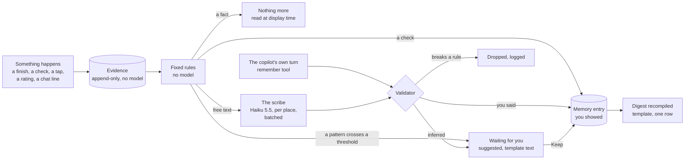

HIGH (a design system across Settings, Loci, Learn and every AI surface; it needs migrations and the owner's decisions in §13)

# Learner memory: one map, five layers, and the Settings that show it

**For:** the owner, to decide; then the agent building learner context in `studiolo` (Stage 4's "Instructions for Loci, app-maintained editable memory entries and their default-on toggle, bounded evidence and context selection").
**Status:** Proposed. Claude, 24 October 2026. Nothing here is approved until the owner says so in the conversation. An agent recommendation is not approval.
**Checked against:** `studiolo` main @ `3c2f744` (24 Oct 2026), read only. Paths below exist on that commit unless marked *new*.
**Builds on, and must not contradict:**
- [`project-docs/product/mvp-scope.md` → Learner context and personalization](https://github.com/ahmedste/studiolo/blob/main/project-docs/product/mvp-scope.md#learner-context-and-personalization) (agreed scope: three layers, memory on by default, no hidden profile);
- [`project-docs/architecture/course-engine.md` §6](https://github.com/ahmedste/studiolo/blob/main/project-docs/architecture/course-engine.md#6-learner-model) (the proposed Learner Model: concept levels, learning records, the learner card);
- [`project-docs/architecture/data-model.md` → Learner context and explainer records](https://github.com/ahmedste/studiolo/blob/main/project-docs/architecture/data-model.md#learner-context-and-explainer-records);
- [`project-docs/design/interface.md` → Learner instructions and memory](https://github.com/ahmedste/studiolo/blob/main/project-docs/design/interface.md#learner-instructions-and-memory);
- Craft, Studilo space: *Learner context & Memory*, *AI BRain*, *Settings & Onboarding*, *Copilot*, *Features & Ideas* ("Agent layers: learning flows up topic to area to map, skill profiles per area", Ahmed), *Library - polishment Phase* (the owner's notes of 10 Oct), *Vision & Principles* (read 24 Oct 2026).

**Prototype:** [`prototypes/settings-memory/`](../../../prototypes/settings-memory/README.md), the Settings tabs and the memory map on Studiolo's real shell and styles.
**System reference (diagrams):** [`2026-10-24-learner-memory-system-reference.md`](2026-10-24-learner-memory-system-reference.md): every Save, Call and Edit step, its tables, its cost and its tests.

## 0. In short

Studiolo should feel like it knows you: what you're new to, what you already do every day, what you got wrong last week, and how you like things explained. To get there without a hidden profile and without sending the whole account to the model every time, memory is organised **the same way as your map**.

**One map.** Every place on your Loci map (You, an area, a topic, a sub-topic) can hold a small **card**: what Loci knows about you *there*. A card has fixed slots (your level, why you're learning it, what you're working on, what you know, what to revisit, how you like it taught, your words). When you're on *Precast*, Loci reads the Precast card in full, a line from each card above it (Facade systems, Envelope & Facade, You), and nothing from Law or Cooking.

**Five layers.** Only the first three are things a person thinks about; the last two are plumbing.

| # | Layer | Who writes it | You see it | You change it | Loci reads it |
|---|---|---|---|---|---|
| 1 | **Profile**: name, time zone, what you do, language | You | Settings → Profile | Yes | What it needs (never your name in a Lumen brief) |
| 2 | **Instructions**: how you want to be taught, in your words, for everything or for one topic | You | Settings → Learning, and on the topic | Yes | Always, and it **wins** over memory |
| 3 | **Memory**: what Loci noticed, as cards on your map | Loci (and you) | Settings → Memory, and on the topic | Edit, delete, or turn it all off | When memory is on |
| 4 | **Evidence**: what happened (watched, answered, said, saved) | The app, automatically | Behind **Why?** on any memory | No (it's the record), but deleting a memory stops it being used | Only through a memory that cites it, plus plain counts |
| 5 | **Working copies**: compiled digests and caches of layers 1–4 | The app | No | No | Yes: they are layers 1–4, pre-shortened |

**The one rule for what's hidden: any sentence about you that Loci reads, you can read.** The app may keep raw records, numbers worked out from them by fixed rules, and shortened copies, out of sight. It may never keep a judgement about you that you can't see, correct or delete. That is already the agreed scope ("They must not become a separate hidden learner profile"); this design makes it testable (§4.3).

**Cheap to read and write.** A card is compiled into a short digest when it changes, not when it's read, so assembling Loci's context is one query and no model call. The slice is about **350–700 tokens** (today's learner line is about 30), and a conversation sends it once, not every turn. Fixed rules handle facts, checks, taps and ratings; a small model reads only the learner's own free text. All of it comes to about **US$0.05 per active learner a month** ([system reference §7](2026-10-24-learner-memory-system-reference.md#7-what-it-costs)).

**Shows little.** The learner sees exactly what Loci reads, and the token budget is the filter: a few short lines per place, written as sentences. While learning, they see almost nothing about memory, just Lumens that are pitched right. Settings opens on one paragraph about you and one line per area; the detail is one tap away; the records behind it are kept, not shown (§4.4).

**Smart about when.** Loci writes facts on its own, writes what you *tell* it with a visible "Loci will remember…" chip you can undo, and only **suggests** anything it infers. It asks **at most one question a session**, and only when the answer would change what it makes next (§8).

**Settings gets five tabs:** **Profile · Learning · Memory · Usage · Privacy & data** (§9). Learning is what you tell Loci; Memory is what Loci noticed. Topic-level cards are also editable where they belong: on the topic in Loci.

**Build order:** six small steps, M0 (no migration: Settings tabs, onboarding answers moved into Profile) to M5 (Stage 4's quizzes and concept levels feeding the cards) (§12). M1–M3 improve every Lumen format at once, because they all share one brief.

---

## 1. What exists today

Verified on `studiolo` main @ `3c2f744`.

| Piece | State | Where |
|---|---|---|
| **Settings** | One tab, **Profile**: display name and time zone (five zones in a select), saved with a version check; a **Privacy** row under it (analytics consent), shown only when analytics are on | [`src/app/(workspace)/settings/page.tsx`](https://github.com/ahmedste/studiolo/blob/main/src/app/(workspace)/settings/page.tsx), [`src/features/settings/`](https://github.com/ahmedste/studiolo/tree/main/src/features/settings), `destinationSections.settings` in [`destinations.ts`](https://github.com/ahmedste/studiolo/blob/main/src/components/shell/destinations.ts) |
| **Appearance** | Light/dark switch in the rail and the account menu, not in Settings | [`account-menu.tsx`](https://github.com/ahmedste/studiolo/blob/main/src/components/shell/account-menu.tsx), [`navigation.tsx`](https://github.com/ahmedste/studiolo/blob/main/src/components/shell/navigation.tsx) |
| **Onboarding answers** | One row per account: field, first interest, purpose (work, career, curiosity, course), level (new, basics, regular, deep). Edited on the map's note card, not in Settings | `studiolo.onboarding` ([`drizzle/0022_onboarding.sql`](https://github.com/ahmedste/studiolo/blob/main/drizzle/0022_onboarding.sql)), [`src/features/onboarding/answers.ts`](https://github.com/ahmedste/studiolo/blob/main/src/features/onboarding/answers.ts) |
| **The learner line** | One or two sentences from those answers, read fresh into every copilot turn (`learner` in `<studiolo_context>`) and every Lumen brief (`Learner: …`). Never says "memory" | [`learnerLine`](https://github.com/ahmedste/studiolo/blob/main/src/features/onboarding/answers.ts), [AI guide → The learner line](https://github.com/ahmedste/studiolo/blob/main/project-docs/implementation/ai.md#the-learner-line-track-2-b3) |
| **Scoped copilot chats** | Map, area and topic chats. The context block carries the topic's path, description, status, My Focus, children, related topics and area outline | [`src/features/copilot/context.ts`](https://github.com/ahmedste/studiolo/blob/main/src/features/copilot/context.ts), [`levels.ts`](https://github.com/ahmedste/studiolo/blob/main/src/features/copilot/levels.ts) |
| **Signals already stored** | Topic status and My Focus (`topics.status`, `want_to_learn`); Lumen viewing (`explainer_views`: position, watched to end); Lumen feedback (`explainer_feedback`: rating, tags, comment); per-topic copilot conversations (`copilot_messages`); the topic journal (`copilot_journal_entries`); item tags with who added them (`content_topic_tags.added_by`) | `drizzle/0004`, `0017`, `0018` |
| **Memory, Instructions, Usage tabs** | Designed in words only ("Stage 4 design extension"); no screens, no tables, no code | [`interface.md`](https://github.com/ahmedste/studiolo/blob/main/project-docs/design/interface.md#learner-instructions-and-memory) |
| **Concept levels, quizzes, learning records** | Proposed for Stage 4 (course engine §6); not built. "Watching is not evidence yet" | [`course-engine.md` §6](https://github.com/ahmedste/studiolo/blob/main/project-docs/architecture/course-engine.md#6-learner-model) |

The old prototype's Settings (`studiolo-design-concept.html`, `#s-settings`) had **Profile · Projects · AI providers · Calendar · Export**. AI providers is BYOK, now deferred. §9.1 says where each of the others goes.

## 2. What's already agreed, and what this design adds

**Kept exactly** (from the agreed scope, the interface guide and Craft):
1. Three layers: learner-written **Instructions**, app-maintained **Memory** of separate editable entries, and **supporting records** the learner doesn't manage.
2. **Instructions win over memory.**
3. Memory is **on by default**, with a short explanation when it ships, and a visible toggle. Off stops creating and updating entries *and* stops using them; it keeps them for reading, editing and deleting.
4. **No hidden profile.** Supporting records "must not become a separate hidden learner profile containing judgments the learner cannot inspect or correct". System data must not be "a hidden route to recreate a learner-corrected or removed memory".
5. Keep **declared knowledge, completed activity and demonstrated understanding** apart. "Completion alone is not mastery."
6. **Topic status stays manual.** Memory never changes status, course structure, published lessons or schedules.
7. Memory entries **are not Graph nodes**, and memory never creates topics.
8. **Broad inference from incidental Library activity or hidden personal traits** is not in the MVP.
9. Onboarding answers **become the first memory entries** when Memory ships (onboarding decision 2).
10. Store **summaries**, not whole chats.

**What this design adds** (each needs the owner's yes, §13):
- **A. Memory is scoped to places on the map.** Entries *attach to* a topic (or to You); they don't *become* nodes. This answers the open grouping question ("Exact grouping labels and boundaries remain to be designed") with the map the learner already owns, and it's the owner's own idea in Craft: "learning flows up topic to area to map, skill profiles per area".
- **B. Instructions can be scoped too.** "Tell Loci about this topic…" on any topic, like a project's instructions file.
- **C. Fixed card slots** instead of free-form entries, so the model can read them cheaply and the learner can scan them.
- **D. Three visible bases on every entry:** *You said*, *You did*, *You showed*, plus *Suggested* for anything inferred and waiting for your yes.
- **E. The one-question rule** and a fixed catalogue of the questions Loci may ask (§8.2).
- **F. "Show the text Loci reads"** on any place: the exact text Loci receives there, as plain text.
- **G. Five Settings tabs** (§9).

## 3. How others do it

*This section summarises the research brief; sources are listed in §14.*

Two kinds of product, two lessons. AI assistants show how to make memory **visible and editable**. Learning products show how to make a learner model **useful**, but they hide it. Studiolo needs both.

| Product | What you see and edit | What's hidden | How it's scoped | What Studiolo takes |
|---|---|---|---|---|
| **Claude** (claude.ai) | Memory as separate **topics** you can view, edit and delete (Settings → Manage memory), or correct in chat; account-wide **Instructions for Claude**; per-Project instructions | How it chooses what to save; ranking | **Account → Project**: a project uses its own memory plus the account's, never another project's; "Use account memory" can isolate it. **Incognito** neither reads nor writes. Sensitive topics aren't saved by default | Separate entries, not one blob. Account plus place layers. A mode that neither reads nor writes |
| **Claude Code** | `CLAUDE.md` files you write; **auto memory** it writes, as plain files you can edit (`/memory`), and `/context` shows what loaded | Nothing important: everything is a file | **By location**: files from the working folder upwards load at start; files in sub-folders load **only when work happens there**. An index of one line per memory (first 200 lines) loads always; detail loads on demand. Each memory has a type and a date | **The closest match to the map.** Load by where the learner is; a short always-on index; detail on demand; hard caps; type and date on every entry |
| **ChatGPT** | Personalisation (name, occupation, "anything else", traits); **saved memories** list (delete one or all); a newer **memory summary** page (June 2026) where you correct facts and say which topics to bring up and when; a **sources** view of which memories shaped an answer | **Reference chat history**: implicit, "not stored or shown in settings the way saved memories are"; background "dreaming" consolidation. Critics call this hard to inspect | Account; **project-only memory**; **Temporary Chat** neither reads nor writes | Show what shaped an answer. Rewrite time-bound facts ("exam on 12 Nov" becomes "had an exam on 12 Nov"). Don't copy the hidden chat-history layer: Studiolo's agreed scope forbids it |
| **Gemini** | Personal context; "past chats" toggle (on by default); connected apps one at a time | Ranking | Account; Temporary Chat | Outside sources are opt-in, one at a time, and named on each answer |
| **Character.ai** | **Pinned messages**, kept word for word; a short memory box | n/a | Per chat | Let the learner **pin a moment** ("this analogy made it click") so it's kept, not summarised away |
| **Duolingo** | Progress, streaks, a proficiency score | All the numbers: half-life regression (recall falls as 2^(−Δ/h)), Birdbrain's predicted chance of a correct answer | Per skill and word | Keep **knowing** and **remembering** apart. Pitch difficulty from evidence |
| **Khan Academy** | **Named levels per skill** that can go down: Attempted, Familiar, Proficient, Mastered (Mastered needs a mixed or later check) | Thresholds | Per skill | A few named levels, never raw probabilities. "Mastered" only after a delayed check |
| **Anki / FSRS** | One setting: desired retention | Difficulty, stability, retrievability per card | Per card | One simple control; the maths underneath |
| **Math Academy** | A knowledge frontier | Practice on an advanced topic gives partial credit to the simpler topics inside it | A hand-built topic graph | Evidence can flow along the graph (later, post-MVP) |

**From research:**
- **Overlay models** put an estimate on each node of a domain graph, which is exactly "a card per place". They can't hold misconceptions, so tutoring systems add a **bug library** per node: Studiolo's `revisit` slot.
- **Open learner models** (Bull and Kay): the learner can inspect, discuss and **negotiate** the model; learners are more motivated when they can see it. Studiolo's suggestions and Q4 are negotiation.
- **Confidence matters.** High-confidence errors are the likeliest to be fixed after feedback (the hypercorrection effect), so they're the best moments to revisit.
- **Cheap memory in prompts** comes from the same few moves everywhere: a small always-loaded core plus on-demand detail (MemGPT/Letta's core blocks, Claude Code's index), explicit **add / update / delete / no-op** write-backs (Mem0), and **consolidation between sessions** (Generative Agents' reflection, Letta's sleep-time agents, ChatGPT's dreaming).

**Rules from law, not taste:** GDPR Article 9's special categories (ethnicity, politics, religion or beliefs, union membership, genetics, biometrics, health, sex life) should never be inferred. The EU AI Act (Article 5(1)(f), in force since February 2025) **bans emotion recognition from biometric data in education**, which covers Live's voice: Studiolo must never read mood from a learner's voice.

**What this design takes, in one line each:**
1. Scope memory **by place**, like Claude Code's folders (§5).
2. Separate **what you write** from **what Loci writes**, and yours always wins (§4).
3. A short core, always loaded, with detail on demand and hard budgets (§6).
4. A basis and a date on every entry (§5.3).
5. Write back as explicit add / update / delete, consolidated between sessions (§7).
6. Show what shaped each Lumen (§8.1).
7. An **off the record** mode that neither reads nor writes (§7.6).
8. A never-infer list, **enforced in code**, not left to the model (§4.2, §7.4).

Where Studiolo deliberately differs: no hidden chat-history layer (ChatGPT), no hidden numbers that the learner can't see as plain facts (Duolingo), and no statistical knowledge tracing in the MVP (course engine §6.6's "deliberately excluded" stands).

## 4. The model: five layers and the hidden-or-visible rule

### 4.1 The layers in detail

1. **Profile.** Name, time zone, what you do (the onboarding field, editable here from M0), language of lessons (English only for now, `locale` already exists in briefs), units and spelling (metric, British). Facts you set.
2. **Instructions.** Your words, which Loci follows. Two forms of the same thing:
   - **Learning preferences**: structured controls (default format, length, depth, examples from my field, checks). Cheap to read and easy to change.
   - **Instructions for Loci**: free text. **About me**, **How I like to be taught**, and per-topic **notes for Loci** ("In Law, use UK cases"; "On Precast, I'm the project architect, not the engineer").
3. **Memory.** Cards on the map (§5). Each entry is short, has a basis and a date, and can be edited or deleted on its own.
4. **Evidence.** Append-only records of what happened: a Lumen finished, a Live "simpler" tap, a check answered, a sentence in a chat, a rating. It's how a memory can say **Why?**, and how rules can be replayed safely when they change (course engine §6.1).
5. **Working copies.** Each card's compiled digest, the ancestor chain cache, the per-run context snapshot (already planned in the data model). Rebuildable at any time from layers 1–4; they never add a claim.

### 4.2 The hidden-or-visible rule

> **Any sentence about you that Loci reads, you can read, at the place it applies, with its reason.**

So the app may hold out of sight:
- **raw records** (layer 4), visible on demand behind **Why?**;
- **numbers from fixed rules** (counts, dates, the course engine's concept levels and review dates), shown as plain facts wherever they're used ("2 Lumens finished here", "due for a quick check on Thursday");
- **compiled copies** (layer 5).

And it may never hold:
- a **judgement** about you (your level, a weakness, a preference, a trait) that isn't a visible memory entry;
- anything about **health, religion, politics, sexuality, ethnicity, finances, family or emotional state**, even if a chat touches it. Studying a subject never implies a trait: learning *Islamic architecture* says nothing about faith; learning *Parenting* says nothing about having children, unless you *say* so, and then it's a *You said* entry you can see;
- a "real" level the learner can't see, kept beside the one they corrected;
- anything read from **how you sound or look**: no mood, stress or confidence from Live's voice (the EU AI Act bans emotion recognition in education, §3).

If you *write* something personal into your own Instructions, that's yours, and Loci follows it; it just never infers or files it.

**The test** (for the implementing agent; one integration test per surface): take any context snapshot; every claim in its learner slice must map to a visible entry, an instruction, a profile field, or a fact shown on screen. A sentence that doesn't is a defect.

### 4.3 Who sees what

| What | Example | Stored as | Loci reads | You see it | You change it | Where you manage it |
|---|---|---|---|---|---|---|
| Name | Ahmed | Profile | Copilot and Live greetings only; never in Lumen briefs (as today) | Yes | Yes | Settings → Profile |
| What you do | Architect, 8 years in practice | Profile (from onboarding) | Everywhere | Yes | Yes | Settings → Profile |
| Learning preferences | Watch first; short; examples from my field | Instructions (structured) | Everywhere | Yes | Yes | Settings → Learning |
| About me / How I like to be taught | "Diagrams before text. Define jargon once." | Instructions (text) | Everywhere | Yes | Yes | Settings → Learning |
| A note for one topic | "On Precast I'm the architect, not the engineer" | Instructions (scoped) | On that topic and below | Yes | Yes | On the topic, and Settings → Learning |
| Your level in a topic | Basics in Precast | Memory (*You said* or *You showed*) | On that topic and below | Yes | Yes | On the topic, and Settings → Memory |
| Something to revisit | Thermal bridging at panel fixings | Memory (*You showed*) | On that topic | Yes, labelled **To revisit** | Delete or mark understood | On the topic, Settings → Memory |
| What you've seen | "Precast joints" finished | Evidence, shown as a fact | Titles only, on that topic | Yes, as **Seen here** | Hide one from Loci | On the topic |
| A Live tap | "Simpler" three times in Structures | Evidence | Never directly; only via a memory it supports | Behind **Why?** | No, but deleting the memory drops it | n/a |
| An inferred pattern | "You often ask for simpler in Structures" | **Suggested** memory, waiting | No, not until you say yes | Yes, in **Waiting for you** | Keep, edit or dismiss | Settings → Memory, and a chip in context |
| Concept levels (Stage 4) | `retrieved` for "load path" | Evidence-derived numbers | As the card's **Known** list | Yes, as **Known** with **You showed** | Delete the entry; the numbers stay as history and stop being used | On the topic |
| Card digests, caches, snapshots | "Precast · basics (showed) · …" | Working copies | Yes | No, but **Show the text Loci reads** prints the same text | No | n/a |
| Usage | 42% of this month's allowance | Usage ledger | No | Yes | No | Settings → Usage |

### 4.4 Show less: what the learner sees, and what's kept

The risk with an honest memory is a wall of information. The answer is one rule, plus four depths.

> **The read set is the show set, and the budget is the filter.** A learner can see every line Loci reads, and nothing else. Loci reads only a few short lines per place (§6.1's budgets), so there are only a few short lines to show. Everything else is a record, kept out of sight.

| Depth | Where | What the learner sees | How much |
|---|---|---|---|
| **1. Felt** | While learning: Lumens, chats, Live | Nothing *about* memory. Lumens and replies are simply pitched right. At most three small signs: a **For you** tag on a Lumen (tap: one sentence and **Too basic · Too advanced**), a one-line **Remembered: …** with **Undo** when you told Loci something about yourself, and one question per session | A few words, rarely |
| **2. Glance** | Settings → Memory as it opens; one line on a topic's panel in Loci | **About you**: one paragraph of up to three sentences. **By area**: one line per area that has something ("Envelope & Facade · regular, for work"). **Waiting for you**: at most three | Seconds to read |
| **3. Open** | Tap an area or topic | That place's notes as short sentences, each with a faint source ("you said", "from a check") and a **⋯** menu (Why?, Edit, Delete); the **level dial**; your note for Loci; **Show the text Loci reads** | On purpose only |
| **4. Kept** | Nowhere as such | Evidence rows, the scribe's runs, digests, tombstones, hashes, snapshots, token sizes, counts and the course engine's concept numbers | Never shown; reachable only as a plain sentence behind **Why?** |

**The display rules** (for every memory screen):
1. **Sentences, not fields.** Slots are for the machine. The learner reads "You know the basics here, for work on the prayer hall", not `level: basics · why: work`.
2. **No empty rows and no zeros.** A slot with nothing in it isn't drawn. A place with nothing isn't listed.
3. **Don't repeat what's on screen elsewhere.** Seen-here, topic status and My Focus are already in Learn and on the map. A card says once, "Loci also reads your status here and what you've seen", and doesn't list them.
4. **Sources in one word, details on request.** "you said", "from a check", "you agreed". The evidence is behind **Why?**, in one or two plain sentences.
5. **Three waiting, at most.** In Settings, the three newest suggestions; in context, one per session.
6. **No technical words.** Never *token, slice, digest, evidence, basis, scribe, confidence, snapshot* on a learner's screen.
7. **Caps match the budget.** A slot shows at most what the slice reads (§5.2's maximums); "and 2 more" opens the rest.
8. **Builder detail stays with builders.** Token sizes and the raw slice live in a **Builder** view (dev specimens, owner accounts), not in Settings. Learners get **Show the text Loci reads** as plain text, no numbers.

**What the learner can steer** is short on purpose, highest leverage first:
1. **The level dial** on any place: New · Basics · Regular · Deep. It's the single biggest lever on every Lumen and reply there.
2. **Too basic · Too advanced** on a Lumen. It's the same lever, pulled in the moment.
3. **Instructions**: two boxes in Settings → Learning, and a note on any topic.
4. **Keep · Dismiss** on what's waiting.
5. **Edit · Delete** any line; **Forget this place**.
6. **Memory on/off** and **Off the record**.

Everything else is Loci's job, and the learner never has to manage it.

## 5. The memory map: cards that follow the graph

### 5.1 Places

Memory has the same shape as the map, and uses the map's own ids:

```text
You                          (the account: who you are and how you learn, everywhere)
├── Envelope & Facade        (an area: a top-level topic)
│   └── Facade systems       (a topic)
│       └── Precast          (a sub-topic: any depth up to the map's 10 levels)
├── Culture & Context
│   └── Climate-responsive design
└── Structures
```

- **A card exists only where something is known.** Most topics have none and simply inherit from above. An empty map has one card: **You**, seeded from onboarding.
- **Entries attach to a place; they never create one.** Something Loci learns that has no place on the map (you're working on a hospital competition) goes on **You**. If it deserves a topic, Loci proposes one through the copilot's normal ghost-topic path, which the learner keeps or dismisses.
- **Related topics** aren't parents, so nothing inherits across them; a related topic's **headline** (one line) can be read for analogies (§6.1).

### 5.2 The card

Every card has the same slots, so the model always knows where to look and the learner can scan any card in seconds. Slots are optional.

| Slot | Shows as | Kind | Max here | Bases allowed | Example on *Precast* |
|---|---|---|---|---|---|
| `level` | **Where you are** | one of `new · basics · regular · deep` (onboarding's four, so one vocabulary everywhere) | 1 | said, showed | Basics *(You said, 12 Oct)* |
| `why` | **Why you're learning it** | `work · career · curiosity · course` + an optional line | 1 | said | Work: "the prayer hall's precast envelope" |
| `working_on` | **Working on** | short line | 3 | said | Mihrab panel joint, coordinating with the precaster |
| `known` | **You know** | short phrases; concept ids in Stage 4 | 8 | said, showed | Panel joints; tolerances |
| `revisit` | **To revisit** | a misconception, gently put | 3 | showed | Thermal bridging at fixings *(a check on 14 Oct)* |
| `prefer` | **How you like it here** | short line | 5 | said, (did → suggested) | Sections before photos |
| `words` | **Your words** | term + definition + "avoid" list (course engine §6.5) | 8 | said, showed | "Reveal", not "return" |
| `seen` | **Seen here** | Lumen, Listen, Read, course lesson titles | 5 newest | did (facts, not entries) | "Precast joints" (finished) |
| `headline` | the card's first line | compiled, ≤ 25 words | 1 | derived | "Basics, for work on the prayer hall; knows joints; revisit thermal bridging." |

`prefer` also holds **What clicked**: an analogy or explanation you pinned with **This clicked** in a Lumen or Live session, kept word for word (≤ 280 characters) and never summarised away (Character.ai's pinned messages, §3).

**You** has the same slots, read as "everywhere": `level` is your general experience ("8 years in practice"), `why` your goals, `prefer` your teaching style, `words` your general vocabulary (British spelling).

Every entry stores: id, place (topic id or You), slot, text (≤ 160 characters; `words` ≤ 280), basis, origin (`app | learner`), status (`active | suggested | dismissed | deleted`), created, updated, learner-edited time, version, and its evidence references. That is the agreed "Memory entry" record with three fields added: place, slot and basis.

### 5.3 Bases: how sure, and why

Every entry shows one of these. They are the agreed "declared / completed / demonstrated" distinction, in plain words:

| Basis | Means | Written by | Can it set a level? |
|---|---|---|---|
| **You said** | You told Loci (onboarding, a chat, a chip, Settings) | Immediately, with a visible chip | Yes |
| **You did** | Activity: finished, opened, saved, tapped "simpler" | Facts only; patterns become *Suggested* | **No.** Completion is not mastery |
| **You showed** | Demonstrated: a correct check, a correct answer days later, notes using it correctly | Rules (course engine §6.3) | Yes |
| **Suggested** | Loci's inference from the above, waiting for your yes | The scribe (§7) | Only after you keep it |

### 5.4 Reading down the map: inheritance

When Loci works at a place, it reads that card fully and the cards above it in short. Conflicts resolve like this, first match wins:

1. **What you say right now**, in this message or Live session.
2. **Instructions**, nearest place first (a note on *Precast* beats "About me").
3. **Learning preferences** (Settings → Learning).
4. **Memory**, nearest place first. For a one-value slot (`level`, `why`) the nearest card wins. For list slots, the nearest card's entries come first, then the parents', within the budget.
5. **Profile and onboarding defaults.**

Two consequences that make it feel right:
- Being **deep** in *Envelope & Facade* doesn't make you deep in *Precast* if Precast says **basics**: the nearer card wins.
- A topic with no card **inherits**: a new sub-topic under *Precast* starts at basics, without a question.

When memory contradicts an instruction (you wrote "I'm new to structures"; three checks say otherwise), the instruction still wins, and Loci may ask its one question (§8.2, *Q4*).

### 5.5 Reading up the map: how learning rolls up

The owner's idea, "learning flows up topic to area to map", made safe:
- **Facts roll up automatically**, as facts: an area's card shows "Basics or more in 3 of 7 topics; 6 Lumens finished". These are counts, not judgements.
- **Judgements roll up only as suggestions.** When three or more children of a place agree (three sub-topics at *regular*), the scribe may suggest the same at the parent: "You use Facade systems regularly. Set Envelope & Facade to *regular*?" Never averaged silently.
- **Patterns across areas rise to You as suggestions.** The same preference noticed in two or more areas ("asks for sections and diagrams") becomes a suggested **You** entry, and the per-area copies are folded into it if you keep it.

### 5.6 When the map changes

| Map change | What happens to memory |
|---|---|
| Rename | Nothing: cards follow topic ids. Digests are recompiled. |
| Move | The card moves with its topic; it now inherits from its new parents. |
| Delete | The topic's cards and its sub-topics' cards are deleted with it. The delete confirmation, which already names the Library items whose tags go, also says "and what Loci noted here". (Owner decision M-D6, §13.) |
| Merge (change plans, later) | Cards merge slot by slot; for a one-value slot the learner-edited one wins, else the newer; the plan's preview shows it. |
| A copilot proposal is kept | No card until something is known. |

## 6. Reading memory cheaply: the context slice

### 6.1 The slice

Every AI surface asks one function (*new*: `learnerSlice(account, place, surface)`) for a **slice**: a few compiled lines, never whole cards of the whole map. It replaces the learner line where that line goes today (`learner` in the copilot's `<studiolo_context>`; `Learner:` in a Lumen brief), so the cached prefix doesn't change.

| Part | What | Budget | Read when |
|---|---|---|---|
| **you** | Profile line, learning preferences, About me / How I like to be taught (shortened), **You** card headline and `prefer` | ≤ 120 tokens | Always |
| **path** | One headline per ancestor that has a card, area first; instructions noted on those places | ≤ 25 tokens each, ≤ 100 | At an area or deeper |
| **here** | This place's full card: level, why, working on, known, revisit, prefer, words; its notes for Loci | ≤ 250 tokens | At a topic or area |
| **seen** | Titles of what's been seen here, newest five | ≤ 60 tokens | When making something (a Lumen, a lesson, a Live session) |
| **below** | One line per child with a card: name and level | ≤ 80 tokens | Planning, "what next", Home's goals |
| **related** | Up to three related topics' headlines | ≤ 60 tokens | When making something (for analogies) |
| **rules** | One fixed line: "This is what the learner told Studiolo and what it noted; instructions win; don't mention memory unless asked; don't invent more" | fixed | Always (it goes in the cached system prefix, once) |

**Trimming order** when over budget: `related`, then `below`, then the oldest `seen`, then `path` beyond the area, then list slots in `here` from the end. `you` and the `here` one-value slots are never cut.

### 6.2 What it looks like

At *Precast*, making a Lumen (about 300 tokens):

```text
<learner>
you: Architect, 8 years in practice. British English, metric. Prefers: diagrams before text; define jargon once; short.
path: Envelope & Facade · regular (you said) · for work
path: Facade systems · regular (you showed: 4 checks)
here: Precast · basics (you said, 12 Oct) · why: work, "the prayer hall's precast envelope"
  working on: mihrab panel joint; coordinating with the precaster
  knows: panel joints; tolerances (you showed)
  revisit: thermal bridging at fixings (a wrong check, 14 Oct)
  prefers here: sections before photos
  words: "reveal", not "return"
  note from the learner: "I'm the project architect, not the engineer."
seen: "Precast joints" (finished); "Why precast cracks" (half)
related: Concrete & precast · basics
</learner>
```

At the map (no place selected), the copilot gets `you` plus one line per area with a card (≤ 18 areas, about 15 tokens each). At *Law*, nothing of the above except `you`.

Format: plain labelled lines, not JSON. They take fewer tokens than the same data as JSON (no quotes, braces or repeated keys), read easily for the model, and the same text the learner sees with **Show the text Loci reads** (§9.2). Inside the copilot's JSON block it's one string field; learner text is escaped exactly as the learner line is today (`tagSafeJson`).

### 6.3 Which surface reads what

| Surface | you | path | here | seen | below | related | Note |
|---|---|---|---|---|---|---|---|
| Copilot, map chat | ✓ | | | | area lines | | Plus the `read_memory` tool for depth |
| Copilot, area or topic chat | ✓ | ✓ | ✓ | | ✓ | | `nowLookingAt` gets the focused topic's `here` |
| Make a Lumen (Watch, Listen, Read) | ✓ | ✓ | ✓ | ✓ | | ✓ | Fills the brief's **Learner** and **Already known** rows ([learning forms §1](2026-10-22-learning-forms-and-dialogues.md)) |
| Item Lumen (one Library item) | ✓ | ✓ for the item's topic | ✓ | ✓ | | | No topic → `you` only |
| Live session | ✓ | ✓ | ✓ | ✓ | | ✓ | Passed at connect in `dynamicVariables`, as the learner line is in the [Live design](2026-10-21-live-lumens-voice-design.md) |
| Course planner, lessons (Stage 4) | ✓ | ✓ | ✓ | ✓ | ✓ | ✓ | Replaces course engine §6.6's learner card, keeping its ≤ 150-word rule for `here` |
| Learn Home "Next for your goals", Today | | | `level`, `revisit` only | ✓ | ✓ | | No model call: ranking rules read the cards |

### 6.4 Why it's cheap

- **Compiled on write, not on read.** When an entry changes, its card's digest and headline are recompiled (a template, no model). Reading is: resolve the ancestor chain (already done for the copilot's `path`), fetch the digests for those ids, concatenate. One query.
- **No model call to read memory.** Ever. The scribe (§7) is the only model that touches memory, and it writes.
- **Depth on demand.** The map chat doesn't load every card. The copilot gets a `read_memory(topicId)` tool beside `read_topic`, for "what do I know about Structures?".
- **Sent once per conversation.** The copilot replays its history verbatim, so a slice sent in one turn is still in front of the model in later turns. A turn sends the full slice only when its hash changed or the earlier copy fell out of the replayed history; otherwise `learner: unchanged`. A 20-turn chat carries one or two slices, not twenty ([reference §4.2](2026-10-24-learner-memory-system-reference.md#42-in-a-conversation-send-it-once)).
- **Names and paths are read live.** A digest never holds its place's name, path or neighbours, so a rename or a move recompiles nothing, and an edit recompiles one row ([reference §3.4](2026-10-24-learner-memory-system-reference.md#34-compile-the-one-step-every-save-and-edit-ends-with)).
- **Prompt caching unchanged.** The slice is per-turn data in the user message, where the learner line already is; the six system blocks and tools stay byte-identical. The one fixed `rules` line joins the system prefix once, with a prompt version bump.
- **Snapshot per generation.** Each Lumen or course run records which instructions and entries (ids and versions) it used: the agreed "Learner context snapshot". That's what lets a Lumen's **For you** tag say what it used, later, and lets a deleted entry stay out of future runs.

### 6.5 What it costs

From the app's own [rate card](https://github.com/ahmedste/studiolo/blob/main/src/features/usage/rate-card.ts) (2026-10-16):
- **Reading:** a 500-token slice costs about **US$0.001 per conversation** (Sonnet 5.5 at $2 per million input tokens, sent once) and about **US$0.0016 per Lumen** (Opus 5.5 at $4).
- **Writing:** rules cost nothing. A scribe run on Haiku 5.5 reads about 2,500 tokens and writes about 300: under **US$0.0005**, about ten times a month.
- **In all:** about **US$0.05 per active learner a month**. The [reference's cost table](2026-10-24-learner-memory-system-reference.md#7-what-it-costs) has the assumptions.

## 7. Writing memory: how Loci fills the cards

### 7.1 Signals

| Signal | Exists today? | Can write | Basis |
|---|---|---|---|
| Onboarding answers | ✓ `onboarding` | **You**: field; first interest's place: `level`, `why` | said |
| Settings, chips, "Remember this" | *new* | Any slot | said |
| A statement in a copilot chat ("I already know Revit", "I'm the architect, not the engineer") | ✓ the messages; *new* the tool | The chat's place: `level`, `known`, `working_on`, `prefer` | said, with a chip |
| Topic status, My Focus | ✓ `topics` | Nothing. Read as facts beside the card; never turned into a level | n/a |
| A Lumen, Listen or Read finished | ✓ `explainer_views` (Lumens); reading state *new* | `seen` (fact) | did |
| Live taps: simpler, deeper, from my field, skip, test me | prototype (Live slice 1) | Evidence; repeated patterns → suggested `prefer` or `level` | did → suggested |
| Lumen feedback: rating and tags ("too basic", "too long") | ✓ `explainer_feedback` | Evidence; patterns → suggested `level` or `prefer` | did → suggested |
| A **Check yourself** answer, a quiz, a spaced review | Read's check (prototype); quizzes Stage 4 | `known`, `revisit`, `level` | showed |
| A note on a lesson (Stage 4 note analysis) | Stage 4 | `known`, `words`, `revisit` | showed |
| Library items saved and tagged | ✓ `content_topic_tags` | **Nothing in the MVP** (agreed: no inference from incidental Library activity) | n/a |
| Time of day, session length, typing | n/a | **Never** | n/a |

### 7.2 The pipeline: rules first, a model only for free text



1. **Evidence first, always cheap.** Every signal writes an evidence row (account, place, kind, typed reference, a template summary, time). No model call.
2. **Rules decide most things.** Facts (finished, opened) stop there: seen-here is read from evidence when it's shown. Checks write *You showed* entries by the course engine's rules (§6.3 there). Taps and ratings write a **suggestion with template text** when they cross a threshold ("3 Simpler taps at one place in 14 days"). The thresholds are in the [reference §3.1](2026-10-24-learner-memory-system-reference.md#31-something-happened-every-signal-no-model).
3. **The copilot catches what it hears.** A statement the learner makes about themselves in a chat is written during the turn, through the tool `remember(slot, text)`, as *You said*, with the one-line **Remembered** sign (§8.1). No extra call.
4. **The scribe reads only free text the copilot didn't catch.** A small model (Haiku 5.5, thinking off, a strict tool) runs per place, in batches, on the learner's own chat and Live lines since its last run (as summaries, never whole transcripts), the place's card and its corrections. It returns `add | update | remove | noop`. With nothing new, it isn't called.
5. **The validator** (server, no model) enforces §7.4 for both the copilot and the scribe. It can only drop what they propose, never add.
6. **Recompile** the one digest that changed. The next call reads it.

### 7.3 When the scribe runs

Never on page load, and never for facts, checks, taps or ratings. Free text queues its place in `scribe_queue`, one row per place, due 30 minutes after the last line, so a burst of messages makes one run. A weekly sweep handles roll-ups (§5.5) and **time-bound entries**: a `working_on` older than 60 days becomes a suggestion ("Still working on the mihrab panel?"), and dated facts move to the past tense ("exam on 12 Nov" → "had an exam on 12 Nov"). Both are rules, not model calls.

Memory off: nothing is queued and no rule writes (evidence still records facts, as progress does today).

### 7.4 What Loci may write on its own

| Kind | Example | Written |
|---|---|---|
| A fact | Seen here: "Precast joints", finished | Automatically |
| Something you said about yourself | "I'm the project architect, not the engineer" | Automatically, **with a visible chip and Undo** |
| Something you showed by a rule | Knows: tolerances (a check right twice, three days apart) | Automatically, basis *You showed* |
| A pattern Loci infers | "You ask for simpler in Structures": level → new? | **Suggested only.** Waits in **Waiting for you** |
| A change to something you edited | Changing your "basics" to "regular" | **Suggested only**, and only from evidence newer than your edit |
| Anything sensitive (§4.2), or about other people | "Mentions a difficult client" | **Never** |
| A new topic | "You should add Fire engineering" | **Never as memory.** Only as the copilot's normal ghost proposal |

Hard limits the validator enforces: slot maximums (§5.2); text ≤ 160 characters; at most **five** suggestions waiting per learner at once (the oldest expires); at most one new suggestion per place per week.

### 7.5 Corrections and deletions

These are the agreed rules, made concrete:
- **An edit locks the slot.** A learner-edited entry carries `learner_edited_at`. The scribe may suggest a change only from evidence *newer* than that time.
- **Deleting leaves a tombstone.** A deleted entry keeps its slot, place, a short hash of its text and the deletion time, nothing else. Evidence older than that time can never recreate it. Newer evidence can only *suggest* it again, never write it. A second dismissal of the same suggestion stops it for that place.
- **Delete is not off.** Deleting an entry doesn't disable memory or ban a subject (agreed).
- **History is history.** Deleting a memory doesn't delete the chat, the check or the usage row it came from (agreed). It just stops being *used*.
- **"Forget this place"** on any card deletes all its entries (with tombstones). **"Delete all memory"** in Settings does the same for every place.

### 7.6 Memory off

The toggle reads: **Memory · On**. "Loci notes what you know and how you like to learn, and uses it to pitch Lumens and replies. Turning it off stops new notes and stops using the ones you have. Nothing is deleted; you can still read, edit or delete them here."

When off, Loci uses **Profile, Learning preferences and Instructions**, plus plain facts shown on screen (topic status, My Focus, what's been seen). It doesn't rebuild a substitute from chat history (agreed). When turned back on, it doesn't process the backlog of what happened while off (owner decision M-D4, §13; recommended).

**Off the record** (one chat or one Live session, chosen before it starts, like Claude's incognito and ChatGPT's Temporary Chat): Loci neither reads memory nor writes evidence for it. Profile and Instructions still apply. The chat is kept as a normal chat unless deleted.

## 8. Using memory: the right thing, at the right time, with the right question

### 8.1 Personalisation you can feel, and see when you want to

People feel personalisation when a Lumen lands at the right level, not when they read about it. So the signs are small, and most of the time there's nothing to see (§4.4, depth 1):

1. **For you** on a Lumen: a small tag beside the topic. Tap it for one sentence ("Pitched at basics. Skips joints and tolerances. Uses your prayer hall.") and **Too basic · Too advanced**, each moving the level dial for that place at once, with Undo.
2. **Remembered: …** in a reply: one line, only when you told Loci something about yourself, with **Undo**. Like ChatGPT's "Memory updated", but with the words.
3. **One line on a topic's panel** in Loci, under status and My Focus: *Loci: basics · for work ›*. It opens that place's card (depth 3) in place.
4. **Openings that remember.** A topic chat or Live session may open with one line drawn from `revisit` or `working_on`: "Last time thermal bridging at the fixings was tricky. Two-minute check first, or straight on?" At most once per place per week, and it counts as the session's one question.

### 8.2 The one-question rule

Loci asks **at most one memory question per session**, and only when all three are true:
1. **The answer changes what it makes next** (a Lumen's level, a course's start).
2. **It can't be read from evidence** already there.
3. **It hasn't been asked here in the last 30 days.**

Questions are always chips, with **Skip** (and skipping is remembered, so it isn't asked again soon). The full catalogue:

| # | When | Question | Chips | Writes |
|---|---|---|---|---|
| Q1 | First Lumen, chat or course in an **area with no card** | "How well do you know Structures?" | New · Basics · Use it regularly · Go deep · Skip | `level` at the area, *You said* |
| Q2 | A topic is added to **My Focus** | "What's Precast for?" | For my work · Career change · Curiosity · A course or exam · Skip | `why` at the topic |
| Q3 | Planning a **course** | "Anything you're working on that this should help with?" | free text · Skip | `working_on` |
| Q4 | Evidence **contradicts what you said** (three checks right after "new") | "These came easily. Skip the basics in Structures from now on?" | Yes · Keep as is | `level` (said) |
| Q5 | A **suggested pattern** is ready (from Live taps or ratings) | "You often ask for it simpler in Structures. Start simpler there?" | Yes · No | `prefer` or `level` |
| Q6 | A pattern **in two areas** | "You like sections and diagrams first in two areas. Make that your default?" | Everywhere · Just those · No | `prefer` at You |
| Q7 | You say **"I already know this"** in a chat | "Noted. Want a 1-minute check so Loci can skip it with confidence?" | Check me · No need | `known` (said); a check can make it *showed* |

Q4–Q6 are the in-context form of **Waiting for you** in Settings: the same suggestion, shown where it matters, once. Unanswered, it stays in Settings.

### 8.3 Rules that keep it from feeling creepy

- **Use, don't announce.** Loci doesn't say "I remember that you…" unless you ask or it's §8.1's single opening line. It just pitches right.
- **Never surprise with the personal.** No slot can hold the sensitive kinds in §4.2, so they can't come back.
- **Cite on request.** "Why did you assume that?" always gets an answer: the entry, its basis, and **Edit**.
- **Shared Lumens carry no memory.** A viewer of a shared Lumen sees no **For you** tag, and the share page never shows the snapshot.

## 9. Settings: five tabs

### 9.1 The tabs, and where today's things go

**Profile · Learning · Memory · Usage · Privacy & data**, in the existing `DestinationHeader` tabs (`destinationSections.settings`), each its own route (`/settings`, `/settings/learning`, `/settings/memory`, `/settings/usage`, `/settings/privacy`).

| From | Goes to |
|---|---|
| Today's Profile (name, time zone) | **Profile** |
| Today's Privacy row (analytics) | **Privacy & data** |
| Onboarding answers (field, level, purpose, first interest) | Field → **Profile**. Level, purpose, interest → **Memory** entries (on You and on the interest's topic). The map's note card keeps **Edit**, which opens the same entries |
| The light/dark switch | Stays in the rail and the account menu; also in **Profile** as System · Light · Dark |
| Old prototype: Projects | **Working on** entries in Memory (and "Right now I'm working on…" in Learning) |
| Old prototype: AI providers | Deferred (BYOK). Not shown |
| Old prototype: Calendar | Later, with the learning planning calendar (Today T4): **Learning → Study rhythm** |
| Old prototype: Export | **Privacy & data** |

### 9.2 Each tab

**Profile.** Display name · Time zone (the full list with search, not five) · What you do (the field: chips plus your words) · Years in practice (optional) · Language of lessons (English; more later) · Spelling and units (British · American; Metric · Imperial) · Appearance (System · Light · Dark).

**Learning** (what you tell Loci).
- *Four preferences*: **Start with** Watch · Listen · Read (the Home bar's default) · **Length** Short · Standard · Long · **Quick checks** Often · Sometimes · Never · **Examples from my field** on/off. Depth isn't here: the level dial in Memory does that job per place. Narrator voice and speed live in the player.
- *Instructions for Loci*: two boxes, **About me and my work** and **How I like to be taught** (each ≤ 1,000 characters). Hints in the boxes suggest what helps: experience, goals, pace, what to skip.
- *Notes on topics*: one collapsed line, "Notes on 2 topics ›", opening the list (path, text, **Edit**, **Delete**, **Open in Loci**).

**Memory** (what Loci noticed), in the depths of §4.4.
- *Glance, as it opens*: the toggle (§7.6) as one line; **About you**, one paragraph of up to three sentences with **Change**; **Waiting for you**, at most three, each with one reason and **Keep · Dismiss**; **By area**, one line per area that has something, with its level and why.
- *Open, on a tap*: a place's page (area, then its topics with notes): the **level dial**, the place's lines as sentences, each with a faint source and **⋯** (Why?, Edit, Delete); your note for Loci; **Show the text Loci reads**; **Forget this place**.
- *At the foot, small*: **Off the record** (what it is) and **Delete all memory…** (typed confirmation, as deleting many items in the Library already does).
- Not here: token sizes, the raw slice for every surface, evidence lists, counts. They're in the Builder view (§4.4, rule 8).

**Usage.** This month as a percentage of the allowance (Phase 3D), and what used it (Lumens, chats, Live minutes); until 3D, the tester cap. No per-call log.

**Privacy & data.** Analytics and recordings (today's row) · What Loci never stores (the §4.2 list, in plain words) · Export my data (Library, map, memory, instructions; JSON and Markdown) · Delete my account.

### 9.3 Outside Settings, where memory lives in context

| Where | What |
|---|---|
| Loci, a topic's panel | One line, *Loci: basics · for work ›* (§8.1); opens the place's card in place, with the same controls as Settings |
| Loci, the topic menu | **Tell Loci about this topic…** writes a scoped instruction |
| The copilot reply | **Remembered: …** with **Undo**; at most one waiting question per session, as chips |
| A Lumen's head | A **For you** tag; tap for one sentence and **Too basic · Too advanced** |
| Learn Home and Today | No new UI: "Next for your goals" ranks with `level`, `revisit` and `seen` |
| Onboarding | The note line keeps its words until Memory ships; then its **Edit** opens the You card and the step adds "Loci remembers this. Change it any time in Settings → Memory." |

### 9.4 States

Every tab uses the existing Settings frame (`.preferences-form`, `.field`) and states: saving, saved, conflict (the version check that Profile already has), unavailable, empty (a new account: "Loci hasn't noted anything yet. It starts with what you told it when you joined."), and memory off (the map dims; entries stay editable; the preview shows what Loci reads *without* memory).

## 10. Data model (proposal)

Logical records; they extend the agreed ones in the data model and don't need a table each. All are account-owned, with same-account composite keys, as every private table is.

| Record | Fields | Notes |
|---|---|---|
| `account_preferences` (exists) | + `locale`, `spelling`, `units`, `appearance`, `field_text`, `years_in_practice`, `learning_prefs` (JSON, validated), `memory_enabled` (default true) | One version for conflict checks, as today |
| `learner_instructions` *new* | id, place (topic id or null for You), kind (`about · teaching · working_on · topic_note`), text ≤ 1,000, version, timestamps | Scoped notes cascade with their topic |
| `memory_entries` *new* | id, place, slot, text, basis, origin, status, learner_edited_at, version, timestamps, tombstone hash | The agreed "Memory entry" + place, slot, basis |
| `learning_evidence` *new* | id, place, kind, typed reference (message, explainer, view, attempt, note, journal entry), summary ≤ 200, at | Append-only. Course engine's `Evidence` |
| `memory_entry_evidence` *new* | entry id, evidence id | The agreed "Memory evidence" |
| `memory_digests` *new* (working copy) | place, digest, headline, token estimate, source versions, compiled at | Rebuildable; drop and rebuild at any time |
| `context_snapshots` (agreed) | run, instruction ids and versions, entry ids and versions, memory on/off, slice hash | No transcript text |

Retention (owner decision M-D7): tombstones kept while the account exists; evidence kept with its source (a chat deleted → its evidence goes); snapshots kept with their Lumen.

## 11. Fit with the Learn roadmap and the course engine

- **Learn roadmap** ([`2026-10-23-learn-roadmap-design.md`](2026-10-23-learn-roadmap-design.md)): every phase's Lumen formats share one brief, so M1–M3 improve Watch, Listen, Read and Live at once. Phase 3's comments ("too basic here") are evidence. Phase 5 Live's taps are the best early signal of level and preference.
- **Course engine** (Stage 4): its Learner Model stays the *engine* for concept levels. This design is the *surface*: concept states show up as `known` and `revisit` entries with basis *You showed*, its learning records become those entries, its glossary becomes `words`, and its learner card becomes the `here` part of the slice. Its "deliberately excluded" list still stands: no statistical knowledge tracing, no embeddings, no fine-tuning.
- **Goals**: the owner's choice of 16 Oct ("goals as Library notes the copilot recognises, plus Settings") fits `why` and `working_on`. A goal note can be the evidence for a `why` entry. Goals' own design stays open (L-D, A12).

## 12. Build order

Each step is useful alone. Tiers as in the Learn roadmap.

| Step | What the learner gets | Tier | Migration | Switch |
|---|---|---|---|---|
| **M0** | Settings tabs: Profile (with what you do, full time zones, appearance), Privacy & data; Learning, Memory and Usage as "coming" placeholders hidden behind the switch | LOW | no | `SETTINGS_TABS` |
| **M1** | **Learning**: preferences and Instructions for Loci (global), read into the copilot and every brief beside the learner line | MEDIUM | yes | `LEARNER_INSTRUCTIONS` |
| **M2** | **Memory on You**: the toggle, You card, onboarding answers turned into entries, the copilot's `remember` tool and chip, **Delete all** | HIGH | yes | `LEARNER_MEMORY` |
| **M3** | **Memory on the map**: cards per place, `learnerSlice`, digests, the Glance and Open views, the topic panel line, **Tell Loci about this topic…**, **For you** on Lumens, snapshots, send-once in conversations | HIGH | yes | `LEARNER_MEMORY` |
| **M4** | **Rules and the scribe**: evidence from views, ratings and Live taps; rule-made suggestions, **Waiting for you**, the one-question rule (Q1, Q2, Q4–Q7), roll-ups; then the scribe for free text | HIGH | yes | `MEMORY_SCRIBE` |
| **M5** | **Stage 4**: checks, quizzes and notes write *You showed*; `known`, `revisit`, `words` from the Learner Model; Q3 in the planner | HIGH | yes (with Stage 4) | with Stage 4 |

**Evaluation before M4 ships** (a fixture set, as the copilot and explainers have): 20 scripted learner histories; for each, the expected entries and suggestions. Pass when no sensitive entry is ever written, no deleted entry returns, every slice line maps to a visible source (§4.2's test), and a blind owner review rates the personalised Lumen better than the unpersonalised one in at least 14 of 20.

## 13. Decisions for the owner

| # | Decision | Recommendation |
|---|---|---|
| M-D1 | Memory attached to places on the map (design A), instead of free groups | **Yes.** It's the owner's "learning flows up topic to area to map" and it makes reading cheap. Entries still aren't nodes |
| M-D2 | Fixed card slots (C) | **Yes**, the eight in §5.2 |
| M-D3 | The five Settings tabs and their names | **Profile · Learning · Memory · Usage · Privacy & data** |
| M-D4 | Turning memory back on: process what happened while off? | **No.** Start fresh from the moment it's on |
| M-D5 | The one-question rule and catalogue Q1–Q7 | **Yes**, at most one per session |
| M-D6 | Deleting a topic deletes its cards | **Yes**, named in the delete confirmation |
| M-D7 | Retention: tombstones, evidence, snapshots | As in §10 |
| M-D8 | Onboarding answers: edit in Settings as well as on the note card | **Both**, one record |
| M-D9 | A **For you** tag on every Lumen | **Yes**, hidden on shared Lumens |
| M-D10 | Live taps and Lumen ratings count as evidence | **Yes**, as *You did*, suggestions only |
| M-D11 | Library saves and tags as a memory signal | **Not in the MVP** (as agreed); revisit post-MVP |
| M-D12 | The scribe on Haiku 5.5 | **Yes**, behind the evaluation in §12 |
| M-D13 | Show less: the four depths and eight display rules (§4.4) | **Yes.** Settings opens on one paragraph and one line per area |
| M-D14 | Rules before the scribe: taps, ratings, checks and expiry by fixed rules; the scribe only for free text | **Yes.** Cheaper, and more predictable |
| M-D15 | Send the slice once per conversation | **Yes** |
| M-D16 | Learning keeps four preferences and two instruction boxes; depth moves to the level dial | **Yes** |

## 14. Sources

`studiolo` main @ `3c2f744`, read only: the paths linked in §1, §2, §6.5 and §10. Craft, Studilo space (read 24 Oct 2026): *Learner context & Memory*, *AI BRain*, *Settings & Onboarding*, *Copilot*, *Graph*, *Course engine (long-term)*, *Features & Ideas*, *Library - polishment Phase*, *Vision & Principles*, *Decisions*. Research sources for §3:

- Claude (read directly): [chat search and memory](https://support.claude.com/en/articles/11817273-using-claude-s-chat-search-and-memory-to-build-on-previous-context), [import and export memory](https://support.claude.com/en/articles/12123587-import-and-export-your-memory-from-claude), [personalisation](https://support.claude.com/en/articles/10185728-understanding-claude-s-personalization-features), [incognito](https://support.claude.com/en/articles/12260368-use-incognito-chats), [Claude Code memory](https://code.claude.com/docs/en/memory).
- ChatGPT (from search summaries of the official pages; not fetched directly): [Memory FAQ](https://help.openai.com/en/articles/8590148-memory-faq), [how memory uses past conversations](https://help.openai.com/en/articles/10303002-how-does-memory-use-past-conversations), [dreaming](https://openai.com/index/chatgpt-memory-dreaming/), [traits](https://techcrunch.com/2025/01/09/chatgpts-newest-feature-lets-user-assign-it-traits-like-chatty-and-gen-z/), [project-only memory](https://www.techradar.com/ai-platforms-assistants/chatgpt/chatgpt-project-only-memory-is-live-and-it-might-change-how-you-work-with-ai).
- Gemini and others: [Temporary chats](https://blog.google/products-and-platforms/products/gemini/temporary-chats-privacy-controls/), [personal context](https://9to5google.com/2025/08/13/gemini-personal-context/), [Perplexity memory](https://intercom.help/perplexity-ai/en/articles/10968016-memory), [Character.ai chat memories](https://blockchain.news/news/character-ai-enhances-user-experience-with-chat-memories-feature).
- Learning products: [Duolingo Birdbrain](https://blog.duolingo.com/learning-how-to-help-you-learn-introducing-birdbrain), [Settles and Meeder 2016](https://preview.aclanthology.org/fix_video/P16-1174.pdf), [Khan Academy mastery levels](https://support.khanacademy.org/hc/en-us/articles/5548760867853), [Anki FSRS](https://docs.ankiweb.net/faqs/what-spaced-repetition-algorithm), [Math Academy](https://mathacademy.com/how-our-ai-works).
- Research: [overlay and bug models (ITS survey)](https://arxiv.org/pdf/1812.09628), [SMILI open learner models](https://research.birmingham.ac.uk/en/publications/smili-a-framework-for-interfaces-to-learning-data-in-open-learner/), [hypercorrection](https://pmc.ncbi.nlm.nih.gov/articles/PMC3970786), [Generative Agents](https://arxiv.org/pdf/2304.03442), [Letta memory](https://docs.letta.com/concepts/memory-management), [Mem0](https://arxiv.org/pdf/2504.19413).
- Law: [GDPR Article 9](https://advisera.com/eugdpracademy/gdpr/processing-of-special-categories-of-personal-data/), [EU AI Act emotion-recognition ban](https://fpf.org/blog/red-lines-under-eu-ai-act-unpacking-the-prohibition-of-emotion-recognition-in-the-workplace-and-education-institutions/).

Not verified first-hand: everything about ChatGPT, Gemini, Duolingo and Khan Academy came through search summaries, because the research fetcher couldn't reach those sites. Exact current labels in ChatGPT's settings, and some reported figures, may differ.
