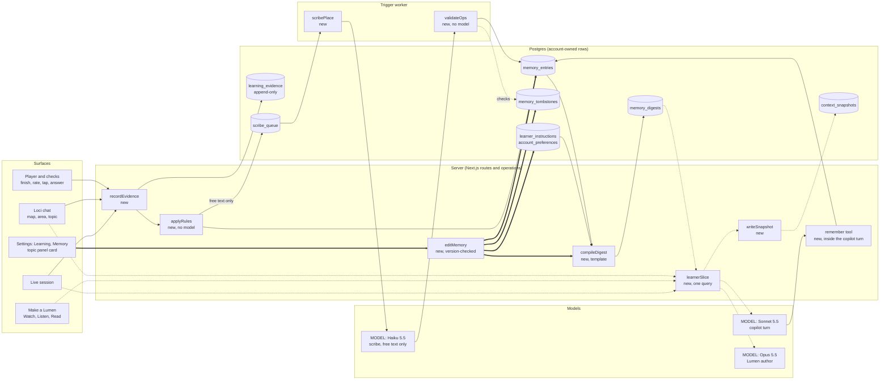
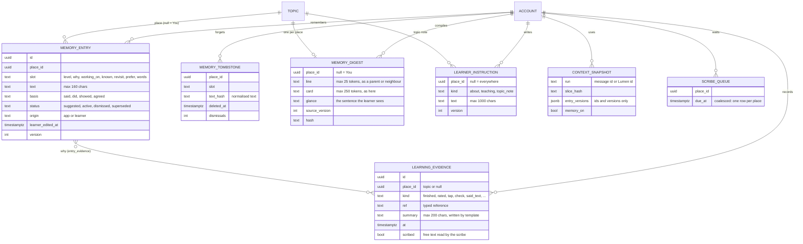
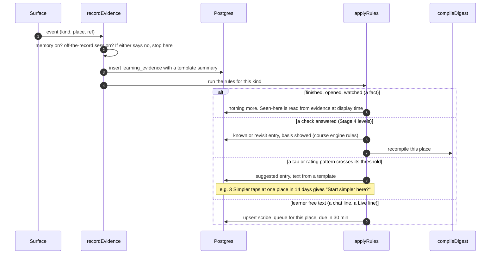
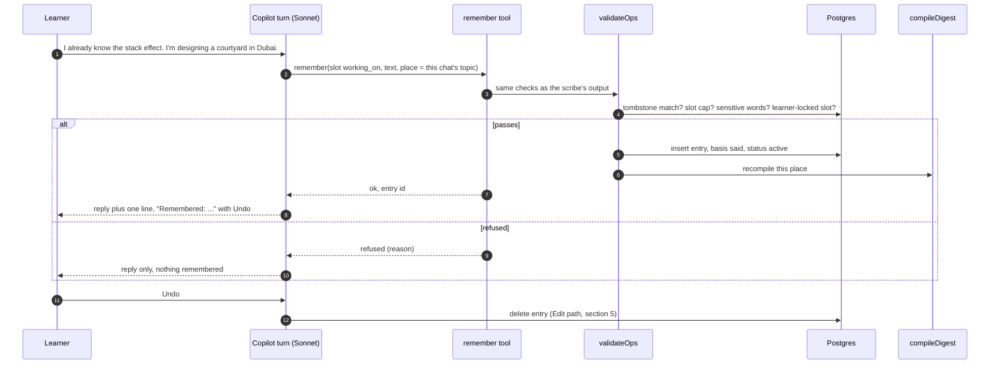
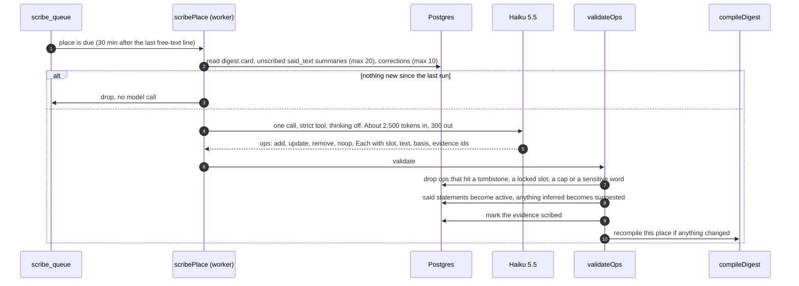
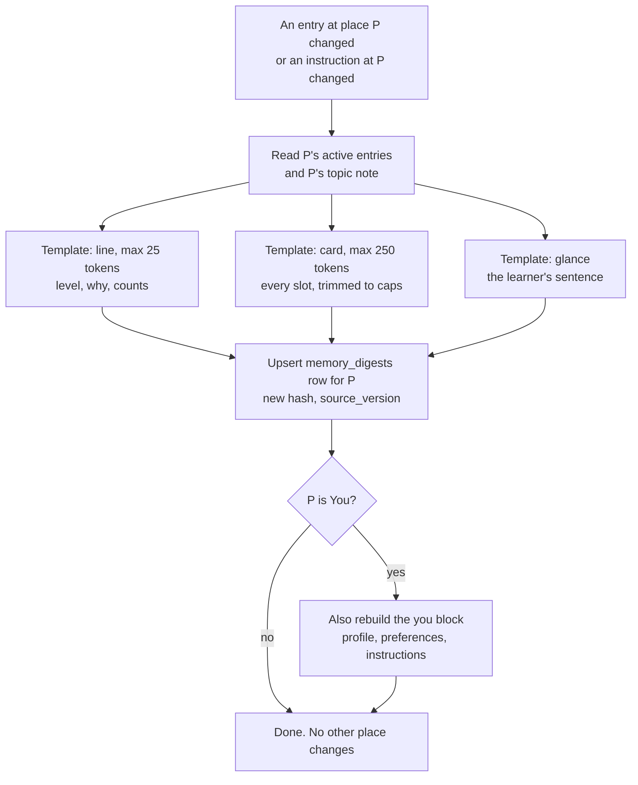
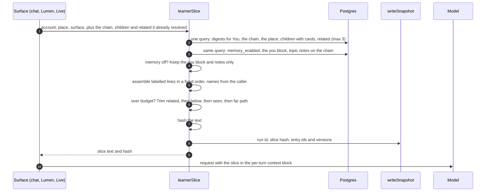
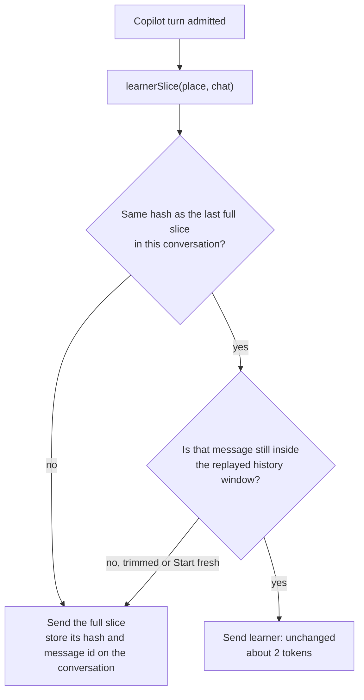
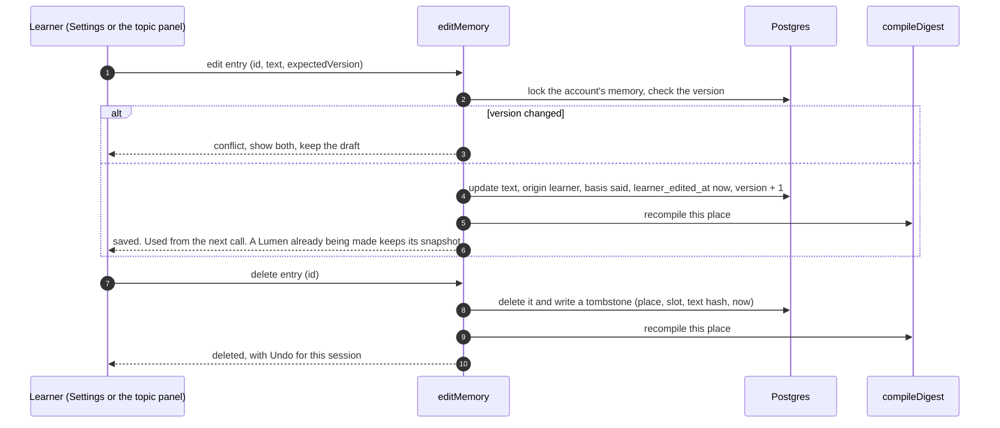
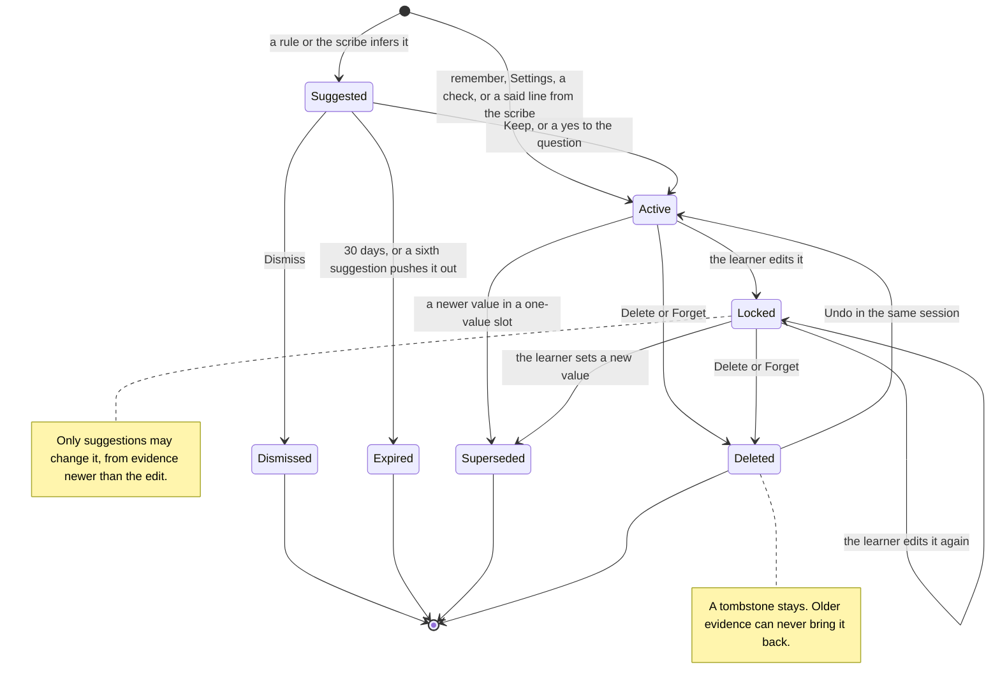

# Learner memory: system reference

**For:** whoever builds learner memory in `studiolo`. This is the reference to keep open while building: what runs, in what order, what it reads and writes, and what it costs.
**Status:** Proposed with the [design](2026-10-24-learner-memory-and-settings-design.md) (Claude, 24 October 2026); not approved. Function and table names marked *new* don't exist yet; the rest exist on `studiolo` main @ `3c2f744`.
**Prototype:** [`prototypes/settings-memory/`](../../../prototypes/settings-memory/README.md). Its **Builder** view shows the slice and its token size for any place.
**Build brief (start here to build):** [`2026-10-28-learner-memory-build-brief.md`](2026-10-28-learner-memory-build-brief.md): the six phases and L1 in detail.

## 0. The system in six rules

1. **Three paths only.** **Save** (something happened, maybe remember it), **Call** (an AI surface needs to know the learner), **Edit** (the learner changes what's remembered). Every diagram below is one of them.
2. **Rules before models.** Facts, checks, taps, ratings and expiry are handled by fixed rules: no model call. A model is used in exactly two places: the copilot's own turn (`remember`, which is a tool call inside a turn that was happening anyway), and the **scribe**, which reads only the learner's own free text that the copilot didn't already catch.
3. **Compile on write, concatenate on read.** Every save or edit recompiles one place's **digest** (ready-made text, by template, no model). A call reads the digests it needs in **one query** and joins them. Calling never runs a model to read memory.
4. **Invalidation is local.** A digest holds only its own place's entries. It holds no names, no paths and no other places, so an edit recompiles one row; a rename or move recompiles nothing.
5. **Send only what changed.** In a conversation, the slice is sent in full once. After that a turn sends a two-token marker until the slice's hash changes (§4.2).
6. **What's shown is what's read.** The learner's screens render the same digests the model reads. Nothing is read that can't be shown, and nothing is shown that isn't read (design §4.4).

## 1. The whole system

Solid lines are the **Save** path, dashed lines the **Call** path, thick lines the **Edit** path. Boxes marked `MODEL` are the only model calls.

## 2. The records

Logical tables; the design's §10 has the fields' meaning. Every table has `account_id`, and every foreign key is a same-account composite key, as in every private table today.

**Indexes that make the paths cheap:** `memory_digests (account_id, place_id)` unique, for the one-query read; `memory_entries (account_id, place_id, status)`; `memory_tombstones (account_id, place_id, slot, text_hash)`; `learning_evidence (account_id, place_id, at)`; `scribe_queue (due_at)`.

## 3. Save

### 3.1 Something happened (every signal, no model)

Every signal enters through one function. Most stop at the rules.

**The thresholds** (rules, tunable, no model):

| Signal | Rule | Writes |
|---|---|---|
| Live **Simpler** / **Deeper** | 3 at one place in 14 days | suggested `level` one step down / up |
| Lumen rating **Too basic** / **Too advanced** | 1 (it's explicit) | suggested `level`, shown at once |
| **From my field** taps | 4 anywhere in 30 days | suggested `prefer` at You |
| Same `prefer` text kept in 2 areas | on the second Keep | suggested `prefer` at You (roll-up) |
| Check right first time, then right again ≥ 3 days later | course engine §6.3 | `known`, basis showed |
| Check wrong | course engine §6.3 | `revisit`, basis showed |
| `working_on` older than 60 days | weekly sweep | suggested "Still working on…?" |

### 3.2 The learner tells Loci something in a chat (inside the turn)

No extra model call: the copilot's turn already reads the message.

### 3.3 The scribe: free text the copilot didn't catch

Runs in the worker, per place, coalesced, rarely.

The scribe's system prompt (about 1,200 tokens) is the same for every place, so a worker that handles several places for one account in a row reads it from the five-minute cache.

### 3.4 Compile: the one step every save and edit ends with

**What's not in a digest, on purpose:** the place's name, its path, its children, its related topics and seen-here. Those are read live at call time from data the caller already has (the copilot's context already resolves the path, children and related topics). So **rename and move cost nothing**, and an edit never cascades.

## 4. Call

### 4.1 Building the slice

**Which parts each surface asks for** (the design's §6.3): chat gets you, path, here, below; a Lumen or Live session gets you, path, here, seen, related. Budgets: you ≤ 120 tokens, each path line ≤ 25, here ≤ 250, seen ≤ 60, below ≤ 80, related ≤ 60. The trimming order is fixed, so the same data always gives the same bytes.

### 4.2 In a conversation: send it once

The copilot replays its history verbatim, so a slice sent in turn 3 is still in front of the model in turn 9.

A 20-turn conversation then carries one or two slices instead of twenty: about 500 tokens instead of about 10,000, and the earlier copy is read from the prompt cache at a tenth of the input price.

### 4.3 Where the slice sits in each request

| Request | Cached prefix (unchanged) | Per-request part | The slice |
|---|---|---|---|
| Copilot turn | Tools and six system blocks, plus one fixed line on how to read `<learner>` | History, then this turn's `<studiolo_context>` | One string field in the context block, replacing today's `learner` line |
| Lumen author | The author contract and brand kit (the brief's cache block) | The brief | Replaces the brief's `Learner:` line |
| Live session | The agent's prompt | `dynamicVariables` at connect | One variable |
| Scribe | Its system prompt | The place's card and new summaries | Not used (it reads the card directly) |

## 5. Edit

Every edit is a normal versioned write under the account's memory lock, then one recompile.

| Edit | Writes | Recompiles | Also |
|---|---|---|---|
| Change a line | entry: learner text, basis said, `learner_edited_at` | that place | Rules and the scribe may only *suggest* changes to it, from evidence newer than the edit |
| Set the level dial | the place's `level` entry (one-value slot) | that place | Same lock as above |
| Delete a line | delete + tombstone | that place | Older evidence can never re-add it; newer evidence can only suggest it; a second dismissal blocks it at that place |
| Forget a place | delete all + tombstones | that place | |
| Keep / Dismiss a suggestion | status active / dismissed (+ tombstone on dismiss) | that place on Keep | |
| Edit an instruction or topic note | `learner_instructions` new version | You, or that place | |
| Memory off | `memory_enabled = false`, `memory_paused_at` | nothing | Calls skip memory digests; `recordEvidence` stops queueing; entries stay editable |
| Memory on | `memory_enabled = true`, `memory_resumed_at` | nothing | Rules and the scribe ignore evidence older than `memory_resumed_at` |
| Delete all memory | delete all + tombstones | all places | One transaction |
| Topic renamed or moved | nothing | nothing | Names and paths are read at call time |
| Topic deleted | cascade: entries, digest, tombstones, notes | nothing | The delete confirmation says "and what Loci noted here" |

## 6. An entry's life

## 7. What it costs

Prices from the app's [rate card](https://github.com/ahmedste/studiolo/blob/main/src/features/usage/rate-card.ts) (2026-10-16). "Active learner" is an assumption: 60 copilot turns, 20 Lumens, 4 Live sessions and 10 free-text scribe runs a month.

| Step | Model | Tokens | How often | Per active learner a month |
|---|---|---|---|---|
| `recordEvidence`, rules, compile, `learnerSlice` | none | 0 | every event and call | US$0 (database rows only) |
| `remember` inside a copilot turn | Sonnet 5.5 (already running) | about 60 out | when the learner says something about themselves | under US$0.001 |
| Slice in copilot turns, sent once per conversation (§4.2) | Sonnet 5.5, $2 per million in | about 500 per conversation | about 15 conversations | about US$0.015 |
| Slice in a Lumen brief | Opus 5.5, $4 per million in | about 400 | 20 Lumens | about US$0.03 |
| Scribe run | Haiku 5.5, $0.10 in and $0.50 out per million | about 2,500 in, 300 out | about 10 | under US$0.005 |
| **Total** | | | | **about US$0.05** |

Without the two savings (send-once, and rules before the scribe), the same month comes to roughly US$0.15: about US$0.065 for a slice in every copilot turn, and about US$0.06 for a scribe run on every one of some 150 events. That's three times as much, and the scribe would be making judgements that rules make more reliably.

## 8. Invariants (one test each)

1. **Every line in a snapshot's slice maps to a visible source**: a digest the learner can open, an instruction, a profile field, or a fact shown on screen.
2. **No model call reads memory.** `learnerSlice` makes no provider request (spy in the unit test).
3. **One query per call.** `learnerSlice` issues one database round trip for digests and instructions.
4. **An edit recompiles exactly one digest** (two for You: its digest and the you block).
5. **Rename and move recompile nothing.**
6. **A tombstoned text never returns** from evidence older than its tombstone, from either the rules or the scribe.
7. **A learner-locked entry is never rewritten** by the app; only a suggestion can appear beside it.
8. **Memory off:** no queue rows, no scribe runs, no memory digests in any slice; instructions still present.
9. **Off the record:** `recordEvidence` writes nothing for that session, and its slices carry no memory.
10. **Same data, same bytes:** two `learnerSlice` calls with no change in between return the same hash.
11. **Sensitive words** (the design's §4.2 list, a maintained word list plus the scribe's own refusal) never reach `memory_entries`.
12. **Account isolation:** every query is scoped by `account_id`, and composite keys prevent cross-account references.

## 9. Function contracts (proposed)

| Function | Called by | Input | Output | Model? |
|---|---|---|---|---|
| `recordEvidence` | player, checks, copilot admission, Live end | account, place, kind, ref | evidence id | no |
| `applyRules` | `recordEvidence`, weekly sweep | evidence | entries or suggestions written, queue row | no |
| `remember` (copilot tool) | copilot turn | slot, text, place | ok + entry id, or refused + reason | inside the turn |
| `scribePlace` | worker, from `scribe_queue` | account, place | ops applied | Haiku 5.5 |
| `validateOps` | `remember`, `scribePlace` | ops | ops kept, ops dropped with reasons | no |
| `compileDigest` | every save and edit | account, place | digest row | no |
| `learnerSlice` | copilot admission, Lumen brief, Live connect, planner | account, place, surface, resolved chain, children, related | text, hash | no |
| `writeSnapshot` | `learnerSlice` callers | run, hash, entry versions | snapshot id | no |
| `editMemory` | Settings, topic panel, chat Undo | op, ids, expectedVersion | saved, conflict or refused | no |
| `setMemoryEnabled` | Settings toggle | on or off | the new state | no |
