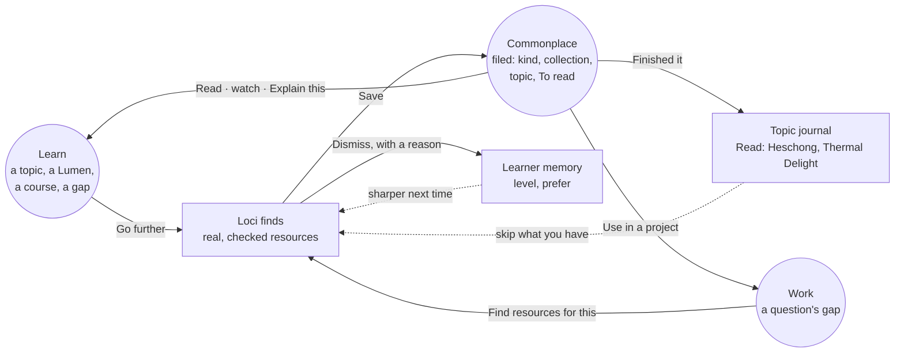
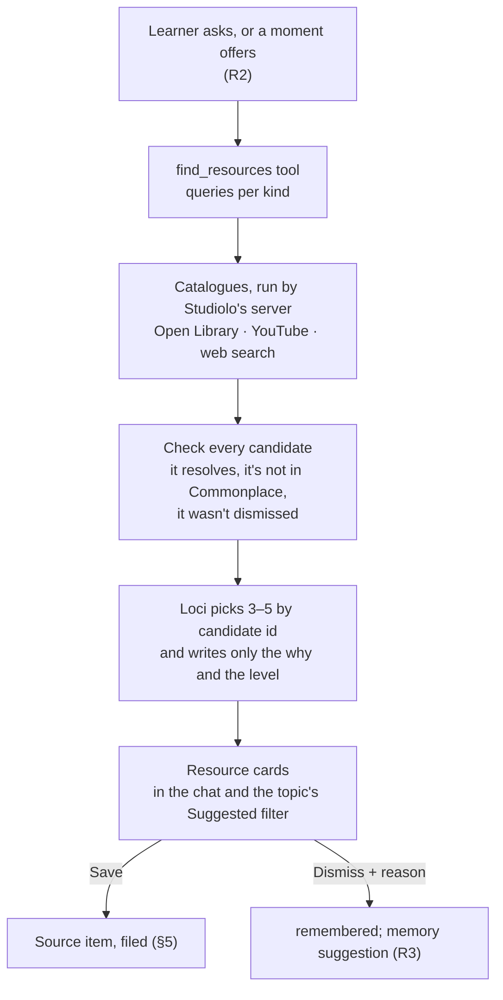

HIGH (a new Loci skill, outside catalogues and a migration; each phase states its own tier)

# Loci suggests resources: books, PDFs, videos and links, saved to Commonplace in the right place

**For:** the owner, to decide the direction, and the agent who later builds it in `studiolo`.
**Prototype (29 Oct):** [`prototypes/loci-resources/`](../../../prototypes/loci-resources/README.md), published at `https://claude.ai/artifact/QZxKcs1UCTUbiTqvcmu4pk`. It shows R1 in Loci's chat. §14 maps R1 onto the code.
**Status:** Proposed. Claude, 24 October 2026. Nothing here is approved until the owner says so in the conversation.
**Checked against:** `studiolo` main @ `dfd4fbb` (24 Oct 2026), read only. Paths exist on that commit unless marked *new*.
**Builds on, in `studiolo`:** decisions **A2, A4, A5, A8, A9, A15** in `docs/superpowers/specs/2026-10-05-ai-direction-graph-copilot-design.md` (agreed 5–7 Oct), and `project-docs/product/mvp-scope.md:48-54` ("Real resources only", "Suggestions stay on their topic"). **In this repo:** the Work loop (`2026-10-24-work-design.md` §0), learner memory (`2026-10-24-learner-memory-and-settings-design.md`), the unified Loci chat brief (`2026-10-24-unified-loci-chat-brief.md`) and the Commonplace photos design (`2026-10-24-commonplace-photos-design.md`, "three questions, never folders").

## 0. In short

The owner agreed this on 5 October and it was never built. A9 says Loci's suggested resources must come from real catalogues, never from model memory. A4 says a suggestion stays on its topic until the learner **Saves** it (into Commonplace, tagged with the topic) or **Dismisses** it (and it is never suggested again). A15 put it in Phase 4. What was still missing is what this document adds:

1. **Where** Loci offers resources, so it happens when it helps and not only when asked.
2. **How a suggestion is checked**, so a title, link or ISBN can never be made up.
3. **How a save is filed** without the learner typing anything: its type, kind, collection, topic, area, reading state and why it was saved.
4. **How the loop closes**: what you save, read, finish or dismiss makes the next suggestion better, and it is all written where the learner can see it.



Today the learner is the only one who brings things into Commonplace. With this, Loci brings things too, and the learner keeps the final word on every one. The loop goes *learn → Loci suggests → save → read → learn deeper*. Work joins it through its **Gaps** (W3).

| # | Phase | What the learner gets | Tier | Migration |
|---|---|---|---|---|
| R1 | **Ask Loci for resources** | "What should I read on courtyard houses?" brings 3–5 resource cards: real books, videos, articles, PDFs and podcasts, each with a reason, a level and a length. **Save** files it in Commonplace in the right place; **Dismiss** remembers it. Both show in the topic's journal | HIGH | yes |
| R2 | **Offered at the right moment** | "Go further" at the end of a Lumen; "Nothing saved here yet. Find a starter shelf?" on an empty topic; readings for each course part; "Find resources for this" on a Work gap | MEDIUM | no |
| R3 | **It learns from you** | Dismiss reasons (*Too basic*, *Not my format*) become memory lines you can see and change; Loci knows what each topic already has ("6 videos, no book") and suggests what's missing; finishing something offers *Explain this* or *Check yourself* | MEDIUM | small (journal kinds) |
| R4 | **Open PDFs and reading paths** | Open-access PDFs (arXiv, open journals, government reports) are saved as files, so they open in the PDF reader and can be explained. A **reading path**: 4–6 resources in order, from first look to deep, saved as one View | HIGH | yes |

**Why this order:**
- **R1 is the whole loop at its smallest.** Asked, found, checked, saved, filed, journalled. Everything after it reuses its tool and its card.
- **R2 adds no new machinery**, only new places to call R1, so it is cheap once R1 is right.
- **R3 depends on learner memory** (Stage 4) existing, as Work's W3–W5 do.
- **R4 brings copyright and file-storage questions**, so it comes last and needs its own owner decision (RS-D5).

## 1. What exists today (main @ dfd4fbb)

| Area | Today | Where |
|---|---|---|
| **The agreed rule** | A4: suggestions stay on their topic, Save or Dismiss, dismissals remembered. A9: videos from YouTube's official search, books from Open Library or Google Books, articles from a bounded web search. "Models invent convincing titles" | `docs/superpowers/specs/2026-10-05-ai-direction-graph-copilot-design.md:44,49`; `project-docs/product/mvp-scope.md:48-54` |
| **Source items** | `content_items.shape = 'source'` with a `sources` row: `kind` ∈ article, video, book, podcast, website, pdf, other; `url`, `creator`, `published`, `isbn`; `reading_state` ∈ unread, reading, read; PDF last page; video position and length | `src/db/library-schema.ts:95-125` |
| **Origin of an item and a tag** | `content_items.origin` ∈ user, source, model, model_external. `content_topic_tags.added_by` ∈ learner, assistant, enrichment | `library-schema.ts:50,75,155,162` |
| **Collections** | Every collection holds one type; an item is in at most one. Sources collections are the learner's own (e.g. Books, Lectures). Shelves group the Sources bay by kind | `project-docs/product/library.md:26,228` |
| **To read** | The reading inbox: Sources by reading state | `library.md:52-61` |
| **Link previews** | After a link is saved, the server fetches its title, description and picture through an SSRF-safe fetch and stores the picture | `src/features/links/safe-fetch.ts`, `preview-image.ts`, `oembed.ts`; `library.md:166` |
| **Books** | An ISBN shows the Open Library cover when no photo is chosen | `library.md:38`; `src/features/library/media.ts` |
| **Videos** | A YouTube Source opens in the watching room and remembers its position | `library.md:182` |
| **Loci's tools** | Tools by action kind (`read`, `propose`, `ask`, `costly`, `change`), the A2 policy enforced in one registry; card tools pause the turn with a card the learner answers | `src/features/copilot/tools/registry.ts:11-120` |
| **Loci's model** | `copilot_chat`: Sonnet 5.5, medium effort, up to 5 calls a turn | `src/features/ai/purposes.ts:42` |
| **Journal** | `copilot_journal_entries.kind` ∈ topics_added, suggestions_dismissed, keep_undone, explainer_made, explainer_started | `drizzle/0018_copilot.sql:160-182` |
| **Explain one item** | A Lumen made from a PDF's or article's own text, with citations | `project-docs/implementation/ai.md:114-118, 400-441` |
| **Outside search** | **None.** No web search, YouTube search or catalogue search anywhere in `src/` | — |

So the parts are there: an item type with the right kinds, collections, To read, link previews, book covers, a video room and the card pattern. The missing part is the search, and the rule that joins the parts up.

## 2. The model: a suggestion is a card, not an item

A suggestion is **not** in Commonplace until it is saved. That is A4's rule ("the Library holds only what the learner chose"), and it keeps Commonplace clean.



| Thing | What it is | Lives in | Notes |
|---|---|---|---|
| **Suggestion** | One checked resource offered for one place: its catalogue facts, the why, the level, the status | *new* `resource_suggestions` | open → saved, dismissed or replaced |
| **Saved resource** | A normal Source item | `content_items` + `sources` | Nothing new about it except where it came from |
| **Where it came from** | "Suggested by Loci for *Courtyards* · 24 Oct", plus the why | the suggestion row, joined on the item page | Loci's words never go into the learner's own notes |
| **Dismissal** | The resource's key and a reason | the suggestion row | Never suggested again at any place |
| **Journal entries** | Suggested, saved, dismissed, finished | `copilot_journal_entries`, new kinds | Feeds A5's Suggested and Saved filters |

**Three rules that keep it trustworthy:**
1. **Loci never types a resource.** The model sees only candidates the server found and checked, each with an id. Its answer names ids. The card's title, creator, year, cover and link come from the catalogue, never from the model. This is the same idea as the citation check for Lumens (`ai.md:509-521`): text that can't be traced to a source is refused.
2. **Your Commonplace first.** Before searching outside, Loci looks at what you already have on the topic and says so ("You have Heschong's *Thermal Delight* and 3 videos; here's what's missing"). It never suggests something you already saved.
3. **Nothing is saved without a tap.** Saving adds an item, so it follows A2's "adds things" rule: one tap per card, or **Save all**, with Undo.

## 3. Finding real resources (A9)

### 3.1 The tool

*New* `find_resources`, kind `propose`, built like `propose_topics` (see §14: a `read` tool may not show a card, and the proposal pattern already gives each row its own Keep, Dismiss and Undo). Its input from the model:

```ts
{
  place: { topicId: string } | { areaId: string } | "home",
  need: string,               // "how deep courtyards stay cool in humid climates"
  queries: { kind: "book" | "video" | "article" | "pdf" | "podcast" | "course"; q: string }[], // ≤ 6
  level?: "intro" | "intermediate" | "advanced",
  count?: 3 | 4 | 5
}
```

The server runs the queries, checks the results and returns **candidates** (at most 25, each about 60 tokens): `{ id, kind, title, creator, year, length, access, catalogue, snippet }`. Loci then calls the tool's second step, or answers with a card naming 3–5 ids, each with one **why** line (at most 160 characters) and a **level**.

### 3.2 Where each kind comes from

| Kind | Catalogue | Checked by | Cost and limits |
|---|---|---|---|
| **Book** | Open Library search (`/search.json`), no key; Google Books as a fallback (RS-D1) | It has an Open Library work key; its ISBN, if any, resolves; the cover comes from the cover service already used | Free. Polite use with a contact User-Agent, and results cached |
| **Video** | YouTube Data API `search.list`, then `videos.list` for length and whether it can be embedded | The video id exists and can be embedded (`oembed.ts`) | `search.list` costs 100 of the default 10,000 quota units a day: **about 100 searches a day for the whole app**. Cache, and ask Google for more quota before launch |
| **Article, PDF, podcast, course** | Anthropic's server-side web search (`web_search_20260209`), with `max_uses` 3 and a blocked-domains list | Each URL is fetched through `safe-fetch.ts`: status 200, a real title, and a content type that matches its kind (`application/pdf` for a PDF) | About $10 per 1,000 searches plus the result tokens (check the current price). Blocked domains include piracy sites (libgen, z-lib, sci-hub, annas-archive) and content farms |
| **Paper** (optional, R4) | OpenAlex, no key | A DOI that resolves; open-access status and licence | Free |

Web search runs on Sonnet 5.5, Loci's own model, so no second model is added.

### 3.3 What a candidate needs to pass

- It **resolves**: the catalogue id exists, or the URL returns 200 with a title.
- It is **not already in Commonplace**: matched on the normalised URL, the YouTube id, the ISBN or Open Library work key, or the DOI. A *new* pure helper, `resourceKey(candidate)`, gives each resource one key, for example `isbn:9780262580397`, `yt:dQw4w9WgXcQ`, `doi:10.…` or `url:<sha256 of the normalised URL>`.
- It was **not dismissed** before. Its key is not on a dismissed suggestion.
- It is **not on the blocked list**, and it is not behind a login wall that hides everything (when the fetch shows a sign-in page, the candidate is dropped).
- Its **text is data**. Snippets pass the same sanitiser as Lumen sources (`sanitiseSpanText`, `ai.md:439`) and are cut to 300 characters before the model sees them, because a web page can contain "ignore your instructions" text.

### 3.4 How Loci chooses

The prompt gives Loci, in this order: the place and its outline (today's `<studiolo_context>`); the **learner memory slice** for the place (level, why, working on, prefer); **what the place already holds** by kind ("3 videos, 1 book, no PDF"); and the candidates. It is asked to:
- start where the learner is (the `level` line, and what they `know`);
- mix kinds unless the learner prefers one (`prefer`);
- fill gaps before adding more of the same;
- say plainly when a resource is paid, needs a library, or is long;
- choose fewer cards rather than weak ones. "I found only two good ones" is a good answer.

## 4. The card

```
┌────────────────────────────────────────────────────────────┐
│ [cover]  Thermal Delight in Architecture                   │
│          Lisa Heschong · 1979 · Book · 78 pages            │
│          Intro · Free to borrow (Open Library)             │
│                                                            │
│  Why: short and readable; it is about how warmth and       │
│  coolness feel, which your notes on the courtyard keep     │
│  coming back to.                                           │
│                                                            │
│  Files to:  Sources › Books  ·  Courtyards › Shading  ▾    │
│                                                            │
│  [ Save ]  [ Save and open ]   Dismiss ▾                   │
└────────────────────────────────────────────────────────────┘
        3 more ·  [ Save all ]  ·  Find more like these
```

- **Facts line:** creator · year · kind badge · length (pages, minutes, or the reading time from the page's word count) · the catalogue it came from.
- **Level and access:** *Intro · Intermediate · Advanced*, and *Free · Free to borrow · Paid · Needs a library*. No shop links in R1 (RS-D4).
- **Why:** one line in Loci's words, marked as Loci's.
- **Files to:** where Save will put it (§5), worked out before the card shows. Tapping it opens the same chip as capture's "Saving to <topic>" (`library.md:153`), plus a collection picker.
- **Save** files it and shows the Undo toast. **Save and open** files it and opens it: the watching room for a video, the item page for a book or link, the PDF reader for a saved PDF (R4).
- **Dismiss ▾** dismisses at once. Its menu holds optional reasons: *Have it already · Too basic · Too advanced · Not my format · Not about this*. A reason feeds R3; no reason is fine.
- **Save all / Choose…** follow A2.
- **Find more like these** runs the tool again with the saved ones as examples. It is a new search, so it counts towards the daily cap.

**Where cards show:**
- **The chat**, in the one Loci thread (unified chat brief), tagged with the place they were asked from.
- **The topic's journal**, under A5's **Suggested** filter, until they are saved or dismissed. Open suggestions fold away after 30 days but stay in the journal (RS-D6).
- **Not in Commonplace.** Unsaved suggestions never appear on the wall, in To read, or in search.
- **Voice:** "Save the first one" and "Dismiss that, too basic" work through the voice dock's existing rules (`2026-10-21-live-lumens-voice-design.md` §5): saving is an addition, so voice may do it with an Undo.

## 5. Filing: the right place, without typing

This is the part the owner asked for: Loci suggests, and the save lands in the right kind of category. It follows the photos design's three questions. Filing is a **pure, deterministic function**, *new* `fileSuggestion(suggestion, account)` in `src/features/library/`, unit-tested. The model does not decide it, so it is the same every time and can be explained.

| Question | Answered by | Rule |
|---|---|---|
| **What is it?** | **Type** Source, and its **kind** | From the catalogue: Open Library gives `book`; YouTube gives `video`; a URL served as `application/pdf` gives `pdf`; a known podcast host or RSS feed gives `podcast`; a course or project home page gives `website`; anything else gives `article` |
| **Which shelf?** | Its **collection** (one Sources collection at most) | In order: **(a)** the collection the learner last chose for this kind *in this area*; **(b)** else the one they last chose for this kind *anywhere*; **(c)** else the **starter shelf** for the kind, the one capture already files into (`starterForSourceKind`: Books, Videos, PDFs, Links); **(d)** else, if the learner deleted that starter, **Not on a shelf** |
| **What is it about?** | **Topic** and its **area** | The place it was suggested for. If Loci matched a sub-topic more closely, the card says so ("Courtyards › Shading") and files there. Tagged with `added_by = 'assistant'`. Never more than 20 topics (the existing cap) |
| **Where is it in my reading?** | **Reading state** | `unread`, so it appears in **To read** at once |
| **Why do I have it?** | **Provenance** | "Suggested by Loci for *Courtyards* · 24 Oct", plus the why line, from the suggestion row. `content_items.origin` stays `user`: the learner chose to keep it |
| **For which piece of work?** | **Project reference** (once Work exists) | If it was found for a Work gap, it is also added as a reference to the project with the gap's question as its reason (Work W1 `project_refs`) |

Rules (a) and (b) mean the learner teaches the filing by using it. Change one card's shelf from *Videos* to *Lectures*, and the next video in that area goes to *Lectures*. There is no settings page to keep. Loci never makes a collection itself; **+ New collection…** in the card's shelf menu makes one only when the learner taps it.

After the save, the existing pipeline runs as it does for a learner's own link: the link preview job (title, description, picture), the Open Library cover for a book, and the YouTube length for a video. Saving goes through the same validated library operation as capture (A8), so account isolation, limits and Undo come with it.

## 6. Phase R2: offered at the right moment (MEDIUM, no migration)

Offers are **buttons, not searches**. Nothing outside is searched until the learner taps, so an offer costs nothing.

| Moment | The offer | Where |
|---|---|---|
| **End of a Lumen** | "Go further: find 3 resources on *Wind catchers*" | The Lumen's end card, next to Learn's existing next steps |
| **A topic with nothing saved** | "Nothing saved here yet. Find a starter shelf?" | The topic panel on the Map and in the Palace, and its journal |
| **A new topic from Loci** | After **Keep** on ghost topics: "Want a starter shelf for these?" (one search for all of them, at most 2 cards each) | The Keep toast |
| **A course part** | "Readings for this part", made when the course plan is made, so they are ready when the part opens | The course part page (`project-docs/architecture/course-engine.md`) |
| **A Work gap** | "Find resources for this", next to *Learn this for the project* | Work's Apply card (W3) and a question's Gaps |
| **A learner question Loci can't answer well** | "This is beyond a short answer. Want something to read?" | The chat, at most once per conversation episode |

**Never:** a push notification, an unasked email, or a card in Commonplace that the learner didn't save. At most **one offer per screen**.

## 7. Phase R3: it learns from you (MEDIUM, small migration)

**Dismiss reasons become memory you can see.** These use the learner-memory spec's slots and its "no hidden judgements" rule: a suggested line shows up on the place's memory card for the learner to accept or change, and nothing is ever written silently.

| Signal | Threshold | Suggested memory line |
|---|---|---|
| *Too basic* | 2 at one place in 30 days | `level` one step up at that place |
| *Too advanced* | 2 at one place in 30 days | `level` one step down |
| *Not my format* on one kind | 3 in an area | `prefer`: "Prefers videos to books in *Climate*" (whichever kinds it saw) |
| Saves of one kind, while other kinds are dismissed | 5 saves | `prefer`, as above |
| *Have it already* | any | Nothing in memory. Offer "Add it to Commonplace?", which opens capture with the title filled in |

**Coverage.** The place's outline (layer 4 of the unified chat) gains one line per topic: what it holds by kind, plus finished counts ("Courtyards: 2 books (1 read), 5 videos, 0 PDFs"). Loci uses it to fill gaps and to avoid suggesting a fifth video to someone who hasn't opened four.

**Finishing closes the loop.**
- When a saved suggestion's reading state becomes **read**, or a video is watched to the end, the journal writes "Read: *Thermal Delight* (suggested 24 Oct)".
- The item page then offers **Explain this** (an item Lumen, which exists), **Check yourself on it** (a course-engine check, so `known` with basis `showed` comes from a check, not from reading), or **Note what you took from it**.
- Reading alone is **not** evidence of knowing. It never sets a status or writes `known`. That stays the existing product rule: "Saving material, watching a video, completing a lesson… does not change it" (`project-docs/product/brief.md:14`).

**Data:** the journal's kind check gains `resources_suggested`, `resource_saved`, `resource_dismissed` and `resource_finished` (one hand-written migration, extending `0018`'s constraint).

## 8. Phase R4: open PDFs and reading paths (HIGH, migration)

**Open PDFs, saved as files**
- When a candidate is a PDF **and** it is clearly free to keep (an arXiv paper; an OpenAlex or Unpaywall result with a CC licence; a government or university report served openly by its publisher), the card offers **Save the PDF**. The server fetches it through `safe-fetch.ts`, checks the size (the existing 20 MB-class limits in `files/limits.ts`) and runs the normal PDF ingest. It then opens in the reading room, remembers its page, and can be explained with citations.
- Anything else is saved as a **link**, never as a copy. No PDF is fetched from a domain that doesn't publish it. See RS-D5.

**Reading paths**
- "Make me a reading path for *Passive cooling*" gives 4–6 resources in order (*first look → core → deeper → case study*), each with its why.
- Saved, they are ordinary Sources plus one **View** (photos design, Phase 3, `library_views`) named "Path · Passive cooling", which holds the order. The path has no items of its own, only a question and an order, in line with "never folders".
- A path can become a **course** later; the course engine owns that design.

**Data:** *new* `library_views.order jsonb null` (item ids in path order), or a path row if Views haven't shipped yet. That is decided in the R4 phase spec.

## 9. Data (R1 migration)

*New* table `resource_suggestions`:

| Column | Type | Notes |
|---|---|---|
| `id` | uuid | |
| `account_id` | uuid | account isolation as elsewhere |
| `place_kind`, `topic_id` | text, uuid null | `home`, `area` or `topic`; `ON DELETE SET NULL` on the topic, so a deleted topic keeps its history |
| `conversation_id`, `message_id` | uuid | the card's message in the thread |
| `origin` | text | `asked`, `lumen_end`, `empty_topic`, `kept_topics`, `course_part`, `project_gap` |
| `resource_key` | text | from `resourceKey`, e.g. `isbn:…`, `yt:…`, `doi:…`, `url:<hash>` |
| `kind` | text | the `sources.kind` values |
| `catalogue` | text | `openlibrary`, `googlebooks`, `youtube`, `web`, `openalex` |
| `facts` | jsonb ≤ 4 KB | title, creator, year, url, isbn, length, access, cover |
| `why`, `level` | text ≤ 160, text | the model's two contributions |
| `status` | text | `open`, `saved`, `dismissed`, `replaced` |
| `dismiss_reason` | text null | the five reasons |
| `item_id` | uuid null | set on save; `ON DELETE SET NULL` |
| `created_at`, `decided_at` | timestamptz | |

Indexes: `(account_id, resource_key)` for the "already have it, or dismissed" check; `(account_id, topic_id, status)` for the journal's Suggested filter.

No new columns on `sources` or `content_items`: the key is worked out from `url` and `isbn`, which already exist.

**Cache:** `resource_searches(account_id, query_hash, kind, results jsonb, created_at)`, kept for 30 days, so asking again, or *Find more*, doesn't pay twice for the same catalogue search. The cache is per account, because queries carry topic words.

## 10. Cost and limits

| Part | Per run, roughly | Notes |
|---|---|---|
| Loci's turn | already paid | the tool is one more call inside a turn Loci was going to have |
| Candidates into the model | 1.5–3k input tokens | 25 candidates × about 60 tokens, plus the coverage line |
| Web search | 1–3 searches, plus their result tokens | `max_uses` 3; the web results are the largest share |
| Open Library, OpenAlex | free | cached |
| YouTube | 100–102 quota units | the app-wide daily limit is the real constraint, not money |
| **Total** | **about $0.03–0.10 a run** | to be measured in R1 on 30 real requests before anything else ships |

- **A cap per learner:** 20 runs a day (RS-D2), shown as "You've asked for a lot today. More tomorrow" with no costs shown, in line with the testers' rule until Phase 3D.
- **Cache layout:** the tool's description is fixed and sorted with the others (`registry.ts`), so the 1-hour cache isn't broken; candidates arrive as a tool result in the volatile part of the turn.
- **Usage ledger:** a *new* purpose `copilot_resources` for the web-search call, so the cost dashboard can show it apart from chat.

## 11. Decisions for the owner

| ID | Question | Recommendation |
|---|---|---|
| **RS-D1** | Which catalogues first? | **Open Library, YouTube and web search in R1.** Add Google Books only if Open Library misses too often on a 50-book hand check. OpenAlex arrives with R4 |
| **RS-D2** | Does a search run straight away (under a daily cap) or ask "Search the web?" each time (`costly`, A2)? | **Straight away, with a cap of 20 a day**, as a `propose` tool (§14). A run costs cents, and asking every time would kill the feature. The cap protects spend until 3D's allowance arrives |
| **RS-D3** | How many cards per run? | **3 by default, up to 5 when asked**, with mixed kinds unless `prefer` says otherwise |
| **RS-D4** | Shop links (A9 mentioned Amazon "afterwards")? | **None in R1.** Show *Free to borrow* (Open Library) and *Find in a library* (WorldCat). Revisit affiliate links only with a written rule that they never affect which books are chosen |
| **RS-D5** | Save open PDFs as files (R4)? | **Yes, but only with an open licence or from the publisher's own open copy.** Everything else is saved as a link |
| **RS-D6** | What happens to open suggestions over time? | **They fold away from the chat after 30 days and stay in the journal's Suggested filter.** Dismissed keys are kept for good, so a resource is never suggested again |
| **RS-D7** | Dismiss reasons feeding memory (R3) | **Yes, as suggested lines the learner accepts**, never written silently (learner-memory rule) |
| **RS-D8** | Ghost resources on the Map lane next to ghost topics? | **Not yet.** Cards in the chat and the journal are enough. Revisit once the Palace draws items (photos design Phase 5) |
| **RS-D9** | Privacy: topic words are sent to Google (YouTube), Open Library and the web-search provider | **Say so on the privacy page** ("When you ask Loci for resources, the words of your request and the topic's name are sent to…"). Memory lines, notes and files are never sent |
| **RS-D10** | Names on screen | **"Find resources"** for the skill, **"Suggested"** for the filter, **Save** and **Dismiss** for the actions (A4's words), **"Go further"** at a Lumen's end, **"Reading path"** for R4 |

## 12. Rules carried over

- **Names:** the screens say **Commonplace**, **Loci**, **Lumens**; the code keeps `library`, `graph`, `copilot`.
- **A2 and A8:** suggestions are additions (one tap, Undo). Every save goes through the library's own validated operation. The model never writes to the database.
- **No hidden judgements:** every memory line that comes from a dismissal is shown and can be changed.
- **Reach:** suggestions default to the current place, and each card says where it will file (this matches the unified chat brief's reach proposal).
- **Files:** pure logic (`resourceKey`, `fileSuggestion`, kind mapping, dedupe) goes in `src/features/library/` with unit tests; catalogue clients go in *new* `src/features/resources/`; the tool goes in `src/features/copilot/tools/resources.ts`.
- **Switches:** `RESOURCE_SUGGESTIONS` (R1), `RESOURCE_OFFERS` (R2), `RESOURCE_MEMORY` (R3), `RESOURCE_PDFS` (R4), testers first.
- **Evaluation:** before R1 ships, a set of 30 real requests across at least 4 fields (architecture, law, medicine, music), checked by hand for *real · relevant · right level · filed right*. The bar is zero made-up resources and at least 80 % filed with no correction.
- **Paperwork:** a phase spec per phase in `studiolo`'s `docs/superpowers/specs/`, with its tier on line one; `ai.md`, `library.md` and `database.md` updated on the same branch; migrations hand-written in `drizzle/` and applied only on the owner's word.

## 13. What this is not

- **Not a recommendation feed.** There's no endless "For you" page. Loci suggests when asked, or offers once at a moment where it helps.
- **Not a shop.** No sponsored or affiliate results decide what is shown.
- **Not a downloader.** Only openly licensed PDFs are copied; everything else stays a link to its owner's site.
- **Not proof of learning.** Saving or finishing a resource never marks a topic Learned and never writes `known`.

## 14. R1 in the code: what to reuse and what to build (checked 29 Oct, `studiolo` main @ `e5bf930`)

The owner's direction (29 Oct): **start in Loci's chat, when the learner asks**, filed under the right type and the right collection. That is R1 alone. This section is what the building agent needs to start it.

**Two corrections to §3 and §5, from the code:**
1. **The tool is a `propose` tool, not a `read` card tool.** The registry refuses a card from a `read` or `propose` tool ("This tool cannot pause the turn.", `src/features/copilot/tools/registry.ts:219`). The closest existing shape is `propose_topics` (`tools/propose.ts:36-64`). It writes its own tables (`copilot_proposals`, `copilot_proposal_items`), returns `ui: { type: "proposal" }` without pausing the turn (`turn.ts:266-272`), and gives every row its own **Keep**, **Dismiss** and **Undo** routes with idempotency keys and journal lines (`src/app/api/copilot/proposals/[proposalId]/{keep,dismiss,undo}/route.ts`; `proposals.ts :: keepProposalItems` 181, `dismissProposalItems` 261, `undoKeep` 289). Resource cards are exactly that: Save is a Keep, per row.
2. **Rule (c) uses the starter shelves.** Capture already files a new Source with no collection into the starter for its kind (`src/features/library/starter-collections.ts :: starterForSourceKind`: Videos, Links, PDFs, Books). So a learner always has a shelf, and the "make a collection" offer is not needed.

| Need | Reuse | Change or build |
|---|---|---|
| The tool | `defineTool` and `copilotRegistry()` (`tools/registry.ts:121`, `tools/index.ts:19`; bump `COPILOT_TOOLS_VERSION`, `prompt/system.ts:28`); a service port in `tools/services.ts :: CopilotServices` | *New* `tools/resources.ts`, kind `propose`, following `propose.ts` |
| The cards in the panel | `proposal-card.tsx:210-248` (rows, `Button data-act`, quiet buttons); "Looked at" steps (`copilot-message.tsx:79-82`, `.steps` in `styles/copilot.css:18-22`); `.cp-card` styles | *New* `resource-card.tsx`: cover, facts, why, **Files to** chips, Save · Save and open · Dismiss ▾ |
| Save, Dismiss, Undo | The proposal routes' pattern: one route per action, a client-made key, Undo in the toast; `components/graph/loci-side/capture-undo.ts :: undoCaptured` → `deleteItem` | *New* `src/app/api/copilot/resources/[suggestionId]/{save,dismiss,undo}/route.ts` and `resources-repository.ts` |
| Making the Source | `createItem` (`library/items-repository.ts:229`) with `sourceCreate` (`library/schema.ts:225`): it already takes `collectionId` (checked by `canFileIn`), `topicIds`, `source: { kind, url, creator, published, isbn }`, and `createKey` idempotency; `reading_state` defaults to unread | Tags are written with `added_by = 'learner'` (`items-repository.ts:431`): add an `addedBy` parameter (precedent: `plan-contents.ts:93`) so Loci's saves say `assistant` |
| After the save | `withPreviews` (`links/refresh.ts:247`): title, picture, YouTube oEmbed; `bookCoverUrl(isbn)` (`library/media.ts:61`) | Nothing new |
| Checking a candidate opens | `safeFetch` (`links/safe-fetch.ts:214`, SSRF-guarded); YouTube oEmbed (`links/oembed.ts`) | `safeFetch`'s `accept` is `html` · `image` · `json`: add `pdf`. Video length isn't known before watching; show it only when the search API gives it |
| Filing (§5) | `readCollections` (`collections-repository.ts:55`); `starterForSourceKind`; the Objects precedent `readLastObjectCollection` (`:308`) | *New* `readLastSourceCollection(kind, areaId?)`, derived from `content_items.created_at` joined to `sources.kind`, then the pure `fileSuggestion` |
| Not suggesting what you have | `normalizeIsbn`, `youtubeId` (`library/media.ts`); `urlHash` (`previews-repository.ts:15`, exact text only) | *New* `resourceKey` with URL normalisation (scheme, `www.`, trailing slash, tracking parameters) |
| Journal | `recordJournalEntry` (`topics/journal.ts:14`). A tagged save already shows as "Saved **X** to this topic" (`journal-read.ts:108-118`) | Saves need nothing. `resources_suggested` and `resource_dismissed` need the kind check widened (migration) and `journalParts` |
| Searching | **Nothing exists** (no web search, YouTube Data API or Open Library search) | *New* `src/features/resources/`: Open Library, YouTube and web-search clients, each with a usage purpose in `ai/purposes.ts` and the ledger |
| A switch | `config/copilot.ts` has none | *New* `RESOURCE_SUGGESTIONS`, following `config/library.ts :: canSeeLibrarySwitch` |

**R1 in four slices, each one shippable behind the switch:**
1. **Save to the right place.** `resourceKey`, `readLastSourceCollection` and `fileSuggestion` (pure, unit-tested), plus `addedBy` on `createItem`. No AI and no migration. Tested with fixture candidates.
2. **Cards in the chat.** The migration (`resource_suggestions`, `resource_searches`), the `find_resources` tool with **Open Library only** (free, no key), `resource-card.tsx`, and the Save, Dismiss and Undo routes. Books work end to end.
3. **Videos and the web.** The YouTube client (needs a Google API key and the quota note in §3.2) and web search with the blocked list. The pre-save check accepts PDFs.
4. **Measure.** The 30-request evaluation set in §12, tokens and cost per run, and the daily cap. The owner tests on the hosted app.

