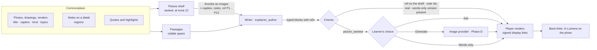

HIGH (a programme of four phases; each phase states its own tier)

# Lumen pictures: Lumens made with your own photos, drawings and words

**For:** the owner, to decide the direction, and the agent who later builds it in `studiolo`.
**Status:** Proposed. Claude, 24 October 2026. Nothing here is approved until the owner says so in the conversation.
**Checked against:** `studiolo` main @ `64a5cee` (24 Oct 2026), read only. Paths below exist on that commit unless marked *new*.
**Prototype:** [`prototypes/lumen-pictures/`](../../../prototypes/lumen-pictures/README.md).
**Builds on:**
- [Commonplace photos](2026-10-24-commonplace-photos-design.md). Its §8 leaves "a Lumen made from a topic can name and show the learner's own photos" to Learn. This is that design.
- [Learn roadmap](2026-10-23-learn-roadmap-design.md), its rule that "the model writes typed content, and Studiolo renders it".
- [Learn slice 2](2026-10-22-learn-slice-2-one-lumen.md): one Lumen in Watch, Listen and Read.

## 0. In short

The owner's question (24 Oct): *a person has placed photos in Commonplace. Why can't a Lumen use them, and what the library items say, instead of only text and graphs? AI-generated pictures should be the fallback, and the priority is the learner's own pictures.*

**Why not today: Lumens are blind by design, not by limit.**

| What | Where | Today |
|---|---|---|
| The writer's contract | `src/features/explainers/contract/text.ts:73` | "There are no pictures or photographs in this version." |
| A topic Lumen's context | `src/features/explainers/repository.ts:288-340` | Up to 8 tagged items, each a title (120 chars) and one note (300 chars). No id, shape or picture. The prompt says "You see only titles and notes, never the items themselves" (`text.ts:284`) |
| A photo item | `src/features/explainers/contract/brief.ts:86` | "a photo, which cannot be seen here": taught from general knowledge |
| Slide types | `src/features/explainers/slide-types.ts:13-15` | 13 types; none holds a picture. Scenes draw only `path` and `text` (`scene/types.ts:25-27`) |
| The player | `src/features/explainers/player/stage/stage-slide.tsx:36-54` | No `` anywhere in the player |
| Reading | `src/features/explainers/reading.ts:15-17` | `img` and `picture` are stripped |
| Generation | — | No AI vision call and no image generation anywhere in the app |

**The proposal in one line:** at make time, give the writer a **picture shelf** (the learner's best-matching pictures, which the model actually *sees*) and the learner's own **passages**. The writer places them through new typed blocks: `photo`, `photo_pair`, `cover`, `quote`. A picture is generated only when nothing of theirs fits, and only as the learner allows.

**The order of preference, for every point a slide makes:**
1. **The learner's own picture**, when one shows what the slide says.
2. **A drawn scene or diagram** (today's kit), when the point is a mechanism. Today's rule against faking drawings with boxes stays.
3. **A generated picture**, when the point is what something *looks like* and nothing of theirs shows it. It is always labelled *Generated*.
4. **Words only.** This is always available: every picture block carries its own words-only version.

| # | Phase | What the learner gets | Tier | Migration |
|---|---|---|---|---|
| A | **Your pictures in Watch** | A picture shelf in the brief; photo, pair and cover slides; your notes on a detail lit as they're spoken; quotes from your passages; a **Pictures** tab with why and Swap; *In Lumens* on a photo | HIGH | yes |
| B | **Drawn over your pictures** | The air's path traced over your section; tap-on-the-picture questions | HIGH | no |
| C | **Read and sharing** | Figures in Read; *Include your pictures* when sharing | HIGH | no |
| D | **Generated pictures** | The fallback: Ask, Generate or Words only; *Keep in Commonplace* | HIGH | yes |

**Why this order:**
- **A changes the most for the least risk.** No paid service is involved, and every picture is one the learner already owns.
- **B needs A's blocks**, plus a check that an overlay really follows the drawing.
- **C waits for Read.** The Read format arrives with Learn roadmap Phase 2's typed lesson blocks. Sharing needs a public picture route.
- **D adds a paid provider**, so it needs the owner's word, and it is the fallback, not the point.

## 1. How it works

### 1.1 The picture shelf (server, before the model call)

- **What's on it:** the account's `image` items tagged to the anchor topic or any topic under it, ranked by:
  1. pinned by the learner in the brief (*Use*);
  2. Picks (`images.picked_at`, Commonplace photos Phase 3, once it exists);
  3. has a caption or a note on a detail;
  4. words shared between the question and the title or caption;
  5. newest tag.
- **Limits:** at most **12** pictures (*new* `SHELF_MAX`), and at most 3 from one album, so a 200-photo site visit can't fill it. Items the learner set to *Leave out* are never on it.
- **Beyond the topic:** also the learner's project items that name the topic in a caption. The prototype's *housing study* render ("the tall wing takes the wind tower") is the example. This is a plain text match, with no AI.
- **Item Lumens:** from Commonplace, "Make a Lumen from these" puts the selected photos on the shelf as *Use*. A single photo's Lumen ("Make a Lumen about this picture") is no longer "a photo, which cannot be seen here".
- **Each shelf entry the writer gets:**
  - `ref` (`P1`…`P12`), kind (Site visits, Drawings, Renders…), title, caption, place or album, date;
  - its notes on a detail, as `{ id, text }` (their regions stay server-side);
  - the **640 px thumb as an image block**. The writer is Opus; it can look at the picture, so this works *before* Commonplace's Phase 6 descriptions exist. When they arrive, they improve the ranking; they don't replace the look.
- **Cost:** a 640 px thumb is about 400–550 input tokens, so 9–12 pictures add about 4,000–6,000 tokens to one `explainer_author` call. This goes through `checkSpendCap` as today. The exact figure is measured in Phase A's live check, not guessed here.

### 1.2 Passages from the learner's items ("use what the library items say")

- **Today:** a topic Lumen sees one 300-character note per item and is told never to quote it.
- **Proposed:** the learner's **quotes** (Notes in the quote style) and **highlights** on sources tagged to the topic join the brief as citable spans. They use the `<sources>` / `` form that item Lumens already use (`contract/brief.ts:101-107`), so citations, verification and the player's source links work unchanged.
- **New block `quote { spanId }`:** the slide shows the passage **verbatim, taken from the stored text, never retyped by the model**, with its source. The prototype's "Shade first, then mass, then air." is one.
- **Limits:** the existing context limits apply: at most 8 passages (`BRIEF_MAX_ITEMS`), each cut as notes are today.

### 1.3 The contract (1.8 → 1.9): new typed blocks

Each block references shelf refs and note ids, never URLs. Each also carries `items`, its words-only version, which is what renders when a picture is gone, left out or not shared.

| Block | Fields | Renders as |
|---|---|---|
| `cover` | `picture` | The title slide with the picture on one side |
| `photo` | `title`, `picture`, `items` (1–4), `notes?` (note ids to light, each with a cue word), `side` (left \| right) | One picture at its own ratio plus 1–4 points. A note lights, and the picture eases in on its region, when its cue word is spoken |
| `photo_pair` | `title`, `pictures` (2), `labels` (2 × `{ kicker, line }`), `items` | Two pictures compared; the side being spoken about stays bright |
| `quote` | `spanId` | The learner's passage, verbatim, with its source |
| `picture_wanted` | `describe` (≤ 200), `look` (photo \| drawing), `items` | Phase D: the gap, shown per the learner's choice |
| *(Phase B)* `trace` on `photo` | `steps` (2–5 × `{ cue, path }`), paths in 0–1 picture coordinates | The scene kit's path drawn over the picture, one step per cue |
| *(Phase B)* `tap_question` | `picture`, `question`, `zone` (a note id or a 0–1 box), `yes`, `no` | Tap on the picture; feedback marks the zone |

**New rules in the contract's picture section:**
- Use a learner's picture only when it shows what the slide says. Never use a picture just to decorate a slide.
- Say only what the caption, the notes or the picture itself shows. Never invent a place, date or fact about a learner's picture.
- Speak of it as theirs ("the photo you took in Yazd") only from its caption, place and date fields.
- Use a mechanism's scene, not a photo, when the point is how something works.
- At most one picture block every other slide, and each picture on at most 2 slides.
- No picture in the first version marks anything by coordinates the model made up. Marks come only from the learner's own notes on a detail (Phase A). Model-drawn paths wait for Phase B's check.

**Checks in ingest** (rejects go through the existing repair round, `author.ts`'s `REPAIRABLE_WARNINGS`):
- Every ref is on this Lumen's shelf, and every note id belongs to that picture.
- Every picture block has its words-only `items`.
- Lines that say "your photo / drawing / render" or "you took / noted" sit only on slides that show a learner picture (a cheap text check).
- The usage limits above.
- `quote.spanId` exists in the brief.

**Versions:** `CONTRACT_VERSION` goes to `1.9`, `text.ts:73` is replaced, and the golden hash in `tests/unit/explainer-contract.test.ts` moves on purpose.

### 1.4 The player

- **Rendering:** `renderSlide` (`stage-slide.tsx`) gains one component per block. Its `satisfies never` forces each to be drawn.
  - Pictures are `` of the `display` variant (2048 px) at the picture's own ratio on the slide's 1280 × 720 stage, `thumb` in the slide strip, and the photo's dominant colour as the placeholder once Commonplace's palette exists.
  - CSP already allows the storage and media origins (`src/features/security/csp.ts:67`).
- **Signed links:** they last 15 minutes (`src/features/files/limits.ts:13`). The player asks for the Lumen's picture links on open and again on any failed load. They are never stored in the Lumen.
- **Notes as marks:** the learner's region (`note_regions` in Commonplace photos Phase 4) outlined, numbered, with the note's words and date. The ease-in is a transform only; with reduced motion it outlines without moving. Before Phase 4 lands, `photo.notes` is simply empty.
- **The Pictures tab** beside Transcript and Sources:
  - For each picture: the slides it's on, why it was chosen (the shelf's ranking reasons, stored with the Lumen), **Show**, **Swap…** and **Open in Commonplace**.
  - **Swap…** replaces a picture on every slide that uses it. Then **one repair call** rewrites only those slides' lines, which are voiced again with today's Retry voice path. Choosing *Words on this slide* needs no model call.
- **In Lumens:** a photo's info panel in Commonplace lists the Lumens and slides that use it, each with **Open at slide N**. A *new* table `explainer_pictures(account_id, explainer_id, item_id, node_id)` serves this. It is written at ingest, and its rows are removed with either side.
- **Deleting a photo** that a Lumen uses: the Lumen keeps working, and those slides render their words-only version. The delete dialog says "Used in 1 Lumen" (the same pattern as other references).

### 1.5 Formats

| Format | Pictures |
|---|---|
| **Watch** | All the blocks above |
| **Read** (Phase C) | A `figure` block (one picture, a pair, or one with its trace), captioned with the learner's own caption, marked *Your caption* |
| **Listen** | No pictures. The cover is the cover picture, and the hosts may say "the photo you took in Yazd" under the same rules |
| **Live** | Later: "show me my section again" puts a shelf picture on screen. Nothing new is fetched mid-session |

## 2. Phase A: your pictures in Watch (HIGH, migration)

- **Shelf and brief:**
  - *new* `src/features/explainers/sources/shelf.ts` (pure ranking, unit-tested) and the shelf read in `repository.ts`, beside `collectBriefContext`;
  - the brief gains a **Pictures** section (the prototype's *Make* screen): *Studiolo picks · Use · Leave out* per picture.
- **The model call:** `buildAuthorPrompt` (`contract/prompt.ts:73-79`) adds image blocks after the brief's text. The cache prefix (contract and examples) is unchanged, so caching still holds.
- **Blocks:** `cover`, `photo`, `photo_pair`, `quote`, with ingest checks as above.
- **Data (migration):**
  - `explainer_pictures` (above);
  - the shelf snapshot (refs → item ids, ranking reasons) stored on the explainer's brief snapshot, so Swap and *why* survive later changes to the library.
- **UI:** the Pictures tab, Swap, *In Lumens*, delete fallback.
- **Switch:** `LUMEN_PICTURES`, testers first. Off, the contract stays 1.8 byte for byte.
- **Not in A:** traces, tap questions, Read, sharing pictures (shared Lumens show words only), generation.
- **Done when:**
  - A topic with 10+ tagged photos gets a Lumen that uses 3–6 of them where they fit, and none where they don't.
  - No ref escapes the shelf, checked on a hand-made set of 10 briefs.
  - Swap and delete fall back cleanly.
  - One live run per kind (topic, photo selection) is recorded with its token count.

## 3. Phase B: drawn over your pictures (HIGH)

- **`trace`:** the writer gives 2–5 steps of path in 0–1 picture coordinates, drawn with the scene kit's `s.flow` look over the picture.
- **The check:** a cheap second look (Haiku with the picture and the rendered overlay: "does each step follow the drawing's walls and arrows?"). A failed trace is dropped and the slide keeps its plain picture. This is the first model-vision check in the app, so it is evaluated on 20 hand-made cases before it's on.
- **`tap_question`:** its zone is a learner's note region, or a box that passed the same check.

## 4. Phase C: Read and sharing (HIGH)

- **Read:** the `figure` block joins the lesson blocks of Learn roadmap Phase 2 (`lesson_page`), so Read and course reading lessons share it.
- **Sharing:** pictures stay private until the learner chooses.
  - **The choice:** the Share dialog asks *Your pictures: Include them · Leave them out*.
  - **Included:** the snapshot whitelist (`src/features/explainers/sharing/strip.ts:8-10`) gains the picture blocks, and a *new* route `/api/shared/[code]/picture/[nodeId]` resolves the code and redirects to a short-lived link, as shared audio does (`src/app/api/shared/[code]/audio/[nodeId]/route.ts`).
  - **Always stripped:** a note's words on marks; marks show as outlines only.
  - **Left out:** those slides render their words-only version.
  - **Narration can't be stripped.** Rule B16 (`ai.md:409`) exists because a shared Lumen must never carry the learner's notes, and spoken lines can't be filtered afterwards. A Lumen whose lines quote a note or a caption ("as you noted, the slots are on one side only") is therefore shared as a **shareable copy**: one repair call rewrites only those lines from the slides' words-only versions and voices them again. The learner's own Lumen keeps its lines. Ingest marks which lines draw on notes or captions (the same check that ties "your photo" lines to picture slides), so the copy knows what to rewrite.

## 5. Phase D: generated pictures (HIGH, migration, paid service)

- **When:** the writer emits `picture_wanted` only for "what it looks like" points with no fitting shelf picture. Mechanisms get a scene instead.
- **The learner's choice** is a setting with a per-brief override (the prototype's *When none of your pictures fits*):
  - **Ask me on the slide** (recommended default): the slide shows *Generate one · Pick one of mine*, or stays words;
  - **Generate, marked Generated**;
  - **Words only**.
- **Rules for what's generated:**
  - A type, never a real named building, place or person ("a barjeel of the Gulf kind", not "the Al Fahidi house").
  - No people's faces.
  - Labelled *Generated · not a real building* on the slide, in Pictures, in Read and when shared.
- **Storage:** a *new* `stored_objects.kind = 'explainer_picture'` (the kind check widens, as it did for `explainer_audio`). It belongs to the Lumen and is deleted with it. **Keep in Commonplace** copies it into a *new* image item of kind *Generated*, linked back to the Lumen.
- **Provider and cost:** an owner decision (D4). Every generation goes through `checkSpendCap` with an in-flight hold. The prototype's dialog says "about as much as one narrated slide" as a placeholder until real prices are measured.

## 6. Decisions for the owner

| ID | Question | Recommendation |
|---|---|---|
| **LP-D1** | Let the writer *see* the learner's pictures at make time (thumbs as image input), before Commonplace's Phase 6 descriptions exist? | **Yes.** It is the only way a Lumen can say true things about a photo with no caption, and it adds about 4–6k input tokens to one call |
| **LP-D2** | Lift the "never quote a saved item" rule for topic Lumens, through citable passages (quotes and highlights)? | **Yes**, through the existing span and citation path, with verbatim `quote` blocks |
| **LP-D3** | When nothing fits, the default: Ask, Generate or Words only? | **Ask on the slide.** Learners see the gap and choose; *Generate* is one setting away |
| **LP-D4** | Which image provider for Phase D, and a monthly cap per account? | Decide at Phase D, after Phases A–C show how often gaps happen |
| **LP-D5** | Sharing a Lumen with your pictures: preselect *Include* or *Leave out*? And is a shareable copy (lines that quote your notes rewritten) acceptable under B16? | **Include, asked on every share** of a Lumen that has them. **Yes to the shareable copy**: note words never travel, in marks or in narration |
| **LP-D6** | Phase B's vision check: Haiku, or skip traces until Opus can place them reliably? | **Haiku check**, measured on 20 cases first |
| **LP-D7** | Where this sits in the Learn roadmap | **After Learn Phase 1, beside Phase 3 (Enhance and share).** It changes today's Watch Lumens and needs no new format |

## 7. Rules carried over

- **Names:** the screens say **Lumens**, **Commonplace**, **Pictures** (the tab), **Generated**. Code keeps `explainer`, `library`.
- **Typed content only:** the model writes refs and fields, never URLs, HTML or image markup. Studiolo renders.
- **Motion:** transform and opacity only; reduced motion settles at once; no continuous motion.
- **Paperwork:** a phase spec per phase in `studiolo`'s `docs/superpowers/specs/`, tier on line one. `project-docs/implementation/ai.md` changes on the same branch as the contract. Migrations are hand-written and applied only with the owner's word. No paid run without the owner's word.

## 8. What this is not

- **Not a slideshow of the library.** A picture appears only where it shows what's being said. A Lumen with no fitting pictures is still made, in words and scenes.
- **Not image editing.** Pictures are shown as they are, at their own ratio. The only marks are the learner's notes, plus (Phase B) checked overlays.
- **Not a replacement for scenes.** How air moves is still drawn. A picture shows what it looks like.
