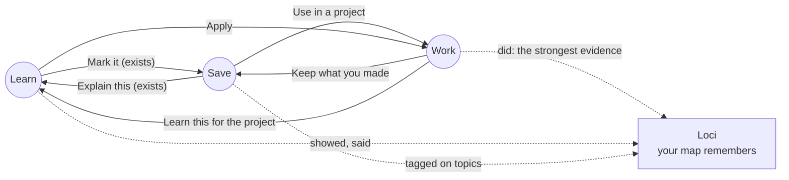
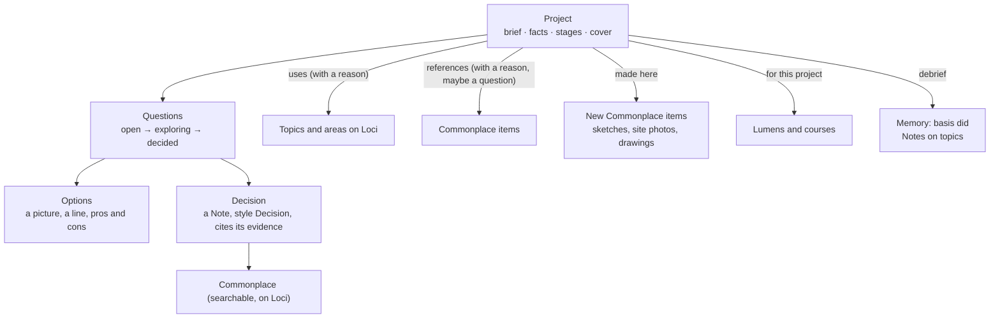
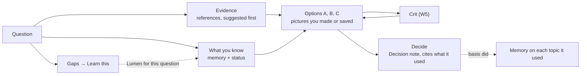
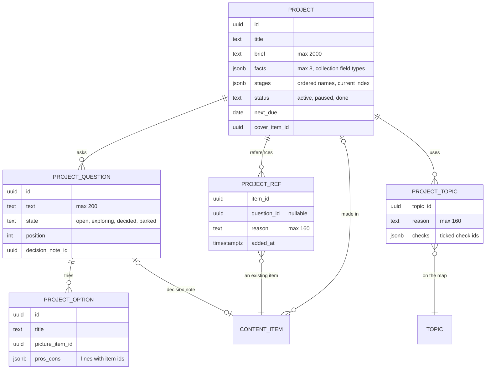

HIGH (a new destination and new records; each phase states its own tier)

# Work: using what you know on what you make

**For:** the owner, to react to and steer. This is a starting point for a discussion, not a build spec.
**Status:** Idea, explored. Claude, 24 October 2026. Nothing here is agreed until the owner says so in the conversation.
**Checked against:** `studiolo` main @ `64a5cee` (24 Oct 2026), read only, and this repo's proposals from 21–24 October (Lumens, learner memory, Commonplace photos, Loci Palace). Paths exist on that commit unless marked *new*.
**Prototype:** [`prototypes/work/`](../../../prototypes/work/README.md).
**Superseded in part (24 Oct):** the model in §2–§6 is shaped around an architect. [Work, in any field](2026-10-24-work-any-field-design.md) replaces it with one shape for every field; the loop, touchpoints and limits here still stand.

## 0. In short

Studiolo today is a loop of two halves: you **learn** (Lumens, courses, Live) and you **save** (Commonplace), and Loci is the map that holds both. Nothing in the app is about *using* any of it. Yet the learner it is built for is a working architect: the sample learner's own memory card already says "Working on: a prayer hall for about 600 in Dubai", and "For work" is the commonest reason they give for learning a topic.

**Work** adds the third half. A **project** is something you are making. It has a brief, a few open **questions**, the **references** you bring to it from Commonplace, the **topics** on your map it uses, the **options** you try and the **decisions** you make. Every one of those links back:

So the loop stops being *learn, save, learn* and becomes *learn, save, work*, in any order and forever: work shows you what you don't know (you learn it), work makes things worth keeping (you save them), and what you learned and saved turns up exactly when the next project needs it. The palace stops being only a place you store things and becomes the place you work from.

| # | Phase | What the learner gets | Tier | Migration |
|---|---|---|---|---|
| W1 | **Projects and references** | A Work destination; a project with a brief, facts, a cover and stages; **Use in a project** on any Commonplace item, with a one-line reason; a project board | MEDIUM | yes |
| W2 | **Questions, options, decisions** | Open questions as the unit of work; options with pictures; **Decide** writes a Decision note that cites its evidence | HIGH | yes |
| W3 | **Apply** | Each topic the project uses gets an **Apply card**: what you know, the rules of thumb from your own saves, checks, gaps. Lumens can be made *for* a project | HIGH | no (cache table optional) |
| W4 | **Start from a sentence** | Type what you're working on; Loci drafts the brief, the first questions, the topics and the references from your own map and Commonplace | HIGH | no |
| W5 | **Crit** | Show Loci a sketch or an option; it critiques it against your brief, your saves and what you know | HIGH | no |
| W6 | **Debrief** | Close a stage or a project: what it taught you goes onto your map as notes and as "did" memory; a finished project can become an Object | HIGH | no (uses memory tables) |

**Why this order:** W1 and W2 are the record and need no AI, so they're useful the day they ship and cheap to run. W3–W5 are where Loci earns its keep, and they depend on learner memory (Stage 4) existing. W6 closes the loop and depends on both.

## 1. What exists today, and why it isn't enough

| Today | Where | What it means for Work |
|---|---|---|
| **Topics are used as projects.** The photos prototype's sample map has *Practice → Riyadh library competition → Massing options*, because there is nowhere else to put a project | `prototypes/commonplace-photos/index.src.html` (sample data); `src/db/topics-schema.ts` | A project isn't something you learn; it's something you make. Filing it as a topic puts a deadline and a client into the knowledge map and leaves the topic status (*Not started · Learning · Learned*) meaningless for it |
| **"Working on" is a memory line.** The memory design keeps it as a slot, up to 160 characters, on You or a topic | `docs/superpowers/specs/2026-10-24-learner-memory-and-settings-design.md` (proposed) | Work makes it a place you can open. The memory slot becomes a link to the project |
| **Goals** ("Thesis · Dubai courtyard house · Due March") feed Learn's *Next for your goals* | Learn slice 2 (proposed); `project-docs/architecture/data-model.md` (`goals`, planned) | A goal is what you want to *know* by a date; a project is what you want to *make*. A project can create goals ("Know enough acoustics before Developed design") |
| **Collections, Views, Picks** group Commonplace items | `project-docs/product/library.md`; photos roadmap (proposed) | None of them say *why* an item matters to a piece of work, and an item is in at most one collection. A project needs many-to-many references, each with a reason |
| **Objects** (a building, a person, a case) with collection fields | `library.md` (Phase 2H Step 3, built) | A finished project can *become* an Object, so your own work joins your references |
| **Learning forms** proposal: *Studio brief* (a design exercise with critique of a sketch) | `docs/superpowers/specs/2026-10-22-learning-forms-and-dialogues.md` §3 | Crit (W5) is that form pointed at real work instead of an exercise |
| **Memory basis** includes `did` | memory reference §2 (proposed) | Work is where `did` comes from. Nothing else in the app produces it |

## 2. The model: a project references, it never holds

The same rule that runs Commonplace ("never folders") runs Work. A project is a **lens** on things that already exist, plus a few things that only exist because of the project.

| Thing | What it is | Lives in | Owned by the project? |
|---|---|---|---|
| **Project** | Title, brief (≤ 2,000 chars), up to 8 **facts** (Site, Size, Client, Climate, Budget, Due…; the same field types as collections), **stages**, a cover, status *Active · Paused · Done* | *new* `projects` | yes |
| **Reference** | An existing item brought to the project, with a **reason** ("for the qibla wall light") and optionally a question | *new* `project_refs` | the link only. Removing it never touches the item |
| **Made here** | A sketch, site photo or drawing created inside the project. It is a normal Commonplace item that remembers where it was made | `content_items` + *new* `made_in_project_id` | no: it's in Commonplace like anything else, and outlives the project |
| **Uses** | A topic or area the project needs, with a reason | *new* `project_topics` | the link only |
| **Question** | One open design question. The unit of work | *new* `project_questions` | yes |
| **Option** | A possible answer: title, one picture, a line, pros and cons with sources | *new* `project_options` | yes |
| **Decision** | What was chosen and why, citing references, options and what you know. Written as a **Note with the style Decision**, so it is searchable and can be tagged | `content_items` (new note style) | no: it's knowledge now |
| **Lesson** | What a stage or project taught you, filed on a topic | Note on the topic + a memory entry, basis `did` | no |

**Three rules that keep it calm:**
1. **One record, everywhere.** A reference shows on the board and keeps its one ID; its page says *Used in: Prayer hall, for the qibla wall light*.
2. **Work never changes topic status.** Applying a topic in a decision can *suggest* "You used this on Prayer hall. Mark Light & threshold as Learned?", never set it. (The product rule in `project-docs/product/brief.md`.)
3. **Your library first.** Everything Loci says in Work cites your own items, your notes or your memory. General knowledge is marked as such, as Lumens already do.

## 3. The six actions, one per edge of the loop

These are the verbs the owner asked for: how a learner *acts* on items, areas and topics in a work setting rather than a learning one.

| Edge | Action | Where it appears | What it does |
|---|---|---|---|
| Save → Work | **Use in a project** | Any item's `⋯` menu, the quick view, Select's bulk bar, the board's *Add from Commonplace* drawer | Adds a reference with a one-line reason and, optionally, a question. Suggestions come first: items tagged on the topics the project uses, Picks first |
| Work → Save | **Keep what you made** | The project's *Add* (sketch, photo, drawing, note), and every Option's picture | Saves a normal item to Commonplace with *Made in: Prayer hall* and the project's topics suggested. Decisions become Decision notes |
| Learn → Work | **Apply** | A topic or area on Loci, a Lumen's end card, a course part | Opens the topic's **Apply card** for a chosen project (§4). From a Lumen's end: "Use this in Prayer hall?" turns its main idea into a line on a question |
| Work → Learn | **Learn this for the project** | A question's *Gaps*, a topic in *Uses* that's Not started, a Crit that finds a hole | Makes a Lumen (or plans a course) whose brief includes the project and the question. The Lumen is tagged *for Prayer hall* and filed on its topic as usual |
| Work → Loci | **Show on Loci** | Project header | Lights the topics the project uses, across areas, and dims the rest. The Palace later draws the project as a thread through its rooms |
| Work → memory | **Debrief** | End of a stage or project | Three prompts; each lesson is filed on a topic as a Note and as a memory entry with basis `did`; status changes are offered, never made |

## 4. The Apply card: a topic in work mode

This is the heart of the idea. In Learn a topic is **explained**. In Work the same topic is **applied**: turned into what you'd pin above your desk for this one project.

For *Climate-responsive design*, used on *Prayer hall*, the card shows:

| Part | Example | Comes from |
|---|---|---|
| **What you know** | "You know the stack effect (from a check, 21 Oct)". "To revisit: evaporative cooling helps little in humid air" | Memory entries at the topic and its children (the slice the memory design already compiles) |
| **Rules of thumb** | "Shade first, then mass, then air", *your quote, lecture notes p. 3*. "A court deeper than it is wide stays shaded most of the day", *Lumen: Wind catchers and the courtyard* | Your items tagged on the topic, the Lumens you watched there, your margin notes. Each line cites one |
| **Checks for this project** | ☐ "Court ratio, height to width, at least 1 : 1" ☐ "Don't count on evaporative cooling between June and September" | Loci, from the rules and the project's facts (Dubai, humid summer). Ticks are stored on the project |
| **Gaps** | "The project needs humid-air comfort; your map has nothing on it." *Learn this for the project* | Facts + questions compared with your map |
| **References here** | The 4 items you've used from this topic, and 3 suggested | `project_refs` and the topic's items |

The card is compiled once per project and topic and refreshed when its sources change, exactly like a memory digest: *compile on write, read on open*. It costs one Sonnet call to build and nothing to reopen.

## 5. A question, worked

The unit of work is a **question**, because that's how design actually moves: "How do we light the qibla wall without glare?" is something you can gather for, learn for, try options for and decide.

States: **Open** (asked), **Exploring** (has evidence or options), **Decided** (has a Decision note), **Parked**. The project's *Work on next* picks the open question nearest its next stage date.

## 6. Starting a project (W4)

The moment that makes the whole app pay off: you type one sentence and your own palace answers.

> "A small library in Sharjah, two floors, with a reading garden. Concept due in three weeks."

Loci drafts, as one change card with **Keep** and **Edit** (the same ask-first card pattern as graph plans):
- a **brief** and **facts** (site, size, climate, due);
- **3–5 first questions**;
- the **topics it uses** from your map, with their status ("Light & threshold · Learned", "Shading & screens · Not started");
- **references** from your Commonplace with a reason each, Picks first ("Reading room with clerestory: you saved it for north light on tables");
- **gaps**: what the brief needs that your map doesn't have.

It reads the learner slice and a project-sized library map (titles, topics, Picks), never whole items. One Sonnet call.

## 7. Everywhere else in the app

Work is a destination, but most of its value shows up on screens that already exist:

| Screen | What changes |
|---|---|
| **Today** | A *Work on next* card beside *Continue*: the question to decide and the stage date ("Concept review · Thu 29 Oct · 1 question to decide") |
| **Learn → Home** | *Next for your goals* becomes *Next for your goals and projects*. A Lumen made for a project carries a small *for Prayer hall* tag, and its end card offers **Use in Prayer hall** |
| **Make a Lumen** | The brief gains a **Project** part: title, facts, the question. "Already known" includes what the project decided |
| **Commonplace** | `⋯` and the quick view gain **Use in a project**; an item's page shows *Used in*. A **Made in** filter. Decision notes have their own card style |
| **Loci → Map** | A topic panel shows *Used in Prayer hall · Apply ›*. **Show on Loci** from a project lights its topics |
| **Loci → Palace** | Later: a project is drawn as a thread through the rooms it uses, the same visual language as a Lumen's "ties together" |
| **Memory** | `working_on` links to the project. `did` entries from decisions and debriefs. "For work" reasons point at a project |
| **Copilot** | New tools: `read_project`, `propose_project_plan` (change card), `apply_topic`, `crit_option` (costly) |

## 8. Records (sketch, for discussion)

All account-owned, same-account composite keys, as every private table today.

Evidence kinds *new* in `learning_evidence`: `applied` (a topic cited in a Decision), `debrief` (a lesson's text, read by the scribe). Both write at the topic's place, so the memory design needs no new path, only two rules.

## 9. Not everyone is an architect

The brief says "an architect or another knowledge professional". The model holds for any work that moves by questions and references:

| Who | A project | Its questions | Its references |
|---|---|---|---|
| Architect | Prayer hall, Al Barsha | Qibla wall light; court cooling; panel joint | Site photos, precedents, details |
| Lawyer | A construction dispute | Is the delay excusable? What did the contract allocate? | Cases (Objects), clauses (Quotes), notes |
| Researcher | A paper | What's the gap? Which method? | Sources, quotes, Lumens |
| Product designer | A checkout redesign | Where do people drop out? | Screenshots, studies, notes |

Stages are a short list per project, seeded from the learner's field (architects get *Brief · Concept · Developed · Technical · Site · Done*), and freely edited.

## 10. Decisions for the owner

| ID | Question | Recommendation |
|---|---|---|
| **W-D1** | Name on screen | **Work**, a verb like Learn, in the rail between Commonplace and Loci. Alternatives: *Studio*, *Atelier*, *Bottega* (the Renaissance workshop to the studiolo's study). Projects inside are **projects** |
| **W-D2** | Is a project its own record, or a kind of topic or area? | **Its own record.** Topics are what you know; projects are what you make. Offer **Turn into a project** on topics that are really projects (the *Practice* area in the sample), moving their items over as references |
| **W-D3** | Does a project hold items? | **No, it references them**, each with a reason. Only Options and Questions belong to it |
| **W-D4** | Decisions as a new Note style, *Decision*? | **Yes.** It makes the design rationale searchable, taggable and visible on Loci, and gives later projects something to learn from |
| **W-D5** | Can work change topic status? | **No.** It offers. Applying a topic in a decision suggests *Learned* once, with Not now |
| **W-D6** | Share a project with a team or a client? | **Later.** Studiolo is one person's library. A read-only *Share the board* is a good later idea, like sharing a Lumen |
| **W-D7** | Where in the build sequence? | **W1–W2 after Commonplace's Picks and Views**; W3–W6 after Stage 4 learner memory, which they need |
| **W-D8** | Crit on sketches uses a vision model | **Yes, in W5**, priced as a costly tool with its own allowance line |

## 11. What this is not

- **Not a project-management tool.** No tasks, assignees, Gantt charts or time tracking. The calendar on Today may show stage dates; that's all.
- **Not a file store for a practice.** No CAD, no versions of drawings, no sharing with consultants. What you keep is what you'd want to learn from later.
- **Not a second library.** Everything a project makes lands in Commonplace and outlives the project.
