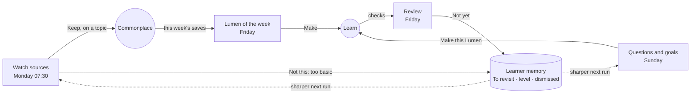

HIGH (a new kind of background work, new records, model calls without the learner present; each phase states its own tier)

# Loci routines: keeping the learning loop moving between sessions

**For:** the owner, to decide the direction, and the agent who later builds it in `studiolo`.
**Status:** Superseded on 29 October 2026 by [What Loci should do while you're away](2026-10-29-background-work-rethink.md). Its run mechanics (§4) still stand; its product shape (nine kinds, a Routines page, a sentence editor) does not.
**Prototype:** [`prototypes/loci-routines/`](../../../prototypes/loci-routines/README.md), published as the claude.ai artifact **Studiolo Loci Routines**.
**Started from:** Walling's "Everyday agents" (instructions, scope, trigger, delivery, run history, cost up front), which the owner shared on 25 October. The structure and the card here are Studiolo's own (§6).
**Builds on, in this repo:**
- [Learner memory](2026-10-24-learner-memory-and-settings-design.md) and its [system reference](2026-10-24-learner-memory-system-reference.md): the Trigger worker, the per-place digest, rules before models, the prompt cache.
- [Loci suggests resources](2026-10-24-loci-suggests-resources-design.md): real catalogues only, Save and Dismiss, dismiss reasons.
- [Questions and goals inside items](2026-10-25-questions-and-goals-inside-items-design.md): `@question` and `@goal`, Explain this, Answered in.
- [Boards](2026-10-24-boards-design.md) and [Work](2026-10-24-work-any-field-design.md): board questions, project decisions and gaps.
- [Learning forms and dialogues](2026-10-22-learning-forms-and-dialogues.md): the Daily brief as a short two-voice Dialogue.

**Checked against:** this repo only. No `studiolo` path is cited as fact here; the B1 spec re-checks every path on main before it is written.

## 0. In short

> **Routines keep your learning moving between sessions.** At places on your map you choose, they bring in what's new, make sense of what you saved and asked, bring back what's slipping, and bring forward what's next. You decide what happens to everything they bring.

Today Studiolo moves only when the learner opens it. A routine is Loci working while they're away: a standing instruction, written as one sentence, tied to one place on Loci.

*"Every Sunday at 18:00, go through my open questions and goals at **Climate-responsive design** and suggest a Lumen for each one my saves can answer. → Today"*

## 1. What routines are for: the loop

The loop is **learn → save → work**, with Loci as the map and memory underneath (Work design §0). Each routine does one of four jobs, and each job is a part of that loop that otherwise waits for the learner:

| Job | Loop step | Kinds | Every run ends in |
|---|---|---|---|
| **Bring in** | Save | Watch sources · Reading list | Keep (on a topic, To read) or Not this, with a reason |
| **Make sense** | Save → Learn | Questions and goals · Lumen of the week · Sort Unsorted | Make this Lumen · Mark answered · Place it |
| **Bring back** | Remember | Review | Got it / Not yet (feeds To revisit) |
| **Bring forward** | Learn → Work | Daily brief · Board digest · Project update | Listen · Explain… · Learn this for the project |

The loop closes because every decision is evidence. What the learner keeps, dismisses and answers goes to memory by the usual rules, so the next run of every routine is sharper:



## 2. Rules

1. **Every routine lives at one place on Loci**: You (the whole map), an area, a topic, a board, a Work project, or Commonplace › Unsorted. It reads that place and what's under it, and nothing else.
2. **Every output ends in a learning action.** A kind of routine whose output can only be read and scrolled past doesn't ship. This is what keeps routines from becoming a feed.
3. **It suggests; the learner decides.** Nothing is saved, made, placed or marked until the learner says so. The one opt-in exception is *Also file what it finds*, which writes only to Commonplace › Unsorted, marked *From a routine*.
4. **It never changes status, memory or the map itself.** The learner's decisions reach memory as evidence, by the memory design's own rules.
5. **Real sources only.** Books are checked in a catalogue, links must open, quotes come from the page. Nothing comes from the model's memory (decision A9).
6. **It earns its place.**
   - A run is skipped, at no cost, when nothing is new at its place.
   - Each run is capped at a few items (5 arrivals, 3 readings).
   - After three runs in a row the learner doesn't open, Loci asks *Pause it?*, and pauses it only on a yes.
7. **Cost is shown before and after**: per run and per month, as a share of the allowance (the unit Settings › Usage uses).
8. **Only for the learner.** A routine never sends anything to anyone else, and email goes only to the account's own address.

## 3. Use cases only Studiolo can have

The kinds in the prototype, and why each one needs Studiolo's own data:

| Kind | What it does | What makes it Studiolo's |
|---|---|---|
| **Watch sources** | Reads sources the learner picked (sites, newsletters, journals, channels), keeps what fits the map and the learner's level, sorts each item onto its topic, and says why it matters | Sorting onto *your* topics, and pitching by *your* level there. A new sub-topic is only suggested (dashed), never made |
| **Reading list** | Books and articles on a topic that you don't have yet, checked in a catalogue | Knows what you saved and dismissed; R1's catalogue check |
| **Questions and goals** | Goes through open `@question` and `@goal` inlines at a place. For each one: a Lumen outline built from your own saves, or *your saves don't answer this* (find readings), or *you may have answered it* (Answered in) | The inside layer (I4) gives it the learner's intent. It turns questions into Lumens without the learner asking |
| **Lumen of the week** | Gathers the week's saves and outlines one short Lumen from those that belong together | Turns saving into learning: the step most learners never take |
| **Sort Unsorted** | A topic for each entry with no place | Keeps Commonplace on the map. Cheap: one small-model call |
| **Review** | Questions on what slipped this week at a place, and one from longer ago | Reads To revisit and checks from memory |
| **Daily brief** | Five minutes of two-voice audio: today's step, yesterday's saves, one question to think over | The Dialogues design's idea #7, on a schedule |
| **Board digest** | A board's open questions and what on it already helps | Reads cards, arrows and questions (Boards) |
| **Project update** | Decisions, open questions and gaps on a Work project, with *Learn this for the project* | Reads Work's records (W2, W3) |

**Later, once these have earned it:**
- **Before a trip or a site visit:** a one-off routine that builds a guide the day before (the Site guide form).
- **Map gardener:** suggests sub-topics where a topic has grown past about 15 saves, and links between topics that a board's arrows connect (Boards B4).
- **Course pacer:** for a course in progress, the next part on the learner's own days.

## 4. How a run really works

A routine is **a workflow, not an agent**. The steps are fixed in code. The model is called once or twice, at known points, with a schema for what it returns. It has no tools that act on anything.

```mermaid
sequenceDiagram
  autonumber
  participant SCH as Scheduler (Trigger.dev, the worker memory uses)
  participant W as runRoutine (worker, new)
  participant DB as Postgres
  participant SRC as Sources and catalogues
  participant AI as Claude (Messages API)
  participant OUT as Today · email (Loops) · voice
  SCH->>W: due: routine r for account a
  W->>DB: read the routine, the place's digest, what's new since the last run
  alt nothing new at the place
    W->>DB: run = skipped (0 tokens)
  else something new
    W->>SRC: fetch (Watch: RSS/Atom, APIs; Reading: catalogue lookup)
    W->>W: filter by rules: seen, duplicates, like dismissed, cap
    W->>AI: one structured call: judge, sort, write (schema per kind)
    AI-->>W: JSON cards
    W->>W: check: links open, titles match, cited saves exist, topics exist
    W->>DB: run + items (status: waiting)
    W->>OUT: deliver
  end
  Note over DB: the learner's Keep / Dismiss / Make / Got it are written as evidence, as in the memory design
```

### 4.1 Each step

1. **Starts.** One scheduled job per routine on the existing Trigger worker, in the learner's time zone. *Run now* starts the same job at once.
2. **Gathers, by rules.** The place's memory digest (already compiled on write, one query), the place's items since the last run, and the routine's guidelines.
3. **Skips, by rules.** If nothing changed at the place since the last run, it stops before any model call and writes a *skipped* run. This is the biggest saving, and the learner sees it as "Skipped: nothing new".
4. **Fetches, in code, not by the model.**
   - Watch reads RSS/Atom feeds, sitemaps and the APIs of the sources the learner listed (arXiv, YouTube channel feeds, journal feeds).
   - Reading list looks titles up in Open Library or a similar catalogue (R1).
   - Fetching in code keeps it cheap, repeatable, and limited to the learner's own list.
5. **Filters, by rules.** Already seen (a hash of the URL and title), duplicates across sources, close to something dismissed before, then a cap.
6. **One model call.** The Messages API with **structured outputs** (`output_config.format` with a JSON schema per kind), so the result is always cards and never free text.
   - **Fixed and cached:** the system prompt holds the kind's contract (what it may say, the schema, the voice). It is identical for every learner, so it is read from the prompt cache.
   - **Per run:** the place's digest, the routine's instructions and guidelines, and the candidates.
   - **Model:** a small model for sorting and judging (Watch, Sort Unsorted, Review), and the writing model for outlines and scripts (Questions and goals, Lumen of the week, Brief), as the memory design already splits the scribe and the copilot.
7. **Checks, by rules.** Every link opens, every title matches its page, every cited save exists and belongs to the learner, every topic exists. A card that fails is dropped, not repaired.
8. **Delivers.** A run row and its items. Today shows *From your routines*, email goes through Loops (a vendor already), and the brief is voiced like a Dialogue.
9. **Waits for the learner.** Their decisions are written as evidence, and as guidelines when they say what to change (§5).

### 4.2 Cost

- **Scheduled runs go through the Message Batches API at half price.** A batch can take up to 24 hours, so the job submits it early (overnight for a morning delivery). It falls back to a normal call if a result is late, and *Run now* always uses a normal call.
- **The fixed part of every prompt is cached** and read at a tenth of the input price, as in the memory design.
- **Skipping** costs nothing, and the per-run caps keep inputs small.
- The prototype's figures are examples. A real per-kind figure comes from the usage ledger (`cost-dashboard` already reads it) after the first 100 runs of each kind.

### 4.3 Safety

- **Source text is untrusted data.** It goes to the model only inside a clearly marked data block, the model has no tools, and its output must fit the schema. A page that says "ignore your instructions" can, at worst, produce one card that the learner dismisses.
- **Fetching is limited** to the learner's listed sources and the catalogue. The model never chooses what to fetch.
- **Copyright:** Commonplace keeps the link, a summary and at most a short quote. Open-access PDFs are saved whole, as in R4.
- **Privacy:** a routine reads only the learner's own data, and only at its place. The never-noted list in the memory design applies to routines too.

### 4.4 Why not an agent, or Managed Agents

A model-driven agent with browsing tools could do Watch "by itself", but it would cost more for each run, give a different result each time, and be harder to make safe against what it reads. Every kind here is a known sequence with one judgement in the middle, which is what a workflow is for.

Managed Agents' scheduled deployments are built for long-running agents in a sandbox. Studiolo needs thousands of small per-account schedules next to its own database, which the existing Trigger worker already does. If a later kind truly needs open-ended research, it can be one step inside the workflow, with a budget.

## 5. Refining: how a routine gets better

- **Taps.** Every run ends with *How was this run?*: Just right · Too basic · Too much · Not about my work. Each tap except *Just right* adds a **guideline** in plain words ("Pitch it one step deeper than my card says").
- **Words.** *Tell it something else…* adds the learner's own sentence as a guideline.
- **Shown with where it came from.** Guidelines appear on the card, *from the run on Mon 26 Oct*, and can be removed in Edit. They go into the per-run part of the prompt.
- **Decisions.** Dismiss reasons and answers also shape the next run through memory, by the memory design's rules: a guideline is about this routine, memory is about the learner.

## 6. The card: Studiolo's, not the reference's

The reference card is a settings panel: a toggle, a table of facts, two cost tiles. A Studiolo routine card reads like the rest of the app instead.

| Part | What it shows | Taken from |
|---|---|---|
| **Kicker + next run** | *QUESTIONS AND GOALS* · *Next Sun 1 Nov, 18:00* | The uppercase kicker of Today's Continue card |
| **Name** | In the reading face | Today's titles, Commonplace cards |
| **The sentence** | The routine itself, with its when and its place underlined, and *→ Today* | Studiolo writes in sentences ("Loci: Basics · for work · 1 to revisit") |
| **In your words** | The learner's instruction, quoted | A note's quote style |
| **Guidelines** | With *from the run on …* | Learner memory's "why" lines |
| **What came of it** | Eight run marks (used, waiting, not opened, skipped), then *8 kept · 3 dismissed* or *2 Lumens made · 3 answered* | Today's week strip; outcomes in the loop's own terms, not activity |
| **Waiting** | *3 to look at · from Today, 7:00 ›* when a run needs the learner | Today's "waiting" rows |
| **Place foot** | The place's status dot and path, and *about 0.4% a run* in small grey | A topic on Loci (`.state`), the wall card's topic foot |
| **Actions** | Run now · Runs · Pause · Edit, as text links | The app's quiet actions |

**The page** groups cards under the four jobs (Bring in, Make sense, Bring back, Bring forward), each with its loop step. It opens on one sentence in the voice of Today's Big Picture: *"This week your routines brought in 11 things. You kept 7, made 1 Lumen and answered 2 questions."*

**The editor is the sentence.** The when, the place and where it lands are choices inside the sentence itself. Below it are the sources (Watch only), *In your words*, the guidelines, what it may do, and *skip when nothing is new*. The cost updates as the learner changes things.

**Where else it shows:**
- **Today:** *From your routines*, plus the runs in the day's timeline.
- **Loci:** *Routines here* on a topic, the latest finding as a message in the topic's chat, and a prompt to make one in a sentence (*Every Friday, ask me what slipped here*).

**Builder** (never shown to learners, as in the memory design) shows how a run worked: each step, whether it ran on rules, search, a small model, the writing model or voice, and the tokens with how many came from the cache.

## 7. Data (for the R1 spec to settle; names indicative, all *new*)

- `routines`: account, kind, name, place (`place_kind`, `place_id`), cadence (`every`, `time`, `tz`), delivery, `may_file`, `skip_when_quiet`, `words`, `on`, `paused_reason`.
- `routine_guidelines`: routine, text, `from_run`, how (tap or words), `removed_at`.
- `routine_sources`: routine, URL, kind (feed, site, channel, journal), `last_seen_at`.
- `routine_runs`: routine, `started_at`, how (schedule or now), status (skipped, waiting, done, failed), tokens in/cached/out, `cost_share`, `batch_id`.
- `routine_items`: run, kind (resource, arrival, question, outline, topic_suggestion, check, chapter), payload (JSON, validated per kind), `ref_id` (the entry it points at, if any), state (null, kept, dismissed, made, answered, placed), `reason`, `acted_at`.
- `seen_items`: account, routine, hash (URL + title), so Watch never brings the same thing twice.

All hand-written SQL, applied only on the owner's word, as with every migration in these designs.

## 8. Phases

| # | Phase | What the learner gets | Needs | Tier | Migration |
|---|---|---|---|---|---|
| R1 | **Routines and runs** | The Routines page and card, the sentence editor, Run now, Runs, *From your routines* on Today, skip when quiet, pause after three unopened runs. Kinds: **Review** and **Sort Unsorted** (rules and a small model; no outside sources) | Learner memory's digest and Trigger worker | HIGH | yes |
| R2 | **Make sense** | **Questions and goals** and **Lumen of the week**: outlines from your own saves, *Make this Lumen*, *Answered in* | Questions and goals I1 + I4; the Lumen writer | HIGH | small |
| R3 | **Bring in** | **Reading list** (catalogue-checked) and **Watch sources** (your feeds, sorted onto topics, Arrivals) | Loci suggests resources R1 | HIGH | yes (sources, seen) |
| R4 | **Bring forward** | **Daily brief** (voiced), **Board digest**, **Project update**, email delivery; Routines here in Loci | Dialogues; Boards B1; Work W2 | MEDIUM | no |
| R5 | **Refine and cost** | Guidelines from taps and words; batch pricing; per-kind cost from the ledger | R1 | MEDIUM | no |

**Why this order:**
- **R1 needs nothing from outside.** It proves the scheduling, the skip rule and the card on two cheap kinds.
- **R2 is the one only Studiolo can do.** It needs the inside layer (questions and goals) to exist first.
- **R3 brings in outside content.** It goes after R2, so new material lands in a loop that already turns it into learning.
- **R4 reads designs that aren't built yet** (Boards, Work), so it goes last among the kinds.

## 9. Open decisions for the owner

1. **Suggest or file?** For Watch, is the default *Suggest only* (an Arrivals shelf with *Keep all*; anything left untouched for 14 days disappears) or *Also file into Unsorted*? Recommended: suggest only. It keeps decision A4, and Commonplace stays the learner's own choices.
2. **Where Routines live.** Under Today (as in the prototype), because that's where runs land? Or in Loci, because every routine has a place?
3. **A monthly ceiling.** Should routines have their own share of the allowance (for example 20%), past which scheduled runs pause until the next month?
4. **Email.** A digest email at most once a day, or one email per routine?
