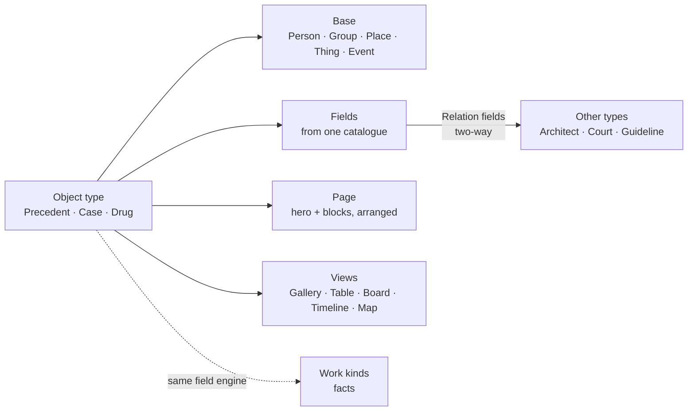

HIGH (new field types, a page layout per type, views; extends existing records, no new item type)

# Objects, in any field: types you shape, pages you arrange

**For:** the owner, to react to and steer. A starting point for a discussion, not a build spec.
**Status:** Idea, explored. Claude, 25 October 2026. Nothing here is agreed until the owner says so in the conversation.
**Checked against:** Craft *02 Product → Library* and *TBS → Library – polishment Phase* ("How it works (verified against code)", `studiolo` @ `ad38415`, 17 Oct 2026). **`studiolo` itself was not read for this document** (the repo could not be attached to this session), so column names for `collection_fields` and `item_field_values` and the field-type list are taken from those notes and from [`2026-10-24-work-any-field-design.md`](2026-10-24-work-any-field-design.md) §1. Check them before any build.
**Builds on:** [Work, in any field](2026-10-24-work-any-field-design.md) (one engine, each field names it), [Commonplace photos roadmap](2026-10-24-commonplace-photos-roadmap-design.md) (Views, the type row), [Boards](2026-10-24-boards-design.md).
**Superseded in part (25 Oct):** §8–§10 are replaced by [Objects: build phases](2026-10-25-objects-build-phases.md), written after reading `studiolo` @ `b5eeee2`. §1 and §6 still stand.
**Prototype:** [`prototypes/objects-any-field/`](../../../prototypes/objects-any-field/README.md). One engine, three fields: an architect, a lawyer and a doctor, each with their own object types, pages and views.

## 0. In short

The owner's point (25 Oct): *Objects need their next level. Today they fit precedents and people. An object could be anything: a person, a precedent, a case, a drug. Think of what lawyers and doctors would keep. The page should be customisable, and so should the fields.*

Objects already have the right idea underneath: a collection is a **data type**, not a folder (the owner's rule from 10 Oct, built in 2H), and an Objects collection carries up to 8 fields. What holds them back is that the type can say very little:

| Today (built, 2H) | What it means |
|---|---|
| Two bases, **Person** and **Thing** (`content_items.object_base`) | A court, a hearing, a site or a procedure has nowhere natural to go |
| **8 fields**, five types: Text, Number, Date, Item, Web link | No choice lists, so no "Status", "Area of law", "Drug class"; no long text, so no "Holding" or "Why it matters"; a date can't say "1956–59" or "c. 1650" |
| Links between items use **11 fixed relation names** (`content_relations`) | "Cites", "Interacts with", "Designed by" can't be named by the learner, and a link has no other side ("Cited by") |
| **One page** for every object (`/library/items/[id]`) | A precedent wants a gallery up top; a case wants its citation and holding; a drug wants a facts table. All get the same page |
| **One view**: cards on the wall. Objects have no filter of their own (roadmap H-D3) | A lawyer can't see their cases as a table, a doctor can't see a procedure log as a timeline |

**The proposal: keep one engine, let each type say more.** An **object type** (today's Objects collection, renamed only on its settings screen) becomes a small template: a **base**, **fields** from a wider catalogue, a **page layout**, and a few **views**. All of it is data the learner edits in a minute or Loci drafts from a sentence. No profession gets its own code, the same rule as work kinds (WA-D1, WA-D2).

This is close to what Tana calls supertags (a tag that brings fields with it), what Capacities calls object types (each with its own page), and Notion's databases (views over typed rows). Studiolo borrows the useful part of each and keeps its own rules: one record everywhere, never folders, your library first.

## 1. What an object is (and isn't)

Three things in Studiolo can look alike. The line between them needs to be clear before anything is built:

| | It is | Example (lawyer) | Example (doctor) | Example (architect) |
|---|---|---|---|---|
| **Topic** (on Loci) | Something you **know**: it has a status, Lumens explain it | Negligence: duty of care | Pulmonary embolism | Light & threshold |
| **Source** | Something you **read or watch**: it has a reading state | The judgment PDF | NICE NG158, as a PDF | A monograph on Kahn |
| **Object** | **A particular thing in the world you keep facts about** | *Donoghue v Stevenson* (court, year, holding) | Apixaban (class, route, interactions) | Salk Institute (architect, year, materials) |

So an object points to the topics it teaches (a **Topics** field) and to the sources about it (a **Relation** to Sources). It never replaces either. Rule for the page: an object's page shows *what you keep about it*; a topic's page shows *what you know*.

## 2. What's fixed and what adapts

### Fixed for everyone (code)

1. An object is a `content_items` row, `shape = 'object'`, in exactly one Objects collection (as today).
2. One **field engine**, shared with work kinds' facts (§5).
3. One **page engine**: a hero and an ordered list of blocks (§3).
4. One **view engine**: the same query (`library_views.query`, roadmap Phase 3) drawn as gallery, table, board, timeline or map (§4).
5. Every object page also shows, without setup: **Mentioned in** (backlinks from notes, quotes, other objects and Work), **On your map** (its topics) and margin notes.

### Adapts per type (data)

| Part of the type | What it holds | Example values |
|---|---|---|
| **Name, icon, colour** | Plural and singular, as now (`collections.name`, `accent`, `cover_image_id`) | Precedents / Precedent; Cases / Case; Procedures / Procedure |
| **Base** | One of five. Gives a default hero, one built-in field and how Loci reads it | **Person** (portrait, Lived/Active) · **Group** (logo: a firm, court, hospital, practice) · **Place** (location, map) · **Thing** (picture, Made by, Date: a building, a case, a drug, a product) · **Event** (date or range, timeline: a hearing, a procedure, a visit) |
| **Extends** | Optional parent type whose fields it inherits | *Architect* extends *People*; *Judge* extends *People*; *Teaching case* extends *Case* |
| **Fields** | Up to 24, from the catalogue (§2.1), in named groups | Precedent: Architect, Year, Place, Typology, Materials, Why it matters, Topics, My status |
| **Card** | Which 2–3 fields show on wall cards | Precedent: Architect · Year |
| **Page** | The hero and the blocks, in order (§3) | Precedent: Gallery hero; Why it matters; Facts beside it; Materials as cards |
| **Views** | Saved views of this type (§4) | Cases: Table (default), Board by Area of law, Timeline by Year |
| **Sensitivity** | Normal · Confidential · Clinical, the same three levels as work kinds (WA §3) | Teaching case: Clinical |

### 2.1 The field catalogue

Today's five types stay and keep their stored values. Seven are new, and two of today's grow options.

| Field type | Stores | Shown as | Example | |
|---|---|---|---|---|
| **Text** | a line | text | Citation: [1932] AC 562 | today |
| **Long text** | Markdown, ≤ 5,000 chars | a section on the page | Holding; Why it matters; Learning points | *new* |
| **Number** | number + **unit** and format | 1,800 m² · £2.4m · 24 days | Area; Damages; Days late | today, *+ unit* |
| **Date** | date + **precision** (day, month, year, decade, circa) + optional **end** | 12 Mar 1932 · 1959–65 · c. 1650 | Year; In force from; Lived | today, *+ precision, range* |
| **Choice** | one or several options, each with a colour | chips | Area of law; Drug class; Typology; My status | *new* |
| **Checkbox** | yes / no | a tick | Visited; Renal adjustment | *new* |
| **Rating** | 1–5 | dots | How useful | *new* |
| **Web link** | URL (+ preview) | link card; can feed the hero | ArchDaily page; BAILII; BNF | today |
| **Place** | label + optional point | text; pin in Map view | Poissy, France | *new* |
| **Relation** | links to objects of one type (or any item), one or many, **two-way** with a name for the other side | cards or chips | Case *Cites* Cases ↔ *Cited by*; Precedent *Architect* ↔ Architect *Works* | today's *Item*, grown |
| **Topics** | links to topics on Loci | topic pills with status dots | Teaches: Duty of care | *new* (uses `content_topic_tags`) |
| **Pictures** | an ordered set of Photos | gallery or slideshow | Site photos; Drawings | *new* (uses existing `depicts` links) |

Not in the catalogue on purpose: formulas, rollups and scripts. They make a type hard to edit in a minute and each needs its own UI. A **count** of a relation ("Cited by 3") is shown automatically instead.

## 3. The page: one engine, arranged per type

An object page is a **hero** plus **blocks**, in one or two columns. The type stores the arrangement as `layout jsonb`; every object of that type uses it. **Arrange page** on any object edits the type's layout in place, and a line says so: *"Changes apply to every Precedent."*

| Part | Choices |
|---|---|
| **Hero** | Picture (first of Pictures, else the Web link's preview) · **Slideshow** (all Pictures: the owner's "project image slideshow" from 10 Oct) · Portrait (Person) · Document (the citation set like a law report heading) · Map (Place) · None |
| **Header** | Title, a subtitle built from 1–3 fields ("Louis Kahn · 1959–65 · La Jolla"), and up to 3 chips |
| **Columns** | One (editorial: hero wide, then sections) or Two (facts in a side column, like an encyclopedia's infobox) |
| **Blocks** | **Facts** (a field group as a list) · **Section** (one Long text field) · **Related** (a Relation field as cards, its own or the other side's) · **Pictures** · **Timeline** (dated relations) · **Mentioned in** · **On your map** · **Sources** · **Used in Work** · **Margin notes** |

Rules that keep it calm:

1. **Blocks that fill themselves hide when empty** (the other side of a relation, Mentioned in, Pictures, On your map), so a sparse object never looks broken. Blocks you write in (Facts, Sections, your own Relations) always show, so a new object can be filled in. Arrange page shows everything, dimmed when hidden.
2. **Layout is per type, not per object.** One object can't be arranged differently. It keeps every Precedent comparable and makes the setting one place to look (OB-D3).
3. **The other side of a relation appears by itself.** Add *Architect* to Precedent and every Architect page gains a **Works** block. Hide it if you don't want it.

## 4. Views: feeds of a type

The owner's word was *feeds*. A view is a saved query of one type, drawn one of five ways. It extends `library_views (id, account_id, name, query jsonb, position)` from the photos roadmap with `collection_id` and `layout`.

| Layout | Needs | Good for |
|---|---|---|
| **Gallery** | nothing | Precedents, Architects, Materials |
| **Table** | nothing; columns are fields, cells edit in place | Cases, Clauses, Drugs: the lawyer's and doctor's default |
| **Board** | a Choice field to group by; dragging a card sets it | Precedents by My status; Procedures by Supervision |
| **Timeline** | a Date field | Architects by Lived; Procedures by Date; Cases by Year |
| **Map** | a Place field | Precedents; Sites |

A view can be **pinned** to the Commonplace type row (after the type's chip) and, later, to Today. A Relation block on a page is a view too: *Cases citing this* is the Cases table filtered by *Cites = this case*.

## 5. One field engine for Objects and Work

Work kinds (WA §1) already plan "up to 8 facts, the same field types as collections". This proposal makes that literal: **one catalogue, one editor, one value store** for object-type fields and work-kind facts. That buys three things:

- A Work's facts can be **Relations to objects**: Matter *Client* → Group; Matter *Authorities* → Cases.
- **Keep as an Object** (Work W6) maps a finished piece of work's facts straight onto an object type (Project → Precedent, Matter → Case).
- Loci reads both through one description, so drafting a type and drafting a work kind are the same prompt.

## 6. Three fields, worked through

Sample types the onboarding answer (`src/features/onboarding/learner.ts`) could seed. All editable; none is code.

**Architect**

| Type | Base | Fields (Relations in *italics*) | Page | Default view |
|---|---|---|---|---|
| Precedents | Thing | *Architect* → Architects, Year (range), Place, Typology (Choice), *Materials* → Materials, Why it matters (Long), Topics, My status (To study · Studied · Visited), Pictures | Slideshow hero, two columns | Gallery; Board by My status; Map |
| Architects | Person, extends People | Lived (range), Nationality, Movement (Choice), *Works* (other side) | Portrait, one column | Gallery; Timeline |
| Materials | Thing | Category (Choice), Typical finish, *Used in* (other side), Supplier link | Picture | Gallery |

**Lawyer**

| Type | Base | Fields | Page | Default view |
|---|---|---|---|---|
| Cases | Thing | Citation, *Court* → Courts, Year, *Leading judgment* → Judges, Area of law (Choice), Holding (Long), Ratio (Long), *Cites* ↔ *Cited by*, How I use it (Rely on · Distinguish · Background), Topics, Judgment → Sources | Document hero; Holding first | **Table**; Board by Area; Timeline |
| Courts | Group | Jurisdiction, Level (Choice), *Decisions* (other side) | None, one column | Table |
| Judges | Person, extends People | Court, Years on the bench, *Judgments* (other side) | Portrait | Gallery |
| Clauses & sections | Thing | Instrument, Section, In force (date), Text (Long), *Considered in* ↔ Cases | Document | Table |

**Doctor** (de-identified and for learning, per WA §3)

| Type | Base | Fields | Page | Default view |
|---|---|---|---|---|
| Drugs | Thing | Class (Choice), Route (Choice, several), Monitoring, Renal adjustment (Checkbox), *Interacts with* ↔ Drugs, *Recommended in* (other side), Topics, BNF link | None, two columns | **Table**; Board by Class |
| Guidelines | Thing | Issuer (Choice), Code, Published (date), *Recommends* → Drugs, Key points (Long), Topics | Document | Table; Timeline |
| Procedures (logbook) | Event | Date, Procedure (Choice), Setting, Supervision (Observed · Supervised · Independent), Outcome, Reflection (Long) | None | **Timeline**; Board by Supervision |
| Teaching cases | Thing, **Clinical** | Age band, Setting, Presenting complaint, Topics, Learning points (Long) | None | Gallery |

A procedures logbook and a reflection per case are what UK doctors already keep for their portfolio and revalidation; here it also feeds Loci (*did*, via Work's debrief path).

**Elsewhere**, in one line each: a researcher's *Datasets* and *Labs*; a teacher's *Lesson plans*; a journalist's *Contacts* (Confidential); a product designer's *Competitor products*; a chef's *Recipes*; an investor's *Companies*.

## 7. Loci and objects

All three follow existing rules: proposals are cards with Undo, never silent changes (`propose_library_plan` in [`2026-10-21-live-lumens-voice-design.md`](2026-10-21-live-lumens-voice-design.md)), and "your library first".

1. **Draft a type from a sentence.** *New type → "I track the drugs I prescribe on the ward"* gives a draft: base, fields, page, views. The learner edits and keeps it. Same pattern as **Add your field** for work kinds.
2. **Fill from a link.** Paste a Wikipedia, ArchDaily, BAILII or NICE link onto a type; Loci proposes field values, each marked with where it came from. Nothing it can't cite is filled.
3. **Link while writing.** In a note, typing `@` and a name links an existing object or offers *New Architect "Lina Bo Bardi"*. That writes a `mentions` relation, so the object's **Mentioned in** fills itself.

## 8. Records (sketch)

No new item type, no new table for objects. **All column names below are unverified against code** (see Status).

- `collections` (shape `object`): `base` widens from `person | thing` to `person | group | place | thing | event` (existing values unchanged); *new* `extends_id`, `icon`, `layout jsonb`, `sensitivity`.
- `content_items.object_base` widens the same way, or is dropped in favour of the collection's `base` (check how 2H uses it).
- `collection_fields`: `type` gains `long_text, choice, checkbox, rating, place, topics, pictures`; `item` is renamed `relation` in code only; *new* `options jsonb` (choices and colours, unit, date precision, relation target collection, `many`, `inverse_name`), `group_name`, `on_card`. The active cap rises from 8 to 24.
- `item_field_values`: one `value jsonb` per field type, if it isn't already.
- `content_relations`: *new* nullable `field_id`. A Relation field writes ordinary relation rows tagged with its field, so backlinks, the graph and today's 11 named relations keep working; the other side is a query, not a second row.
- `library_views`: *new* `collection_id`, `layout` (`gallery | table | board | timeline | map`), `group_by_field_id`.
- `work_kinds.facts` (proposed): uses the same field definitions (§5).

## 9. Phases

| # | Phase | What the learner gets | Tier | Migration |
|---|---|---|---|---|
| O1 | **Fields for any field** | The full catalogue, groups, 24 fields, date ranges, units, two-way Relations | MEDIUM | yes |
| O2 | **Arrange page** | Hero choices including the slideshow, one or two columns, blocks in order, empty blocks hidden | MEDIUM | yes (`layout`) |
| O3 | **Views** | Table, Board, Timeline (Map later) per type; pinning a view | MEDIUM | yes (`library_views`) |
| O4 | **Bases and starter types** | Five bases, *extends*, starter types seeded from onboarding | MEDIUM | yes (enum) |
| O5 | **Loci for objects** | Draft a type; fill from a link; `@` to link | HIGH | no |
| O6 | **Sensitive types** | Confidential and Clinical types, shared with Work | HIGH | small |

**Why this order:** O1–O3 need no AI and are useful the day they ship. O1 alone already makes Cases and Drugs workable. O2 answers "the page should be customisable"; O3 answers "feeds". O5 depends on learner memory and the AI phase. O6 should land with Work's sensitivity, not before.

## 10. Decisions for the owner

| ID | Question | Recommendation |
|---|---|---|
| **OB-D1** | One type per object, or several at once (Tana lets a node carry several supertags)? | **One type, with *extends*.** It keeps "one collection per item" and every page predictable. *Architect extends People* covers the common case of wanting both |
| **OB-D2** | How many fields? | **24, in groups,** with 2–3 on the card. Today's 8 is too few for a case or a drug |
| **OB-D3** | Layout per type or per object? | **Per type.** Per-object layouts make objects incomparable and the setting hard to find |
| **OB-D4** | Is the topic / source / object rule in §1 right? | **Yes.** It stops objects from duplicating the map |
| **OB-D5** | Relation fields: new rows in `content_relations` or values in `item_field_values`? | **`content_relations` with `field_id`,** so the graph and backlinks see them for free |
| **OB-D6** | One field engine for Objects and Work kinds? | **Yes** (§5) |
| **OB-D7** | Names on screen | **Objects** stays the item type. Each Objects collection shows its own name (Precedents, Cases, Drugs). Its settings screen is **Edit type**. *Base* stays out of sight unless you open it |
| **OB-D8** | Formulas and rollups? | **No.** Automatic counts on relations instead |

## 11. What this is not

- **Not a database builder.** No formulas, scripts or automations. A type is a short list of fields and a page, editable in a minute.
- **Not a practice-management or records system.** No client files, no patient records. Clinical types follow WA §3: bands, not identifiers.
- **Not a replacement for topics or sources.** Objects point to them (§1).
