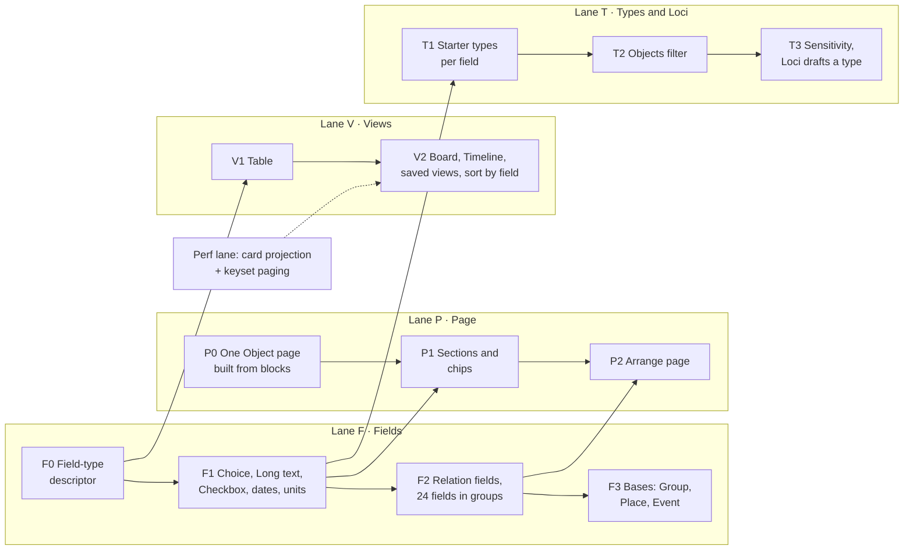

HIGH (new field types, relation fields, a page layout per collection, collection views; six migrations across four lanes)

# Objects: from what is built to types you shape, in phases and lanes

**For:** the owner, to decide the phases and the order of lanes; then the agents who build each phase in `studiolo`.
**Status:** Proposed. Claude, 25 October 2026. Nothing here is approved until the owner says so in the conversation.
**Checked against:** `studiolo` main @ `b5eeee2` (25 October 2026), read only. Every path below exists on that commit unless marked *new*.
**Replaces:** §8–§10 (records, phases, decisions) of [`2026-10-25-objects-any-field-design.md`](2026-10-25-objects-any-field-design.md), which was written before the code could be read. Its §1 (topic / source / object) and §6 (three fields worked through) still stand.
**Works with:** the Library lane of the MVP tracker (perf baseline → card projection and keyset paging → client cache; `project-docs/implementation/library-perf-baseline.md`), [Work in any field](2026-10-24-work-any-field-design.md) (one field engine), [Questions and goals inside items](2026-10-25-questions-and-goals-inside-items-design.md) (the `@` trigger), the photos roadmap's Views (one `library_views` table).
**Prototype:** [`prototypes/objects-phases/`](../../../prototypes/objects-phases/README.md). The real Commonplace (rail, header, cards, item page, customizer) with a phase switch: **Today · Phase 1 · Phase 2 · Phase 3**. Each step adds what that phase builds.

## 0. In short

Phase 2H built the right base: an Object lives in an Objects collection; the collection has a **base** (Person, Thing), a **layout** (Portrait, Picture, Text), an **item label**, up to **8 fields** of five types and up to **3 card fields**. What's missing is the customization a lawyer, a doctor or an architect needs: richer fields, links that show on both sides, a page you can arrange, and views other than the wall.

The plan builds it in **four phases** across **four lanes** that run in parallel. Each lane owns its own files and its own tables, so branches don't collide.

| Phase | What the learner gets | Lanes in parallel | Migrations |
|---|---|---|---|
| **0 · Groundwork** | Nothing visible. One descriptor for field types; one Object page built from blocks | F0, P0 | none |
| **1 · Fields for any field** | Choice lists with colours, long text as page sections, checkboxes, year-only dates and ranges, units; a **Table** view; starter types for law, medicine and architecture | F1, P1, V1, T1 | 1 (F) |
| **2 · Links, pages, views** | Relation fields shown on both sides (Cites ↔ Cited by), up to 24 fields in groups; **Arrange page**; **Board** and **Timeline**; saved views; sort by a field; an Objects filter | F2, P2, V2, T2 | 3 (F, P, V) |
| **3 · Every field** | Group, Place and Event bases; Confidential and Clinical collections; Loci drafts a collection from a sentence and fills fields from a link | F3, T3 | 2 (F, T) |

## 1. How Objects work today (b5eeee2)

| Part | As built | Where |
|---|---|---|
| **Item** | `content_items.shape = 'object'`, `object_base` `person` or `thing`, kept equal to its collection's base by a composite foreign key. Must be in exactly one collection. Markdown body ("What I took from it", 100,000 chars), description (the lead), cover photo | `drizzle/0014_objects.sql`; `src/features/library/item-kinds.ts` |
| **Collection** | `shape`, `base` (fixed at creation), `layout` `portrait` / `picture` / `text`, `item_label`, `card_field_ids` (≤ 3), `description` (≤ 1,000), `cover_image_id`, `accent` (`s1`–`s3`), `position`, `starter_key` | `drizzle/0014_objects.sql`, `0015_collections.sql` |
| **Fields** | `collection_fields`: `label` (≤ 40), `value_type` `text` / `number` / `date` / `item` / `url`, `position`, `retired_at`. **8 active** (`MAX_ACTIVE_FIELDS`). A field's type is locked once it has values (`field_type_locked`); removing a field retires it and keeps its values | `src/features/library/collection-presets.ts` (`diffFields`); `limits.ts` |
| **Values** | `item_field_values`: one row per item and field, exactly one typed column (`text_value` ≤ 500 in the app, `number_value`, `date_value` as a full date, `item_value` one item) | `0014_objects.sql`; `read-model.ts` (`readFieldValues`) |
| **Starters and presets** | People (Person, Portrait; Role, Location, Dates as Text) and Things (Thing, Picture). Presets: Buildings, Cases, Conditions, Companies, Experiments, Pieces, all Text fields except Buildings' Project page | `starters.ts`, `starter-collections.ts`, `collection-presets.ts` |
| **Card** | Portrait: paper card, 42 px round photo or initials, serif name, fields 1–2 beside it and 3 below. Picture and Text: picture (or the collection name as kicker), title, "Item label · card fields" | `item-card.tsx` (`objectCardBody`), `library.css` |
| **Page** | Portrait → `PersonPage` (side portrait hero; rail: Template, fields, Strongest on, counts, Photos, Linked, Collection; shelf "In your Commonplace" by tab; body only once written). Picture and Text → `WorkPage` (wide picture or link preview; rail: Type, fields, Photos, In Loci, Linked, Collection; body always; Margin notes and linked shelf). "Add a property" opens the customizer | `item-page.tsx` (`ObjectPage`), `person-page.tsx`, `work-page.tsx`, `item-hero.tsx`, `item-page-frame.tsx` |
| **Links** | 11 fixed relations. Object-relevant: Made by ↔ Works (Made), Part of ↔ Includes, Cites ↔ Cited by (to Sources only), See also, Compared with, Shows ↔ Photos. An `item` field is a separate one-way pointer: the other item never shows it | `relations.ts`; `content_relations` (`0005_library.sql`); 5,000 links per account |
| **Customizer** | About (name, type, description, cover, colour); Card (base on creation, layout, "One item is called"); Fields (≤ 8, presets, Card tick); live preview of the card and the page's properties | `collection-customizer.tsx`, `customizer-state.ts` |
| **Collection page and wall** | A collection's page is its wall of cards under its hero. The header's type row shows Objects and, after `›`, its collections. Objects have no filter of their own (roadmap H-D3) | `collection-hero.tsx`, `type-bar.tsx` |
| **Read path** | 14 queries per `/library` render after `commonplace-speed`. Field values are read once per page (`= ANY`), collection fields once per page read, card fields computed in memory | `library-perf-baseline.md` |

## 2. What's missing, by who feels it

| Gap | Lawyer | Doctor | Architect |
|---|---|---|---|
| **No choice lists**, so no consistent values to filter or group by | Area of law, How I use it | Drug class, Supervision | Typology, My status |
| **Text is 500 characters in the rail**, so no place for a holding or key points | Holding, Ratio | Key points, Reflection | Why it matters |
| **A date is a full day**: "1959–65", "1932" or "born 1941" can't be stored (People's Dates is Text for that reason) | Year | Published | Built, Lived |
| **A link field is one value, one way** | Cites (several), Cited by | Recommends (several), Alternatives (both ways) | Architect ↔ Works, Materials ↔ Used in |
| **8 fields** | A case needs 10–11 | A drug needs 8–9 | A precedent needs 10 |
| **Two fixed pages** | Wants the holding before the facts, the citation as a heading | Wants a facts table, no picture | Wants a slideshow of the project |
| **One view (cards)** | Wants cases as a table | Wants a procedure logbook as a timeline | Wants precedents on a board by status |
| **Two bases** | A court is neither | A procedure is an event | A site is a place |

## 3. Rules every phase keeps

1. **2H stays true.** An Object is in exactly one collection; a collection has one type; fields belong to collections; no folders. A field's type stays locked once it has values; removing a field retires it.
2. **One descriptor, as H14 did for kinds.** Every field-type decision (editor, card text, table cell, sort, how Loci reads it) goes through `field-types.ts` (*new*, F0). No `switch (valueType)` outside it.
3. **Each lane owns its tables.** F: `collection_fields`, `item_field_values`, `content_relations.field_id`. P: `collections.page_layout`. V: `library_views`. T: `collections.base` checks and `collections.sensitivity`. Two lanes never change the same column.
4. **Migration numbers are given at merge.** Parallel branches name their migration `00xx_<lane>_<what>.sql` and take the next number when they merge into `main` (and on the production cutover list), so branches don't fight over `0027`.
5. **Hosted code never runs ahead of the hosted database** (`AGENTS.md`). A phase with a migration merges only after the owner approves the migration and it's applied.
6. **The read path doesn't grow per card.** Values stay in the one `= ANY` read; choice options and page layouts come with the collection fields already read once; anything shown only on an item page (the other side of relation fields) is one query on that page, never on the wall.
7. **The prototype design stays.** New controls reuse what exists: rail rows (`.prop`), type pills (`.coll-select-pills`), the shelf tabs, the customizer's form rows and live preview, `mcard` cards.

## 4. The design, part by part

### 4.1 Fields (Lane F)

**F0 · Descriptor (no visible change).** `field-types.ts` describes each value type: label, editor, card text, table cell, comparable for sorting, empty test, how it is described to AI. `field-input.ts`, `field-editor.tsx`, `read-model.ts` (`fieldValue`), `customizer-state.ts` and `cardFieldsOf` read it. Existing tests pass unchanged.

**F1 · Five new abilities, one migration.**

| Type | Stores | Shown | Limit |
|---|---|---|---|
| **Choice** | `choice_values text[]`; options and colours in `collection_fields.options` (`[{id, label, accent}]`) | chips (`s1`–`s3` plus three new accents, both themes) | 30 options; "Allow several" per field |
| **Long text** | `text_value` | a section in the main column under its label, edited with the Markdown editor; first line on the card | 5,000 chars |
| **Checkbox** | `bool_value` | a tick; on the card as the field's label when true | — |
| **Date** (grown) | `date_value` + `date_precision` (`day` / `month` / `year`) + optional `date_end` | 12 Mar 1932 · Mar 1932 · 1932 · 1959–65 · born 1941 | end ≥ start |
| **Number** (grown) | `number_value`; unit in `options.unit` | 1,800 m² · 24 days | unit ≤ 12 chars |

Migration (Lane F, first): `collection_fields` gains `options jsonb NOT NULL DEFAULT '{}'`; `value_type` check adds `choice`, `long`, `check`. `item_field_values` gains `choice_values text[]`, `bool_value boolean`, `date_precision text`, `date_end date`; the single-value check counts the new columns; the text check becomes "≤ 5,000 when the field is `long`, else ≤ 2,048" (enforced in the app by type, since the row doesn't carry its type). A choice value must be one of the field's option ids: checked in the app (options live in JSON), and cleared from values when an option is removed.

**F2 · Relation fields and 24 fields in groups.**

- **Relation** (`relation`) replaces the `item` type for new fields. Settings: which collection (or any item), **one or several**, and **the name on the other side** ("Cited by"). Values are stored as `content_relations` rows with a new nullable **`field_id`** and relation name `field`, so backlinks, Shelves threads and the graph see them with no extra read. Today's `item` fields keep working; the customizer offers "Turn into a relation" which copies `item_value` into a relation row.
- **The other side shows itself.** On the target's page a block "Cited by (3)" lists the items whose relation field points at it: one query per item page (`WHERE account_id = $1 AND to_item_id = $2 AND field_id IS NOT NULL`, served by `content_relations_account_to_idx`).
- **Symmetric** relation fields ("Alternatives") store one row with the lower id first, as `see_also` does.
- **24 active fields**, each in an optional **group** (`collection_fields.group_name`, ≤ 40). Groups become headings in the rail and in Table's column picker. Card fields stay ≤ 3.
- **Relation cap.** Field links count toward the 5,000 per account (`MAX_RELATIONS_PER_ACCOUNT`). Raise it to 20,000 in the same phase, or keep field links out of the count: decision OB-D9.

**F3 · Bases.** `base` adds `group` (a firm, court, hospital), `place` (a site; a Place field leads its card) and `event` (a hearing, a procedure; a Date field leads and Timeline is its default view). Checks on `collections` and `content_items` widen; existing values are untouched. The base stays fixed after creation (2H P2).

### 4.2 Page (Lane P)

**P0 · One Object page from blocks (no visible change).** `PersonPage` and `WorkPage` become one `ObjectPage` that draws an ordered list of blocks: hero, lead, body ("What I took from it"), field sections, rail (fields, Photos, In Loci / Strongest on, counts, Linked, Collection), shelves. Portrait, Picture and Text become three **default block lists** that reproduce today's pages exactly (screenshots compared at 1280 and 390, both themes).

**P1 · Sections and chips.** With F1: Long-text fields render as sections in the main column (in field order, under "What I took from it"); Choice fields render as chips in the rail and on cards; dates by precision.

**P2 · Arrange page.** `collections.page_layout jsonb` (Lane P's migration) holds the hero, the columns and the block order. **Arrange page** in the item page's `⋯` menu (and in the customizer's preview) turns the page into the same page with a move / hide control on each block and one line: "Changes apply to every Case (6)."

| Choice | Options |
|---|---|
| **Top** | Portrait (today's Person hero) · Picture (today's Work hero) · **Slideshow** (every photo that shows it, the owner's 10 Oct ask) · **Document** (a law-report heading: court and judge small caps, the title in italic, the citation) · Title only (today's Text) |
| **Properties** | In a side rail (today) · Under the title (one column, for phones and reading-first pages) |
| **Blocks** | Move up or down, hide. Blocks that fill themselves (the other side of a relation, Photos, Margin notes, linked shelf) hide when empty; blocks you write in always show |

The layout is per collection, never per object. `layout` (Portrait, Picture, Text) stays as the **card** layout, so nothing about cards changes.

### 4.3 Views (Lane V)

**V1 · Table.** A collection's page gets a view switch: **Cards** (today's wall) · **Table**. Columns are the active fields (choose which, in the column header's menu); choice and checkbox cells edit in place; the title opens the item. Same query, same keyset paging and page size (60) as the wall; sorted by date added or by title. No migration.

**V2 · Board, Timeline, saved views, sort by field.**

- **Board** groups by a Choice field; dragging a card sets the value (one `PATCH`, the same field write as the rail). Columns load 60 cards each, with "Load more".
- **Timeline** draws a Date field to scale (ranges as bars, open ranges fading to today). It reads a light projection (id, title, the date columns) for up to 500 items.
- **Saved views** in `library_views` (Lane V's migration), the same table the photos roadmap proposes for Commonplace Views: `collection_id` (nullable), `layout` (`cards` / `table` / `board` / `timeline`), `group_by_field_id`, `sort jsonb`, `columns uuid[]`, `query jsonb`, `position`. A view can be pinned after its collection in the header's type row.
- **Sort by a field** waits for the perf lane's keyset work: ordering by `(value, id)` needs an index per type on `item_field_values (account_id, field_id, <value column>, item_id)`, measured on the perf branch's seeded account before it ships.

### 4.4 Types, filter, sensitivity, Loci (Lane T)

- **T1 · Starter types per field** (no migration, code presets with F1 types). The six presets grow into collections with choices, sections and card fields: Law (Cases, Courts, Judges, Clauses), Medicine (Drugs, Guidelines, Procedures, Teaching cases), Architecture (Buildings, Architects, Materials), plus today's Companies, Experiments and Pieces. Onboarding (`src/features/onboarding/learner.ts`) offers the matching set once; the Templates page gets "Start from your field".
- **T2 · Objects filter** (roadmap H-D3). On an Objects collection, the header's slim bar offers its first Choice field as the type's own filter.
- **T3 · Sensitivity** `collections.sensitivity` `normal` / `confidential` / `clinical`, shared with Work kinds (WA §3): off the record for memory, a standing line, and for Clinical a warning when text looks like a name, date of birth or record number. Depends on learner memory's "off the record".
- **T3 · Loci drafts a collection** (2H's H15): a sentence gives a collection draft (base, fields, choices, page, views) shown as the customizer filled in, kept only on **Save**. **Fill from a link** proposes field values with where each came from. Linking objects while writing uses `@`; it shares the trigger with `@question` and `@goal` (OB-D10). Depends on the Copilot lane.

## 5. Phases, lane by lane

Each row is one branch and one handover. "Needs" are hard dependencies; everything else in a phase runs in parallel.

| ID | Lane | What it builds | Main files | Migration | Needs | Tier |
|---|---|---|---|---|---|---|
| **F0** | Fields | `field-types.ts`; every field switch reads it | `field-types.ts` *new*, `field-input.ts`, `field-editor.tsx`, `read-model.ts`, `customizer-state.ts`, `rules.ts` | — | — | LOW |
| **P0** | Page | One `ObjectPage` from blocks; three default lists | `item-page.tsx`, `person-page.tsx`, `work-page.tsx` → `object-page.tsx` *new*, `object-blocks.tsx` *new* | — | — | MEDIUM |
| **F1** | Fields | Choice, Long text, Checkbox, date precision and range, units | `field-types.ts`, `field-editor.tsx`, `collection-customizer.tsx`, `items-repository.ts`, `memory-gateway.ts`, `schema.ts` | **F-1** | F0 | MEDIUM |
| **V1** | Views | Table view on a collection page | `collection-view.ts`, `library-views.tsx`, `table-view.tsx` *new* | — | F0 | MEDIUM |
| **P1** | Page | Long-text sections, chips, dates by precision | `object-blocks.tsx`, `item-card.tsx` | — | P0, F1 | LOW |
| **T1** | Types | Starter types per field; onboarding offer; Templates "Start from your field" | `collection-presets.ts`, `templates-page.tsx`, `onboarding/learner.ts` | — | F1 | LOW |
| **F2** | Fields | Relation fields (both sides, several, symmetric), 24 fields, groups, item → relation | `relations.ts`, `relations-repository.ts`, `collection-fields-repository.ts`, `field-editor.tsx`, customizer | **F-2** | F1 | HIGH |
| **P2** | Page | Arrange page; Slideshow and Document heroes; other-side blocks | `object-page.tsx`, `object-blocks.tsx`, `item-hero.tsx`, `collections-repository.ts` | **P-1** | P1 (other-side blocks need F2) | MEDIUM |
| **V2** | Views | Board, Timeline, saved views, pinning, sort by field | `board-view.tsx` *new*, `timeline-view.tsx` *new*, `views-repository.ts` *new*, `search.ts` | **V-1** | V1; sort by field needs perf keyset | HIGH |
| **T2** | Types | Objects' own filter in the header | `wall-chips.ts`, `header-model.ts` | — | F1 | LOW |
| **F3** | Fields | Group, Place, Event bases | `item-kinds.ts`, `starter-collections.ts`, customizer | **F-3** | F2 | MEDIUM |
| **T3** | Types | Sensitivity; Loci drafts a collection; fill from link; `@` linking | `collections-repository.ts`, copilot tools, `ai.md` | **T-1** | Learner memory, Copilot on | HIGH |

**Suggested order with two agents:** agent A takes F0 → F1 → F2 → F3; agent B takes P0 → V1 → P1 → P2 → V2. T1 and T2 slot in between, wherever an agent is waiting on a migration approval. T3 waits for the Copilot and learner-memory lanes.

## 6. How this fits the perf lane

| Perf step | Effect on Objects | What Objects must do |
|---|---|---|
| Card projection | Cards carry fewer columns | Card fields stay computed from values already read; choice chips need only `{label, accent}` from the collection fields read |
| Keyset paging | Table uses the same keyset | V1 sorts only by date added and title; V2's sort by field adds its own keyset and index, measured first |
| Client cache and delta sync | Edits must update cached cards | Field writes (rail, table cell, board drag) return the changed card, as rail edits do today |
| Album rule (open) | None | — |

## 7. Decisions for the owner

| ID | Question | Recommendation |
|---|---|---|
| **OB-D1** | One collection per Object, with richer types (this plan), or several types per Object (Tana)? | **One collection.** 2H's rule; every phase builds on it |
| **OB-D2** | Field cap | **24 in groups** (F2); 8 until then |
| **OB-D3** | Page layout per collection or per object? | **Per collection** (P2) |
| **OB-D4** | Relation fields stored as `content_relations` rows or as values? | **`content_relations` + `field_id`** (F2), so Shelves, the graph and backlinks see them |
| **OB-D5** | Start with Phase 0 groundwork before anything visible? | **Yes.** It's what made 2H safe (H14) |
| **OB-D6** | Two agents in parallel (Fields; Page and Views)? | **Yes**, with migration numbers given at merge |
| **OB-D7** | Starter types per field offered in onboarding (T1)? | **Yes, once**, as an offer; never created silently |
| **OB-D8** | Map view for Place | **Later**: it needs a map tile provider (a paid service decision) |
| **OB-D9** | Field links and the 5,000-link cap | **Raise the cap to 20,000** in F2; field links are links |
| **OB-D10** | `@` for objects and for `@question` / `@goal` | **Share it**: `@question` and `@goal` are keywords; any other word searches your objects |

## 8. What this is not

- **Not a database builder.** No formulas, rollups or automations (the earlier spec's OB-D8 stands).
- **Not a change to cards.** Portrait, Picture and Text cards stay; only their field text grows (chips, dates by precision).
- **Not a new item type.** Objects stay `shape = 'object'`.
