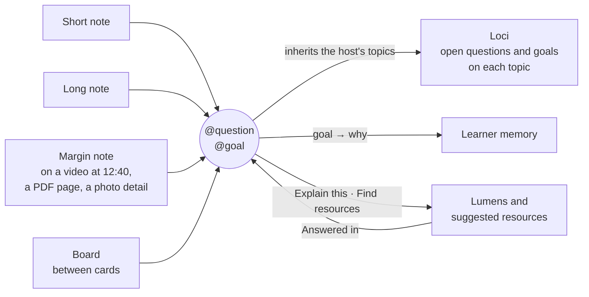
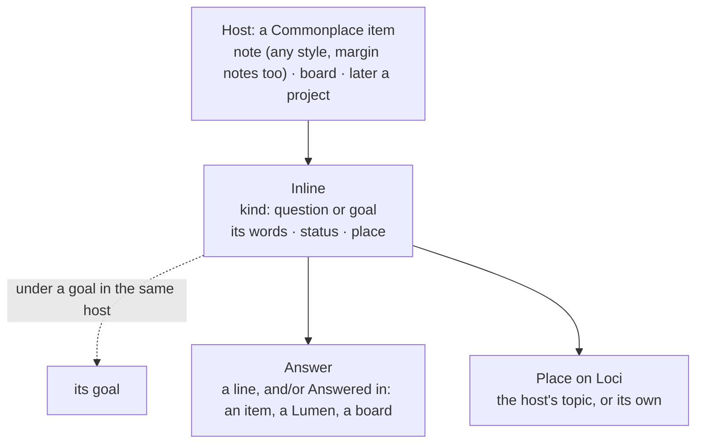

HIGH (a new layer in Commonplace, a migration, and changes to the Boards, Work and learner-memory designs; each phase states its own tier)

# Questions and goals inside items: the layer under types and collections

**For:** the owner, to react to and decide, and the agent who later builds it in `studiolo`.
**Status:** Proposed. Claude, 25 October 2026. Written from the owner's idea in the conversation of 25 October. Nothing here is approved until the owner says so.
**Checked against:** `studiolo` main @ `b5eeee2` (25 Oct 2026), read only. Paths exist on that commit unless marked *new*.
**Build order:** [`2026-10-25-questions-and-goals-roadmap-design.md`](2026-10-25-questions-and-goals-roadmap-design.md) replaces the phase table below for order and scope (notes, long notes and margin notes first; boards and projects later).
**Changes, if agreed:** the owner's choice of 16 Oct, "goals as Library notes the copilot recognises, plus Settings" (`studiolo` `docs/superpowers/specs/2026-10-16-today-design.md:178`). It also changes, in this repo: Boards (`2026-10-24-boards-design.md` rules 2–3, line 37: "a note or question written on a board becomes a Note"), Work (`2026-10-24-work-design.md` §2, `project_questions`) and learner memory (`2026-10-24-learner-memory-and-settings-design.md:557`, goal notes as evidence for `why`).

## 0. In short

The owner's idea: a **question** or a **learning goal** isn't an item of its own. It's something you write *inside* whatever you're already doing. While writing a note you type `@goal I want to understand how a deep court stays cool`. While watching a lecture at 12:40 you type `@question Why does the air move at night?` into a margin note. On a board you drop a question between two cards. A question isn't a card on the wall. It lives in the note, the margin note or the board where it was asked.

So Commonplace gets a layer under the two it has:

| Layer | Answers | Examples | Lives in |
|---|---|---|---|
| **Type** | What is it? | Note, Source, Photo, Object, Board | `content_items.shape` |
| **Collection** | Which shelf? | Books, Renders, Cases | `content_items.collection_id` |
| **Topic and area** | What is it about? | Climate › Courtyards | `content_topic_tags` |
| ***new* Inside** | **What do I want from it?** | `@question` · `@goal` | *new* `item_inlines`, hosted by an item |

The first three describe what you **have**. The inside layer describes what you **want**: what you're asking and what you're aiming for. That is exactly what Loci has lacked. Learner memory's `why`, Learn's *Next for your goals*, Loci's suggested resources and a Lumen's check all need the learner's intent, and today they have to guess it. With this layer, the learner writes it down where it occurs to them, in a couple of keystrokes, and it stays attached to the moment and the material that raised it.



| # | Phase | What the learner gets | Tier | Migration |
|---|---|---|---|---|
| I1 | **Write them anywhere you write** | `@question` and `@goal` in short, long and margin notes and in the capture box; they show as chips on the item; open, answered or parked; a note card shows "? 2"; a **Has ▾** filter on the wall; Loci's topic inspector lists them | HIGH | yes |
| I2 | **Where you watch and read** | **Q** and **G** in the watching room, the PDF reader and the photo viewer start a margin note at that moment; the chip leads back to 12:40, page 14 or the box on the photo | MEDIUM | no |
| I3 | **On boards and in projects** | A question or goal placed on a board's canvas; the board's goal *is* a goal inline; a project's questions are question inlines | MEDIUM | small |
| I4 | **They do something** | Goals feed `why` and *Next for your goals*; a question has **Explain this**, **Find resources** and **Answer**; answered questions become recall checks; Loci offers "This note asks three things. Make them questions?" | HIGH | no |

**Why this order:**
- **I1 is the layer itself**, in the one place where everyone writes. It is useful on its own: one place to see what you're asking, across everything.
- **I2 adds no new data.** It only uses the margin notes and locators that already exist, so it comes almost free after I1.
- **I3 changes two designs that aren't built yet** (Boards B1 and Work W2). If I1 is agreed before they're built, they adopt it from the start.
- **I4 needs learner memory and Loci's tools.** As with Work and resources, the AI comes last.

## 1. What exists today (main @ b5eeee2)

| Area | Today | Where |
|---|---|---|
| **Writing** | A note's body is Markdown in a `textarea`; the view renders it with `parseMarkdown`. Saved with Save or Ctrl/Cmd+Enter, never on blur | `src/components/library/markdown-editor.tsx:18-22`; `src/db/library-schema.ts:44` |
| **The `/` menu** | Heading, Quote, List, Link (writing); Heading, Photo, Quote, Link, Note (capture). Triggered by `/` at a line start or after a space | `src/features/library/slash.ts` |
| **Margin notes** | A Note with `about_id` set; `on_wall = false`, so it never shows on the wall. Its locator (page, seconds or text) is in `annotations` | `library-schema.ts:45-49, 127-147`; `library.md:34` |
| **Search through a host** | A wall search matches margin notes' words and shows *the item they belong to*, once, with "found in a note: …" | `library.md:208` |
| **Mentions** | A relation `mentions` from notes and quotes to any item, edited in the rail, not typed inline | `src/features/library/relations.ts:24`; `note-page.tsx:42` |
| **Goals** | None built. `goals` is planned (text and active/paused/completed). The owner's choice of 16 Oct: goals as Library notes Loci recognises, plus Settings | `project-docs/architecture/data-model.md:237`; `today-design.md:178` |
| **Questions** | None built. Proposed as their own board cards that become Notes (Boards) and as `project_questions` (Work) | this repo's Boards and Work designs |

**What already points this way:** margin notes are already *inside* other items and kept off the wall, and search already shows a host for what's inside it. The inside layer takes that same rule one step further.

## 2. The model

### 2.1 An inline is hosted, never standalone



| Part | What it is | Rule |
|---|---|---|
| **Host** | The item the inline was written in | Every inline has exactly one, except a goal written in Settings on *You* (IN-D5). Deleting the host deletes its inlines, and the delete dialog says so ("This note holds 2 open questions") |
| **Kind** | `question` or `goal` | Only these two in I1–I4. The table allows more later (IN-D3) |
| **Words** | What the learner wrote | **They live in the host's body.** The row keeps a copy for lists, refreshed on every save of the host. So search, Lumens and exports see them with no extra work |
| **Status** | Question: *Open · Answered · Parked*. Goal: *Active · Reached · Paused · Dropped* | Set only by the learner. Loci may *suggest* "Answered in *Wind catchers*. Mark it answered?" |
| **Place** | Where it shows on Loci | The host's topics by default (a question in a note tagged *Courtyards* is a *Courtyards* question). It can be re-aimed to one topic of its own from the chip's menu |
| **Goal link** | Which goal a question serves | Automatic when the question comes after a goal in the same host; it can be linked by hand to another goal |
| **Answer** | How it was answered | A short line written on the chip (≤ 500 characters), and/or **Answered in**: links to items, Lumens or boards |
| **When** (goals) | An optional date | Written naturally: `@goal Brief the engineer on passive cooling by March`. Parsed into `due`, and shown as "by March" |

**Rules that keep it simple:**
1. **Never on the wall on its own.** An inline only appears through its host: as a chip on the host, a small "? 2 · ◎ 1" in the host card's foot, and in lists that always name the host.
2. **Your words, your status.** Only the learner writes an inline or changes its status. Loci can offer one ("Make this a question?"), and that offer is an addition with one tap (A2), never a silent edit of your note.
3. **One question, everywhere.** A question on a board, in a margin note or in a project is the same kind of thing, with the same chip, statuses and actions.

### 2.2 Typing it

- **`@`** at a line start or after a space opens a small menu, like today's `/` menu (`slash.ts`): **Question** (`?`) and **Learning goal** (`◎`). Typing `@q` or `@g` and Enter is enough.
- It inserts a marker at the start of the paragraph: `@question ` or `@goal `. The rest of the paragraph is the inline's words. In the textarea that reads naturally:

  ```markdown
  The court at Sultan Hassan stays shaded most of the day.

  @goal Understand how a deep court stays cool without machines, well enough to brief the engineer, by March

  @question Does depth matter more than width?
  @question How much does evaporative cooling help in humid air?
  ```

- In view mode each marker becomes a chip: `? Does depth matter more than width?  · Open ▾`, with the goal shown above its two questions.
- **Why a paragraph, not words mid-sentence:** a question or a goal is a thought of its own. A paragraph is easy to parse, easy to see in the textarea, and it survives copy, export and the Markdown view. Mid-sentence inlines can come later if people ask for them (IN-D2).
- **Why `@` and not `/`:** `/` already *formats* (a heading, a list). `@` *makes a thing* that lives beyond the text and shows up elsewhere. Later, `@` can also mention a topic or an item (`@Hassan Fathy`), which would replace the rail-only Mentions (IN-D4).
- **No ids in the text.** When the host is saved, a pure function, *new* `reconcileInlines(previous, parsed)`, matches the inlines by kind and order, then by closeness of the words. A reworded question keeps its status and answer. A removed question that has an answer or links asks first: "Remove the question *Does depth matter…*? Its answer goes too. Undo is available."
- **Phones and touch:** the editor's toolbar gets **?** and **◎** buttons, which insert the marker.
- **Dictation** (the Moonshine proposal): saying "question:" or "goal:" at the start of a sentence inserts the marker.

## 3. Phase I1: write them anywhere you write (HIGH, migration)

**Goal:** a learner can write a question or a goal in any note, see them on the item, and find all of them again.

**Hosts in I1:** short notes, long notes and margin notes (any `content_items` with `shape = 'note'`, including `about_id` notes), and the capture box. Quotes can host one in their note line.

**On the item**
- Chips as in §2.2. The chip menu: **Answer…** · **Mark answered** / **Park** (questions); **Reached** / **Pause** / **Drop** (goals); **Move to topic…**; **Copy link**.
- An item page gains a small **Inside** row in its rail: "2 open questions · 1 goal". It links to the chips.

**On the wall**
- No new cards. A host card's foot gains "? 2" (open questions) and "◎" (an active goal), in `--ink-3` and in the same line as its topic foot.
- The slim bar gains **Has ▾**: *Open questions · Goals*. It filters the wall to the **hosts** that contain them. This generalises the Boards design's *With open questions* filter to every type.
- Search: the words are in the host body, so today's search finds them already. `?` or `◎` results show the host with the matched inline under it, like "found in a note".

**One list of them all**
- A **Questions and goals** page, reached from the Has ▾ menu (*See them all*) and from Learn. It is a list, not a wall: goals at the top with their questions under them, then other open questions grouped by area and topic. Each row names its host and opens it at the chip.
- Filters: *Open · Answered · Parked*, topic, area.

**On Loci (read only in I1)**
- The topic inspector gains **Open questions** and **Goals** (at the topic and below it), each naming its host.

**Data (migration)**

*New* table `item_inlines`:

| Column | Type | Notes |
|---|---|---|
| `id` | uuid | |
| `account_id` | uuid | account isolation as elsewhere |
| `host_item_id` | uuid null | FK to `content_items` on `(account_id, id)`, `ON DELETE CASCADE`. Null only for a goal set in Settings, on *You* (IN-D5); a check allows that for goals alone |
| `kind` | text | `question` · `goal` (check) |
| `position` | smallint | order in the host |
| `text` | text ≤ 500 | the words, copied from the body on save |
| `status` | text | per kind (check) |
| `goal_id` | uuid null | the goal a question serves; `ON DELETE SET NULL` |
| `topic_id` | uuid null | its own place, when re-aimed; else it follows the host's topics |
| `due` | date null | goals only |
| `answer` | text ≤ 500 null | questions only |
| `anchor` | jsonb null | a board position (I3); time and page come from the host margin note's locator |
| `origin` | text | `learner` · `loci_offer` (accepted from an offer, I4) |
| `created_at`, `updated_at`, `decided_at` | timestamptz | |

*New* table `inline_answers(inline_id, account_id, item_id null, explainer_id null, board_id null, created_at)`: the **Answered in** links. Exactly one target per row.

Indexes: `(account_id, host_item_id, position)`; `(account_id, kind, status)`; `(account_id, topic_id) WHERE topic_id IS NOT NULL`.

**Code**
- `parseMarkdown` learns the two paragraph markers (pure, unit-tested); `\@goal` stays literal.
- `reconcileInlines` is pure and unit-tested. It runs in the same transaction as the host save, through the library's own update operation, so version conflicts and Undo work as they do now.
- `slash.ts` gains a sibling, *new* `at-menu.ts`, with the same token rules.
- Switch: `INLINES` (testers first).

**Done when:** a learner writes two questions and a goal in a long note; sees the chips; finds the note through Has ▾ › Open questions; sees the questions on the note's topic in Loci; rewords one question and it keeps its answer; and deletes the note, warned about its open questions.

## 4. Phase I2: where you watch and read (MEDIUM, no migration)

**Goal:** "Oh, I want to learn this" turns into a goal in two keys, at the exact moment and place it occurred to you.

| Where | Keys | What happens | The chip leads back to |
|---|---|---|---|
| **Watching room** (YouTube Source) | **Q** · **G** (or the panel's ? and ◎) | Pauses the video, opens a margin note at the current time, with the marker already typed | the video at 12:40 |
| **PDF reader** | **Q** · **G** | A margin note on the current page | page 14 |
| **Photo viewer** | **Q** · **G** after drawing a box (photos design, Phase 4 *Notes on a detail*), or on the whole photo | A margin note with the region | the photo, with the box lit |
| **Web viewer** | **Q** · **G** | A margin note on the link | the page |

- Today's margin note locators (`annotations.locator_seconds`, `locator_page`) carry the moment; the inline doesn't copy them.
- In lists, such a question reads *"Why does the air move at night?" · Lecture: Passive cooling, 12:40*.
- The watching room's notes panel shows the questions on the timeline as small **?** ticks. Clicking one seeks there.

## 5. Phase I3: on boards and in projects (MEDIUM, small migration)

**Boards** (changes `2026-10-24-boards-design.md`):
- A **question** on the canvas is a question inline hosted by the board, with `anchor = { x, y }`. It is no longer a Note on the wall. The rule "a note or question written on a board becomes a Note" becomes "a note becomes a Note; a question stays the board's own".
- The board's **goal card** is a goal inline hosted by the board, with the role *the board's goal*. The board's own `goal` field goes away, and a board's goal shows in the same lists as every other goal.
- A question on a note card that's placed on the board shows on that card. It still belongs to the note.
- The arrow word *raises* (A raises question B) points at a question inline.
- Board tool **Q** stays as it is; a new **G** places a goal.

**Work** (changes `2026-10-24-work-design.md` §2):
- A project's **questions** are question inlines hosted by the project, and they gain Work's extra states (*Exploring*, *Decided*) only inside a project (IN-D6). `project_questions` is not built.
- A **Decision** answers its question through `inline_answers`.
- A question raised in any note can be brought into a project ("Use in a project").

**Migration:** `item_inlines.host_item_id` must also accept a board (a Commonplace entry in the Boards design, so no change) and a project (*new* `host_project_id`, nullable, with a check that at most one host is set, and that only a *You* goal has none).

## 6. Phase I4: they do something (HIGH, no migration)

| Inline | What it now drives | Where |
|---|---|---|
| **Goal** | `why` at its place in learner memory. A goal *is* the evidence for a `why` line, basis `said` (this replaces the "goal note" idea, memory spec :557). Reached goals stay as history | memory cards; Loci's layer 2 |
| **Goal** | Learn Home's *Next for your goals* and Today's goals (T3). An active goal with a date ranks its topics first as the date nears | Learn, Today |
| **Goal** | A **course** or a **reading path** (resources design R4) made *for* the goal, whose brief is the goal's words | the goal's chip: **Plan a course for this** |
| **Question** | **Explain this**: a Lumen whose brief is the question, its host and its topic. The Lumen's end shows "Did this answer *Does depth matter…*?", and *Yes* links it through **Answered in** | the chip; Learn |
| **Question** | **Find resources**: the resources design's `find_resources`, origin `question`; saves are filed to the question's topic and linked as *For: Does depth matter…* | the chip |
| **Question** | **Ask Loci**: opens the one Loci thread with the question and its host in context | the chip |
| **Answered question** | A **recall** card: the question, then your answer (Boards B3's Recall, for every host) | Learn, a topic's Recall |
| **Open questions** | Loci's context at the place (unified chat layer 4): "Open here: 3 questions" | every turn |

**Loci's offers (A2: additions, one tap):**
- After a host is saved: "This note asks three things. Make them questions?", when a paragraph ends in "?" and isn't one yet. At most once per note.
- "I want to…" / "I need to understand…" at a paragraph start: "Make this a learning goal?"
- When a Lumen or a saved resource matches an open question: "*Wind catchers* may answer *Why does the air move at night?* Mark it answered?"

**Never:** Loci writes a marker into your text without your tap, sets a status on its own, or treats an answered question as `known`. Only a check answered right does that (course engine §6.3), and topic status still changes only when the learner chooses (`project-docs/product/brief.md:14`).

## 7. Decisions for the owner

| ID | Question | Recommendation |
|---|---|---|
| **IN-D1** | Agree the layer: questions and goals as inlines hosted by items, never standalone on the wall (replacing "goals as Library notes", 16 Oct) | **Yes.** It keeps the wall to things you *have* and gives intent its own place |
| **IN-D2** | Paragraph inlines only, or mid-sentence too? | **Paragraphs in I1.** Simple to parse and see; revisit if asked for |
| **IN-D3** | Only questions and goals, or room for more kinds later (`@todo`, `@idea`, `@definition`, `@claim`)? | **Two now, and the table allows more.** Each new kind needs its own owner decision, so the layer doesn't become a task manager |
| **IN-D4** | Should `@` also mention topics and items later, replacing the rail-only Mentions? | **Yes, later.** `@` makes things that live beyond the text; `/` formats text |
| **IN-D5** | A captured note that is *only* a goal ("@goal Learn Arabic calligraphy"): a note on the wall, or kept off the wall? | **A note on the wall, with the goal chip.** It is what you captured. If people want it off the wall, a *Goal only* capture can be added. Goals with no host, written in Settings on *You*, are allowed (`host_item_id` null) |
| **IN-D6** | Work's *Exploring* and *Decided* states: for every question, or only inside a project? | **Only inside a project.** Everywhere else, Open · Answered · Parked is enough |
| **IN-D7** | A board's goal: a goal inline (one list of goals), or keep the board's own `goal` field? | **A goal inline.** One goal model everywhere |
| **IN-D8** | Names on screen: *Question*, *Learning goal* (short: *Goal*), *Inside* (the rail row), *Questions and goals* (the list), *Has ▾* (the filter) | **Yes.** In code: `inlines`. Avoid *Mark*, which Learn already uses for saving a moment |
| **IN-D9** | Removing a question that has an answer: ask first, or remove with Undo? | **Ask first**, because it removes the learner's own answer (the "changes or removes your things" rule, A2) |

## 8. Rules carried over

- **Names:** the screens say **Commonplace**, **Loci**, **Lumens**; the code keeps `library`, `graph`, `copilot`.
- **The prototype and `interface.md` rule:** chips use the existing chip pattern and tokens: questions in `--pick` and goals in `--accent-soft`, as the Boards design already chose. No new colours.
- **Saving:** writing is never saved on blur (`markdown-editor.tsx:21`); inlines are reconciled only on the host's save.
- **A2 and A8:** Loci's offers are additions with one tap; every change goes through the library's validated operations.
- **No hidden judgements:** a goal shown as `why` on a memory card names the note it came from.
- **Files:** pure logic (`parseMarkdown` markers, `reconcileInlines`, `at-menu.ts`, due-date parsing) goes in `src/features/library/` with unit tests; the list page goes in new files.
- **Paperwork:** a phase spec per phase in `studiolo`'s `docs/superpowers/specs/`, with its tier on line one; `library.md`, `data-model.md` and `database.md` updated on the same branch; migrations hand-written in `drizzle/` and applied only on the owner's word.

## 9. What this is not

- **Not a task manager.** There are no assignees, priorities or reminders. A goal's date is a horizon, not a deadline alarm.
- **Not a new type.** Nothing is added to the type row, and nothing is added to the wall but a small count on a host's card.
- **Not Loci's notes.** Loci never writes questions or goals into your writing. It only offers, and you tap.

## 10. Addendum, 28 October: the Questions and goals page as cards, and one look everywhere

**The owner's direction (28 Oct):** questions and goals should be visually coherent and nice to look at, not a long list.

**Prototype:** [`prototypes/objects-boards-questions/`](../../../prototypes/objects-boards-questions/README.md), **Questions** in the bar at the bottom.

### 10.1 The page

- **Four tiles at the top**, each a number with its mark: **? 10 open questions · ◎ 3 active goals · ✓ 1 answered · – 0 parked**. Clicking one filters the page. You see where you stand before reading anything.
- **One bar:**
  - *Open · Answered · Parked · All*;
  - **topic chips**, taken from the hosts' topics;
  - a view switch, **Cards · List**. The list from §3 stays for people who prefer it.
- **Goals as cards**, side by side.
  - **The top:** a **progress ring** (answered of total), a kicker *◎ Learning goal · by March · Climate-responsive design*, and the goal in Newsreader.
  - **Inside, its questions as small rows.** An amber **?** is open. A green **✓** is answered, struck through. A grey **–** is parked. Each opens where it was written, highlighted.
  - **One Next line:** the first open question, so every goal says what to do now. When all are answered, it reads *Every question answered. Mark it reached?*
  - **The foot:** where the goal was written (an icon and a title, which opens it) and its status button.
  - **The background** is a soft accent wash, which turns green when the goal is reached.
- **Questions not under a goal** form a wall of cards, grouped by topic. Each card has:
  - an amber top edge and the **?** mark;
  - the question large, in Newsreader;
  - the goal it serves, if any;
  - where it was written, which opens it.
  
  Answered cards turn green, with the answer and *Answered in* in a soft green box.
- **Answered** turns the page into **What you've found out**: each question with its answer, by topic, and the goals reached above. A learner can read back what they've learned. **Parked** shows what's waiting.
- **Every card opens where it was written**, at the exact spot, highlighted. On a board, the canvas centres on the card. This is the same jump as **Appears in** ([Collections and linking](2026-10-28-collections-and-linking-design.md) §3.2).

### 10.2 One look, everywhere a question or goal appears

| Mark | Colour | Where |
|---|---|---|
| **?** open question | `--pick` amber, on `--pick-soft` | the inline row in writing, a card's foot count, a board's question card, the page's cards and goal rows, Appears in |
| **◎** goal | `--accent`, on `--accent-soft` | the inline row, a board's goal card, the goal cards |
| **✓** answered or reached | `--ok` green | goal rows (struck through), answered cards, a reached goal's ring and wash |
| **–** parked, paused or dropped | `--ink-3` | rows and cards, faded |
| **Progress ring** | the accent; green when reached | the goal cards (46 px with "1/2"); a small 18 px ring with "1 of 2 answered" beside a goal in writing and on a board's goal card |

No new colours: these are the tokens §8 already names.

### 10.3 Decisions

| ID | Decision | Recommendation |
|---|---|---|
| **IN-D10** | The page opens on **Cards**: goal cards with rings, and a question wall by topic; **List** stays as a view | **Yes** |
| **IN-D11** | Every goal shows a **Next** question | **Yes**. It turns a goal into a next step |
| **IN-D12** | **Answered** reads as *What you've found out*: question and answer cards | **Yes** |
| **IN-D13** | The progress ring appears wherever a goal does (page, writing, board) | **Yes** |

**Build:** in Q2 (the page) and Q-B (the board's goal card). No migration: everything shown is already in `item_inlines` and `inline_answers`.
