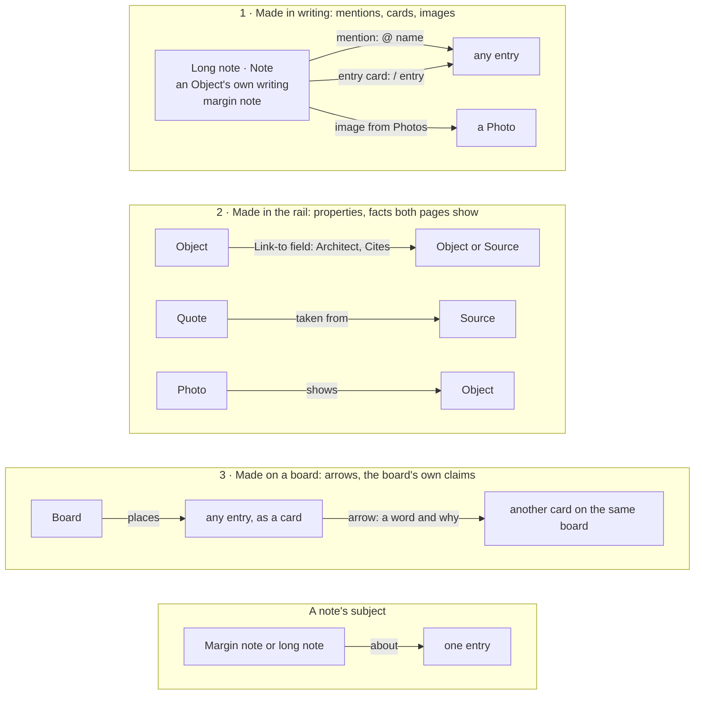
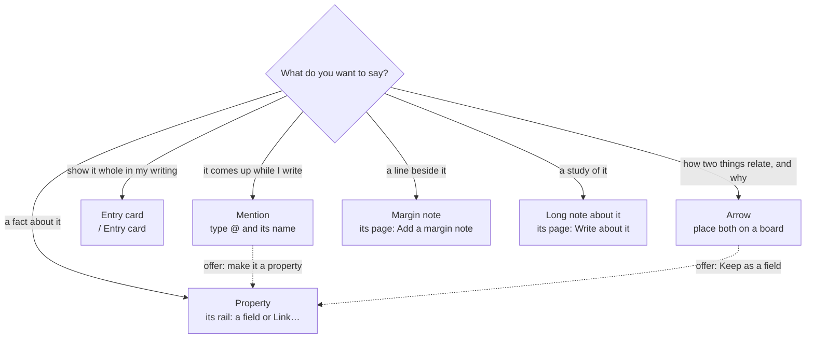
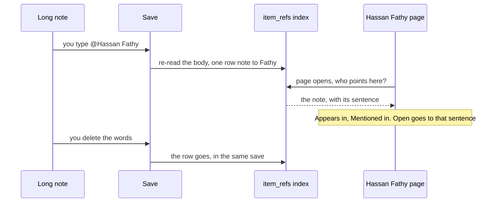
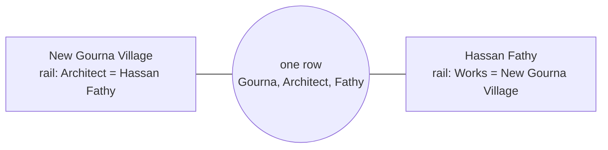
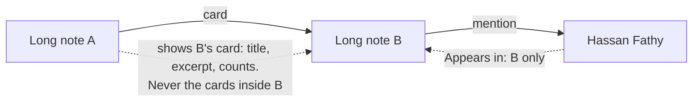
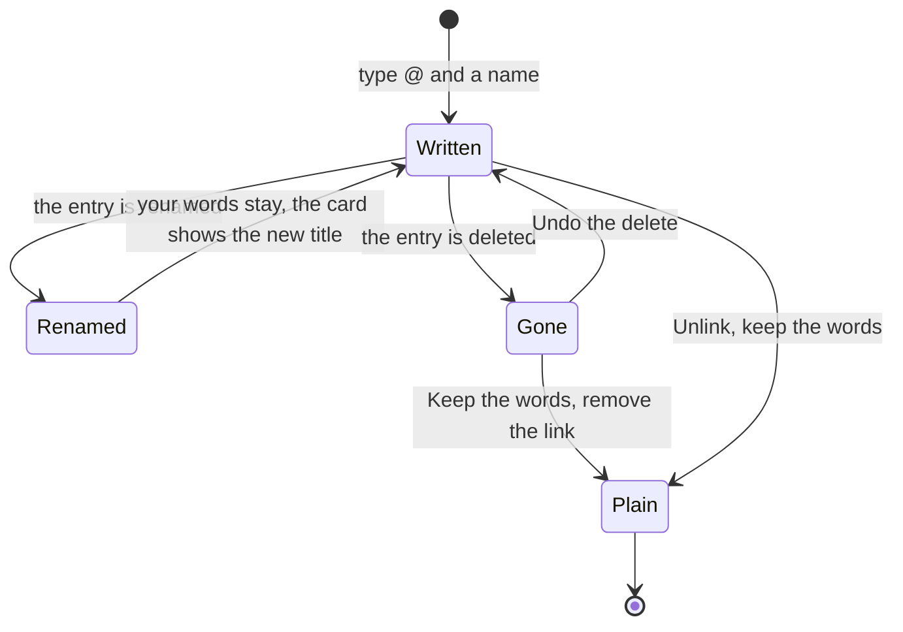

HIGH (lane C in the Objects, questions and boards programme: collections you shape by looking at them, and backlinks on every entry; four phases, one small migration)

# Collections and linking: shaping collections, and knowing where everything is used

**For:** the owner, to approve the model and the order; then the agents who build lane C in `studiolo`.
**Status:** Proposed. Claude, 28 October 2026. Nothing here is approved until the owner says so in the conversation.
**Checked against:** `studiolo` main @ `7c0e8732`, read only. Paths exist on that commit unless marked *new*.
**Builds on:** [Long notes and connections](2026-10-28-long-notes-and-connections-design.md) (the three connection kinds, `item_refs`, lane N), the [Objects build phases](2026-10-25-objects-build-phases.md) (fields F1–F3, page P2, starter types T1) and the [programme](2026-10-28-objects-questions-boards-programme.md).
**Prototype:** [`prototypes/objects-boards-questions/`](../../../prototypes/objects-boards-questions/README.md). Try **Collections** (the header tab), **Customize** (the bar at the bottom), and the **↩ Appears in** chip at the top of any entry. **Show phases** labels the parts C1 to C4.

## 0. In short

The owner's direction (28 Oct):
- make editing a collection visual and customisable without overwhelming anyone;
- design backlinks on notes, Objects, photos and everything else, so that opening an entry tells you where it's shown or borrowed, and every backlink is clickable;
- draw how linking works, what's allowed, and what happens when linked things link onward;
- think of Commonplace as a whole, for any field, and keep it easy to understand.

**Collections: you shape a collection by looking at it.** Today's *Edit collection* is one long form. It becomes a **studio** with four tabs, each answering one question about a picture of your own entries:

| Tab | The question | What you see | What you change, on the picture |
|---|---|---|---|
| **Card** | *How does one look on the wall?* | three of your own entries as wall cards | layout (three thumbnails), the fields under the title (up to three, in order), chips and counts |
| **Page** | *How does its page read?* | one entry's page, drawn small | the top of the page (five thumbnails), the sections' order and visibility, the *Write about it* headings |
| **Fields** | *What do I record?* | every field next to its value on a real entry | name, kind, choices, links; drag to reorder; suggestions to add |
| **Settings** | *What is it called, and how private is it?* | its tile on the Collections page | name, colour, cover, sensitivity, merge, delete |

Changes save as you make them, and **Undo** takes back the last one. Nothing deletes values without first offering to **hide** instead. **New collection** is three small steps, each with a picture: what it holds, a starting point for your field, then a name and a colour.

**Backlinks: every entry says where it appears.** At the top of every page, a chip reads **↩ Appears in 4 places**. At the foot, **Appears in** lists each place: *Mentioned in* (with the sentence), *Shown as a card in*, *Shown in* (for photos), *Quoted in* (for sources), *Answers*, and *On boards* (with the arrows). Each row opens that place **at the exact spot**, highlighted.

**Linking stays three kinds, each made in one place** (lane N): a *mention* in writing, a *property* in the rail, an *arrow* on a board. Backlinks go **one step**: what links here, never what links to what links here. That one rule avoids loops, floods and confusion (§4.4).

## 1. What's there today

- **Edit collection** (`collection-customizer.tsx`, as rendered at 7c0e8732) is one long form:
  - a row of every collection as pills;
  - **About** (Name, Type, Description with a 0/1,000 count, Cover *Choose cover…*, Colour: Ultramarine, Mid blue or Pale blue);
  - **Card** (Layout);
  - the fields as numbered rows, each with a name, a type select, a **Card** checkbox and ✕, plus presets.
  
  A preview on the right shows *Card on the wall* and *Item page* with placeholder values ("Example"). Every option is visible at once, and the preview uses made-up values, not your entries.
- **The Collections page** (`collections-page.tsx`) is a grid of tiles (`.cgrid .coll`) with *Search your collections…*, **⋯** (reorder) and **+ New collection**, which opens a dialog (`new-collection-dialog.tsx`).
- **Backlinks today:**
  - the rail's **Linked** shows named links both ways (`linked-items.tsx`);
  - **Margin notes** shows notes *about* the entry;
  - a photo's *Shows* link puts it in an Object's **Photos** strip (`relations.ts`, `depicts`).
  
  Nothing tells you that a note mentions this entry in its text, or which boards and long notes use it. Lane N adds *Mentioned in*; this design completes the set.

## 2. Collections, redesigned

### 2.1 Principles

1. **Show, don't form.** Every choice is made on a picture of your own entries, never on placeholders.
2. **One question at a time.** Four tabs, each about one thing. Each tab has a stage (the picture) and a panel (the few choices for it).
3. **Edit from where you are.** You rarely open the studio from a menu. Click a property's name on any page, **Add a property**, **Edit collection** on the wall, or **Edit** on a tile, and the studio opens at that spot.
4. **Safe by default.** Changes autosave with **Undo**. *Hide* comes before *delete*. A destructive choice says how many entries it touches first ("3 buildings have a value here").
5. **The same for every field.** Starters differ (buildings, cases, drugs), but the studio, the words and the steps never do.

### 2.2 The Collections page (C1)

- The page stays as it is: the tiles, search, **⋯** and **+ New collection**.
- **Kind chips** above the grid: *All · Notes · Sources · Photos · Objects*, with counts, in the wall's own type-row style.
- **Edit** appears on a tile when you hover it (always shown on touch). It opens the studio.
- An Objects tile's small line says how many fields it has ("6 fields"); a Clinical one says *Clinical*.
- A last dashed tile, **+ New collection**, so the way to make one is where you're looking.

### 2.3 New collection (C1)

Three steps in one dialog, each with **Back**. Notes, Sources and Photos skip step 2.

1. **What will you keep in it?** Four large choices with icons: *Notes*, *Sources*, *Photos*, *Objects* ("people, places and things, each with its own fields"). This is the one choice that can't change later (the collection's shape), so it comes first, alone.
2. **Start from…**:
   - the field's starters (T1), each showing its fields as small chips with kind icons: *Buildings · Architects · Materials* for an architect; *Cases · Judges · Clauses* for a lawyer; *Drugs · Guidelines · Teaching cases* for a doctor, the last marked *Clinical*;
   - **Blank**;
   - **Describe it**: Loci drafts the fields from a sentence (T3).
3. **Name and look**: name, *One entry is called*, colour, with the tile as it will look on the Collections page.

**Make the collection** opens the studio on **Fields**, so the first thing you see is what the collection records, ready to change.

### 2.4 The studio (C2)

- **The top bar:**
  - the collection's name as a switcher (**Buildings ▾**, listing every collection plus **+ New collection**);
  - the four tabs;
  - *Changes apply to every building (3)*, which becomes *Saved · Undo* after a change;
  - **Done**, which returns to the collection's wall.

**Card**
- **Stage:** three of your own entries as real wall cards on the wall's background. Click one to preview with it.
- **Layout:** *Portrait · Picture · Text*, as thumbnails.
- **Under the title:** numbered slots, up to three, each with ↑ and ×, plus **+ Add a field…** while a slot is free.
- **Also on the card:** *Choices as chips* and *Open questions and goals*, each with an example of what it shows.

**Page**
- **Stage:** one entry's page, drawn small. The top, the sections in order, and the properties rail with real values. Click a property to edit its field.
- **Top of the page:** *Portrait · Picture · Slideshow · Document · Title only*, as thumbnails (P2).
- **Sections, in order:** *What I took from it*, each long-text field, *Notes about it*, *Appears in*. Each has ↑ and **Hide**. Hidden sections show struck through on the stage.
- **Write about it starts with:** the headings as chips, × to remove, and a field to add one (N3).

**Fields**
- **Stage:** every field as a row: drag handle, kind icon, name, its value on the chosen entry, and tags (*On the card*, *Section*, *→ People*, *Hidden*). Drag to reorder; the order is the rail's order on every page. **+ Add a field** ends the list with "6 of 24".
- **Panel, for the selected field:**
  - name, and kind as eight tiles (*Text, Long text, Number, Date or year, Choice, Checkbox, Link to…, Web link*);
  - **Choice:** the options as chips, plus *More than one can be picked*;
  - **Link to…:** which collection; what it's called on the other side; a two-line picture of both sides ("Building → Architect", "Person → Works"); *Several*; and the sentence "One link, shown on both pages. Changing it on either page changes it on both";
  - **Date or year:** *A year or a range is enough*, which gives the collection a Timeline;
  - *On the card* (disabled with its reason when three are used) and *Hidden on pages*;
  - **Delete**, which says how many entries have a value. When any do, it offers **Hide it instead, keep the values** first.
- **Panel, when adding:** suggestions for this collection, one tap each ("Often kept for buildings: Architect, Typology"), then the eight kinds with a line each.
- **Changing a field's kind** keeps values that don't fit, shown as text until you change them. Nothing is dropped silently.

**Settings**
- **Stage:** the collection's tile.
- **Panel:**
  - name, *One entry is called*, and description;
  - colour as three swatches; cover chosen from its own pictures, or *Newest*;
  - **Sensitivity** as three explained choices (*Normal · Confidential · Clinical*, T3);
  - the kind, read-only, with why;
  - **Merge into another collection…** (fields with the same name and kind join, the rest come along);
  - **Delete collection…** (its entries move to Unsorted; nothing in them is lost).
- Notes, Sources and Photos collections open on **Settings** alone, since card, page and fields belong to Objects.

### 2.5 Editing from where you are (C3)

| You're on | You do | The studio opens at |
|---|---|---|
| an Object's page | click a property's name in the rail ("Architect") | **Fields**, that field selected |
| an Object's page | **Add a property** | **Fields**, *Add a field* |
| a collection's wall | **Edit collection** | **Card** |
| the Collections page | **Edit** on a tile | **Card** |
| New collection | **Make the collection** | **Fields** |

## 3. Appears in: backlinks on every entry (C4)

### 3.1 What it lists

One step back from the entry: every place that **shows or uses** it, read from where they were made.

| Group | Means | Comes from | On which entries |
|---|---|---|---|
| **Mentioned in** | named in a sentence | `@[words](item:…)` in any writing, margin notes included (N2) | all |
| **Shown as a card in** | shown whole inside writing | `::card` (N2) | all |
| **Shown in** | a picture used elsewhere | an image block that uses this Photo; an Object whose picture or cover it is | Photos |
| **Quoted in** | a passage taken from it | a Quote whose source is this (`annotations`) | Sources |
| **Answers** | a question answered here | `inline_answers` (Q2) | all |
| **On boards** | placed on a board, with the arrows that touch it there | `board_placements`, `board_arrows` (B1) | all |

**Not listed here, on purpose:**
- **Properties** stay in the rail, both ways (Architect / Works). They're facts about the entry, not places it appears.
- **Notes about it** has its own section above, because you make those on this page.
- **Two steps away**: see §4.4.

### 3.2 How it looks

- **The chip.** In the page's top bar, beside the crumb: **↩ Appears in 3 places**, or *↩ Not used anywhere yet*. It scrolls to the section. It is on every entry page: Object, person, long and short note, Source, Photo, Quote.
- **The section** follows **Notes about it**. Each row, in groups:
  - an icon for what the place is (✎ long note, ▣ Object, ▦ board, ¶ note, “ quote);
  - the place's title;
  - its kind and collection, and **where in it**: *under “Plan and section”*, *margin note at 12:40*, *its picture*, *p. 41*, or *3 times*;
  - the sentence or caption, with the words that link here highlighted;
  - **Open ↗**.
  
  A board row shows the arrows that touch the entry there ("explains → New Gourna Village").
- **Open goes to the exact spot.** The place opens:
  - scrolled to the mention, card or image, which is highlighted for two seconds;
  - on a board, the canvas centred on the card, which is selected.
  
  **←** then names the entry you came from.
- **Busy entries.** With more than four rows, filter chips (*All · Mentioned in · On boards…* with counts) sit above the groups. Repeats in the same place collapse into one row ("3 times").
- **Empty.** "Nothing uses it yet. Mention it with **@** in any note, show it with **/ Entry card**, or place it on a board." So the empty state also says how to make one.
- **A Quote** gains **Taken from** in its rail: the Source as a link, with the page.

## 4. How linking works

### 4.1 What can link to what

- **Writing** (long notes, notes, an Object's own writing, margin notes) is the only place mentions and cards are made. A Quote's note line and a board's own notes are writing too.
- **Properties** run between Objects, and from Objects to Sources, as each collection's fields say. The named links of the Link dialog (*Compared with*, *Made by*…) are properties too.
- **Arrows** join two cards on the same board, and nothing else.
- **Not allowed:** an entry mentioning itself (the `@` menu leaves it out, and the index ignores it); an arrow between boards; a property to a Note (write a mention instead).

### 4.2 Which one do I use?

### 4.3 One link, two sides

A **mention** is stored once, in the writing; the other side is read from an index.

A **property** is one row, shown on both rails; editing it on either page edits that row.

- **Symmetric properties** (*Compared with*, *See also*) are one row with one name on both sides. Adding B → A when A → B exists does nothing, and says so ("These are already linked that way", `duplicate_relation`).
- **Both sides editing at once.** The row has a version, like every entry. The second save meets the library's existing conflict check and is asked to reload.

### 4.4 Links of links: one step only

- **Backlinks are one step.** Fathy's page lists B, not A. A shows B, but it doesn't mention Fathy. To see further, **Open in Loci** shows the neighbourhood on the map. Commonplace never shows chains.
- **Cards are shallow.** A card shows an entry's own title, fields, excerpt and counts, never the cards or images inside it. So a card can't open into a card, and nothing nests.
- **Loops are harmless.** If A shows B and B shows A, each shows the other's card once. Both list each other under *Appears in*. Nothing recurses, because cards are shallow and backlinks are one step.
- **Boards don't chain either.** A board placed on a board would be a card of a board: its cover, title and counts. The prototype doesn't offer it, and B1 can add it later.

### 4.5 A mention over time

## 5. Problems thought through

| # | Situation | What happens | Why |
|---|---|---|---|
| P1 | An entry is mentioned in a note that's mentioned in another note | Only the first note is listed on the entry (§4.4) | One step keeps the list true and short; Loci is the map for chains |
| P2 | A shows B as a card, and B shows A | Each shows the other once; each lists the other under Appears in | Cards are shallow, so nothing recurses |
| P3 | The same entry is mentioned five times in one note | One row: "5 times", opening at the first | A list of places, not of words |
| P4 | A mention sits in a margin note | The row says *margin note at 12:40* on *Passive cooling in hot climates*, and opens there | The margin note is part of its entry's page |
| P5 | A mentioned entry is renamed | Your words stay as typed; cards and rows show the new title | Your sentence is yours; the card is live |
| P6 | A mentioned entry is deleted | Warned first ("Mentioned in 3 notes; their words stay"); then pills show struck through, and cards say *This entry was deleted* until removed; Undo restores the links | Never break someone's writing silently |
| P7 | Typing @ and your own note's title | Not offered; pasted self-links are ignored by the index | An entry doesn't appear in itself |
| P8 | Two people… | Not applicable: Commonplace is one learner's. If boards are shared later, Appears in shows only places the viewer can open | Privacy before completeness |
| P9 | An entry in a **Clinical** or **Confidential** collection is mentioned in an ordinary note | The mention works and the backlink shows. Loci's memory still skips the clinical entry. The row carries the collection's banner word ("Clinical") | The learner should see their own links; the record shouldn't keep patients |
| P10 | A field with values is deleted | Offered **Hide it instead** first; deleting says how many values go; Undo restores them | Hide before delete |
| P11 | A field's kind changes (Text → Choice) | Values that fit become choices; the rest stay as text until changed | Nothing dropped silently |
| P12 | A Link-to field's target collection is deleted | Its entries move to Unsorted and keep their ids, so the links still resolve; the field says *→ Unsorted* until re-aimed | Links follow entries, not collections |
| P13 | An entry moves to a collection with different fields | Values for fields the new collection doesn't have are kept, hidden, and listed under *From Buildings* in the rail until moved or cleared | Moving never loses data |
| P14 | Two collections merge | Same name and kind fields join; others come across as new fields; mentions and properties keep pointing at the same entries | Ids don't change on merge |
| P15 | Two entries are merged (duplicates) | References to the old one are rewritten to the kept one in the same transaction; Appears in combines | One entry, one list |
| P16 | Something is used in 200 places | Groups with counts; filter chips; first 5 per group, then *Show all 38*; the top chip says "200+" | Never a wall of rows |
| P17 | An arrow on a board between two Objects that also have a property | The property shows as a dashed field link; the arrow stays the board's claim (OQB-D7) | Arrows and properties never merge |
| P18 | A note placed on a board mentions another card on the same board | No line is drawn (LN-D9); the mention shows in the cards' Appears in | Boards stay readable |
| P19 | A question in a note is answered in an Object, and the note is mentioned elsewhere | The Object lists the question under *Answers*, naming its note; the note's own backlinks are separate | A question belongs to its writing (C5) |
| P20 | Export and import | Markdown export turns `@[words](item:…)` into the words with a link to the entry's address, and `::card` into the entry's title as a link; import of Studiolo's own export restores them by id | Writing stays portable |
| P21 | A photo used inside a note, and also as an Object's picture | The photo lists both under *Shown in*: the note at the image, and the Object as *its picture* | A photo's uses are its backlinks |
| P22 | Undo after a structural change in the studio | Undo restores the collection and every value it touched, as one step | Safe to try things |

## 6. Code

- **One read model.** *New* `appearsIn(itemId)` (it replaces lane N's `connectionsFor`) returns grouped rows in one round trip:
  - `item_refs` reversed (mention, card, and image when the image is a Photo);
  - Objects whose picture or cover is this Photo (`content_items.cover_image_id`, `depicts`);
  - Quotes whose source is this (`annotations`);
  - `inline_answers`;
  - `board_placements` with the arrows that touch them.
  
  It returns a count for the chip too. Rows know *where in* (the heading before the block, the margin note's locator) because `item_refs` stores the position and the nearest heading at save.
- **Images from Photos** are written `` (an uploaded image stays `file:<id>`, LN-D7), so a Photo's uses are refs like any other.
- **One component.** *New* `<AppearsIn>` and *new* `<AppearsChip>` sit in `ItemPageFrame` (`item-page-frame.tsx`), so every page type gets them at once. *Jump to the spot* is a URL fragment (`#ref-<item id>`) that the editor and the board read on load.
- **The studio** replaces `collection-customizer.tsx`'s form with `collection-studio.tsx` (*new*): one file per tab, sharing a `useCollectionDraft` hook that saves through the existing update (version check, Undo toast). The stage reuses `ItemCard` and a small *new* `PageSketch`.
- **Data** (C2's one migration):
  - `collection_fields.hidden` boolean;
  - `collections.card_options` jsonb (`chips`, `counts`).
  
  Page order and hidden sections are P2's `collections.page_layout`; the writing template is N3's `collections.write_template`; sensitivity is T3's. Starters are T1's.

## 7. Phases: lane C in the programme

| ID | Stage | What | Tier | Migration | Depends on |
|---|---|---|---|---|---|
| **C1** | 1 | **Collections page and New collection**: kind chips, Edit on tiles, the dashed tile, the three-step dialog with starters | MEDIUM | no | T1 (starters) |
| **C2** | 1 → 2 | **The studio**: Card, Fields and Settings tabs in Stage 1; the Page tab when P2 lands; autosave and Undo; hide before delete | HIGH | yes: `collection_fields.hidden`, `collections.card_options` | F1 (the field kinds), P2 for the Page tab |
| **C3** | 1 | **Edit from where you are**: the rail's property names, *Add a property*, *Edit collection* | LOW | no | C2 |
| **C4** | 2 | **Appears in**: the chip, the section, every group, jump to the spot, filters, *Taken from* on Quotes | HIGH | no (reads `item_refs` from N2) | N2; *On boards* rows arrive with B1 |

**Agents.** C1 → C2 → C3 is one agent's lane from Stage 1, beside lane F: F adds field kinds, and C2 is where you see them. C4 belongs to lane N's agent, straight after N2, because it reads the same index.

## 8. Decisions for the owner

| ID | Decision | Recommendation |
|---|---|---|
| **CL-D1** | Edit collection becomes a studio of four tabs on a picture of your own entries | **Yes** |
| **CL-D2** | Changes save as you go, with Undo, and no Save button | **Yes**, with the existing version check |
| **CL-D3** | Hide before delete for fields with values | **Yes** |
| **CL-D4** | New collection is three steps; what it holds is chosen first and can't change | **Yes** |
| **CL-D5** | Every entry page shows **↩ Appears in** at the top and an **Appears in** section at the foot | **Yes** |
| **CL-D6** | Backlinks are one step; chains are Loci's job | **Yes** |
| **CL-D7** | Properties stay in the rail, not in Appears in | **Yes**: facts about it, not places it's used |
| **CL-D8** | Opening a backlink goes to the exact spot, highlighted | **Yes** |
| **CL-D9** | A clinical entry's backlinks show to its owner, labelled *Clinical* | **Yes**; memory still skips it |

## 9. What this is not

- No per-entry layouts: a collection has one card and one page, so every building looks like a building.
- No formulas, rollups or computed fields.
- No graph of backlinks in Commonplace: one step here, the neighbourhood in Loci.
- No sharing model. P8 notes what changes if boards are ever shared.
