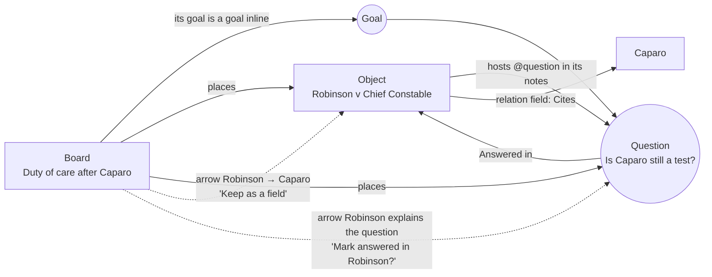

HIGH (a programme of five stages across six lanes; each phase states its own tier)

# Objects, questions and goals, and boards: one programme, start to finish

**For:** the owner, to approve the order; then the agents who build each phase in `studiolo`.
**Status:** Proposed. Claude, 28 October 2026. Nothing here is approved until the owner says so in the conversation.
**Checked against:** `studiolo` main @ `b5eeee2`, read only. Paths exist on that commit unless marked *new*.
**Joins three designs into one order:**
- [Objects: build phases](2026-10-25-objects-build-phases.md) (fields, page, views, types: lanes F, P, V, T);
- [Questions and goals roadmap](2026-10-25-questions-and-goals-roadmap-design.md) and its [design](2026-10-25-questions-and-goals-inside-items-design.md) (lane Q);
- [Boards](2026-10-24-boards-design.md) (lane B);
- [Long notes and connections](2026-10-28-long-notes-and-connections-design.md) (lane N, added 28 October: the writing page, and the three ways things connect);
- [Collections and linking](2026-10-28-collections-and-linking-design.md) (lane C, added 28 October: the collection studio, New collection, **Appears in** backlinks on every entry, Templates, and the linking model drawn out).

Each of those documents keeps its detail and its reasoning. This one decides **the order**, **where they meet**, and the few rules that change because they meet.

**Prototype:** [`prototypes/objects-boards-questions/`](../../../prototypes/objects-boards-questions/README.md). It shows the end state: an architect's, a lawyer's and a doctor's Commonplace where Objects, questions and goals, and a board work together. **Show phases** labels each part with the phase that builds it.

## 0. In short

The owner's direction (28 Oct): *questions and goals early; boards at the end; one actual prototype showing how Objects, boards, and questions and goals fit together.*

**Three systems, one idea each:**

| System | Answers | Lives in |
|---|---|---|
| **Objects** | *What is it, and what do I know about it?* A case, a building, a drug, with fields and links | an Objects collection (`content_items.shape = 'object'`) |
| **Questions and goals** | *What do I want from it?* `@question` and `@goal`, written inside whatever you're writing | *new* `item_inlines`, hosted by an item |
| **Boards** | *How does it fit together?* Things placed on a canvas, joined by simple links (a line, an optional label), toward a goal | a Commonplace entry of type Board, with *new* placements, arrows and frames |

**Where they meet (the whole point):**

1. **An Object hosts questions and goals.** "What I took from it" and its margin notes take `@question` and `@goal`, as notes do. Its card shows "? 2 · ◎ 1".
2. **A question can be answered in an Object.** *Answered in* links to the case, building or drug that answers it. The Object's page then shows **Answers**: the questions it answered.
3. **A board's goal is a goal inline, and its questions are question inlines.** They appear in the same **Questions and goals** list as every other question, named by their board.
4. **A board places Objects with their facts.** An Object card on the canvas shows its card fields and its "? · ◎" counts, and opens the Object's page.
5. **Arrows and relation fields meet, but never merge.** A link stays the board's. When an arrow joins two Objects whose collections have a matching relation field, the arrow offers one tap: **Keep as a field** ("Set New Gourna's Architect to Hassan Fathy"). Relation fields already set between two placed Objects show as faint dashed **field links**.
6. **A link to a question can answer it.** Linking a card to a question card offers **Mark answered in Robinson?** One tap; never automatic.

## 1. The order: five stages, six lanes

| Stage | Lane Q · Questions and goals | Lane F · Fields | Lane P · Page | Lane V · Views | Lane T · Types and Loci | Lane B · Boards |
|---|---|---|---|---|---|---|
| **0 · Groundwork** | **Q1** Write them (no migration) | **F0** Field-type descriptor | **P0** One Object page from blocks | — | — | — |
| **1 · Track and fields** | **Q2** Keep track (migration) · **Q3** While you watch and read | **F1** Choice, Long text, Checkbox, dates, units (migration) | **P1** Sections and chips | **V1** Table | **T1** Starter types per field | — |
| **2 · Links and places** | **Q4** On Loci · **Q-O** Objects host them, *Answers* shelf | **F2** Relation fields, 24 fields in groups (migration) | **P2** Arrange page (migration) | **V2** Columns, Timeline, saved views (migration) | **T2** Objects filter | — |
| **3 · Loci uses them** | **Q5** Loci reads, explains, offers | **F3** Group, Place, Event bases (migration) | — | — | **T3** Sensitivity, Loci drafts a collection (migration) | — |
| **4 · Boards** | **Q-B** Questions and goals on boards | — | — | — | — | **B1** Boards as entries (migration) · **B2** Viewer · **B3** Learn on a board (migration) · **B4** Boards in Loci (migration) |

**Lane N · Long notes and connections** (added 28 October) runs beside these: **N1** the writing page and editor in Stage 1, **N2** mentions, entry cards, images and the shared *Appears in* in Stage 2 (with F2), **N3** *Write about it* and margin notes on a block from Stage 2 into 3, and **N4** Loci in the writing in Stage 3. Detail, the connection model and its decisions (LN-D1 to LN-D9) are in [its design](2026-10-28-long-notes-and-connections-design.md).

**Lane C · Collections and linking** (added 28 October): **C1** the Collections page and New collection, **C2** the collection studio and **C3** editing from where you are, all in Stage 1 beside lane F (C2's Page tab waits for P2); **C4** *Appears in* in Stage 2, straight after N2; **C5** Templates as a gallery of collections, long notes and boards to start from, with *How Commonplace works*, in Stage 2 (its Boards group with B1). Detail and decisions (CL-D1 to CL-D13) are in [its design](2026-10-28-collections-and-linking-design.md).

**Why questions and goals come first.** Q1 needs no migration: the words live in the note's own text, so learners start the habit on day one, and every later lane reads what they wrote. Q2 and Q3 run beside the field work in Stage 1. By the time Objects get relation fields (Stage 2), *Answered in* already exists for them to join.

**Why boards come last.** A board is where everything else is placed. It needs the photo roadmap's header, viewer and Picks (Boards design §1); question and goal inlines (Q2), so its goal and questions are inlines from the start and nothing is migrated twice; and relation fields (F2), so *Keep as a field* and field links work. Building it earlier means building its own goal field and question notes and then replacing them, which Boards design §0 and IN-D7 already ruled out.

**Two agents, then three.**
- Agent A: Q1 → Q2 → Q4 → Q-O → Q5 → Q-B.
- Agent B: F0 → F1 → F2 → F3.
- Agent C (from Stage 1): P0 → P1 → V1 → P2 → V2.
- Agent D (from Stage 1, after Q1 merges): N1 → N2 → C4 → N3 → N4.
- Agent E (from Stage 1, beside Agent B): C1 → C2 → C3 → C5.
- The small T phases slot in wherever an agent waits for a migration approval. Lane B starts after Stage 2 and the photo roadmap's Phase 7, and is one agent's lane from then on.

**Migrations are numbered at merge.** Each lane owns its tables (Q: `item_inlines`, `inline_answers`; F: `collection_fields`, `item_field_values`, `content_relations.field_id`; P: `collections.page_layout`; V: `library_views`; T: `collections.base` checks, `collections.sensitivity`; B: `board_placements`, `board_arrows`, `board_frames`, the `board` shape). Branches name their file `00xx_<lane>_<what>.sql` and take the next number when they merge, and each one is applied only on the owner's word (`AGENTS.md`).

## 2. Stage 0 · Groundwork

| ID | What | Tier | Detail |
|---|---|---|---|
| **Q1** | `@question` and `@goal` in every note composer (the `@` menu); marked lines on cards and long notes; "? 2 · ◎ 1" on a card's foot; `has:question`, `has:goal` | MEDIUM | Q roadmap §3. One parser, `inlines.ts`; switch `INLINES` |
| **F0** | `field-types.ts`: one descriptor for every field type | LOW | Objects plan §4.1 |
| **P0** | Person and Work pages become one Object page drawn from blocks; three default lists reproduce today | MEDIUM | Objects plan §4.2 |

**Done when:** a learner writes a goal and two questions in a lecture note and finds them with `has:question`; the Object pages look exactly as before (paired screenshots).

## 3. Stage 1 · Track and fields

| ID | What | Tier | Detail |
|---|---|---|---|
| **Q2** | Statuses (Open · Answered · Parked; Active · Reached · Paused · Dropped), an answer line, *Answered in*, goal dates, the **Questions and goals** page beside To read | HIGH | Q roadmap §4. Migration: `item_inlines`, `inline_answers` |
| **Q3** | **Q** and **G** in the watching room, PDF reader, photo and web viewers | MEDIUM | Q roadmap §5. Parallel with Q2 |
| **F1** | Choice, Long text, Checkbox, year dates and ranges, units | MEDIUM | Objects plan §4.1. Migration |
| **P1** | Long-text fields as sections; choice chips | LOW | Objects plan §4.2 |
| **V1** | Table view of a collection | MEDIUM | Objects plan §4.3 |
| **T1** | Starter types for law, medicine, architecture | LOW | Objects plan §4.4 |

**Change from the Q roadmap:** *Answered in* (`inline_answers.item_id`) takes **any** Commonplace item from Q2, Objects included. The picker lists Objects first, grouped by collection, because a case, a building or a guideline is most often what answers a question.

## 4. Stage 2 · Links and places

| ID | What | Tier | Detail |
|---|---|---|---|
| **Q4** | A topic's panel lists its open questions and active goals | MEDIUM | Q roadmap §6 |
| **Q-O** | **Objects host questions and goals** (*new* here). Hosts widen from notes to an Object's body ("What I took from it"); margin notes on Objects already host them. An Object's rail gains **Inside** ("1 goal · 2 questions"), and its page gains an **Answers** shelf: the questions answered in it, each naming its host | MEDIUM | Changes RQ-D2 for Object bodies only; Object fields still don't host |
| **F2** | Relation fields on both sides, symmetric links, 24 fields in groups | HIGH | Objects plan §4.1. Migration |
| **P2** | Arrange page; Slideshow and Document tops; other-side blocks; the **Answers** shelf is one of the blocks | MEDIUM | Objects plan §4.2. Migration |
| **V2** | **Columns** (by a Choice field), Timeline, saved views, sort by field | HIGH | Objects plan §4.3. **Renamed from "Board"** to avoid the clash with Boards (§8, OQB-D1). Migration |
| **T2** | Objects' own filter in the header | LOW | Objects plan §4.4 |

## 5. Stage 3 · Loci uses them

| ID | What | Tier | Detail |
|---|---|---|---|
| **Q5** | Loci reads open questions and goals at the place; goals suggest *why*; **Explain this**, **Find resources**, **Ask Loci** on a question; "Make this a question?" offers | HIGH | Q roadmap §7, in slices Q5a–e |
| **F3** | Group, Place and Event bases | MEDIUM | Objects plan §4.1. Migration |
| **T3** | Confidential and Clinical collections; Loci drafts a collection from a sentence | HIGH | Objects plan §4.4. Migration |

**With Objects:** Q5's *Explain this* on a question hosted by an Object uses the Object's fields as context ("Robinson v Chief Constable, [2018] UKSC 4, UK Supreme Court, Tort"). Loci's offer "*Robinson* may answer *Is Caparo still a test?* Mark it answered?" fires when an Object in the question's topic has a matching holding or long-text field.

## 6. Stage 4 · Boards

Boards design §3 stands, with what Stages 0–3 already built folded in. The table lists only what changes.

| ID | What changes because the rest exists | Tier |
|---|---|---|
| **B1** | The **goal card is a goal inline** hosted by the board (IN-D7), and **question cards are question inlines** with an `{x, y}` anchor (Q-B); a note written on the board is still a Note. Board tool **G** places the goal. **Object cards** are the wall's Object cards (Portrait, Picture or Text) with their card fields and "? · ◎" counts. **Field links**: relation fields between two placed Objects show as faint dashed lines, never as arrows. **Keep as a field**: an arrow between two Objects whose collections have a matching relation field offers to set it, one tap. The add drawer lists Objects by collection and saved views (V2) as a source | HIGH |
| **B2** | Unchanged. The viewer's *On boards* also lists boards on Object pages (a rail row, **On boards**) | MEDIUM |
| **B3** | **Make a Lumen**: question inlines on the board become the check (as designed), and an Object's long-text fields are quoted like notes. **Recall** covers answered questions (Q2's answer line). An arrow with the word *explains* into a question offers **Mark answered in…** | HIGH |
| **B4** | Unchanged, plus: the board's goal is already a goal inline, so Q4's topic panel lists it with no extra work, and Q5's *why* reads it | HIGH |

**Q-B** (the Q roadmap's "later: Boards") is built inside B1: the migration that adds boards also lets `item_inlines.anchor` hold a board position.

**Addendum, 28 October: the board as a learning space.** B3 becomes three phases: **LB1** (the path), **LB2** (Lumens on the board) and **LB3** (notes and Recall on the board). The board's questions form a suggested path to its goal. Each one can be answered with a Lumen that plays inside its card, to read, watch or listen to. The learner's notes gather beside it. There is no separate learning mode, and nothing is locked or reordered by the app. A board opens as one full-screen, infinite canvas with floating panels, like Miro. B1 places things by double-clicking empty board to search, or by dragging from a visual shelf. See [Boards §7](2026-10-24-boards-design.md) and decisions LB-D1 to LB-D9.

## 7. Rules where the three meet

| Rule | Why |
|---|---|
| **Three kinds of connection, each made in one place** (lane N): a *mention* in the writing, a *property* in the rail, a *link* on a board. Every page shows them the same way: the rail says what it is, the foot says where it shows up | So a learner always knows where to look and where to change it, and the code has one writer per kind (Long notes design §2) |
| **An arrow never writes a field, and a field never draws an arrow.** *Keep as a field* is one tap; field links are dashed and can't be edited on the board | An arrow is a claim on one board (Boards §2.1); a field is a fact everywhere. Mixing them makes both unreliable |
| **A question has one host.** Placing a note's question on a board places a *view* of it ("from *Seminar notes*"); its status is the same everywhere | One question, everywhere (IN rule 3) |
| **Answered in points at items, Lumens or boards** | A question is often answered by an Object, sometimes by a whole board |
| **Counts, not cards, on the wall** | Questions and goals never become wall cards (IN rule 1); boards and Objects show "? · ◎" in their foot |
| **Loci only offers** | *Keep as a field*, *Mark answered*, *Make this a question?* are all one-tap offers (A2) |
| **Clinical collections stay clinical on a board** | A teaching case placed on a board keeps its banner, and its questions stay off the record for memory |

## 8. Decisions for the owner

| ID | Question | Recommendation |
|---|---|---|
| **OQB-D1** | The Objects plan's grouped view was called **Board**, which clashes with Boards | **Rename it Columns** |
| **OQB-D2** | Questions and goals first (Q1 in Stage 0, Q2 and Q3 in Stage 1) | **Yes** |
| **OQB-D3** | Boards last (Stage 4), after Q2 and F2 | **Yes**, so a board's goal and questions are inlines from day one and *Keep as a field* works |
| **OQB-D4** | Object bodies host `@question` and `@goal` (Q-O) | **Yes**, from Stage 2; fields stay plain |
| **OQB-D5** | *Answered in* can point at Objects, with an **Answers** shelf on the Object | **Yes** |
| **OQB-D6** | *Keep as a field* from an arrow between two Objects | **Yes, as a one-tap offer** |
| **OQB-D7** | Field links shown on a board | **Yes, dashed, with a toggle** (on by default) |
| **OQB-D8** | An arrow *explains* into a question offers *Mark answered in…* | **Yes, as an offer** |

Earlier decisions stand: Objects OB-D1 to OB-D10, questions and goals IN-D1 to IN-D9 and RQ-D1 to RQ-D7, Boards BD-1 to BD-10.

## 9. What this is not

- **Not a task manager**: no assignees, due-date alarms or statuses beyond the ones above.
- **Not a database builder**: no formulas or automations.
- **Not a whiteboard**: no freehand, shapes or elbow connectors (Boards §5).
- **Not shared**: boards, objects and questions are the learner's own in this programme.
