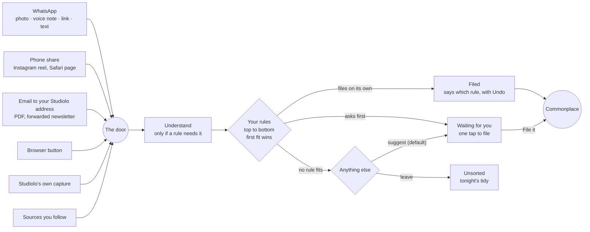

HIGH (new capture channels, rules that act on the learner's Commonplace, model calls on arrival; each phase states its own tier)

# Routines, version 3: your filing rules, and the rest

**For:** the owner, to decide the direction, and the agent who later builds it in `studiolo`.
**Status:** Proposed. Claude, 29 October 2026. Nothing here is approved until the owner says so in the conversation.
**Prototype:** [`prototypes/loci-routines/`](../../../prototypes/loci-routines/README.md), version 3, published as **Studiolo Loci Routines** (same link as before).
**Owner's direction (29 Oct):** keep Routines, make them useful and used. Routines should help the user **store, manage and learn from** their content. The new idea: when I send something to Commonplace, a routine sorts it. I set the rules: "when I send something like that, move it to there; when I send something from WhatsApp, do that."
**From Craft, in the owner's words:**
- *Library – polishment Phase:* "I want the system to be simple for the user input but … very customizable." "Collections are data types rather than folders." "A photo … can have multiple sub data types, like site photos, renders." "Something called inbox where a link can be added … for a user to sort."
- *Daily note, 25 Oct:* "Send audio on WhatsApp and it takes an action where it creates a Lumen and sends it back, and/or saves something to Commonplace." "Share … reels and AI analyzes them and saves them in the correct category; if it's a food recipe it just saves the recipe; if it's a reel with video links inside it, AI looks for it and saves it."
- *Features & Ideas › Sources pulling* (17 Oct): sources pulled into a wall where the user chooses.
**Updates:**
- [Loci routines](2026-10-25-loci-routines-design.md): its scheduled routines and run mechanics stand, with the additions in §6.
- [The 29 Oct rethink](2026-10-29-background-work-rethink.md): the owner keeps Routines, so its cuts are reversed. Its usefulness test (§2 there) stays, as the bar every routine is held to.

## 0. In short

> **Simple to send, sorted your way.** Send anything from anywhere and it's filed the way you said. Loci tidies, checks and brings things back on a schedule. What you learn comes back to you.

Routines become three families, named by what starts them:

| Family | What starts it | What it does | Examples |
|---|---|---|---|
| **When something arrives** (new, the core) | Anything entering Commonplace, from any channel | Your **filing rules**: When / If / Then, checked from the top | "When a photo with #site arrives from WhatsApp, file it as Site photos, add it to the prayer hall project and describe it" |
| **On a schedule** (from 25 Oct, plus three) | A time | Tidy, bring in, bring back | Tidy Unsorted (nightly), Follow sources, Review, Questions and goals, Clear the To read pile, Keep sources alive |
| **When something happens** (new, small) | Something the learner did | A follow-up | "When I finish a Lumen, bring its check back three days later" |

Each family covers one or more of the owner's three verbs. **Store:** the filing rules and Follow. **Manage:** the tidy, the To read pile, dead links, duplicates. **Learn:** questions, Lumens, review.

## 1. One door

Everything that enters Commonplace comes through one door, whatever the channel. Things that come in through the door get the same treatment: understood once, checked against the learner's rules once, filed or held for them.

The door is today's capture path (`createItem`) plus a log of what arrived and what happened to it. That log is the **Inbox** in the prototype (Commonplace › Inbox). It's the owner's "inbox where a link can be added … for a user to sort", with the sorting done by the learner's own rules.

## 2. A filing rule

### 2.1 Its parts

| Part | Choices | Who decides |
|---|---|---|
| **When**: the channel | Anywhere · WhatsApp · Email · A phone share · The browser · Studiolo itself · Sources you follow | Code |
| **If**: conditions, all must fit | It's *a photo / link / PDF / voice note / video / reel / note* · It's from the site … · It has the tag #… · Its words include … | Code: plain, free, predictable |
| | Loci reads that it's *a book / a recipe / a paper / a lecture / a site photo* · Loci reads that it's about *a topic* | A small model, only when a rule asks |
| **Then: file it** | **As** a collection (Site photos, Precedents, Books, Specifications, Recipes…). **On** the topic it's about, a chosen topic, or none. **Reading status** Inbox / To read / Reading. **Also add to** a project or board | Code, except "the topic it's about" |
| **Then: have Loci** | Describe photos · Write out voice notes · Give it a title · Save the links inside it · Find the book · Pull out the text · Three-line summary · Keep just the recipe | Speech-to-text, a small vision model, a catalogue, text extraction (code), a small model |
| **Then: learn from it** | Questions become `@question`s (Questions and goals I1) · Add it to Review · Offer a short Lumen | A small model; a Lumen only after a yes |
| **Then: reply** (WhatsApp only) | No reply · A short line saying where it went · The Lumen's link once you've said yes | Code |
| **Before it files** | Ask me first · File on its own | The learner |

**Collections stay kinds of thing, never folders.** *File as Books on Climate-responsive design* means the type is Source, the collection is Books, and the topic is Climate-responsive design. That's the owner's model; no rule can create a folder.

### 2.2 Order

- Rules are checked **from the top**, and **the first rule that fits files it**, as in mail filters. One rule, one outcome, easy to explain.
- New rules go to the top, and the learner moves rules up or down.
- **Try it** shows when an earlier rule would catch something first ("today *Precedents* gets it first").
- **Anything else** is the last line. By default Loci suggests a place and asks. The learner can set it to leave things in Unsorted for the nightly tidy instead.

### 2.3 Reading as a sentence

Every rule reads as one sentence, on its card and while it's being edited. Dotted parts are where Loci reads the item; the rest are plain rules and cost nothing:

> When **a photo** with **#site** arrives from **WhatsApp**, ·describe it·, file it as **Site photos** and add it to **Prayer hall, Al Barsha**.

## 3. Making rules, without effort

The owner's bar is *simple for the user input*. There are four ways in, from least effort to most:

1. **Suggested from what you do.**
   - Loci notices a filing done by hand three times or more, with the same source, tag or kind, going to the same place.
   - It asks once: *"You filed 7 links from dezeen.com as Precedents by hand this month. Add dezeen.com to your Precedents rule?"*
   - The noticing is counting, not a model.
   - This is how most rules should be born.
2. **Make a rule from this.** On anything in the Inbox, especially what no rule caught. The editor opens with its channel, kind, tag and site already filled in.
3. **Say it.**
   - The learner writes a sentence; Loci turns it into the rule's parts; the learner checks and saves.
   - In the app, one small-model call with the rule schema as structured output.
   - In the prototype, a keyword reader stands in, with four examples to try.
4. **Set it**, with choices for each part.

**Try it on your last 20 arrivals** before saving. It shows what would have been filed where, and moves nothing.

## 4. Trust: why a learner can let it run

- **New rules ask first.** An item waits with Loci's suggestion, and **File it** takes one tap. Changing the place before filing counts as a miss.
- **Earned, not assumed.** After a rule has been right 9 times in 10, the card offers *"Let it file on its own?"* Nothing changes until the learner says yes.
- **Every filed item says which rule filed it**, with **Undo** and **Why** ("Rule 2, *Site photos*: it came from WhatsApp · it's a photo · it has #site").
- **Undo counts against the rule**, and the card shows "1 undone".
- **Nothing is ever deleted by a rule.** *Let go* archives.
- **Anything that costs always asks.** A Lumen asks on WhatsApp itself: *"I can make a 3-minute Lumen on this … about 1% of your monthly allowance. Make it?"*
- **Duplicates are caught** ("You already have this one, saved 19 Oct. Nothing added.") by an event routine the learner can turn off.

## 5. Channels: what each one really takes

| Channel | What it gets | What it takes | Phase |
|---|---|---|---|
| **Studiolo's own capture** | Everything it gets today | Built. Already runs fixed rules by kind (`library/classify.ts`) | R1 |
| **Email** to a personal Studiolo address | Attachments (PDFs, images), forwarded newsletters, links in the body | An inbound-email service and one address per account. Cheap and well understood | R3 |
| **Phone share** | The link and caption from Instagram, Facebook, YouTube or Safari; files from Photos | Android: the web app's share target. iPhone: an Apple Shortcut until there's a native app. **For a reel we get the link and caption, not the video**; "the links inside it" means links in the caption and on the page | R3 |
| **WhatsApp** | Photos, voice notes, PDFs, links, text; Studiolo can reply | The **WhatsApp Business Platform**: a Studiolo business number, Meta business verification, a webhook, and linking a learner's phone number to their account with a code. Replies are free inside 24 hours of the learner's message; outside that, only approved templates | R4 |
| **Browser button** | The page address, title and selected text | A small extension (already listed as later work in the photos design) | Later |
| **Sources you follow** | New items from chosen feeds | The Follow routine (the scheduled job from 25 Oct), entering through the same door | R5 |

Telegram is a cheaper first chat channel than WhatsApp (a bot, no business verification) if WhatsApp's set-up is a blocker. The owner's notes name WhatsApp, so it's the target.

## 6. On a schedule, and when something happens

**Scheduled routines.** All of the 25 Oct kinds stay: Follow (Watch) sources, Reading list, Questions and goals, Lumen of the week, Review, Daily brief, Board digest, Project update. They are now grouped by **Store / Manage / Learn**. Three are new, all in Manage:

| New | What it does | The user's part | Model? |
|---|---|---|---|
| **Tidy Unsorted** (nightly) | Applies the rules to anything that arrived before a rule existed; suggests a place for the rest; leaves what it can't place | *Place all*, or one by one; *Keep* or *Let go* for the rest | One small call for the suggestions |
| **Clear the To read pile** (monthly) | Lists what has sat in To read for over three months | *Read it this week* (adds a session) · *Keep* · *Let go* (archived) | None |
| **Keep sources alive** (monthly) | Opens every saved link; where one is gone, the copy saved at capture opens instead; where one moved, the address is updated | Nothing, unless it wants to look | None |

**When something happens** (each on or off, no setup):
- When I finish a Lumen, bring its check back three days later.
- When I highlight in the reader, turn the week's highlights into questions on Friday.
- When I send something I already have, keep the one I have and tell me.
- When I set a date on a topic or project, plan sessions to get ready by then (the *Get ready* job from the rethink, with Today T4).
- When I mark a topic Learned, check me once, a month later (off by default).

**Improvements carried into every routine,** from the rethink's test:
- skip when nothing is new;
- ignored items expire;
- after three unopened runs, Loci asks before pausing;
- the card shows outcomes (kept, placed, answered), not activity;
- Builder shows which steps used a model.

## 7. How an arrival is handled

1. **Received.** WhatsApp webhook, email webhook, share target or capture. Media is stored like any capture (the existing upload path).
2. **Understood, only if needed.** If any rule that could fit has a dotted part, **one small-model call** returns, as structured output: what it is (book, recipe, paper, lecture, site photo), which topic on the map it's most about, and a title. If no rule needs it, there's no call.
3. **Matched**, in code, top to bottom.
4. **Acted on**:
   - transcription (speech-to-text);
   - a photo description (a small vision call);
   - finding the book (the Open Library lookup from Loci suggests resources);
   - pulling text (the existing extraction);
   - a summary or questions (the small model);
   - links in a caption (code), each one then captured like any link.
5. **Filed** in code, with an undo record (`filed_by_rule`, the previous state).
6. **Replied** (WhatsApp), from the same job.

**The AI decision.** Today capture classification is "never by AI" (`library/classify.ts`). This design keeps that rule for anything the learner hasn't asked for:
- the model runs only when a learner's rule asks it to, or when *Anything else* is set to suggest;
- what it does is either shown as a suggestion or labelled with the rule that did it.

That needs the owner's yes (§10).

**Cost.**
- Plain rules cost nothing.
- Reading an item is one small call, well under 0.1% of the allowance.
- A voice note adds speech-to-text.
- A Lumen costs what a Lumen costs, and always asks first.
- The prototype's figures are examples; real ones come from the usage ledger.

## 8. Data (for R1 to settle; names indicative, all *new*)

- `filing_rules`: account, position, name, `channel`, `conditions` (JSON, validated), `actions` (JSON, validated), `mode` (ask, own), `always_ask`, `on`, `origin` (made, suggested, from_item), counts (right, checked, filed, undone).
- `arrivals`: account, channel, received_at, `item_id` (once created), `understood` (JSON: is, about, title), `rule_id`, `state` (filed, waiting, suggested, unsorted, duplicate, undone), `undo` (JSON).
- `rule_suggestions`: account, pattern (site, tag or kind → collection and topic), count, `asked_at`, `answer`.
- `channel_links`: account, channel (whatsapp, email), address or number, `verified_at`.
- Scheduled and event routines: as in the 25 Oct design (`routines`, `routine_runs`, `routine_items`), plus an `event` trigger kind.

## 9. Phases

| # | Phase | What the learner gets | Tier | Migration |
|---|---|---|---|---|
| R1 | **The door and plain rules** | The Inbox; rules with plain conditions (channel, kind, site, tag, words) and File actions; Ask first / On its own; Filed by, Undo, Why; Try it; Anything else. Studiolo's own capture only. **No AI, useful alone** | HIGH | yes |
| R2 | **Loci reads it** | Dotted conditions (is, about) and actions (describe, transcribe, find the book, summary, recipe, links in a caption, questions); *Say it*; rules suggested from what you do | HIGH | small |
| R3 | **Email and phone share** | A personal email address; the share target, plus an iPhone Shortcut | HIGH | yes (channel links) |
| R4 | **WhatsApp** | Linking a number; photos, voice notes and links in; replies; *Ask and get a Lumen* | HIGH | no |
| R5 | **The schedule and events** | Tidy Unsorted, the To read pile, Keep sources alive, Follow through the door; the event routines; the 25 Oct kinds as they're needed | MEDIUM | yes (routines) |

**Why this order:**
- **R1 proves the door and the trust model with no model calls.** Rules on Studiolo's own capture are already useful: links from a site file as Precedents, PDFs mentioning "specification" file as Specifications.
- **R2 adds the reading.**
- **R3 and R4 add the channels** that make "send it from anywhere" true. WhatsApp goes last because it needs Meta's verification.

## 10. Decisions for the owner

1. **Is the shape right?** Three families (arrives, schedule, happens), with filing rules as the core?
2. **AI on capture, through rules only.** May Loci read and file arrivals when a learner's rule asks for it, which relaxes "classification never by AI" (§7)?
3. **The default for Anything else:** *suggest and ask* (as in the prototype), or *leave in Unsorted*?
4. **Which channel first after Studiolo's own:** email (cheapest), phone share, or WhatsApp (most wanted, slowest to set up)?
5. **Name:** keep **Routines** for all three? Or call the first family **Filing rules** inside Routines (as the prototype does), or give it a name of its own?
