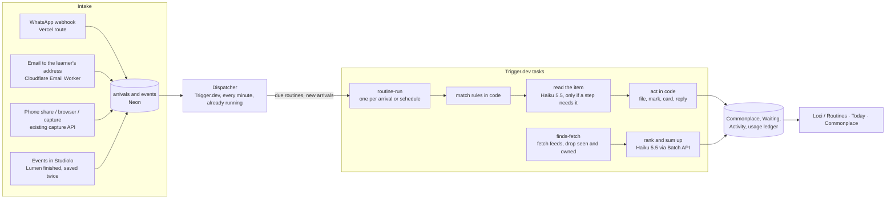

# Routines: how they run, what they run on, and what they cost

**For:** the owner, to decide whether and how to build routines; and the agent who later builds them in `studiolo`.
**Status:** Proposed. Claude, 29 October 2026. Nothing here is approved until the owner says so in the conversation.
**Owner's direction (29 Oct):** "How it starts needs some kind of integration, like Make.com or Zapier do … just more visual. … Is Routines the right name now? Where does this fit? Commonplace? Under Loci? … How it actually works and how it fits in our system. … Would it work on Trigger.dev? On Cloudflare Workers? … The tokens as well, the cost. Let's take this to realistic."
**Prototype:** [`prototypes/routines/`](../../../prototypes/routines/README.md), version 8, published as **Studiolo Routines**.
**Cost model:** [`routines-study/cost-model.mjs`](../../../routines-study/cost-model.mjs). Every figure in §7 comes from it; change a rate or an assumption there and run it again.
**Builds on:**
- [Routines v3: filing rules](2026-10-29-routines-filing-rules-design.md) (§5 channels, §7 handling an arrival, §8 data);
- [Routines: the user experience](2026-10-29-routines-chat-ux-design.md);
- [Loci routines, 25 Oct](2026-10-25-loci-routines-design.md) (scheduled runs on the Trigger worker, the Batch API);
- [Cost dashboard](2026-10-18-cost-dashboard-design.md) (the stack, the usage ledger).

## 0. In short

| Question | Answer |
|---|---|
| **Is it possible?** | Yes. Almost all of it reuses what Studiolo already runs. The two hard parts are outside the code: WhatsApp (Meta's business verification, and per-message billing since 1 October 2026), and reading arbitrary web pages reliably for Finds. |
| **What does it run on?** | **No new platform.** The engine runs on **Trigger.dev**, as Lumens and memory already do. One **Cloudflare Email Worker** receives email. **Vercel** routes take the webhooks; **Neon** holds the data. **Claude Haiku 5.5** does the routine work; **Sonnet 5.5** only when the learner talks to Loci. **ElevenLabs Scribe** turns voice notes into text. |
| **Cloudflare Workers instead of Trigger.dev?** | Not for the engine, not now: Trigger.dev already has Studiolo's code, the usage ledger, the spend cap, retries and free waits. Workers fits two edges: receiving email (needed), and fetching feeds once there are thousands of learners (optional). §5. |
| **Cost per user** | About **$0.08 a month** for a light user, **$0.36** for a typical one and **$2.35** for a heavy one (§7). The routines themselves cost a few cents. What costs more are four things the learner turns on: talking to Loci, voice notes, WhatsApp replies, and searching the open web. Each gets a guardrail (§7.4). |
| **Tokens** | A typical learner: about **0.94 million Haiku tokens in and 0.09 million out**, plus **0.15 million Sonnet tokens in** (talking to Loci), a month. |
| **The name** | **Keep "Routines."** It says *things done for you, regularly*, it's warm, and it's what Claude, Google and Alexa call the same idea. "Automations" is colder and sounds like work software. Its results are called by what they are: **Finds**, **Waiting**. §1. |
| **Where it lives** | **Under Loci, in its own place in the rail:** *Loci / Routines · Finds · Waiting · Activity · Connections*. Routines are what Loci does for you, and they reach beyond Commonplace into Learn and Today. Their results also show where the learner already works: on Today, and Unsorted in Commonplace. §1. |
| **The builder** | **A vertical flow, as in Zapier:** a trigger, then steps, joined by a line with a **+** between them. Triggers are "apps" grouped by where things come from. One **step registry** in code drives the builder, the cost line, validation and the worker. §2. |
| **Effort** | About **8 to 11 weeks of building** for everything except connected apps, in six phases. The first useful phase (in-app filing rules, the builder, scheduled routines) is about 3 weeks. Connected apps such as Zotero or Readwise come later, about a week each. §8. |

## 1. Name and place

### 1.1 The name

| Name | For | Against |
|---|---|---|
| **Routines** (recommended) | A learner's day already has routines; it fits reviews and follow-ups as well as filing. Claude, Google Assistant and Alexa use it for the same idea, so it's familiar. Warm, not technical | Slightly soft for "when WhatsApp sends a photo, file it" |
| Automations | Exact; Apple Shortcuts and Notion use it | Cold; sounds like work software, not a studio |
| Rules | Exact for filing | Wrong for Finds, reviews and follow-ups |
| Flows, Recipes | Visual (flow), or friendly (recipe, as IFTTT once used) | "Recipes" clashes with real recipes in the Commonplace; "Flows" means nothing to a learner |

The parts keep plain names: a routine has a **trigger** ("When") and **steps**. What routines bring back is named for what it is: **Finds** (from sources), **Waiting** (needs a decision), **Activity** (what was done).

### 1.2 The place

| Option | For | Against |
|---|---|---|
| A tab of **Commonplace** (version 7) | Most routines file into Commonplace | Reviews, Lumen follow-ups and Today cards aren't Commonplace; a sixth tab there is crowded |
| **Settings** | Rarely visited, like a control panel | Routines are visited weekly (Finds, Waiting); Settings hides them |
| **Under Loci, its own place in the rail** (recommended; version 8) | Routines *are* what Loci does for you, so it's the honest place. It gives Loci a home beyond the panel, and holds Connections too. Memory (now in Settings) could move here later | A fifth rail item; on a phone, a fifth tab |

**Recommendation:** a **Loci** place in the rail, after Graph, with tabs **Routines · Finds · Waiting · Activity · Connections**.
- Results still show where the learner works: **Today** gets a card ("6 filed overnight · 6 new finds"), and Unsorted in **Commonplace** keeps what no routine covered.
- Loci's panel, everywhere, can make or change a routine.
- On a phone, **Loci** is the fifth tab (the prototype shows it).

## 2. The builder: a trigger, then steps

A routine is drawn as **a vertical flow**, as in Zapier: one card per step, joined by a line, with a **+** between steps.
- Each card shows its number, its kind (When, Only if, Loci, Then, Before it files) and a one-line summary.
- Click a card to open its settings.
- The sentence at the top (*It will …*) and the cost line update as you change anything.

Zapier's vertical list is chosen over Make's free canvas of circles: Studiolo's routines are short and run in a straight line. A list reads top to bottom on a phone; a canvas doesn't.

### 2.1 Triggers ("apps")

| Group | Triggers | What it needs | Phase |
|---|---|---|---|
| **Send to Studiolo** | WhatsApp · Email · Phone share · Browser · Anywhere | Each channel's intake (v3 spec §5): Studiolo's capture (built), an Email Worker, a share target, WhatsApp Cloud API, an extension | R1 to R5 |
| **Watch sources** | Websites and journals (RSS or Atom) · Newsletters (forwarded to the learner's address) · YouTube channels (their public feed) | A feed fetcher; the inbound email address | R4 |
| **On a schedule** | Every day, weekdays, a day, monthly, at a time | The scheduler (§4.2) | R1 |
| **In Studiolo** | Finish a Lumen · Save something twice · Add a question · Set a goal | An event from the code that already does it (§4.4) | R2 |
| **Connected apps** (later) | Zotero · Readwise · Google Drive · Raindrop · Calendar | OAuth, and polling each app's API | R6 |

**Connections** (a Loci tab) lists every source with its state: connected, ready, not set up, or a source that has gone quiet. Each one names the routines that use it.

### 2.2 Steps

| Kind | Steps | Model? |
|---|---|---|
| **Only if** (filter) | What kind; has a tag; from a site; mentions words; *is* a book or recipe or paper; *is about* a topic | Plain rules in code; *is* and *is about* need Loci to read the item |
| **Loci** (reads the item) | Describe it · Write out what I said · Sum it up · Find the book · Keep just the recipe · Keep the caption's links · Questions become @questions · Offer a Lumen | Haiku 5.5; speech-to-text for voice; Open Library for books; links in code |
| **Then** (acts) | File it (as which kind, on which topic, mark it, add to a project) · Bring finds to a page or To read · Ask questions on Today · Put a card on Today · Tell me on WhatsApp | Code, except a WhatsApp reply (a paid message) |
| **Before it files** (a check) | Ask me first · File on its own (the trust ladder) | Code |
| **Wait** | A day · three days · a week | The scheduler |

### 2.3 One step registry

Every trigger and step is one entry in a registry in code (`src/features/routines/registry.ts`). Each entry has:
- a **schema** (zod) for its settings;
- a **label, icon and summary** for the builder;
- whether it **needs a model**, and a **cost estimate** per item;
- an **executor** the worker runs.

So the builder, validation, the cost line ("Under 1% of your monthly allowance"), Loci's structured output when it makes a routine, and the worker all read the same list. Adding a connected app later means adding entries, not a new screen.

A routine is stored as `{ trigger: {type, config}, steps: [{type, config}], mode }`. The order is fixed by kind: filters, then Loci steps, then checks, then actions. The **+** offers only steps that fit the trigger.

## 3. How it works: four paths through one engine

### 3.1 Something arrives (WhatsApp, email, phone, browser, capture)

1. **Received.**
   - WhatsApp posts to a Vercel route, which checks Meta's signature and answers within seconds.
   - Email reaches a Cloudflare Email Worker on a catch-all address (`*@in.studiolo.app`); the Worker reads the account from the address and posts the parsed message.
   - Both write an `arrivals` row, store any media in R2 (the existing upload path), and start a `routine-arrival` task.
2. **Matched in code.** Plain conditions (channel, kind, tag, site, words) are checked first. If no routine could fit without reading the item, there's no model call.
3. **Read, only if needed.** One Haiku 5.5 call with structured output: what it is, which topic, a title, plus any Loci steps the routine asks for (describe, sum up). The learner's topics and the routine's instructions are a cached prefix.
4. **Acted on, in code.** File (with an undo record), add to Waiting if the routine asks first, write Activity, write the usage ledger, and reply on WhatsApp only if that step is on.

### 3.2 On a schedule

The **every-minute dispatcher** Studiolo already runs on Trigger.dev picks up routines whose `next_run_at` has passed, in each learner's time zone, and starts a `routine-run` task for each.
- **Why one dispatcher, not one Trigger.dev schedule per routine:** schedules on Trigger.dev are counted per plan. Thousands of learners' routines are rows in a table, not schedules.
- **Model calls that can wait go through the Message Batches API at half price.** The task submits the batch early (overnight for a morning delivery) and waits with Trigger.dev's checkpointed wait, which costs nothing while waiting. *Run now* and *Check now* use a normal call.
- **A run with nothing new makes no call.** Routines whose results go unopened three times in a row pause themselves (25 Oct design).

### 3.3 Finds: watching sources

1. `finds-fetch` reads each source with a conditional GET (ETag and Last-Modified), so unchanged feeds cost almost nothing. Sources include:
   - RSS or Atom for sites and journals;
   - YouTube's public channel feed;
   - newsletters, which arrive by email, as in §3.1.
2. **In code:** drop items seen before (link, then a normalised title), anything already in the learner's Commonplace (link or DOI), the same story from two sources, and anything older than the last run.
3. **For the top 10 by plain signals, fetch the page and extract the text** (Mozilla Readability). Paywalled or unreadable pages keep their feed summary.
4. **One Haiku 5.5 call for the run** (by batch), given:
   - the subject, the learner's topics, open questions and goals, and the last 30 *Not for me* reasons;
   - about 30 candidates.

   It returns a score, a two-line summary and the *why* for each. Code keeps the top *N*, links the question or goal the model named (only ones that exist), and writes the Finds page.
5. **Decisions teach it,** in code: *Not from this source* lowers that source's weight; *Not this topic* lowers that topic for this routine; Saved raises both.
6. **The open web** (Loci searching beyond the chosen sources) is a separate, opt-in step: Claude's web search tool on Sonnet 5.5, a few searches a run, at $10 per 1,000 searches plus tokens. It's about 75 times the cost of a sources-only run (§7), so it's weekly at most, and a decision for the owner (§10).

### 3.4 Something happens in Studiolo

The code that finishes a Lumen, saves an item or adds a question writes a row to `routine_events`; the dispatcher handles it like an arrival. No polling.

## 4. The stack, piece by piece

| Piece | Runs on | New or existing | Notes |
|---|---|---|---|
| Builder, routine pages, Finds, Connections | Next.js on **Vercel** | New screens, existing app | The prototype's screens |
| Routine data | **Neon** Postgres, Drizzle | New tables (§6) | Small rows |
| Engine: dispatcher, `routine-arrival`, `routine-run`, `finds-fetch`, `finds-rank` | **Trigger.dev** | The dispatcher exists; four new tasks | Retries, idempotency keys, a concurrency key per account, checkpointed waits |
| WhatsApp intake and replies | **Vercel** route + **Meta WhatsApp Cloud API** (direct, no reseller) | New | Business verification; a Studiolo number; linking a learner's number with a code |
| Email intake | **Cloudflare Email Routing** catch-all → **Email Worker** | New Worker | Inbound mail is free and unlimited on Workers plans; parsing with `postal-mime`; posts to Studiolo with a signed secret |
| Phone share | Web app share target (Android); an Apple Shortcut (iPhone) | New, small | A native app later |
| Browser | An extension | New, later | Already on the photos roadmap |
| Media | **Cloudflare R2** | Existing | Photos, PDFs, voice notes |
| Reading items, Finds, tidy, review | **Anthropic API**, Claude Haiku 5.5 | Existing account, new purposes | Structured output; prompt caching; Batch API for scheduled work |
| Talking to Loci about routines | Anthropic API, Sonnet 5.5 (Loci's model) | Existing | Could run on Haiku 5.5 (§7.3) |
| Open-web Finds (opt-in) | Anthropic web search tool, Sonnet 5.5 | New purpose | Metered per search |
| Voice notes | **ElevenLabs Scribe v2**, $0.22 an hour | Existing vendor | Studiolo already pays ElevenLabs |
| Books | Open Library | Existing (Loci suggests resources) | Free |
| Cost and limits | Usage ledger (`provider_usage_evidence`), `checkSpendCap` | Existing | New purposes: `routine_read`, `routine_finds`, `routine_web`, `routine_stt`, `whatsapp_reply` |
| Email from Studiolo (weekly summary) | **Loops** | Existing | Optional |

## 5. Trigger.dev, Cloudflare Workers, or something else?

| | Trigger.dev (recommended for the engine) | Cloudflare Workers + Cron + Queues | Vercel Cron + routes | Claude Managed Agents (scheduled) |
|---|---|---|---|---|
| Runs Studiolo's code as is | **Yes** (Node; the same services, Drizzle, usage ledger) | Partly: Workers runtime with `nodejs_compat`; Neon over its HTTP driver or Hyperdrive; a second deploy | Yes, but functions time out and there are no retries or queues | No: an agent in a sandbox, outside Studiolo's database |
| Waiting on a model or a batch | Billed while the task runs; **free** during checkpointed waits (`wait.for`) | **Billed on CPU time only**, so waiting on I/O is nearly free | Billed as function time | Billed per session hour |
| Thousands of per-learner schedules | One dispatcher over a table (as Studiolo does now) | Cron triggers per Worker (a few), plus a table | Cron jobs are few and global | One deployment per agent; not built for thousands |
| Retries, idempotency, observability | Built in, and already used | Queues retry; you build the rest | You build it | Built in, for agents |
| Cost at Studiolo's size | About $0.0001 a run; $10 to $50 a month plan | $5 a month plan (already paid); very cheap per request | Included in Vercel | Session time plus tokens |
| Fits | **The engine** | **Email intake** (needed); feed fetching at large scale (optional) | Webhook routes only | Not routines; maybe a future research step with a budget |

**Verdict:** the engine stays on Trigger.dev, because that's where Studiolo's code, ledger and spend cap already live, and its checkpointed waits make Batch API runs free while waiting. Cloudflare takes email intake, and could take feed fetching later, past roughly 5,000 learners, when thousands of small, I/O-bound fetches a day are cheaper as Workers billed on CPU time. Both reach Neon.

## 6. Data (names indicative; all new; R1 settles them)

| Table | What it holds |
|---|---|
| `routines` | Account, name, `on`, `position` (for When I send), `trigger` (type and config, validated), `steps` (JSON array, validated by the registry), `mode` (ask, own), counts (right, checked, filed, undone), `next_run_at`, `tz`, `origin` (made, template, Loci, from an item), `paused_reason` |
| `routine_runs` | Routine, started, how (arrival, schedule, event, now), status, tokens in, cached and out, `cost_cents`, `batch_id`, error |
| `arrivals` | As in v3 §8: channel, received, item, what Loci understood, which routine, state, undo |
| `routine_events` | Account, kind (lumen_finished, saved_twice, question_added, goal_set), subject id, at |
| `connections` | Account, kind (whatsapp, email, share, browser, later apps), address or external id, `verified_at`, state, token reference (secrets stay in the vendor's vault or encrypted) |
| `sources` | Account, kind (feed, newsletter, youtube), URL, feed URL, ETag, Last-Modified, `last_new_at`, `weight` |
| `finds` / `find_pages` | Page per run; each find: source, URL, title, summary, why (question, goal or topic ids), score, state (saved, later, no), reason |
| `rule_suggestions` | As in v3 §8 |

## 7. Tokens and cost per user

### 7.1 Prices used (checked 29 Oct 2026)

| Item | Price |
|---|---|
| Claude Haiku 5.5 | $0.10 per million tokens in, $0.50 out; cache reads $0.01 (prompts up to 100K tokens) |
| Claude Sonnet 5.5 | $2 in, $10 out; cache reads $0.20 |
| Batch API | 50% off every token |
| Web search tool | $10 per 1,000 searches, plus tokens |
| ElevenLabs Scribe v2 | $0.22 per hour of audio |
| Trigger.dev | $0.000025 a run, about $0.0000169 a second on the Micro machine; plans $10 (Hobby) and $50 (Pro) a month, each also credit (from secondary sources; trigger.dev wasn't reachable from this session) |
| WhatsApp Cloud API | Messages the learner sends are free. Since 1 October 2026, Studiolo's replies inside the 24-hour window are billed, by country, roughly $0.003 to $0.007 in the US and more in parts of Europe. Each business number has 1,000 free service messages a month, shared by all learners (secondary sources; Meta's page wasn't reachable) |
| Cloudflare | Workers Paid $5 a month (already in the stack); inbound email unlimited |

### 7.2 What one unit of work costs

| Work | Model | Tokens (in / out) | Cost |
|---|---|---|---|
| Read an arrival (what is it, which topic, a title) | Haiku 5.5, cached prefix | 1,600 / 150 | $0.0001 |
| Describe a photo | Haiku 5.5 (vision) | 1,900 / 200 | $0.0003 |
| Sum up a PDF (about 10 pages of text) | Haiku 5.5 | 8,800 / 300 | $0.001 |
| A voice note, per minute | Scribe + Haiku 5.5 | 600 / 200 | $0.0038 (speech-to-text is 97% of it) |
| A Finds run (30 candidates, 6 summed up from their page text) | Haiku 5.5, Batch | 18,500 / 1,600 | $0.0013 |
| A Finds run on the open web (3 searches) | Sonnet 5.5 + web search | 26,000 / 1,500 | $0.10 |
| Sort Unsorted (9 things) | Haiku 5.5, Batch | 3,900 / 540 | $0.0003 |
| Review questions | Haiku 5.5, Batch | 3,000 / 600 | $0.0003 |
| A turn talking to Loci about routines | Sonnet 5.5, cached prefix | 6,000 / 300 | $0.0078 |
| A Trigger.dev run (about 4 s) | | | $0.0001 |
| A WhatsApp reply | | | about $0.005 |

### 7.3 A month, per learner

| | Light | Typical | Heavy |
|---|---|---|---|
| Things sent to Studiolo | 20 | 120 | 400 |
| Photos described, PDFs summed up | 5, 2 | 30, 10 | 100, 30 |
| Voice-note minutes | 0 | 20 | 60 |
| Finds runs (sources), open-web runs | 4, 0 | 30, 0 | 90, 4 |
| Tidy and review runs | 8 | 34 | 38 |
| Turns talking to Loci about routines | 8 | 25 | 60 |
| WhatsApp replies | 0 | 0 | 200 |
| **Tokens** | Haiku 0.15M in · Sonnet 0.05M in | Haiku 0.94M in, 0.09M out · Sonnet 0.15M in | Haiku 2.7M in, 0.24M out · Sonnet 0.46M in |
| **Routine work** (reading, Finds, tidy, review) | $0.01 | $0.08 | $0.21 |
| Voice notes | $0 | $0.08 | $0.23 |
| Open-web Finds | $0 | $0 | $0.39 |
| Talking to Loci | $0.06 | $0.19 | $0.47 |
| Trigger.dev runs | $0.003 | $0.02 | $0.05 |
| WhatsApp replies | $0 | $0 | $1.00 |
| **Total** | **about $0.08** | **about $0.36** | **about $2.35** |

**For 1,000 typical learners:** about **$364 a month** all in: AI, speech-to-text and Trigger.dev runs. The fixed costs (Cloudflare $5, the Trigger.dev plan, Neon) are already paid for the rest of Studiolo.

**What moves the number:**
- **Loci's model for routine chats.** On Haiku 5.5 instead of Sonnet 5.5, with the same structured output (UX spec §5), the typical $0.19 becomes about **$0.01**. Recommended, after an eval of 50 real requests.
- **The Finds model.** Ranking on Sonnet 5.5 instead of Haiku 5.5 costs about **$0.79 a month** per daily Finds routine, against $0.04. Start on Haiku; move only if an eval shows Haiku misjudges relevance.
- **WhatsApp replies.** They're the largest line for a heavy user. Keep them a step the learner adds, not the default. Prefer one reply summarising a batch to one reply per item, and show results in Studiolo instead.
- **Open-web search.** Weekly at most, opt-in, with a cap.
- **Voice minutes.** Speech-to-text, not the model, is the cost. It's fair use; cap at, say, 120 minutes a month.

### 7.4 Guardrails

- **An allowance share for routines:** for example $2 a month (decision RT-7). The builder shows each routine's cost as a share ("Under 1% of your monthly allowance"); Builder view shows dollars. Past the share, scheduled routines pause until next month and filing continues on plain rules.
- **Every call goes through `checkSpendCap`** and writes the usage ledger with the routine's purpose, so the cost dashboard shows routines per user and per kind.
- **Skip when quiet** (no new items, no call); **pause after three unopened runs**; **conditional GETs** for feeds.
- **A Lumen from a find always asks first:** about $0.13 each (Lumen generation, Opus 5.5).

## 8. How hard is each part?

| Part | Difficulty | Risk | Rough time | Depends on |
|---|---|---|---|---|
| Engine: tables, registry, dispatcher hook, `routine-arrival` and `routine-run` | Medium | Low (the patterns exist) | 1.5 weeks | Trigger worker, usage ledger |
| Builder (flow, trigger picker, step menu, cost line), routine page, Activity, Waiting | Medium | Low | 1.5 weeks | Registry |
| Filing rules on Studiolo's own capture | Low | The "never by AI" rule (`library/classify.ts`) needs the owner's yes (v3 §7) | 3 days | Engine |
| Scheduled routines: tidy, review, the To read pile; Batch API path | Low to medium | Batch latency (up to 24 hours): submit early, fall back to a normal call | 4 days | Engine |
| Studiolo events (Lumen finished, saved twice) | Low | | 2 days | Engine |
| Email intake (Email Worker, address per learner) | Low | Spam to learners' addresses: accept only from the learner's verified senders, plus newsletters they approve | 3 to 4 days | Cloudflare |
| Phone share (Android target; iPhone Shortcut) | Low to medium | iPhone needs a Shortcut until there's an app | 3 days | |
| Finds: feeds, newsletters, YouTube; dedupe; page text; ranking; the Finds page | Medium | Page extraction fails on some sites; relevance needs an eval of real feeds | 2 weeks | Email intake for newsletters |
| WhatsApp | Medium to hard | **Meta business verification** (days to weeks); per-message billing since October 2026; number linking | 1 week to build, plus the wait | A Meta business account |
| Loci making and changing routines (structured output against the registry) | Medium | Wording breadth: the eval in UX spec §5 | 1 week | Registry |
| Browser extension | Medium | Store review | 1 week | Later |
| Connected apps (Zotero, Readwise, Google Drive, Raindrop, Calendar) | Medium each | OAuth review, each API's limits | About 1 week each | Later |

**Total for R1 to R5:** about **8 to 11 weeks** of one builder's time, plus Meta's verification wait running alongside.

## 9. Phases

| Phase | What | Weeks |
|---|---|---|
| **R1** | Engine, registry, the Loci place (Routines, Waiting, Activity), the builder; filing rules on Studiolo's own capture; scheduled tidy, review and the To read pile | 3 |
| **R2** | Studiolo events; Loci makes and changes routines; Today card; the allowance share | 1.5 |
| **R3** | Email intake and Phone share; **Connections** | 1.5 |
| **R4** | **Finds** from chosen sources (feeds, newsletters, YouTube) | 2 |
| **R5** | WhatsApp (once Meta has verified the business) | 1 to 1.5 |
| **R6** (later) | Open-web Finds (if the owner says yes); the browser extension; connected apps, one at a time | 1 each |

## 10. Decisions for the owner

| ID | Decision | Recommendation |
|---|---|---|
| RT-1 | The name | **Routines** |
| RT-2 | Where it lives | **Loci, its own place in the rail:** Routines · Finds · Waiting · Activity · Connections |
| RT-3 | The builder | **A vertical flow** (trigger, then steps), with Loci able to fill it in |
| RT-4 | The engine | **Trigger.dev**; Cloudflare Email Worker for email; feed fetching on Workers only past about 5,000 learners |
| RT-5 | Models | **Haiku 5.5** for all routine work; routine chats on Haiku 5.5 too, after a 50-case eval; Sonnet 5.5 kept for open-web Finds |
| RT-6 | Open-web Finds | **Later, opt-in, weekly at most**, with a cap |
| RT-7 | The allowance share for routines | **$2 a month** to start; shown as a share, never as dollars to learners |
| RT-8 | WhatsApp replies | **Off by default**; a step the learner adds; batch replies where possible |
| RT-9 | AI in filing (v3 §7) | **Yes, only when a learner's routine asks for it**, labelled with the routine that did it |
| RT-10 | First phase | **R1** as above; no outside channel until the engine and builder are used |

## 11. Sources

- **Stack and ledger:**
  - [Cost dashboard design](2026-10-18-cost-dashboard-design.md): the services, Trigger.dev's every-minute schedule, the usage ledger (`drizzle/0002_jobs_usage.sql`, `0016_jobs_generalise.sql`), `checkSpendCap`.
- **Model choices:**
  - [Learner memory](2026-10-24-learner-memory-and-settings-design.md): Haiku as the scribe, Sonnet for Loci, Opus for Lumens.
  - Loci's model: `copilot_chat`, Sonnet 5.5 (`src/features/ai/purposes.ts`, as cited in the Loci finds-resources design).
- **Lumen cost:** about $0.13 per Lumen (Live Lumens design).
- **Claude prices and the Batch API:** Anthropic's API reference (cached 6 Oct 2026). The web search tool is $10 per 1,000 searches.
- **ElevenLabs Scribe v2:** $0.22 an hour, from [elevenlabs.io/pricing/api](https://elevenlabs.io/pricing/api) via [Puter's pricing guide](https://developer.puter.com/tutorials/elevenlabs-api-pricing/).
- **Trigger.dev:** plans and per-run and per-second rates from secondary sources ([ZenML](https://www.zenml.io/blog/trigger-dev-pricing), [UsagePricing](https://usagepricing.com/blueprint/trigger-dev), [CostBench](https://www.costbench.com/software/ai-workflow-orchestration/trigger-dev/)). Confirm on trigger.dev/pricing.
- **Cloudflare:**
  - [Workers pricing](https://developers.cloudflare.com/workers/platform/pricing/).
  - Email Routing [limits](https://developers.cloudflare.com/email-routing/limits) and [pricing](https://developers.cloudflare.com/email-service/platform/pricing/): inbound unlimited; at most 200 rules, so use one catch-all to a Worker.
- **WhatsApp:** pricing changes from 1 Oct 2026, from [Meetergo](https://help.meetergo.com/en/integrations/automation/whatsapp-pricing), [Darwin](https://help.getdarwin.ai/en/articles/16516839-whatsapp-business-platform-pricing-changes-service-messages-billed-starting-october-2026), [EngageLab](https://www.engagelab.com/blog/whatsapp-pricing-2026-service-message-cost) and [Courier](https://www.courier.com/guides/whatsapp-pricing). Rates vary by country; confirm on Meta's rate card.
- **Zapier and Make:** the comparison of their builders (a vertical step list against a free canvas) is from their public products, as patterns, not copied designs.
