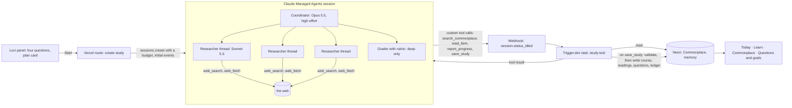

# Loci's tasks: routines, and studies that run for an hour in the cloud

**For:** the owner, to decide the idea, the name and the first slice; and the agent who later builds it in `studiolo`.
**Status:** Proposed. Claude, 30 October 2026. Nothing here is approved until the owner says so in the conversation.
**Owner's direction (30 Oct):** "Routines could also be something that runs in the cloud, where [Loci] deep-thinks a course for an element for some time, and the user doesn't have to wait, and it does it with multiple steps and multiple segments at higher effort. … If a user would like to learn something not as simple as going to Loci and asking for it, it's much more comprehensive: taking a long time to plan and a long time to research. … Maybe routines shouldn't be named routines … they host routines and they host these long tasks as well."
**Prototype:** [`prototypes/routines/`](../../../prototypes/routines/README.md), version 9, published as **Studiolo Routines** (the same link).
**Cost model:** [`routines-study/study-cost.mjs`](../../../routines-study/study-cost.mjs). Every figure in §7 comes from it.
**Builds on:**
- [Routines: system and cost study](2026-10-29-routines-system-and-cost-study.md) (the engine, the ledger, the allowance);
- [Routines: the user experience](2026-10-29-routines-chat-ux-design.md) (the Loci place, the flow editor);
- [Learn roadmap](2026-10-23-learn-roadmap-design.md) (Courses, `explainer_series`, the course's *mission*, reading lessons; course engine Stage 4);
- [Background work rethink](2026-10-29-background-work-rethink.md) §2 (the usefulness test).

## 0. In short

| Question | Answer |
|---|---|
| **The idea** | A second kind of task: a **study**. Loci works once, in depth, for 20 minutes to an hour: it plans, researches each question separately, writes a course, and checks it. The learner agrees a plan and then gets on with their day. It ends on **Today**: a course in Learn, readings in Commonplace, and questions in Questions and goals. |
| **Is it possible?** | **Yes.** It is what Claude Managed Agents is built for: Anthropic runs the agent loop for as long as it takes, with researchers in parallel threads, a grader against a rubric, and a hard spending cap per session. Studiolo supplies the learner's material through tools and keeps the result. |
| **The name** | **Tasks**, with two kinds: **routines** (every time something happens) and **studies** (once, in depth). The Loci place becomes *Loci / Tasks · Finds · Waiting · Activity · Connections*. "Study" fits a learning app, and Studiolo means "little study". §2. |
| **What it runs on** | **Claude Managed Agents** for the study itself: an Opus 5.5 coordinator at high effort, Sonnet 5.5 researchers, web search and fetch. Studiolo's **Trigger.dev** worker answers its tool calls and saves the result. Routines stay as they are (Trigger.dev, Haiku 5.5). No new platform beyond the Anthropic API. §5. |
| **Cost** | A **standard** study (3 questions, about 20 minutes): about **$1.66**, 0.96 million tokens. A **deep** one (5 questions, about 50 minutes, checked twice): about **$4.03**, 2.9 million tokens and 40 searches. That's 13 or 31 Lumens' worth. Its lessons are made later, one by one, as Learn already does. §7. |
| **Per user** | With routines: about **$2.02 a month** for a typical learner doing one standard study a month; about **$9.70** for a heavy one doing three. Studies, not routines, set the bill, so they need a monthly limit, decided with pricing (§7.3). |
| **Effort** | About **6 to 7 weeks** for the full version. A useful first slice, a **study brief** (findings, readings and questions, no course yet), takes about 3 weeks. The course needs Learn's Stage 4 work on missions and reading lessons. §8. |

## 1. What a study is for

The learner wants to *understand* something properly: "passive cooling for the prayer hall", "the acoustics of domed rooms". Asking Loci gives one answer in a minute. A study gives a planned course built from many sources, with the learner's own material read first, while they're away.

It passes the usefulness test (background-work rethink §2):

| Test | A study |
|---|---|
| Replaces a chore or catches a loss | It replaces hours of searching, reading and planning a path through a subject |
| Needs to run without the learner | It takes 20 to 60 minutes; nobody should watch that |
| Shows where the learner already is | On Today when it's ready; the course in Learn; readings in Commonplace |
| One decision | **Agree the plan** (with its time and cost). Everything after is optional |
| Setup in one step | Four questions, all tap-to-answer |
| We can tell if it works | Share of studies whose course is started within a week, and the lesson-1 rating |

**What the model does that code can't:**
- choose the questions that matter for this learner;
- judge sources;
- write a course with a reason for each lesson.

Everything else is code: the scoping questions, checking sources and links, saving, and showing progress.

## 2. Name and place

| Name for the whole | For | Against |
|---|---|---|
| **Tasks** (recommended) | Plain; "Loci / Tasks" reads as *Loci's* tasks, so it isn't mistaken for the learner's to-do list. It holds both kinds | Generic |
| Routines (as now) | Known | Wrong for a one-off study |
| Errands | Warm: things done for you | Sounds small for an hour of research |
| Commissions | Fits the Renaissance studiolo: you commission a study | Obscure; clarity comes first |
| Agents | Exact technically | Makes the learner an operator of agents |
| Work, Jobs | | Already taken: *Work* is a Studiolo area, and `jobs` is the usage-ledger table |

| Name for the long kind | For | Against |
|---|---|---|
| **Study** (recommended) | A learning word; the result is a course; Studiolo means "little study" | Also a verb, though in the app it's always a noun ("a study", "New study") |
| Deep dive | Vivid | Jargon |
| Research | Accurate | Sounds like a report, not learning |

**Where:**
- The Loci place's first tab becomes **Tasks**. It shows **Studies** first (working, ready, done), then the routine groups.
- **New task** offers *Study something in depth* above the routine ways in.
- Results live where the learner works:
  - a card on **Today** (working, ready, or next lesson);
  - the course in **Learn › Courses**;
  - readings in a **Commonplace** collection;
  - new questions in **Questions and goals**.

## 3. The experience (prototype version 9)

1. **Start** from:
   - **New task** (a subject in your own words, or a suggestion);
   - Loci anywhere ("I want to really understand stack ventilation");
   - **Study this in depth** on a find;
   - **Study it again, deeper** on a finished study.

   Later: from a question or a goal.
2. **Four questions**, each a template in code with tap answers:
   - How much do you know already?
   - What is it for (the prayer hall, a talk, just to understand)?
   - How much time a week?
   - How deep (Standard or Deep, each with its time and cost)?
3. **The plan**, a card in Loci:
   - the aim (the course's *mission*);
   - the questions it will research;
   - where it will look (your Commonplace first, then journals, books and the open web);
   - what you'll get;
   - when it'll be ready;
   - its cost, as a share of the allowance with a ceiling ("about 17%, never more than 25%").

   **Start the study**, **Change the plan** (one question fewer, add how it applies to the prayer hall, only my Commonplace and books, deeper or lighter) or **Not now**. Nothing runs before Start.
4. **Working.** A card in Tasks and on Today with a progress bar. The study's page shows:
   - each phase: plan, question 1 to *n*, write the course, and for deep studies a check;
   - what it's doing now;
   - the aim.

   You can ask "How is it going?", add a question, or **Stop** it: what it found is kept, and **Finish it** carries on.
5. **Ready.** A toast, a card on Today, and a WhatsApp message if connected. The study's page shows:
   - **What Loci found**, one finding per question, each marked *Sure*, *Mostly*, *Mixed* or *Thin*, with its sources;
   - **the course**, each lesson with what you'll be able to do, its format, its length and its main source. Each lesson is made when you reach it;
   - **also from this study**: readings saved, new questions, and **Keep it up to date**, which makes a Finds routine from the best sources it found;
   - **sources it kept**.
6. **Afterwards:**
   - Loci answers "Why these lessons?" and "What's still unsure?";
   - "Make the course shorter" merges lessons;
   - Today shows the next lesson.

## 4. How studies and routines connect

- A **find** can become a study (*Study this in depth*).
- A study can become a **Finds routine** (*Keep it up to date*).
- Later, a **routine step** *Study it in depth* (for example, "on the 1st of each month, study what changed in passive cooling"). It always asks first, because of the cost.
- Both show in **Activity**, and both use the allowance, the spend cap and the usage ledger.

## 5. How it runs

1. **Create.** Studiolo creates a session from a saved agent (synced from a file in the repo, not made per run). It sets:
   - **a budget**: a hard cap on list cost, 1.5 times the estimate;
   - the plan as the opening event;
   - for deep studies, **an outcome**: a rubric the grader checks the course against, at most 2 rounds.
2. **Research.** The coordinator gives each question to a **researcher thread** with a fresh context, so its reading doesn't fill the coordinator's.
   - Researchers search and fetch the web.
   - They read the learner's own material through **custom tools** answered by Studiolo: `search_commonplace` and `read_item`. That keeps Studiolo's data in Studiolo, and only what the agent asks for is sent.
3. **Progress.** The agent calls `report_progress(phase, note)`; Studiolo stores it, and the page shows it.
4. **The result is typed.** The agent calls `save_study` with a `StudyResult`:
   - the mission;
   - findings, each with a confidence and the ids of its sources;
   - lessons, each with a *win*, a format, minutes and source ids;
   - readings and questions;
   - sources, with URL, kind and whether each came from the learner's Commonplace.

   This keeps Learn's house rule: the model writes typed content and Studiolo renders it.
5. **Checked in code before saving** ("grounded, not invented"):
   - every source id exists;
   - every URL was fetched in the session;
   - every lesson has a source;
   - readings already in Commonplace are linked, not duplicated.

   A failed check goes back to the session as the tool result, at most twice.
6. **Saved:**
   - the course as an `explainer_series` with its `mission`, parts created **lazily** (each Lumen or reading is made when the learner reaches it, as Learn does now);
   - readings into a new collection;
   - questions into Questions and goals;
   - cost into the usage ledger from the session's `usage.list_cost` (purpose `study`).
7. **Notified** on Today, by push, and on WhatsApp or email if the learner has turned that on.
8. **Budget reached?** The session pauses. Studiolo asks it to save what it has, with a small top-up to the cap, and the page says the study was cut short.

**Why Managed Agents here, when the routines study turned it down:**

- **Routines are small and frequent.** Thousands a day, one model call each, so Trigger.dev and Haiku are right.
- **A study is the opposite:** one long, many-step, parallel piece of work that must not run away on cost.

| | Claude Managed Agents (recommended for studies) | Own agent loop on Trigger.dev |
|---|---|---|
| Long multi-step loop | Anthropic runs it, for as long as needed | Studiolo's code runs it (tool runner); a task that lives for an hour |
| Parallel researchers | Built in: threads with fresh context | Build fan-out and fan-in with subtasks |
| A check against a rubric | Built in: outcomes, a separate grader | Build it |
| A hard cost ceiling | Built in: the session budget pauses at the cap | Count tokens and stop in code |
| Learner's data | Custom tools answered by Studiolo | Direct |
| Running cost | $0.08 an hour of session time | About $0.06 an hour (Micro machine) |
| Maturity | **Beta** (`managed-agents-2026-04-01`); the API may change | Stable parts Studiolo already uses |
| Cheaper overnight mode | No batch | Possible: plan, writing and checks via the Batch API at half price |

**Cloudflare Workers** don't fit studies: an hour-long agent loop would need Durable Objects and a hand-built loop. Workers stay with email intake.

**If Managed Agents' beta is a concern,** build the own-loop version on Trigger.dev instead. The tokens cost the same, and it takes about 2 weeks more.

## 6. Data (names indicative)

| Table | What it holds |
|---|---|
| `studies` | Account, subject, mission, depth, state (planned, running, stopped, done, cut short, failed), the agreed plan (jsonb), `session_id`, budget, `cost_cents`, started and ready times, `series_id` (the course), result (jsonb) |
| `study_events` | Study, at, phase, note (what the page's progress shows) |
| `study_sources` | Study, source id, URL, title, kind, from Commonplace, kept, used by which findings and lessons |
| `explainer_series` | Existing. Gains `mission` (Learn roadmap Phase 2) and an `origin_study_id` |

Routines keep their tables. **Tasks** is a view over `routines` and `studies`, not a new table.

## 7. Tokens and cost

### 7.1 One study

| Part | Standard (3 questions, about 20 min) | Deep (5 questions, about 50 min) |
|---|---|---|
| Scoping (four questions; one Haiku 5.5 call reads the answers) | $0.0006 | $0.0006 |
| Plan (Opus 5.5, high effort) | $0.15 · 14k in, 4k out | $0.19 · 14k in, 6k out |
| **Research** (Sonnet 5.5 researchers, each about 10 to 14 turns) | **$0.93** · 0.8M in, 29k out, 15 searches | **$2.48** · 2.56M in, 78k out, 40 searches |
| Coordinating (Opus 5.5) | $0.23 | $0.31 |
| Writing the course (Opus 5.5) | $0.33 · 14k out | $0.54 · 24k out |
| Checking (grader and on average one revision) | none | $0.44 |
| Running time ($0.08 an hour) | $0.03 | $0.07 |
| **Total** | **$1.66** · 0.96M tokens in, 51k out | **$4.03** · 2.87M in, 124k out |

- **Research is 56% to 62% of the cost.** Each researcher's context grows as it reads: about 5,000 tokens a turn. Prompt caching makes re-reading cheap ($0.20 per million), but it adds up.
- **The lessons come later.** A course of 5 Watch and 3 Read lessons costs about $0.80 more, spread over the weeks the learner takes it, and only for lessons they reach. That is Learn's existing cost.

### 7.2 What moves the number

| Lever | Deep study | Trade-off |
|---|---|---|
| Researchers on **Haiku 5.5** | **$2.05** (standard $0.92) | Weaker judgement of sources; needs an eval |
| **Ready by morning** (own loop; plan, writing and checks through the Batch API) | $3.45 | Hours, not minutes; only on Trigger.dev |
| Read the learner's Commonplace first, **half the searches** | $3.83 | Less that's new |
| **Only my Commonplace and books** (a plan option) | about 20% less research | Finds less that's new |
| Effort *medium* instead of *high* on the coordinator | small | Plans and courses less considered |

### 7.3 Per learner, per month

| Learner | Studies a month | Studies | With routines |
|---|---|---|---|
| Light | none | $0 | **$0.08** |
| Typical | 1 standard | $1.66 | **$2.02** |
| Heavy | 2 standard, 1 deep | $7.35 | **$9.70** |

- **For 1,000 typical learners:** about **$2,022 a month**, against $364 for routines alone.
- **Guardrails:**
  - the plan shows the cost before anything starts;
  - **the session budget caps every study** (1.5 times the estimate), so a run can never cost much more than it said;
  - `checkSpendCap` runs before creating a session;
  - **a monthly limit on studies** (for example 2 standard studies a month, with a deep one counting as 2) until pricing is set;
  - studies that are never opened stop being suggested.
- **The allowance.** The prototype shows costs as a share of an assumed **$10 monthly allowance** (decision ST-6). On that basis a standard study is about 17% and a deep one about 40%.

## 8. How hard is it?

| Part | Difficulty | Risk | Rough time |
|---|---|---|---|
| The agent definitions (coordinator, researcher) in a repo file, synced; session creation with budget and outcome | Medium | Beta API changes | 3 days |
| Webhook route and `study-tool` task: custom tool calls, progress, budget pauses, retries, idempotency | Medium | Webhooks arrive out of order: always fetch the session's state | 1 week |
| `StudyResult` schema, the checks in code, saving to course, Commonplace and Questions and goals | Medium | Depends on Learn Phase 2 (`mission`, reading lessons) for the course | 1.5 weeks |
| Screens: New task, the plan card, the Tasks tab, the study's page, Today cards, notifications | Medium | | 1.5 weeks |
| Rubric and an eval: 10 real subjects from the owner's field, graded by the owner | Medium | Research quality is the product; budget for two rounds | 1 week |

- **Total: about 6 to 7 weeks.**
- **Risks to name:**
  - Managed Agents is in **beta**;
  - paywalled journals: the study uses abstracts, open versions, and what the learner has saved;
  - safety classifiers can refuse a step: the session reports it, and the study is cut short, not failed;
  - cost variance: the budget caps it.

## 9. Phases

| Phase | What | Weeks |
|---|---|---|
| **S1: a study brief** | Four questions, the plan, the session, progress, and a result page with findings, readings and questions. No course yet. Tasks tab and Today card | 3 |
| **S2: the course** | `save_study` writes a course with a mission and lazily made lessons (after Learn Phase 2); *Keep it up to date* | 2 |
| **S3: more ways in** | From a find, a question or a goal; *Study it again, deeper*; deep studies with the grader | 1.5 |
| **S4: cheaper** | Haiku researchers if the eval allows; *Ready by morning* through the Batch API | 1 |

## 10. Decisions for the owner

| ID | Decision | Recommendation |
|---|---|---|
| ST-1 | The idea: a long, in-depth task that ends in a course | **Yes**, as studies |
| ST-2 | The name of the whole, and of the long kind | **Tasks**; **studies** and **routines** |
| ST-3 | Where it shows | **Loci / Tasks** (studies first); Today; the course in Learn |
| ST-4 | What it runs on | **Claude Managed Agents**, with Studiolo's tools answered by the Trigger.dev worker; the own loop on Trigger.dev as the fallback if the beta is a concern |
| ST-5 | Depths | **Standard** (3 questions, about 20 minutes) and **Deep** (5, about 50 minutes, with the grader) |
| ST-6 | How cost is shown | A share of the monthly allowance, with a ceiling, before it starts; dollars only in Builder view. Set the allowance (assumed here: $10 a month) |
| ST-7 | A monthly limit | **2 standard a month** (a deep one counts as 2) until pricing is decided |
| ST-8 | First slice | **S1, the study brief**, before the course engine work |

## 11. Sources

- **Claude Managed Agents** (Anthropic API reference, claude-api skill, read 30 Oct 2026):
  - sessions, budgets ("session running time at $0.08/hour", web searches "$10 per 1,000", the cap pauses the session): `managed-agents-core.md`;
  - threads and researchers: `managed-agents-multiagent.md`;
  - outcomes and the grader (`max_iterations`, default 3): `managed-agents-outcomes.md`;
  - webhooks (`session.status_idled`, `session.status_terminated`, out-of-order delivery): `managed-agents-webhooks.md`;
  - the deep-researcher template: `managed-agents-quickstarts/deep-researcher.md`.
- **Model prices:** `models.md` (Opus 5.5 $4 and $20 per million, cache reads $0.20; Sonnet 5.5 $2 and $10; Haiku 5.5 $0.10 and $0.50).
- **Courses, mission, reading lessons, the house rule on typed content:** [Learn roadmap](2026-10-23-learn-roadmap-design.md) §1, §4 (`explainer_series`, course engine §8, §13).
- **Lumen cost** (about $0.13): Live Lumens design.
- **Real sources named in the prototype's sample study:**
  - Hassan Fathy, *Natural Energy and Vernacular Architecture* (1986);
  - Baruch Givoni, *Passive and Low Energy Cooling of Buildings* (1994);
  - G. Z. Brown and Mark DeKay, *Sun, Wind & Light* (3rd ed., 2014);
  - ASHRAE Standard 55.

  The findings attributed to them are summaries written for the prototype, not quotations. Every other source is marked as an example.
