HIGH (changes the shell on every iPad and on touch screens 700 px and wider; no data, AI or desktop change)

# Studiolo on iPad: the phone's idea, given room

**For:** the owner, to decide the direction, and the agent who later builds it in `studiolo`.
**Status:** Proposed. Claude, 31 October 2026. Nothing here is approved until the owner says so. The decisions in §13 are recommendations.
**Checked against:** `studiolo` `origin/main` @ `0f6bd765` (the dictation merge), read-only, run locally on `/dev/specimens` at nine iPad sizes and window widths (§2).
**Prototype:** [`prototypes/ipad/`](../../../prototypes/ipad/README.md), built to `prototypes/ipad/dist/ipad-prototype.html`. It runs the phone prototype's own modules and Studiolo's real Palace and Map engines, with an iPad layer on top.
**Builds on:**
- [The phone spec](2026-10-25-phone-control-bar-and-loci-design.md) (§1–§14, MB-D1…D13). Everything it decided for phones stays, and compact iPad windows get it unchanged.
- [The phone's next 20 percent](2026-10-29-phone-next-20-percent.md): its six system rules are carried over in §11.
- [The dictation brief](../../../proposals/2026-10-25-dictation-design-brief.md): voice in the bar, on every destination.
- `studiolo`'s tablet rules in `project-docs/design/interface.md` (the 72 px rail, `pointer: coarse` targets). This spec replaces the rail on touch screens from 700 px.

## 1. What the owner asked for

> The phone experience is really good, but the iPad is taking how the desktop works and just doing it in the desktop way, and there are features like the voice and the audio and stuff that are not there. I would like to get the iPad experience elevated, the same way we did for the iPhone experience.

Success means:
- an iPad feels like the phone app given more room, not like the desktop made touchable;
- the bar is the one place to ask, find, make, search and dictate, with the mic on every destination;
- Listen, Now Playing and picture in picture exist on iPad, and playback survives moving around;
- a window that changes size (Split View, Slide Over, Stage Manager, turning the iPad) never loses the place, the card, the room or the sound.

## 2. The audit: what an iPad gets today

**How it was measured.** The local app on `/dev/specimens`, Playwright's Chromium with `isMobile`, `hasTouch` and an iPad user agent, at 2× scale. Sizes: iPad Air 11″ (820 × 1180 and 1180 × 820), iPad Pro 13″ (1024 × 1366 and 1366 × 1024), iPad mini (744 × 1133), and the window widths 981, 694, 507 and 320 (Split View and Slide Over on an iPad Pro 13″). 18 screens at each size: 162 captures. Script and raw numbers: the session scratchpad (`ipad/audit.cjs`, `ipad/live/results.json`). Screenshots: [`assets/2026-10-31-ipad-audit/`](assets/2026-10-31-ipad-audit/).

### 2.1 Findings

| # | Finding | Evidence |
|---|---|---|
| **A1** | **Every iPad gets the desktop app.** The phone shell applies only under 700 px (`COMPACT`, `use-loci-sheet.ts:16`). Every iPad, in both orientations, and a ⅔ Split View window (981) get the 72 px rail, the desktop headers and the side panel. Only a ½ or ⅓ window (694, 507, 320) gets the phone shell. Moving a window across 700 px swaps between two different apps. | `01`, `02`, `16` (981: desktop) beside `17` (694: phone) |
| **A2** | **Voice is missing on iPad.** With dictation on (`&dictation=1`), the only mic at 700 px and wider is inside Loci's chat panel: **30 × 30 px**, labelled "Dictate". Today, Learn and Commonplace have **no mic at all**. The same pages at 694 px show the bar's mic, "Dictate. Hold to talk". The cause: `PhoneDictationRoot` carries the engine only while the phone shell is active (`components/phone/voice.tsx:22`). | `13`, `14` (no mic) beside `15` (mic) |
| **A3** | **Audio is missing on iPad.** Listen is a disabled button marked **Soon** at every size (`make-lumen-bar.tsx:152`). There is no Now Playing: the mini player (`phone/mini-player.tsx`) is phone-only. Leaving a Lumen stops it. There is no picture in picture. | `06` |
| **A4** | **The Palace gets none of the phone's touch rules.** On iPad, the hold menu, the two-finger tap for Back, the 22 px tap slop and the closer framing are all phone-only (`palace-engine.ts:480`, `:941`, the `touch` option). Pinch works. There is no twist. Hover affordances wait for a mouse. | `01`, `02` |
| **A5** | **Desktop chrome takes the canvas.** In Loci at 1180 × 820, a "Find a topic" field and a trail row float on the scene, the key runs along its foot, and the side panel takes a third. The canvas starts at 136 px and covers **74 %** of the screen. At 820 × 1180 the bottom sheet covers the lower third. | `01`, `02`, `03` |
| **A6** | **Targets are too small for a finger.** At 1180 × 820 the Palace with a topic open has **16 controls under 44 pt, 13 under 32**: Back 26 × 26, Options 26 × 26, Topic menu 28 × 26, the status pill 90 × 21. The Commonplace wall at 1024 × 1366 has **42 under 44** (the area picker is 85 × 23). A Read lesson's section links are 32 tall; Settings' interest chips 30; a photo's "Back to Commonplace" 125 × 31 and its menu 30 × 28. | `08`, `09`, `11`, `12` |
| **A7** | **Hover-only controls on touch.** On the Map, each topic's **＋ Add sub-topic** (43 × 43) stays invisible until hovered: 5 per open area, at every iPad size. A finger can't find them. | `03` |
| **A8** | **Two fields, and a crumb, on most screens.** Loci shows "Find a topic" and the chat's "Ask about…". Commonplace shows "Search your Commonplace" and "Capture a thought, quote or link…". Breadcrumbs render on Loci (1), the Map (3), a course part (3), Commonplace (1) and Settings (1). | `01`, `07`, `09` |
| **A9** | **Content starts late.** The first Commonplace entry starts **255–263 px** down; Collections **392–449 px**; To read **430–438 px**. That is the desktop header, the tabs and the capture box above the wall. | `09`, `10` |
| **A10** | **No keyboard model.** There is no global shortcut to ask or find, no list of shortcuts, and dropping a file or a link works only onto Commonplace's capture box. | code search: no `⌘K`; `onDrop` only in the capture components |

### 2.2 The numbers by size

Rounded; "first" is where the first sizeable content block starts (px from the top); "< 44" counts visible controls under 44 pt.

| Screen | Air portrait 820 | Air landscape 1180 | Pro portrait 1024 | Pro landscape 1366 | mini 744 | Split ⅔ 981 | Split 694 / 507 / 320 |
|---|---|---|---|---|---|---|---|
| Shell | desktop | desktop | desktop | desktop | desktop | desktop | phone |
| Palace, topic open: < 44 / < 32 | 9 / 5 | 16 / 13 | 9 / 5 | 16 / 13 | 9 / 5 | 9 / 5 | 5 / 2 |
| Palace canvas share | 80 % | 74 % | — | 79 % | — | — | 87 % |
| Mic on Today / Learn | none | none | none | none | none | none | 42 px |
| Mic in Loci | 30 px | 30 px | 30 px | 30 px | 30 px | 30 px | 42 px |
| Listen | Soon | Soon | Soon | Soon | Soon | Soon | Soon |
| Commonplace wall: first / < 44 | 255 / 25 | 263 / 21 | 263 / 42 | 263 / 37 | 255 / 24 | 263 / 25 | 291–316 / 9–22 |
| To read: first | 430 | 438 | 438 | 438 | 430 | 438 | 466–592 |
| Map: hover-only buttons | 5 | 5 | 5 | 5 | 5 | 5 | 5 |

No page errors and no horizontal scroll at any size.

**Not verified:** Learn's Lumens and Courses tabs (their specimens need seeded database rows, and there is no database here); a real iPad's Safari, its trackpad pointer effects, the hardware keyboard and Pencil; the hosted app.

### 2.3 Screenshots

| | |
|---|---|
| 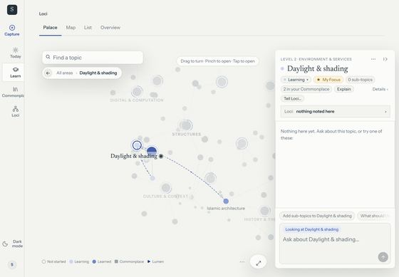 Loci on an iPad Air in landscape: the rail, a find field and a trail on the scene, the key along the foot, the panel taking a third. | 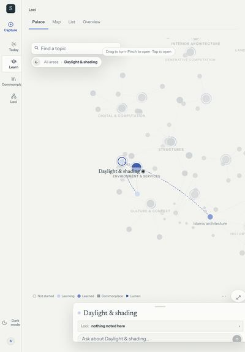 Portrait: the same, with the sheet over the lower third. |
| 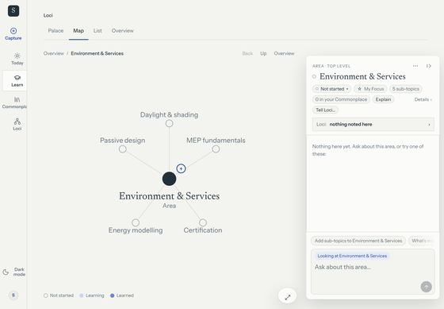 The Map: ＋ buttons appear only on hover. | 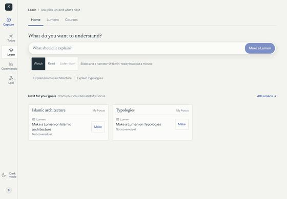 Learn: Listen is "Soon"; no mic. |
| 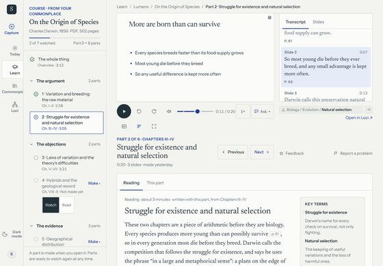 A course part: the desktop page, with its crumb. | 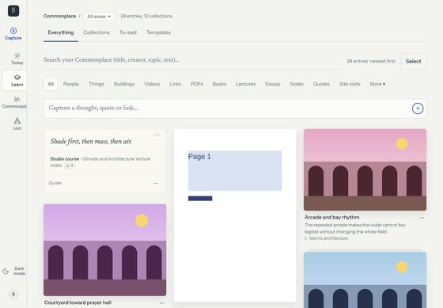 Commonplace: two fields and a header before the wall. |
| 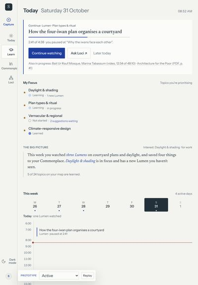 Today at 820 with dictation on: no mic. | 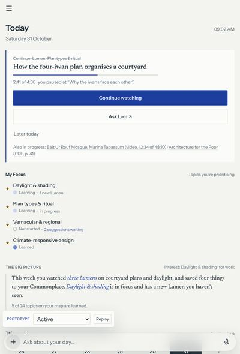 Today at 694: the phone bar and its mic. |

More in the folder: the List, Today, a Read lesson, To read, a photo, Settings, Loci's 30 px mic, and the 981 / 694 pair.

## 3. Principles: iPadOS, translated

1. **Same app, more room.** The phone's idea holds: the foot is for doing, one field does everything, a place shows as a card, a Lumen opens in a room. The iPad adds room around it; it doesn't add a second way of working.
2. **Size classes, not devices.** Layout follows the window's width, as iPadOS apps do. A compact window is the phone shell; a regular one is the iPad layout. The same iPad shows both as it goes in and out of Split View.
3. **A sidebar for going.** iPadOS apps with a few top-level places use a sidebar (Mail, Notes, Music, Files). It shows where you are and what's inside, and folds away when the content needs the width.
4. **Content in the middle, tools beside it.** The canvas, the room and the wall get the width. Details float in an inspector at the side (Keynote, Freeform, Maps), not in a page stacked under the content.
5. **Touch first, pointer and keyboard as accelerators.** Every control works with a finger. A trackpad adds hover and right-click; a keyboard adds ⌘ shortcuts, listed when you hold ⌘. Nothing needs hover to be found.
6. **Playback is the system's.** Video can leave the room as picture in picture; audio keeps playing as Now Playing, with lock-screen and Control Center controls.

## 4. Size classes and live resizing

### 4.1 The breakpoints

| Class | Width of the window | Pointer | What it gets | Examples |
|---|---|---|---|---|
| **Compact** | under 700 px (`COMPACT`, unchanged) | any | the phone shell, exactly as built | iPhone; Slide Over 320; Split ½ (507 on a Pro 13″ portrait, 585 on an Air landscape); Split ⅓; narrow Stage Manager windows |
| **Regular** | 700 px and up | coarse (touch) | the iPad layout: sidebar over the content, the card as a sheet | every iPad in portrait; Split ⅔ (694 on a Pro 13″ portrait, 981 on a Pro 13″ landscape) |
| **Regular, wide** | 1000 px and up, landscape | coarse | the sidebar docked, the card as an inspector, rooms side by side | iPad Air, mini and Pro in landscape, full screen |
| Desktop | 700 px and up | fine | **unchanged** | Mac and PC browsers |

- The iPad layout is `TABLET = "(min-width: 700px) and (pointer: coarse)"`, and "wide" adds `(min-width: 1000px) and (orientation: landscape)`. An iPad with a trackpad still reports a coarse primary pointer, so it keeps the iPad layout and gains hover (§6.4).
- Desktop browsers (a fine pointer) keep today's layout at every width. That keeps the desktop unchanged at 1100 px and wider, as the plan requires. Whether a narrow desktop window (700–1099 px, mouse) should also get the sidebar layout is decision **IP-D14**; the recommendation is "not yet".
- The prototype keys only on width, so a desktop browser can show the iPad layout in its frame.

### 4.2 Live resizing keeps everything

One app state behind every layout, so a change of size class is only a change of layout:
- **The place:** what is open in Loci, the trail and the view (Palace, Map, List) stay.
- **The card:** its height is the learner's, remembered **per size class**: the phone card, the iPad sheet and the inspector each keep the height last given them (peek, card or full). The inspector's width is remembered too.
- **The room:** an open Lumen or course room stays open at the same format, slide or scroll position.
- **Playback:** the Lumen keeps playing, from the same second. Its mini form moves: the sidebar's Now Playing when docked, above the bar otherwise, the phone's mini player when compact; a Watch Lumen's picture-in-picture tile stays a tile on iPad and becomes the mini player when compact.
- **The bar:** text being typed or dictated stays in the field; dictation doesn't stop.
- **Selection:** Commonplace's selection and filters stay.

The prototype does all of this: drag the Split View divider across 700 px while a Listen plays (measured: same topic, still playing, position advanced by a second).

**Accept when:** each width in the table gets its class; crossing 700 px and 1000 px with a room open and a Lumen playing keeps the place, the room, the field's text and the playback position (± 1 s); a desktop at 1100 px and wider with a mouse is pixel-identical to today.

## 5. Navigation: the sidebar

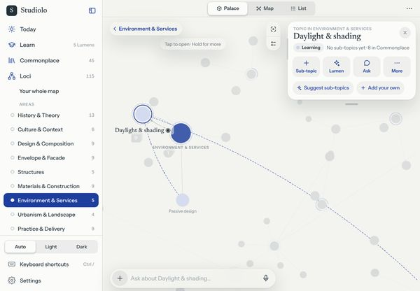

The sidebar replaces the phone's drawer in regular widths (and the desktop rail on touch screens).
- **What's in it:**
  - **Today**, **Learn**, **Commonplace**, **Loci**, each with its icon and a quiet count;
  - under the current destination, its own places, indented: Learn's **Home · Lumens · Courses**; Commonplace's **Everything · Collections · To read** and its **collections**; Loci's **Your whole map** and its **areas**, with status dots and counts;
  - **Recent:** the last four places and Lumens;
  - **Now Playing** (§8.4), when something plays and the sidebar is docked;
  - at the foot: **Appearance** (Auto · Light · Dark), **Keyboard shortcuts**, **Settings**.
- **Shown or hidden:**
  - **Docked** in wide windows (landscape, 1000 px and up), 288 px wide, beside the content.
  - **Over the content** in portrait and in Split ⅔: hidden until the toolbar's sidebar button or a swipe from the left edge (22 px) opens it. A tap outside, Escape or a row closes it.
  - The sidebar button in its header hides a docked sidebar; the toolbar's button brings it back. The choice is remembered.
- **When docked, it replaces the page's segmented control.** Learn's Home · Lumens · Courses and Commonplace's tabs leave the page, because the sidebar shows them. When it isn't docked, the segmented control is back.
- It is the only way to change destination besides the bar ("open Commonplace") and ⌘1–4.

**Accept when:** landscape full screen docks the sidebar; portrait shows it only on the button or the edge swipe; every row is at least 44 pt (sub-rows 40 pt with a 44 pt hit box); the current place is marked; choosing a row in the overlay closes it.

## 6. The bar on iPad

### 6.1 Where it lives (and why)

**A floating capsule, centred at the foot of the content column**, 56 px tall and at most 620 px wide, 8 px above the safe area. In Loci with the inspector out, it centres in the canvas left of the inspector.

Why there, against the alternatives:
- **Not a toolbar search field** (as in Mail, Notes and Files). That pattern is for search alone. Studiolo's field is mostly for asking and talking: Loci's replies, the finds and the suggestions rise above it, and they need room above, not below.
- **Not edge to edge.** A 1180 px field is a long reach for the eye and the hand. 620 px reads like a message field, as in the Claude and ChatGPT iPad apps.
- **Same place as on the phone.** The muscle memory carries across devices and across Split View, where a compact Studiolo puts the bar in the same spot.
- **With the keyboard:** the on-screen keyboard pushes the bar up with it (the phone's `visualViewport` rule). With a hardware keyboard nothing moves: ⌘K reaches the field from anywhere, so its position doesn't cost a reach.

**The bar keeps every verb of the phone bar:** ＋ to create, the field to find a place, ask Loci, make a Lumen (on Learn) or search (on Commonplace), and the mic (§6.2). The panel above it (finds, Ask Loci rows, suggestions, Loci's reply card, the thread sheet) takes the bar's width.

### 6.2 Voice on every destination

- The mic is **in the bar on every destination**, 44 pt, as on the phone: **tap** to dictate, **hold** to talk (release sends).
- **⌘⇧D, held,** talks from the keyboard; letting go sends.
- In a room the mic asks about what's in front of you ("Ask the hosts…", "Ask about this slide…"); in ● Live, holding it interrupts (§8.3).
- The fix for A2 is one line of scope: `PhoneDictationRoot` carries the engine on tablets too, and the bar is mounted on tablets.

### 6.3 The keyboard

| Keys | Does |
|---|---|
| **⌘K**, **⌘F** | Focus the bar (Ask, find or search, depending on the destination) |
| **Return** | Acts: opens an exact place, asks, makes, searches. Never nothing (20 % rule 2) |
| **↑ / ↓** | Move through the rows above the bar |
| **Esc** | Leave the field; close a sheet or a menu; back a level in Loci |
| **⌘⇧D** (hold) | Talk; release to send |
| **⌘N** · **⌘L** | Write a note · Make a Lumen |
| **⌘1 – 4** | Today · Learn · Commonplace · Loci |
| **⌘[** | Back (a room, or a level in Loci) |
| **⌃⌘S** | Show or hide the sidebar (the iPadOS key) |
| **⌥⌘1 – 3** | Palace · Map · List |
| **⌘↑ / ⌘↓** | The inspector's height |
| **Space** | Play or pause, when no field has focus |
| **⌘/** | The list of shortcuts |

**Holding ⌘** for two-thirds of a second shows the shortcuts in a glass panel, as iPadOS's discoverability list does, grouped as Studiolo, Go to, and Loci and playback. Letting go hides it. Safari keeps some ⌘ keys for itself (⌘1–9 in a tab); installed on the Home Screen, Studiolo gets them. The build registers them for both, and tests on a real iPad.

### 6.4 Pointer and trackpad

- **Hover** fills rows, chips and buttons with `--hover-fill`, under `(any-hover: hover)` only, so touch never sees a stuck hover.
- **Lift:** cards (Lumen posters, wall cards, course cards) rise 2 px with a soft shadow on hover; the card's big actions rise 1 px. This stands in for the iPadOS pointer effect, which the web can't use directly.
- **Right-click** (or a two-finger click) opens the same context menu as a hold.
- **Never hover-only.** The Map's ＋ buttons show on touch screens as they do with keyboard focus (fixes A7).
- **Pencil hover** (iPad Pro with Pencil Pro or the 2nd generation): the Palace and the Map treat a hovering Pencil like a pointer, naming the mark under it before it touches.

**Accept when:** the bar is the only text field outside a sheet on every screen (20 % gate rule 2); the mic is present at 44 pt on Today, Learn, Commonplace, Loci and in rooms at every regular width; ⌘K focuses the bar and Return acts on every destination; holding ⌘ shows the list; ⌘⇧D held talks and sends; no control is invisible without hover.

## 7. Loci on iPad

### 7.1 The canvas

- The Palace and the Map fill the content column, edge to edge, under a translucent toolbar.
- **The toolbar:** the sidebar button, then **Palace · Map · List** as a segmented control in the middle, then ⋯ (Slow turn, Rearrange).
- **On the canvas:** the back pill at the top left (hold for the trail), and the two-button stack (Whole map, Key) at the top right, left of the inspector. The key shows only when asked (A5).
- The "Find a topic" field leaves the canvas: the bar finds places (A8).
- The engines frame what is open in the space left of the inspector (landscape) or above the sheet (portrait). Both already support this (`panel: "side"` with a cover width; the Map's `coveredRight`).

### 7.2 The card becomes an inspector

| | Portrait (regular) | Landscape (wide) |
|---|---|---|
| Form | **A sheet** at the foot of the content column, at the bar's width (620 px), above the bar | **An inspector** floating on the right, 12 px from the edges, under the toolbar |
| Heights | Peek, card, full; drag the top, as on the phone | The same three; it hangs from the top, so **dragging its foot down makes it taller**; a tap on a peeked name opens it to card |
| Width | the bar's | 360 px by default; **drag its left edge** between 300 and 480 px (or the arrow keys on the edge) |
| Remembered | its height | its height and its width |
| Content | the phone card: kicker, title, status, four actions (＋ Sub-topic · Lumen or ▶ Play · Ask · More), the children as chips; full adds Status, Sub-topics, Lumens, In Commonplace | the same; the chips wrap rather than scroll |

The inspector stays put while you move: open another place and it shows that place at the same size. It hides behind a room and comes back when the room closes.

**Actions in the inspector:** ＋ **Sub-topic** turns the bar into naming mode (the phone's §6.1), with Loci's suggestions above the bar and the inspector still showing the parent. **✦ Lumen** opens the Make sheet (a centred form sheet on iPad). **Ask** focuses the bar on the place.

### 7.3 Touch, trackpad and Pencil

| Gesture | Does |
|---|---|
| Tap a mark | Open it. The nearest mark within 22 px counts (44 pt), as on the phone |
| Hold a mark (480 ms) | Its context menu, with a light haptic and the scene blurred behind |
| Two-finger tap | Back one level |
| Pinch | Zoom; pinch in on an area opens it, pinch out goes back (as today) |
| **Two-finger twist** | Turns the Palace (new) |
| One-finger drag | Turns the Palace; pans the Map |
| Edge swipe from the left | The sidebar (when it isn't docked) |
| Right-click / two-finger click | The context menu |
| Trackpad scroll | In and out, as on a desktop |
| Pencil hover | Names the mark under it |

The phone's touch rules (`touch` in `palace-engine.ts`) apply to every touch screen, not only under 700 px (fixes A4). Framing is closer than the desktop's on iPad, but less than the phone's: topics at 0.6× the app's distance and areas at 0.85× (the phone uses 0.42× and 0.72×), to tune on a real iPad (**IP-D7**).

### 7.4 The List as columns

The List becomes a column view, as in Files: **Your map** (the areas), then the open area's topics, then the open topic's sub-topics, each column 260 px with its title and count. The open row in each column is marked. The last column ends with **＋ Add a sub-topic**. Columns scroll sideways and fade at the left edge when scrolled. The inspector shows what is open, as in the Palace.

### 7.5 The Map

- The Map keeps its layout. The whole-map level shows areas only, as on the phone.
- Its ＋ buttons are visible on touch screens.
- It frames what is open left of the inspector.

**Accept when:** in landscape the inspector shows what is open, its height and width follow a drag and stay after reopening the app; in portrait the card is a sheet at the bar's width; the canvas covers at least 85 % of the content column with the card at peek; hold, two-finger tap, pinch and twist work on the Palace at every regular width; every mark is a 44 pt target; the List shows columns and the inspector follows a row.

## 8. Learn on iPad

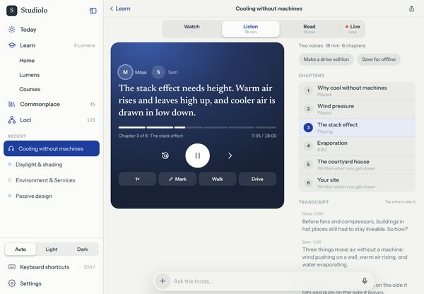

### 8.1 The pages

- **The page frame:** a 40 px Newsreader large title in the content column, with its line under it (*Ask, pick up, and what's next*). It folds into the toolbar on scroll.
- **Home · Lumens · Courses:** in the sidebar when docked; a segmented control under the title otherwise.
- **Grids, not stacks:**
  - Home's **Pick up where you left off** and **Next for your goals** as cards in a grid of 380 px columns (two in landscape);
  - Lumens as rows in 400 px columns;
  - Courses as cards in 420 px columns.
- **The make card** stays at most 720 px wide. Its field is the bar: *Type it in the bar below, or hold the mic and say it*.

### 8.2 Rooms

A Lumen or a course opens in a room in the content column; the sidebar stays.
- **Landscape (a room 860 px and wider):** two columns.
  - **Watch** and **● Live:** the stage, its control row, and Live's interruption chips on the left (about 60 %); the title, **Transcript | Slides**, sources and **Questions to take further** on the right.
  - **Listen:** the dark cover with the two hosts, the line being said, the chapter bar and the transport on the left; **Chapters**, the **Transcript** (tap a line to play it), **Your marks** and the **Your turn** recall card on the right.
  - **Read:** **In this Lumen** (the section list) on the left, sticky; the article in a 38-em column on the right.
  - **A course part:** the episode bar across the top; the stage on the left; **Reading · This part · Transcript · Slides** and **Up next** on the right.
- **Portrait:** one column, as on the phone, with the stage at the content column's width (16:9) and the text below at most 720 px wide.
- **The bar stays** and asks about what's in the room.
- **Walk** and **Drive** are full-room dark pages with large controls (72 px and 84 px), centred in a 600 px column.

### 8.3 Live, with voice

● Live keeps the Watch stage. **Hold the mic** (or ⌘⇧D) to interrupt and ask; the answer replaces the caption, and the chips (*Explain that another way · Go deeper · From my field · Simpler · Test me · Skip*) sit under the stage. Typing gives a written answer.

### 8.4 Playback that survives navigation

- **Listen (and a Watch Lumen's narration):** leaving the room keeps it playing as **Now Playing**:
  - in the **sidebar's foot** when the sidebar is docked;
  - **above the bar** when it isn't (the phone's mini player at the bar's width);
  - tapping it returns to the room at the same second.
  
  It also publishes the Media Session (title, artwork, play, pause, ±15 s, next chapter), so the Lock Screen, Control Center and AirPods control it.
- **Watch:** leaving the room keeps it playing as **picture in picture**:
  - a 300 × 169 tile in a corner of the content column, showing the current slide, a progress line, and **Back to the room**, play/pause and stop;
  - drag it to any corner; it snaps and remembers the corner;
  - the stage's control row gets a **picture in picture** button (in place of full screen). Where the browser allows, this hands the slide to the system's picture in picture, so it floats over other apps; otherwise the tile is the fallback.
- **When compact**, both become the phone's mini player above the bar.

**Accept when:** Home, Lumens and Courses show at least two columns in landscape; a Lumen room in landscape shows the stage and its words side by side, in portrait one column; leaving a playing Listen shows Now Playing (sidebar or above the bar) and a tap resumes within 1 s; leaving a playing Watch shows the tile, which can be dragged to four corners; the Lock Screen shows the playing Lumen (on a device).

## 9. Commonplace on iPad

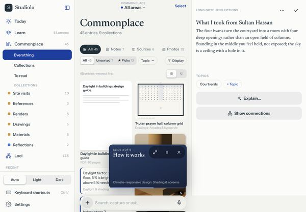

- **The page:** the phone's header, at iPad size:
  - **the area is the title** (*COMMONPLACE · All areas ⌄*);
  - **Select** at the top right;
  - **the types** (All · Notes · Sources · Photos · Objects) and their collections;
  - the slim bar (All · Unsorted · ★ Picks · Topic · the type's own filter · Display).
  
  The tabs move to the sidebar when it is docked. The capture box and the search field leave the page: the bar searches as you type and ＋ captures (A8, A9).
- **The wall:** masonry columns of about 210 px (Medium), so three in an iPad Air and four on a Pro in landscape. Display's Small and Large give more or fewer. Photos' Grid fills the width.
- **Opening an item:**
  - **Landscape:** notes, sources, books, links and videos open **beside the wall**, in a 440 px pane on the right, and the wall stays live: tap another card and the pane shows it; ✕ closes it.
  - **Portrait:** a centred form sheet.
  - **Photos** open in the full-screen viewer; in landscape its **Info** is a panel on the right instead of a strip at the foot.
  - **A PDF** opens in its reading room, with the same split as a Read Lumen.
- **Multi-select:**
  - **Select**, then tap cards;
  - with a pointer, **⌘-click** adds a card and **Shift-click** adds a range;
  - the iPadOS **two-finger drag** over cards selects them as you pass;
  - the selection bar is centred at the foot, at most 560 px wide.
- **Drag and drop:**
  - **Into Studiolo:** pictures, links, PDFs and text dragged from another app (Split View, Slide Over or Stage Manager) can drop anywhere in Studiolo. The window shows *Drop to save in your Commonplace* and where it will be filed (on the open place in Loci, on the wall in Commonplace). A drop makes the item, says so, and offers **Show**.
  - **Out of Studiolo:** a photo or link card can be dragged into another app.

**Accept when:** the wall shows three or more columns in landscape; there is no field on the page; an item opens beside the wall in landscape, and another card replaces it in place; dropping a picture or a link from another app adds it to Commonplace on what is open; the selection bar is reachable and every target in it is 44 pt.

## 10. Today and Settings

- **Today:** the page frame; in landscape, **Continue** and **Your Focus** on the left, the week on the right. "Ask Loci ↗" goes; the bar asks (20 % rule 2).
- **Settings:** the page frame, reached from the sidebar's foot. In landscape it is a split, as in iPadOS Settings: Profile · Learning · Memory · Privacy on the left, the section on the right, as grouped rows with 44 pt controls (A6: today's chips are 30 tall).

**Accept when:** both have a large title, no crumb, and no control under 44 pt.

## 11. The six system rules, for iPad

| # | Rule (from the 20 % audit) | On iPad |
|---|---|---|
| 1 | **One page frame** | A large title (40 px Newsreader) in the content column that folds into the toolbar; scope as a title menu (Commonplace's area); a page's sections in the sidebar when docked, a segmented control otherwise. No breadcrumbs (A8) |
| 2 | **One field** | The bar, on every destination and in rooms. No find, search or capture fields on pages or on the canvas. Return always acts |
| 3 | **Rooms** | Lumens, courses, PDFs and items open in rooms; in landscape a room is two panes (media and words), in portrait one column. Playback leaves as Now Playing or picture in picture |
| 4 | **Springs** | The sidebar, the inspector's height and width, sheets and the picture-in-picture tile move with the same spring helper as the phone, carry the finger's speed, rubber-band past their ends, and snap under Reduce Motion |
| 5 | **44 pt targets** | On every touch screen, whatever the width. Hover only adds; it never reveals a required control (A7) |
| 6 | **A CI gate and primitives** | §11.1 |

### 11.1 The gate, extended to iPad

`tests/e2e/tablet-quality.spec.ts` (beside the phone gate) runs every specimen at **820 × 1180, 1180 × 820, 1024 × 1366, 1366 × 1024, 744 × 1133** and at the window widths **981, 694, 507 and 320** (height 1024), light and dark, with `hasTouch`, and fails on:
1. the wrong shell for the width (§4.1);
2. a visible interactive element under 44 × 44 pt;
3. more than one visible text field outside the bar (open sheets excepted);
4. no mic in the bar while `DICTATION` is on;
5. a breadcrumb or underlined desktop tab strip;
6. horizontal scroll;
7. an interactive element with opacity 0 (hover-only);
8. first content more than 200 px below the toolbar (destinations);
9. Axe violations, serious and up.

It also checks that the desktop at **1440 × 900 with a fine pointer** is pixel-identical to the base, and writes a contact sheet of every screen and size. It starts in report mode and switches rule by rule as the plan's phases land.

**The primitives** are the phone's (`PhonePage`, `PhoneRoom`, `PhoneSegmented`, `PhoneRow`, `PhoneSheet`), each given a regular-width layout, plus `TabletSidebar`, `Inspector` and `PipTile`.

## 12. What changes in the app (for the builder)

| Area | Change | Where |
|---|---|---|
| Size classes | `TABLET` and `TABLET_WIDE` queries; `useTabletShell()`; `html[data-tablet-shell]`; per-class card height | `components/phone/phone-shell-context.tsx`, `graph/loci-side/use-loci-sheet.ts` (beside `COMPACT`), new `components/tablet/size-class.ts` |
| Shell | On tablets the rail goes; a sidebar (docked or over the content, edge swipe, ⌃⌘S), a toolbar per destination, the phone's dock and bar in the content column | `shell/app-shell-frame.tsx`, `shell/navigation.tsx`, new `components/tablet/sidebar.tsx`, `tablet/toolbar.tsx`, `src/styles/tablet.css`; `phone/dock.tsx`, `phone/loci-bar.tsx` mounted on tablets |
| Voice | The bar's dictation root active on tablets | `phone/voice.tsx` (`PhoneDictationRoot`), `app-shell-frame.tsx` |
| Keyboard | ⌘K and the rest; the shortcuts list on a held ⌘ | new `components/tablet/shortcuts.tsx`, `tablet/shortcuts-hud.tsx` |
| Loci | The inspector (landscape) and sheet (portrait) from the place card; the engines' side cover; touch rules on every touch screen; twist; Pencil hover; tablet framing; the List's column view; the Map's ＋ visible on touch | `phone/place-card.tsx`, `phone/use-card-height.ts`, new `tablet/inspector.tsx`, `palace/palace-engine.ts` (`touch`, `framing`, twist, pen hover), `palace/palace-workspace.tsx`, `graph/graph-workspace.tsx`, `graph/topic-tree.tsx` → new `tablet/topic-columns.tsx`, `src/styles/graph.css` |
| Learn | Grids; rooms in two panes; Now Playing in the sidebar; picture in picture; Media Session | `explainers/learn-home.tsx`, `explainer-list.tsx`, `courses/course-list.tsx`, `courses/course-viewer.tsx`, `features/explainers/player/*`, `phone/mini-player.tsx`, new `tablet/pip-tile.tsx`, `src/styles/learn.css`, `explainer.css`, `courses.css` |
| Commonplace | Header at iPad size; wall columns; item beside the wall; viewer Info at the side; multi-select by pointer and two-finger drag; drops anywhere | `library/wall-header.tsx`, `library-wall.tsx`, `photo-viewer-context.tsx`, `selection-bar.tsx`, `features/library/card-open.ts`, `shell/stray-file-drop-guard.tsx` → a drop target, `src/styles/library.css`, `photo-wall.css` |
| Today, Settings | The page frame; Settings as a split | `today/*`, `app/(workspace)/settings/*` |
| Gate | `tablet-quality.spec.ts` | `tests/e2e/` |

## 13. Decisions for the owner

| # | Decision | Recommendation |
|---|---|---|
| **IP-D1** | Compact windows (under 700 px) get the phone shell unchanged; regular widths on touch screens get the iPad layout | **Yes** |
| **IP-D2** | The iPad layout keys on a coarse pointer, so desktop browsers keep today's layout at every width | **Yes**. It is what keeps desktop unchanged |
| **IP-D3** | "Wide" (sidebar docked, inspector, rooms in two panes) is landscape from 1000 px | **Yes** |
| **IP-D4** | A sidebar replaces the drawer and the rail on tablets: docked in landscape, over the content in portrait, with Learn's sections, Commonplace's collections and Loci's areas inside | **Yes** |
| **IP-D5** | The bar stays at the foot, centred in the content column, at most 620 px, with ⌘K | **Yes**. The alternative is a toolbar search field (§6.1) |
| **IP-D6** | The mic is in the bar on every destination on iPad, as on the phone | **Yes** (fixes A2) |
| **IP-D7** | The phone's touch rules apply on every touch screen; iPad framing is 0.6× (topics) and 0.85× (areas); a two-finger twist turns the Palace | **Yes**; tune on a real iPad |
| **IP-D8** | In landscape the card is an inspector on the right, resizable in height and width; in portrait a sheet. Each size class remembers its own size | **Yes** |
| **IP-D9** | The List is a column view on iPad | **Yes** |
| **IP-D10** | Rooms are two panes in landscape (media and words), one column in portrait | **Yes** |
| **IP-D11** | Video leaves as picture in picture; audio leaves as Now Playing (sidebar foot when docked, above the bar otherwise), with Media Session controls | **Yes** |
| **IP-D12** | In landscape, Commonplace opens an item beside the wall | **Yes** |
| **IP-D13** | Drops from other apps are accepted anywhere and filed on what is open | **Yes** |
| **IP-D14** | Narrow desktop windows (700–1099 px, mouse) also get the sidebar layout | **Not yet**: revisit after the iPad ships |
| **IP-D15** | When the sidebar is docked, pages drop their own section control (Learn's and Commonplace's tabs) | **Yes**; it comes back whenever the sidebar isn't docked |

## 14. The prototype

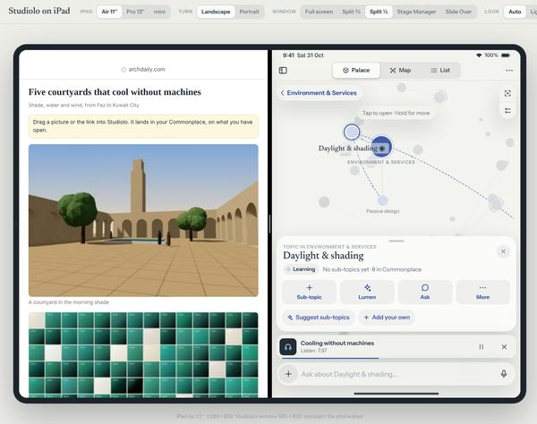

**Open** `prototypes/ipad/dist/ipad-prototype.html`.
- **On a desktop** it shows an iPad in a frame. You can choose:
  - the iPad (Air 11″, Pro 13″, mini);
  - the orientation;
  - the window: Full screen, Split ⅔, Split ½, Stage Manager or Slide Over;
  - the look.
  
  In Split View the other app is a web page whose pictures and link you can drag into Studiolo, and the divider can be dragged across 700 px.
- **On an iPad** (or any touch device) it runs full screen.

| | |
|---|---|
| 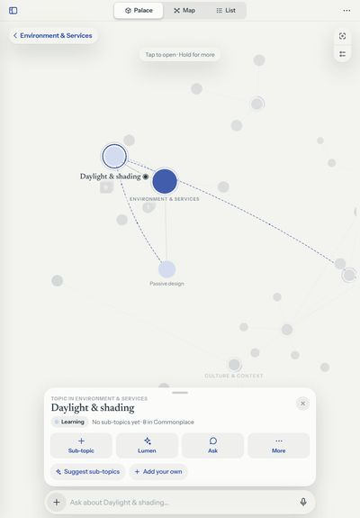 Portrait: the card as a sheet at the bar's width. | 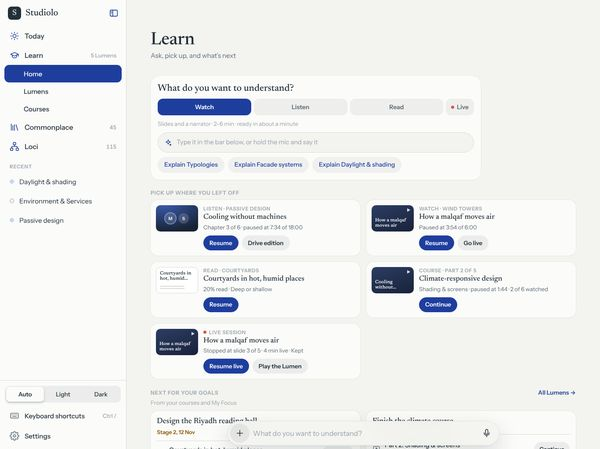 Learn Home on an iPad Pro: grids, the sections in the sidebar. |
| 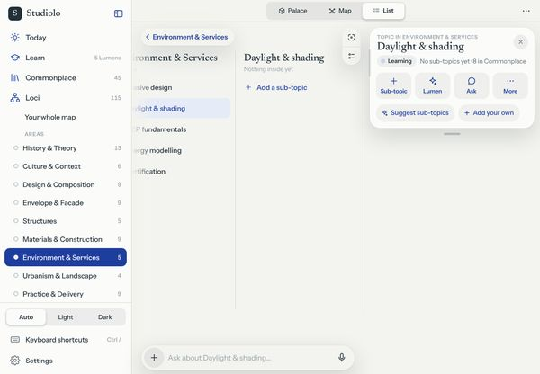 The List as columns, the inspector beside it. | 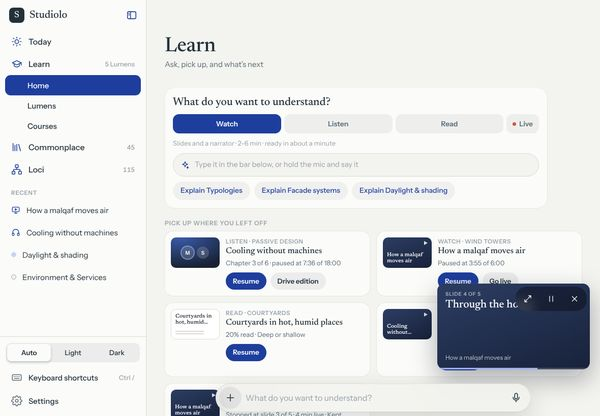 A Watch Lumen left playing: the tile in a corner. |
| 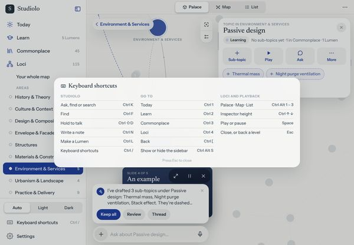 Hold ⌘: the shortcuts. | 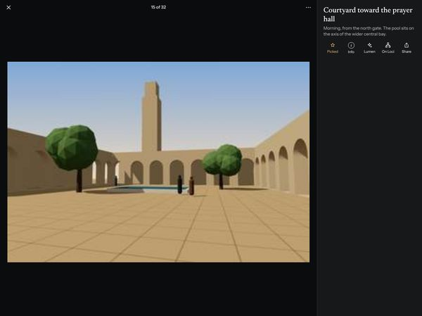 A photo with its Info beside it. |
| 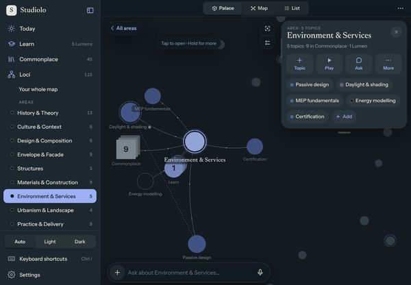 Dark. | |

**Does:** §4–§9 on the app's real Palace and Map engines and the phone prototype's own Learn and Commonplace modules (unchanged), in light and dark: the sidebar, the bar with the mic (the browser's speech recognition where allowed, otherwise simulated), ⌘K, held ⌘⇧D, the shortcuts list, the inspector and the sheet, the List as columns, twist, Learn's grids and two-pane rooms (Watch, Listen with Walk and Drive, Read, Live, a course part), Now Playing, the picture-in-picture tile (and the system's, where Chromium allows it), Commonplace's columns, the item beside the wall, the photo viewer's Info panel, and drops from the other app. It has been checked with Playwright at the five iPad sizes in both orientations, the four window widths and a phone, in light and dark: no console errors, no horizontal scroll.

**Doesn't:**
- the phone prototype's limits apply: Loci's answers, making and playback are simulated, nothing is saved, and the Map has no hold menu;
- ↑/↓ through the bar's rows, ⌘-click and Shift-click selection, the two-finger selection drag, dragging out of Studiolo, Media Session and Pencil hover are specified here but not built in the prototype;
- Settings and Today keep the phone prototype's simple pages;
- the size classes key on width only, so the desktop frame can show the iPad layout;
- it is not yet tried on a real iPad.
