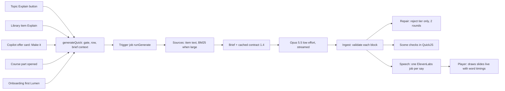

# Proposal: better Lumens, and where the board fits

Status: review and plan, for the owner's decision · 19 Oct 2026
Builds on: [`2026-10-19-lumen-board-sketching.md`](2026-10-19-lumen-board-sketching.md) and the [board prototype](../prototypes/lumen-board/index.html)
Evidence: `studiolo` @ `c7d39da` (main, 19 Oct; read only), its run evidence and specs, and the Craft Studilo space (read only).

## 1. Summary

Lumens work, but they are **short, visually static and checked mostly by the prompt itself**.

- **Length.** The 40 tuned runs (AI tune-up, run 3) have a median of **315 narration words, about 2.0 minutes**. 17 of 40 are under 2 minutes, none reach 3, and none has more than 8 slides. The contract asks for 2–6 minutes, "most near the middle", and 6–12 slides.
- **Visuals.** They are the weakest-scored dimension. The judge's means are visual use 3.13 and visual polish 3.10, against 3.9–4.0 for accuracy, story, clarity and pacing. 139 of 211 recorded faults are visual: empty halves of the frame, scenes that haven't started, and diagrams that look like stock Mermaid.
- **Static slides.** Eight of the eleven slide types appear all at once, and the voice never builds them. Only infographics and animations move with the narration.
- **Untested promises.** Several contract rules have no check behind them: the length floor, the answer-slide type, "every slide has a say", and counts that must match the screen. Warnings are never sent to repair.

The board fits **as one more slide type written in the same author pass**. Every creation path ends in the same function (`generateQuick`), so adding it to the contract and ingest makes it available to the topic Explain button, library items, the copilot, course parts and onboarding at once. The paths only differ in whether they *hint* that a board would help. Boards also address three of the problems above: they build with the narration by nature, they fill the frame, and they break up the run of tables and animations.

**Recommended order:**

1. **Now:** six small fixes that raise every Lumen (§4.1).
2. **Next:** "build with the voice" for every typed slide (§4.2).
3. **Then:** the board as a slide type with a light hint from each entry point (§5).
4. **Later:** a short board-only "draw it for me" from the copilot (§5.5).

## 2. How a Lumen is made today (short version)

- **One entry point.** `generateQuick` is the only one (`src/features/explainers/service.ts:245-250, 278-411`).
- **Brief.** Depth is always "overview", and there is no length or format field (`contract/brief.ts:57-59, 147-161, 196`).
- **Models.** The author is Opus 5.5 at low effort with 32k tokens; repair is Opus at medium (`features/ai/purposes.ts:34-36`).
- **Slide types.** Only the author picks them, from contract §3 (`contract/text.ts:52-70`). No path hints at a type.
- **Copilot.** The conversation never reaches the author: only the request and focus strings do (`copilot/tools/explain.ts:17-42`, `prompt/system.ts:263-268`).
- **Library items.**
  - An item is grounded `strict` when its text can be read: PDF native text, a link, or a note or quote body.
  - Citations live only in narration. Item bodies may not carry them (`text.ts:113`, `ingest/types.ts:50-62`).

## 3. What the evidence says

| Signal | Value | Source |
|---|---|---|
| Narration length, tuned runs | median 315 words (≈2.0 min at 155 wpm), max 432; 17/40 under 2 min | recomputed from `docs/superpowers/evidence/ai-tune-up-2026-10-16/runs/T1` (40 runs) |
| Slides per Lumen | median 7 including the intro, max 8 | same |
| Slide-type mix | animation 74, table 52, diagram 36, math 26, cards 20, ul 9, code 6, infographic 3, ol 2, diff 1 | same |
| Weakest judge dimensions | visual use 3.13 and visual polish 3.10, others 3.9–4.0; 139/211 faults are visual; 58 mention empty halves | judgements in the same evidence folder; `scripts/lab/judge.ts:22-36` |
| Item faithfulness | 33/40, below the bar | `project-docs/implementation/ai.md:467-478` |
| First slide | 1 in 3 take 14–34 s | Craft *Explainers* (known issues) |
| Phones | body text about 8 px at 390 px wide | `docs/superpowers/specs/2026-10-16-mobile-responsive-mockups` (after/learn-player--390) |
| Feedback | 1–5 ratings and problem reports are stored; nothing reads them | `features/explainers/feedback.ts:157-180` |
| Owner calibration | your 12 ratings are pending, so judge-vs-you agreement is unknown | Craft *AI Lab & Test Results* |

Two causes stand out:

- **The length problem is partly self-inflicted.** The first-call instruction says *"Do not plan the whole explainer before you start… plan each next slide as you go"* (`contract/prompt.ts:32`). Contract §9 says *"Plan the whole story before you write the first tag"* (`text.ts:245`). No check enforces a lower bound on length.
- **The examples lean one way.** 11 of the 12 worked examples are about building and architecture (`contract/examples.ts`). The voice director still says "for architects" (`speech/direction.ts:38`). The audience is law, engineering, business, medicine and more (Craft *Settings & Onboarding*).

## 4. Enhancements for better Lumens

Sizes: S = up to a day, M = 2–4 days, L = a week or more. The estimates are mine, not measured.

### 4.1 Now: small fixes with a large effect

| # | Change | Why | Where | Size |
|---|---|---|---|---|
| 1 | **Fix planning and set a length floor.** Rewrite `INTRO_FIRST` to "decide the question and the slide list silently, then write the intro at once". Add a `length_short` signal at ingest finish (under about 300 words or under 6 slides) that goes to repair as "add the missing step". Pass a target length in the brief. | 17/40 are under 2 min, and the two instructions contradict each other | `prompt.ts:32`, `text.ts:241-245`, `ingest/ingest.ts` finish, `brief.ts:57` | S |
| 2 | **Repair chosen warnings when a round is left:** `say_without_ref`, `scene_one_colour`, soft over-limit. | 33 one-colour scenes and 20 says without a ref in 40 runs, none repaired | `author.ts:119` | S |
| 3 | **Add whole-Lumen structure checks:** intro first; every item has a say; the answer slide is not ul/ol/cards; spoken counts match the screen; no duplicate slides. | These are contract promises with no check | `ingest.ts` finish | S |
| 4 | **Fix tables:** strip header anchors (the judge saw literal "[B]" on screen) and render maths in cells. | A visible defect | `ingest/items.ts:276-290`, `player/stage/table-slide.tsx` | S |
| 5 | **Fix the pointer:** keep its last position while hidden and jump rather than spring on a new slide. Today it flies in from the stage's top-left, because the hidden transform falls back to `translate(0,0)`. This is inferred from the code. | It looks broken | `player/stage/pointer.tsx:75-91`, `explainer.css:489` | S |
| 6 | **Remove the domain tilt:** vary the worked examples' subjects (law, health, business, design), make `direction.ts` field-neutral, and extend `pronounce.ts`. That file's comment says "£500" is read "pounds 500", which is the wrong order. | Most of the audience is not architects | `examples.ts`, `speech/direction.ts:38`, `speech/pronounce.ts` | S |

### 4.2 Next: make slides build with the voice

| # | Change | Why | Where | Size |
|---|---|---|---|---|
| 7 | **Build with the voice on every typed slide.** Generalise `reachedQuadrants` into a list of reached anchors for all types. Parts not yet spoken sit dimmed, and spoken ones get a quiet "said" mark. Lists, cards, table rows, maths lines and diagram nodes appear as they are named. | Eight of eleven types are static; "show before you tell" is the contract's own rule (`text.ts:48`) | `player/view.ts:521`, `stage-slide.tsx:30-45`, `explainer.css` | M |
| 8 | **Draw diagrams on in Studiolo's look:** edges reveal with a stroke dash in ref order, 2 px borders, 26–28 px labels and role tints. Validate Mermaid and KaTeX **on the server** so a broken one goes to repair instead of `console.warn`. | Stock Mermaid look; diagrams arrive late and empty | `player/stage/diagram-slide.tsx:42-145`, `ingest/items.ts:347-363` | M |
| 9 | **Fill the frame:** centre and scale sparse typed slides, and stagger the slide's own parts as it enters. Crossfade between slides, keeping the outgoing slide for about 300 ms; the mockup already did this. | 58 faults mention empty halves; the hard cut looks cheap | `player.tsx:690`, `slide-frame.tsx`, `explainer.css:37-49` | M |
| 10 | **Add a motion check for scenes:** warn or reject when the frames at 10/50/90% are equal, or when nothing has changed by the first pinned moment. | 24 faults are about stills where nothing has happened yet | `scene/checks/frames.ts` | S |
| 11 | **Make captions a phrase window:** at most about 12 words around the current word and two lines, with their own dark-theme tokens. | Today a whole say covers the slide | `player/captions.tsx`, `tokens.css:101-103` | S |
| 12 | **Make phones watchable:** captions on under 560 px, a CSS "watch" mode instead of the Fullscreen API on iPhone, and a compact `FIT_LIMITS` profile. | Body text is about 8 px on a phone | `player.tsx:454-457`, `explainer.css:1666-1708`, brand kit | M |

### 4.3 Then: make quality measurable

| # | Change | Why | Where | Size |
|---|---|---|---|---|
| 13 | **Add the stills reviewer (S20b):** after repair, one low-effort call looks at rendered stills and flags at most one slide for one fix. | Visuals are the weakest dimension, and judges only see light-theme stills today | after `author.ts:504`; needs headless render of typed slides | L |
| 14 | **Run a consistency pass:** a cheap call checks numbers and claims across slides and narration, and sends contradictions to repair. | The judge found contradictions (COP 3 vs 4; −5 °C called "freezing") | new step after `author.ts:437` | M |
| 15 | **Improve item faithfulness:** run item Lumens at medium effort, or judge the cited lines. | 33/40 is below the bar | `purposes.ts:34` | S–M |
| 16 | **Close the loop:** build 3B-5a (golden Lumens, CI stamp), add a weekly query over `explainer_feedback` and issue codes, and **give your 12 calibration ratings**. | Without your ratings nobody knows whether the judge agrees with you | `scripts/lab`, `feedback.ts` | M |

### 4.4 Learning value, after the above

- **Misconceptions.** Add a rule to contract §11: for "tricky" topics, name the common misconception and correct it on screen. 17/40 eval requests are tagged tricky; the existing rule only covers false premises (`text.ts:297`).
- **Check yourself.** Add an optional "check yourself" question as a third follow-up kind. This starts toward your "readings and quizzes under the video" idea (Craft *Features & Ideas*).
- **Kickers and step markers.** Bring back the mockup's eyebrow and card kicker so a viewer always knows where they are. This needs a contract field.

## 5. The board inside the system

### 5.1 Principles

1. **Same author, same pass.** The lab found that splitting writer and drawer always loses quality (E25–27, Craft *AI Lab & Test Results*). The board is written by the explainer author inside the same stream as the narration, as data: one line per mark (see the prototype format). It is not code, so it needs no QuickJS sandbox.
2. **Same timing system.** Narration refs already pin animation moments (`ingest/refs.ts:113-123`). A board uses the same refs: `[[s4.cache]]` starts drawing `cache` as the word is spoken, and a second ref points back at it.
3. **Same look.** The board uses Studiolo's light and dark stage values and role colours, which the prototype now does. No pen is shown: a small ink dot does the drawing and stands in for the pointer.
4. **Grounded like everything else.** Citations stay in narration. In strict mode, board labels are checked against the cited spans (§5.4).

### 5.2 Core change (enables every path at once)

| Layer | Change | Where |
|---|---|---|
| Contract 1.5 | Add a `board` type and rules for when to use it (§5.6), the shape list, limits (≤16 marks, labels ≤4 words, ≤3 roles) and one worked example in a non-architecture subject | `contract/text.ts` §3, §4, §8; `examples.ts`; `CONTRACT_VERSION` (`types.ts`); golden hash test |
| Types and limits | `board` in `AUTHOR_TYPES`, `ITEM_TYPES` and `FIT_LIMITS` | `ingest/types.ts:10`, `brand-kit/stage.ts:1-24` |
| Ingest | Board parser (port the prototype's parser). Mark ids become anchors (`payloadAnchors`), and moment pinning is generalised from animation to board marks | `ingest/items.ts:33-43, 188, 387-430`, `refs.ts:113-123`, `view.ts:459` |
| Checks | Out of the safe area or caption band, the watermark corner, overlaps (frames may contain marks), labels on lines and ids that clash with keywords. Failures go to the existing repair path as a cheap item rewrite | new `scene/checks/board.ts` |
| Player | `BoardSlide` on the `AnimationSlide` pattern (canvas or SVG, anchors as 1×1 spans), timed through `sceneTimeMap`, `sceneTime` and `settledTime`, with `host: null` so no worker starts. Hide the cursor on board slides, as is done for the infographic camera, and draw the ink dot | `stage-slide.tsx:30-45`, `animation-slide.tsx`, `player.tsx:404-423, 693`, `moments.ts` |
| Stills and sharing | Thumbnails and the Learn poster default to the finished board, not `sceneTime: 0`, which would be blank. Add a `board` case to the share strip, whose default `return null` would otherwise drop board slides from public pages | `stage-slide.tsx:27`, `transcript.tsx:29`, `sharing/strip.ts:93` |

The contract prefix is cached and byte-identical (`prompt.ts:1-4`), so the bump costs one cache rewrite for every explainer, once.

### 5.3 Per creation path

A board hint is a new optional brief field, for example `visual: "board"`, rendered in the user message as "A board would suit this request." It needs plumbing through `GenerateQuickInput`, `fitJobInput`, `readBriefContext` and the create-key check `sameRequest`, so that existing keys don't change (`service.ts:184-205`). **It never goes into `focus`**, which would pollute the stored request and break the copilot's no-added-framing rule.

| Path | What changes | Notes |
|---|---|---|
| **Topic Explain button** (graph, `explain-dialog.tsx`) | Nothing required: the author picks a board when the idea suits one. Optionally add an "Explain with sketches" toggle in the dialog that sets the hint | The dialog already sends `request` and `focus`; the toggle sits beside the focus field |
| **Library item** (`explain-item-button.tsx`, item page, library wall) | Nothing required. Under strict grounding a board can draw relationships named in the sources: parties and duties in a contract, the parts of a building section from a specification, the steps of a process. It must not draw what the text never states | Mermaid-style text cannot describe an unprocessed figure; the scope says "Do not claim to understand an unprocessed diagram from surrounding text alone" (`product/mvp-scope.md:135`). Once 3C image descriptions land, a described figure can become a board |
| **Copilot** (`explain` tool) | Add an optional `visual` parameter, stored on `ExplainerOffer` and passed on by `decideOffer`. The prompt gets one line: offer a board when the learner asks to see how parts relate or asks for a sketch. Bump the prompt and tool versions | Stays a costly tool with a confirm card; the registry and A11 require this (`copilot/tools/registry.ts:86-87`) |
| **Course parts** (`plan_course`) | An optional per-part hint on `partSchema` and `CoursePart` (jsonb, no migration). The planner can mark the part that introduces a structure ("How the parties relate") as a board part | Keeps course parts varied; the course's own `<series>` block is unchanged |
| **Onboarding** first Lumen | No change | The free Lumen is a plain topic explainer; the author can still choose a board |

### 5.4 Grounding and citations for boards

- **Today.** A board mark is grounded only through the say that refs it. Citations attach to narration spans (`refs.ts:243-277`).
- **Proposed check, strict mode only.** At ingest, every board label containing a number or a proper name must appear in a cited span or in the say that draws it. Otherwise it gets `board_label_unsupported`, a warning sent to repair. This stops a board from showing a figure the sources don't contain.
- **Viewer link (optional).** A mark drawn in the same say as a citation could show that citation when tapped. Both carry offsets in the clean say text (`ingest/types.ts:45, 62`), so the link costs no extra model work.

### 5.5 A short board on its own ("Draw it for me")

A one-board answer in the copilot is attractive: a 30–60 second sketch with voice, for "how do these relate?".

- **What it would reuse:** `generateQuick`, the gate, the job, ingest, speech, the player and citations.
- **What would be new:**
  - A **short mode** of the contract: no intro, one board, 2–4 says and one follow-up. The contract currently requires an intro, 6–12 slides and two follow-ups (`text.ts:76, 113, 247`).
  - An embedded player in the copilot card.
  - A decision on where shorts live in Learn and whether they can be shared.
- **Cost and latency.** My estimate is about US$0.02–0.05 and a first stroke within a few seconds; this is not measured. A short still takes one of the two-at-once slots.
- **Naming.** "Sketch" is taken: the onboarding map uses it. Use "Draw it" or "Board" in the interface.
- **Sketch a highlighted passage.** "Explain this" on a highlighted PDF passage was explicitly out of scope in 3B-4 (spec §12). The hook exists (`library/select-to-quote.tsx:24-40`): saving the selection as a quote already gives a strict-grounded note with a page. That makes it a natural second step once shorts exist.

### 5.6 When to use a board, a diagram or an animation (proposed contract wording)

- **Board:** an idea explained by building a picture one piece at a time, in the order it is spoken: relationships between parties, a cause and its effect, a before and after, an annotated graph, a labelled section. The value is in the order of the build and in pointing back at parts.
- **Diagram:** a flow, hierarchy or state machine whose final shape matters more than the order it was built in.
- **Animation:** motion over time, or precise geometry, such as a plan, a section, load paths in 3D, or a growing quantity.
- **Mix.** In a 6–10 slide Lumen, use at most two boards, and never two boards in a row.

### 5.7 How boards help the quality problems

| Problem (§3) | How a board helps |
|---|---|
| Static typed slides | A board is drawn with the voice by nature |
| Empty halves of the frame | Boards are laid out on the whole 1280×720 stage, and the checks flag empty or overflowing layouts |
| Run of tables and animations | A third visual mode, cheap to render and with no sandbox |
| Scene stills with nothing happening yet | A board starts drawing on the first ref; there is no blank first tenth to reject |
| Cost | Boards are data, not code: no kit, no QuickJS run, and repairs are small |

## 6. Plan

| Step | Content | Size |
|---|---|---|
| 1 | §4.1 fixes 1–6 | about 4 days |
| 2 | §4.2 items 7–12 | 2–3 weeks |
| 3 | Board core (§5.2) and contract 1.5 with evals: 30 runs, half of them non-architecture | 6–9 days (from the board proposal) |
| 4 | Board hints: dialog toggle, copilot parameter, course-part hint (§5.3) | 2–3 days |
| 5 | §4.3 quality loop (stills reviewer, consistency pass, 3B-5a) | 2–3 weeks |
| 6 | Short board in the copilot and on a highlighted passage (§5.5), after the owner decides | 1–2 weeks |

## 7. Decisions for you

1. **Order.** Fixes first (steps 1–2) and then the board? Or the board first, because it addresses the visual problems directly?
2. **Length target.** Hold the contract's 2–6 minutes and enforce a floor of about 2.5 minutes? Or accept short Lumens and change the contract to 1.5–4 minutes?
3. **Brand.** A hand-drawn board with handwriting departs from S19 ("type from the stage library") and the prototype-fidelity rule. Approve it as an exception for board slides only?
4. **Hints.** Is a dialog toggle ("Explain with sketches") wanted, or should the author always decide?
5. **Shorts.** Should one-board answers exist in the copilot, and where do they live in Learn?
6. **Highlighted passage.** Should "Draw it" on a highlighted passage come back into scope? It was excluded in 3B-4.
7. **Calibration.** When can you give the 12 explainer ratings? Every quality change after this one needs them to be judged fairly.

## Sources

- `studiolo` @ `c7d39da` (read only):
  - `src/features/explainers/{service,run,author,brief,feedback}.ts`
  - `src/features/explainers/contract/{text,prompt,examples,brief}.ts`
  - `src/features/explainers/ingest/{items,refs,types,ingest}.ts`
  - `src/features/explainers/scene/checks/frames.ts`
  - `src/features/explainers/speech/{direction,pronounce}.ts`
  - `src/features/explainers/player/{player.tsx,view.ts,captions.tsx,stage/*}`
  - `src/features/explainers/sharing/strip.ts`
  - `src/features/copilot/{tools/explain.ts,tools/registry.ts,prompt/system.ts}`
  - `src/features/ai/purposes.ts`, `src/features/brand-kit/*`, `src/styles/{explainer,tokens}.css`
  - `src/components/explainers/explain-dialog.tsx`, `src/components/library/select-to-quote.tsx`
  - `docs/superpowers/specs/`: stage-3, 3B-2, 3B-2b, 3B-3, 3B-4, 3B-5, AI tune-up, course planning, mobile and web mockups
  - `docs/superpowers/evidence/ai-tune-up-2026-10-16/` (runs and judgements)
  - `project-docs/{implementation/ai.md,product/mvp-scope.md,design/interface.md,architecture/course-engine.md}`
- Craft, Studilo space (read 19 Oct 2026):
  - *Explainers*, *Courses*, *Copilot*, *Library - polishment Phase*, *Settings & Onboarding*
  - *Vision & Principles*, *Logo & Visual Identity*
  - *AI Lab & Test Results*, *Pricing & Unit Costs*, *Features & Ideas*, *Changelog*, *Decisions*, *Founder Home*
  - Craft has very little feedback in the owner's own words; the Inbox and the weekly review are empty.
- Board prototype and the earlier proposal in this repo.
